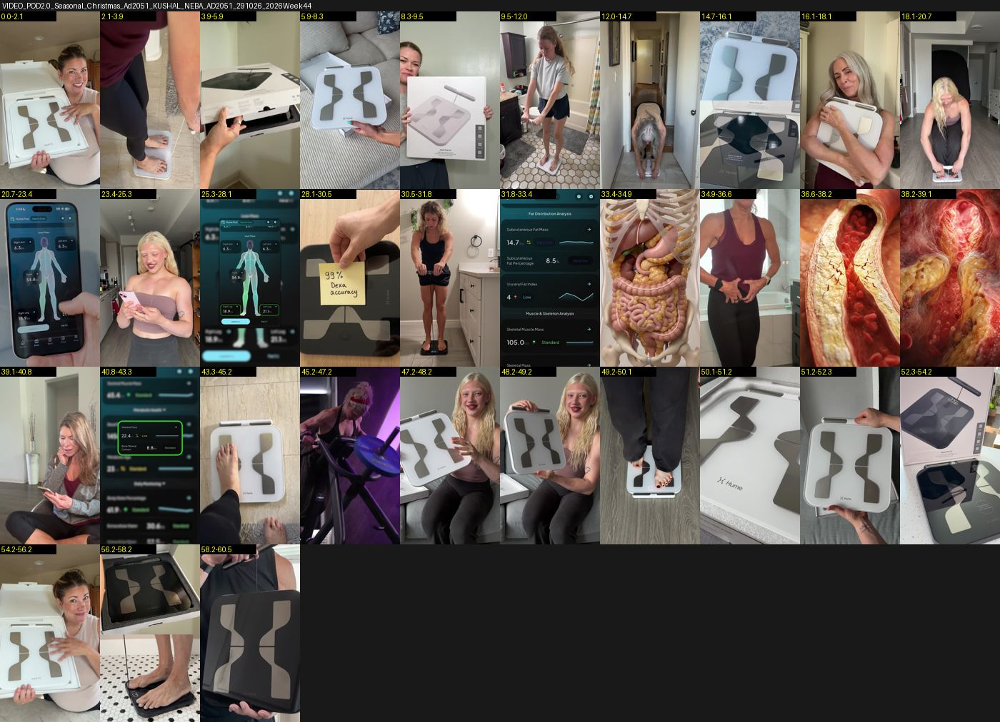

# VIDEO_POD2.0_Seasonal_Christmas_Ad2051_KUSHAL_NEBA_AD2051_291026_2026Week44

Master: `VIDEO_POD2.0_Seasonal_Christmas_Ad2051_KUSHAL_NEBA_AD2051_291026_2026Week44_9x16_hook1.mp4` · 60.5s · 1080x1920

**Pacing:** 33 shots · avg 1.832s · median 1.88s · 5.29 cuts/10s · first cut 2.12s · 209.0 wpm · talk ratio 0.96 · cuts on word start 93.8% · cuts in speech gaps 56.2%
**Audio:** {'I_lufs': -18.7, 'LRA': 2.6, 'true_peak_db': -0.8} · BPM≈117.5 · music {'speech_rms_db': -24.8, 'pause_seconds': 0.0} · cuts with SFX/transient 40.6%

**Captions:** 83 cards · 1 words/card (median) · y≈0.66 of frame height · text height≈0.0258 · colours {'white': 56, 'dark/other': 24, 'yellow': 1, 'red': 1, 'blue': 1} · cards crossing a cut: 0
Highlighted: 99%, 4个, HAMU
**Headlines:** 2:496 (21.0–23.0s, blue) | SOS (21.0–23.0s, white) | Height (21.0–21.0s, white) | Age (21.0–21.0s, white) | Metabolic Age (21.0–21.0s, white) | 165cm (21.0–21.0s, white) | 23yrs (21.0–21.0s, white) | 25yrs (21.0–21.0s, white)

**Hook (0–3s) spoken:** The Hume Pod 2 .0 is amazing, but I get it, the
**Hook on-screen:** omuH X
**CTA (last 5s):** does. So it's $224 now or $352 later. · on-screen: FCRO / HumePod2.0

## Beat sheet

| # | in–out (s) | dur | transition | spoken | on-screen text |
|---|---|---|---|---|---|
| 1 | 0.00–2.12 | 2.12 |  | The Hume Pod 2 .0 is amazing, | omuH X |
| 2 | 2.12–3.92 | 1.8 | cut | but I get it, the price was a lot. |  |
| 3 | 3.92–5.88 | 1.96 | cut | Hume just dropped the Pod 2 .0 to | HumePod2.0 / FE RoHS / HumeHeoth / Hume |
| 4 | 5.88–8.28 | 2.4 | cut +SFX hit | $224 for Christmas, with | Hume / 188883 / Questionsorconcerns?Piasereachouttoussupport@myhumeheatth.com / XHume |
| 5 | 8.28–9.52 | 1.24 | cut +SFX hit | code XMIS30. | XHume |
| 6 | 9.52–12.00 | 2.48 | cut | It's $352 the rest of the year, |  |
| 7 | 12.00–14.68 | 2.68 | cut | so that's $128 off a scanner that |  |
| 8 | 14.68–16.08 | 1.4 | cut | only launched this fall, | HumePod2.0 / Please charge for / Smlnsermere / Irit'snetturnlngen |
| 9 | 16.08–18.12 | 2.04 | cut +SFX hit | and it's the one worth waiting for. |  |
| 10 | 18.12–20.72 | 2.6 | cut | You step on, hold the handles, and in 30 seconds it |  |
| 11 | 20.72–23.40 | 2.68 | cut +SFX hit | breaks down your entire body into five parts and | 2:496 [blue] (HEADLINE) / SOS (HEADLINE) / Height (HEADLINE) / Age (HEADLINE) / Metabolic Age (HEADLINE) / 165cm (HEADLINE) |
| 12 | 23.40–25.28 | 1.88 | cut +SFX hit | shows you how much muscle and fat you have | 2:496 [blue] (HEADLINE) / SOS (HEADLINE) / 54.8ibs / Right Leg / 18.9ibs / Plans |
| 13 | 25.28–28.08 | 2.8 | cut | separately in each leg, arm, and your torso. It's | Hume Pod (HEADLINE) / StepOnScale [green] (HEADLINE) / MetabolicAge (HEADLINE) / Age (HEADLINE) / Height (HEADLINE) / 25yrs (HEADLINE) |
| 14 | 28.08–30.48 | 2.4 | cut +SFX hit | 99 % as accurate as a DEXA scan, | 99% (HEADLINE) / Dexa / Hume (HEADLINE) / 99% [yellow] / XHume (HEADLINE) / accuracy |
| 15 | 30.48–31.80 | 1.32 | cut | and you use it at home. | Dexa / 99% [yellow] / accuracy |
| 16 | 31.80–33.40 | 1.6 | cut | It also tracks your visceral fat, | HumePod (HEADLINE) / StepOnScale [green] (HEADLINE) / Lean Mass (HEADLINE) / 148.3bs+ (HEADLINE) / Standard (HEADLINE) / 85.5% (HEADLINE) |
| 17 | 33.40–34.88 | 1.48 | cut | which is the fat around your organs that | Visceral Fat Index / Low / 14.7 (HEADLINE) / 105.0 / 22.4 |
| 18 | 34.88–36.56 | 1.68 | cut +SFX hit | you can't see and can't pinch. |  |
| 19 | 36.56–38.24 | 1.68 | cut | That's the fat behind heart disease and |  |
| 20 | 38.24–39.08 | 0.84 | cut +SFX hit | diabetes, and |  |
| 21 | 39.08–40.80 | 1.72 | cut +SFX hit | this shows you the number every morning. |  |
| 22 | 40.80–43.32 | 2.52 | cut | Plus, your bone density and your metabolic age. | HumePod (HEADLINE) / StepOnScale [green] (HEADLINE) / 18.4ibs (HEADLINE) / Verylow (HEADLINE) / Body Fat Mass (HEADLINE) / LeanMass (HEADLINE) |
| 23 | 43.32–45.24 | 1.92 | cut | 83 % of human pod users hit | Metabolic Age / 23yrsStandard / HAMU [blue] |
| 24 | 45.24–47.20 | 1.96 | cut | their weight goal in under six months. | HAMU [blue] / MPRELOR / Hume |
| 25 | 47.20–48.24 | 1.04 | cut | There's no subscription. | Hume |
| 26 | 48.24–49.20 | 0.96 | cut | You buy it once and scan |  |
| 27 | 49.20–50.12 | 0.92 | cut +SFX hit | for life. | XHume (HEADLINE) |
| 28 | 50.12–51.24 | 1.12 | cut +SFX hit | It's HSA and FSA | XHume (HEADLINE) / Hume |
| 29 | 51.24–52.32 | 1.08 | cut +SFX hit | -eligible, and | Hume / XHume |
| 30 | 52.32–54.16 | 1.84 | cut +SFX hit | you get 45 days to return it. | XHume / 2056 (HEADLINE) / Hume Pod 2.0 |
| 31 | 54.16–56.24 | 2.08 | cut | The Christmas price ends when Christmas does. So | HumePod2.0 (HEADLINE) / FCRO (HEADLINE) |
| 32 | 56.24–58.24 | 2.0 | cut | it's $224 now or | HumePod2.0 (HEADLINE) / FCRO (HEADLINE) |
| 33 | 58.24–60.46 | 2.22 | cut | $352 later. |  |

## Hook variants

| hook | file | dur | first cut | spoken 0–3s | on-screen 0–3s |
|---|---|---|---|---|---|
| 1 | `s_Ad2051_KUSHAL_NEBA_AD2051_291026_2026Week44_9x16_hook1.mp4` | 60.5 | 2.12 | The Hume Pod 2 .0 is amazing, but I get it, the | omuH X |
| 1 | `s_Ad2051_KUSHAL_NEBA_AD2051_291026_2026Week44_9x16_hook1.mp4` | 60.5 | 2.12 |  |  |
| 2 | `s_Ad2051_KUSHAL_NEBA_AD2051_291026_2026Week44_9x16_hook2.mp4` | 60.5 | 3.92 |  |  |
| 2 | `s_Ad2051_KUSHAL_NEBA_AD2051_291026_2026Week44_9x16_hook2.mp4` | 60.5 | 3.92 |  |  |
| 3 | `s_Ad2051_KUSHAL_NEBA_AD2051_291026_2026Week44_9x16_hook3.mp4` | 60.6 | 2.0 |  |  |
| 3 | `s_Ad2051_KUSHAL_NEBA_AD2051_291026_2026Week44_9x16_hook3.mp4` | 60.6 | 2.0 |  |  |

## Full transcript

The Hume Pod 2.0 is amazing, but I get it, the price was a lot. Hume just dropped the Pod 2.0 to $224 for Christmas, with code XMIS30. It's $352 the rest of the year, so that's $128 off a scanner that only launched this fall, and it's the one worth waiting for. You step on, hold the handles, and in 30 seconds it breaks down your entire body into five parts and shows you how much muscle and fat you have separately in each leg, arm, and your torso. It's 99% as accurate as a DEXA scan, and you use it at home. It also tracks your visceral fat, which is the fat around your organs that you can't see and can't pinch. That's the fat behind heart disease and diabetes, and this shows you the number every morning. Plus, your bone density and your metabolic age. 83% of human pod users hit their weight goal in under six months. There's no subscription. You buy it once and scan for life. It's HSA and FSA-eligible, and you get 45 days to return it. The Christmas price ends when Christmas does. So it's $224 now or $352 later.