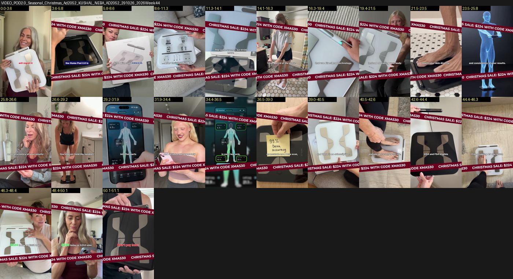

# VIDEO_POD2.0_Seasonal_Christmas_Ad2052_KUSHAL_NEBA_AD2052_291026_2026Week44

Master: `VIDEO_POD2.0_Seasonal_Christmas_Ad2052_KUSHAL_NEBA_AD2052_291026_2026Week44_hook1_9x16.mp4` · 51.1s · 1080x1920

**Pacing:** 23 shots · avg 2.22s · median 2.2s · 4.31 cuts/10s · first cut 3.56s · 206.0 wpm · talk ratio 0.91 · cuts on word start 81.8% · cuts in speech gaps 81.8%
**Audio:** {'I_lufs': -19.2, 'LRA': 3.3, 'true_peak_db': -1.8} · BPM≈123.0 · music {'speech_rms_db': -24.9, 'pause_seconds': 0.8, 'pause_rms_db': -24.2, 'bed_minus_voice_db': 0.7, 'music_bed_likely': True} · cuts with SFX/transient 63.6%

**Captions:** 115 cards · 1 words/card (median) · y≈0.639 of frame height · text height≈0.0304 · colours {'white': 90, 'red': 2, 'dark/other': 18, 'blue': 2, 'green': 2, 'yellow': 1} · cards crossing a cut: 2
Highlighted: will regret it, whichincreasestheaccuracy, andconsistencyof yourresults., ineachleg,arm,, 99%, $224todayor$352later., Don'tpaylater.
**Headlines:** SALE: $224 WITH CODE XMAS (3.5–3.5s, white) | CHRISTMAS SALE: $224 (3.5–3.5s, white) | E: $224 WITH CODEXMAS30 (4.0–4.0s, white) | CHRISTMAS SALE: $224 WIT (4.0–4.0s, white) | 24WITHCODEXMAS30 (4.5–4.5s, white) | CHR (4.5–4.5s, white) | CHRISTMAS SALE: $224 WITH ( (4.5–4.5s, white) | /ITHCODEXMAS30 (5.0–5.0s, white)

**Hook (0–3s) spoken:** Most people who miss this offer will regret it for the entire year.
**Hook on-screen:** Most people who miss this offer / XHume / for the entire year. / will regret it
**CTA (last 5s):** $224 today or $352 later. Don't pay later! · on-screen: $224todayor$352later. / 24WITHCODEXMAS30 / ALE: $224 WITH CODE XMAS30 / CHI / CHRIST / CHRISTMA / CHRISTMAS SAI / CHRISTMAS SALE: $224 / DDEXMAS30 / Don'tpaylater. / HCODEXMAS30 / MAS SALE: $224 WITH CODE X

## Beat sheet

| # | in–out (s) | dur | transition | spoken | on-screen text |
|---|---|---|---|---|---|
| 1 | 0.00–3.56 | 3.56 |  | Most people who miss this offer will regret it for the entire year. | Most people who miss this offer / XHume / will regret it [red] / for the entire year. / SALE: $224 WITH CODE XMAS (HEADLINE) / HumePod2.0 |
| 2 | 3.56–5.76 | 2.2 | cut +SFX hit | Until Christmas, the HumePod 2 .0 is | SALE: $224 WITH CODE XMAS (HEADLINE) / HumePod2.0 / FGROHS / Until Christmas, / CHRISTMAS SALE: $224 (HEADLINE) / E: $224 WITH CODEXMAS30 (HEADLINE) |
| 3 | 5.76–8.56 | 2.8 | cut +SFX hit | $224 with code XMIS30. | theHumePod2.0is / CODEXMAS30 (HEADLINE) / CHRISTMAS S (HEADLINE) / MAS SALE: $224 WITH CODE X (HEADLINE) / EXMAS30 (HEADLINE) / CHRISTMASSALE (HEADLINE) |
| 4 | 8.56–11.28 | 2.72 | cut +SFX hit | After Christmas, it's $352. | ALE:$224 WITH CODE XMAS30 (HEADLINE) / 18888 / AfterChristmas,it's$352 / Questionsarconcerns? / CHRISTMAS SAI / ODEXMAS30 |
| 5 | 11.28–14.08 | 2.8 | cut +SFX hit | The same scanner, but $128 more. | ODEXMAS30 (HEADLINE) / CHRISTMAS SA (HEADLINE) / AfterChristmas,it's$352. / CHRISTMAS SALE: $224 WITH (HEADLINE) / S30 (HEADLINE) / CHRISTMAS SALE: $224 (HEADLINE) |
| 6 | 14.08–16.32 | 2.24 | cut | And this is the scanner that got rid of the glass. | SALE: $224 WITH CODE XMAS (HEADLINE) / And thisisthescanner / CH / 224WITHCODEXMAS30 (HEADLINE) / CHR (HEADLINE) / that got rid of the glass. |
| 7 | 16.32–19.40 | 3.08 | cut | It comes with next -gen sensors that use direct read technology. | that got rid of the glass. / CODE XMAS30 (HEADLINE) / CHRISTMAS (HEADLINE) / CHRISTMAS SAL / DEXMAS30 / MAS30 (HEADLINE) |
| 8 | 19.40–21.48 | 2.08 | cut +SFX hit | Instead of reading your body through a layer of glass, | thatuse DirectRead technology. / AS SALE: $224 WITH CODE XM (HEADLINE) / TMAS SALE: $224 WITH CODE (HEADLINE) / $224 WITH CODE XMAS30 (HEADLINE) / Instead ofreadingyourbody / "Hume |
| 9 | 21.48–23.48 | 2.0 | cut +SFX hit | the sensors now touch your skin directly, | TH CODE XMAS30 (HEADLINE) / CHRISTMA (HEADLINE) / through a layer ofglass, / XHume / CHR / 224 WITH CODE XMAS30 (HEADLINE) |
| 10 | 23.48–25.80 | 2.32 | cut +SFX hit | which increases the accuracy and consistency of | CHRISTMAS SALE: $224 WIT (HEADLINE) / touchyourskin directly, / CHRISTMAS SALE / DEXMAS30 / TMAS SALE: $224 WITH CODE [blue] (HEADLINE) / whichincreasestheaccuracy [blue] |
| 11 | 25.80–26.64 | 0.84 | cut | your results. You | andconsistencyof yourresults. [blue] / WITHCODEXMAS30 (HEADLINE) / CHRISTI (HEADLINE) / MAS SALE: $224 WITH CODE X (HEADLINE) |
| 12 | 26.64–29.16 | 2.52 | cut +SFX hit | step on, hold the handles, and in 30 seconds, | DEXMAS30 (HEADLINE) / CHRISTMAS SALI (HEADLINE) / Youstepon,holdthehandles / ALE: $224 WITH CODE XMAS30 (HEADLINE) / 30 (HEADLINE) / CHRISTMAS SALE: $224 W (HEADLINE) |
| 13 | 29.16–31.88 | 2.72 | cut +SFX hit | it breaks down your entire body into five parts and | SOS (HEADLINE) / 2:496 [blue] (HEADLINE) / ISTMAS SALE: $224 WITH COD (HEADLINE) / 104.1ibs1 (HEADLINE) / Updated:Today / it breaks.downyour'entire body |
| 14 | 31.88–34.44 | 2.56 | cut | shows you how much muscle and fat you have separately in | CODEXMAS30 (HEADLINE) / CHRISTMAS S (HEADLINE) / andshows you how muchmuscle / CHRISTMAS SALE:$224 WITH C (HEADLINE) / AS30 (HEADLINE) / CHRISTMAS SALE:$224 (HEADLINE) |
| 15 | 34.44–36.48 | 2.04 | cut | each leg, arm, and your torso. | and fatyou have separately / HRISTMAS SALE: $224 WITH C (HEADLINE) / ALE: $224 WITH CODE XMAS30 (HEADLINE) / CHumePod [green] (HEADLINE) / S SALE: $224 WITH CODE XMA (HEADLINE) / 165cm (HEADLINE) |
| 16 | 36.48–39.04 | 2.56 | cut | It's 99 % as accurate as a DEXA scan. | 165cm (HEADLINE) / 6.31bs (HEADLINE) / Right Leg / LeftLeg / 18.9ibs / 21.1ibs |
| 17 | 39.04–40.52 | 1.48 | cut +SFX hit | And there is no subscription. | CHRISTMAS SALE: $224 WITH (HEADLINE) / andthereisno subscription / CHRISTMAS SALE: $224 WITH ( (HEADLINE) / ΛAS SALE:$224 WITH CODE XN (HEADLINE) / XHume / MAS SALE: $224 WITH CODE X (HEADLINE) |
| 18 | 40.52–42.60 | 2.08 | cut +SFX hit | You buy it once and you get scanned for life. | E: $224 WITH CODEXMAS30 (HEADLINE) / and you get scanned for life. / ALE: $224 WITH CODE XMAS30 (HEADLINE) / ITHCODEXMAS30 [red] (HEADLINE) / CHRISTM (HEADLINE) / CHF |
| 19 | 42.60–44.44 | 1.84 | cut +SFX hit | HSA and FSA eligible. | EXMAS30 (HEADLINE) / CHRISTMAS SALE (HEADLINE) / HSAandFSAeligible / CHRISTMA / HCODEXMAS30 / CHRISTMAS SALE: $224 WI (HEADLINE) |
| 20 | 44.44–46.32 | 1.88 | cut | Free shipping, 45 -day returns. | HSAandFSAeligible / CHRISTMAS SALE: $224 WI (HEADLINE) / CHRISTMASSALE / EXMAS30 / STMAS SALE: $224 WITH CODE (HEADLINE) / Freeshipping45dayreturn |
| 21 | 46.32–48.44 | 2.12 | cut | $224 today or $352 | ALE:$224 WITHCODEXMAS30 (HEADLINE) / $224todayor$352later. [green] / CHRISTMAS SALE: $224 WITH (HEADLINE) / WITHCODEXMAS3O (HEADLINE) / CHRIST (HEADLINE) / MAS SALE: $224 WITH CODE X (HEADLINE) |
| 22 | 48.44–50.12 | 1.68 | cut +SFX hit | later. | $224todayor$352later. [green] / DDEXMAS30 (HEADLINE) / CHRISTMAS SAI (HEADLINE) / ALE: $224 WITH CODE XMAS30 (HEADLINE) / S30 (HEADLINE) / CHRISTMAS SALE: $224 (HEADLINE) |
| 23 | 50.12–51.05 | 0.93 | cut +SFX hit | Don't pay later! | RISTMAS SALE: $224 WITH COI (HEADLINE) / Don'tpaylater. [red] / CHRISTMA / HCODEXMAS30 |

## Hook variants

| hook | file | dur | first cut | spoken 0–3s | on-screen 0–3s |
|---|---|---|---|---|---|
| 1 | `s_Ad2052_KUSHAL_NEBA_AD2052_291026_2026Week44_hook1_9x16.mp4` | 51.1 | 3.56 | Most people who miss this offer will regret it for the entire year. | Most people who miss this offer / XHume / for the entire year. / will regret it |
| 1 | `s_Ad2052_KUSHAL_NEBA_AD2052_291026_2026Week44_hook1_9x16.mp4` | 58.7 | 2.38 |  |  |
| 2 | `s_Ad2052_KUSHAL_NEBA_AD2052_291026_2026Week44_hook2_9x16.mp4` | 49.6 | 2.0 |  |  |
| 2 | `s_Ad2052_KUSHAL_NEBA_AD2052_291026_2026Week44_hook2_9x16.mp4` | 60.3 | 0.7 |  |  |
| 3 | `s_Ad2052_KUSHAL_NEBA_AD2052_291026_2026Week44_hook3_9x16.mp4` | 51.4 | 2.12 |  |  |
| 3 | `s_Ad2052_KUSHAL_NEBA_AD2052_291026_2026Week44_hook3_9x16.mp4` | 61.3 | 2.62 |  |  |

## Full transcript

Most people who miss this offer will regret it for the entire year. Until Christmas, the HumePod 2.0 is $224 with code XMIS30. After Christmas, it's $352. The same scanner, but $128 more. And this is the scanner that got rid of the glass. It comes with next-gen sensors that use direct read technology. Instead of reading your body through a layer of glass, the sensors now touch your skin directly, which increases the accuracy and consistency of your results. You step on, hold the handles, and in 30 seconds, it breaks down your entire body into five parts and shows you how much muscle and fat you have separately in each leg, arm, and your torso. It's 99% as accurate as a DEXA scan. And there is no subscription. You buy it once and you get scanned for life. HSA and FSA eligible. Free shipping, 45-day returns. $224 today or $352 later. Don't pay later!