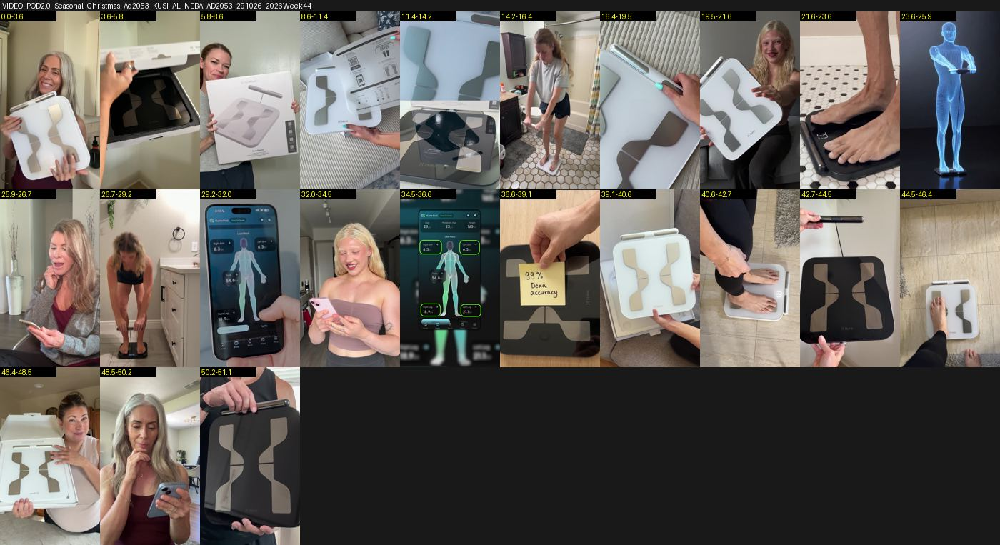

# VIDEO_POD2.0_Seasonal_Christmas_Ad2053_KUSHAL_NEBA_AD2053_291026_2026Week44

Master: `VIDEO_POD2.0_Seasonal_Christmas_Ad2053_KUSHAL_NEBA_AD2053_291026_2026Week44_9x16_hook1.mp4` · 51.1s · 1080x1920

**Pacing:** 23 shots · avg 2.223s · median 2.24s · 4.3 cuts/10s · first cut 3.56s · 195.0 wpm · talk ratio 0.96 · cuts on word start 68.2% · cuts in speech gaps 50.0%
**Audio:** {'I_lufs': -19.2, 'LRA': 3.3, 'true_peak_db': -1.7} · BPM≈123.0 · music {'speech_rms_db': -25.1, 'pause_seconds': 0.6, 'pause_rms_db': -29.1, 'bed_minus_voice_db': -4.0, 'music_bed_likely': True} · cuts with SFX/transient 63.6%

**Captions:** 51 cards · 1 words/card (median) · y≈0.673 of frame height · text height≈0.0269 · colours {'white': 32, 'dark/other': 19} · cards crossing a cut: 0
**Headlines:** XHume (0.5–0.5s, white) | 8888 (10.0–10.0s, white) | 2:49 (29.0–29.0s, blue) | SOS (29.0–30.0s, white) | 104.1ibs1 (29.0–29.0s, white) | HumePod (30.0–31.0s, blue) | StepOnScale (30.0–31.0s, dark/other) | Height (30.0–30.0s, white)

**Hook (0–3s) spoken:** Most people who miss this offer will regret it for the entire year.
**Hook on-screen:** XHume
**CTA (last 5s):** $224 today or $352 later don't pay later · on-screen: 

## Beat sheet

| # | in–out (s) | dur | transition | spoken | on-screen text |
|---|---|---|---|---|---|
| 1 | 0.00–3.56 | 3.56 |  | Most people who miss this offer will regret it for the entire year. | XHume (HEADLINE) / XHume / HumePod2.0 / FE ROHS / HurmoHeaen |
| 2 | 3.56–5.84 | 2.28 | cut +SFX hit | Until Christmas, the HumePod 2 .0 is | HumePod2.0 / FE ROHS / HurmoHeaen / XHume |
| 3 | 5.84–8.64 | 2.8 | cut +SFX hit | $224, with code XMIS30. | XHume / HumePod2.0 / HumeHnath |
| 4 | 8.64–11.36 | 2.72 | cut +SFX hit | After Christmas, it's $352, | 188883 / Questionsorconcerms?Please/eachouttous supportgmyhumehealth.com / 8888 (HEADLINE) / Hume |
| 5 | 11.36–14.16 | 2.8 | cut +SFX hit | the same scanner, but $128 more. | Hume / Please charge for / Ilt'notturningen / Smintermore / Jtit'snottumdngon / Hume |
| 6 | 14.16–16.40 | 2.24 | cut | And this is the scanner that got rid of the glass. |  |
| 7 | 16.40–19.48 | 3.08 | cut +SFX hit | It comes with next -gen sensors that use direct read technology. |  |
| 8 | 19.48–21.56 | 2.08 | cut | Instead of reading your body through a layer of glass, | Hume |
| 9 | 21.56–23.56 | 2.0 | cut | the sensors now touch your skin directly, |  |
| 10 | 23.56–25.88 | 2.32 | cut +SFX hit | which increases the accuracy and consistency of |  |
| 11 | 25.88–26.72 | 0.84 | cut | your results. You |  |
| 12 | 26.72–29.24 | 2.52 | cut +SFX hit | step on, hold the handles, and in 30 seconds it | 2:49 [blue] (HEADLINE) / SOS (HEADLINE) / 104.1ibs1 (HEADLINE) / Updated:Today / 24/09 / 23/09 |
| 13 | 29.24–31.96 | 2.72 | cut +SFX hit | breaks down your entire body into five parts and | 2:49 [blue] (HEADLINE) / SOS (HEADLINE) / 104.1ibs1 (HEADLINE) / Updated:Today / 24/09 / 23/09 |
| 14 | 31.96–34.52 | 2.56 | cut +SFX hit | shows you how much muscle and fat you have separately in |  |
| 15 | 34.52–36.56 | 2.04 | cut | each leg arm and your torso it's | HumePod [green] (HEADLINE) / MetabolicAge (HEADLINE) / Height (HEADLINE) / 25yrs (HEADLINE) / 23yrs (HEADLINE) / 165cm (HEADLINE) |
| 16 | 36.56–39.12 | 2.56 | cut +SFX hit | 99 % as accurate as a DEXA scan and | 99% / Dexa / Hume (HEADLINE) / XHume |
| 17 | 39.12–40.60 | 1.48 | cut +SFX hit | there is no subscription you | XHume / XHime |
| 18 | 40.60–42.68 | 2.08 | cut | buy it once and you get scanned for life HSA | 1222 |
| 19 | 42.68–44.52 | 1.84 | cut +SFX hit | and FSA eligible free | XHume |
| 20 | 44.52–46.40 | 1.88 | cut | shipping 45 day returns $224 |  |
| 21 | 46.40–48.52 | 2.12 | cut | today or $352 |  |
| 22 | 48.52–50.20 | 1.68 | cut +SFX hit | later don't |  |
| 23 | 50.20–51.14 | 0.94 | cut +SFX hit | pay later |  |

## Hook variants

| hook | file | dur | first cut | spoken 0–3s | on-screen 0–3s |
|---|---|---|---|---|---|
| 1 | `s_Ad2053_KUSHAL_NEBA_AD2053_291026_2026Week44_9x16_hook1.mp4` | 51.1 | 3.56 | Most people who miss this offer will regret it for the entire year. | XHume |
| 1 | `s_Ad2053_KUSHAL_NEBA_AD2053_291026_2026Week44_9x16_hook1.mp4` | 51.1 | 3.56 |  |  |
| 2 | `s_Ad2053_KUSHAL_NEBA_AD2053_291026_2026Week44_9x16_hook2.mp4` | 49.6 | 2.0 |  |  |
| 2 | `s_Ad2053_KUSHAL_NEBA_AD2053_291026_2026Week44_9x16_hook2.mp4` | 49.6 | 2.0 |  |  |
| 3 | `s_Ad2053_KUSHAL_NEBA_AD2053_291026_2026Week44_9x16_hook3.mp4` | 51.4 | 2.12 |  |  |
| 3 | `s_Ad2053_KUSHAL_NEBA_AD2053_291026_2026Week44_9x16_hook3.mp4` | 51.4 | 2.12 |  |  |

## Full transcript

Most people who miss this offer will regret it for the entire year. Until Christmas, the HumePod 2.0 is $224, with code XMIS30. After Christmas, it's $352, the same scanner, but $128 more. And this is the scanner that got rid of the glass. It comes with next-gen sensors that use direct read technology. Instead of reading your body through a layer of glass, the sensors now touch your skin directly, which increases the accuracy and consistency of your results. You step on, hold the handles, and in 30 seconds it breaks down your entire body into five parts and shows you how much muscle and fat you have separately in each leg arm and your torso it's 99% as accurate as a DEXA scan and there is no subscription you buy it once and you get scanned for life HSA and FSA eligible free shipping 45 day returns $224 today or $352 later don't pay later