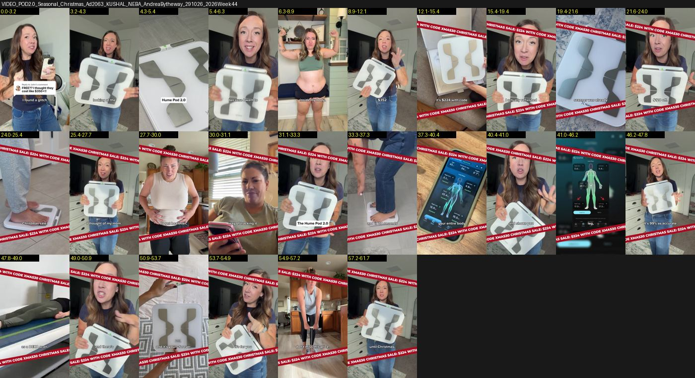

# VIDEO_POD2.0_Seasonal_Christmas_Ad2063_KUSHAL_NEBA_AndreaBytheway_291026_2026Week44

Master: `VIDEO_POD2.0_Seasonal_Christmas_Ad2063_KUSHAL_NEBA_AndreaBytheway_291026_2026Week44_Hook1_9x16.mp4` · 61.7s · 1080x1920

**Pacing:** 26 shots · avg 2.374s · median 2.267s · 4.05 cuts/10s · first cut 3.233s · 176.0 wpm · talk ratio 0.96 · cuts on word start 72.0% · cuts in speech gaps 44.0%
**Audio:** {'I_lufs': -18.9, 'LRA': 2.7, 'true_peak_db': -0.3} · BPM≈129.2 · music {'speech_rms_db': -24.3, 'pause_seconds': 0.0} · cuts with SFX/transient 48.0%

**Captions:** 113 cards · 1 words/card (median) · y≈0.732 of frame height · text height≈0.0293 · colours {'white': 83, 'dark/other': 25, 'blue': 3, 'red': 2} · cards crossing a cut: 1
Highlighted: GeneratePror, Body, LeanMass, Nutrit, 13
**Headlines:** ODEXMAS30CHRISTMASSALE:$224W (12.0–12.0s, red) | ODEXMAS30CHRISTMASSALE:$224WI (12.0–12.0s, red) | JITHCODEXMAS3OCHRISTMASSALE:S (13.0–13.0s, red) | ITHCODEXMAS3OCHRISTMASSALE:$2 (13.0–13.0s, red) | 224WITHCODEXMAS3OCHRISTMASSA (14.0–14.0s, red) | ALE:S224WITHCODEXMAS30CHRISTN (15.0–15.0s, red) | ALE:$224WITHCODEXMAS30CHRISTM (15.0–15.0s, red) | MASSALE:$224WITHCODEXMAS30CH (16.0–16.0s, red)

**Hook (0–3s) spoken:** I genuinely thought I found a glitch on Hume's website.
**Hook on-screen:** FREE??Ithoughtthey / Ifound a glitch / Igenuinely thought / ReplytoJohn'scomment / costlike$350+!! / genuinely thought / on Hume's website. / onHume'swebsite
**CTA (last 5s):** It's $224 in till Christmas and $352 after. · on-screen: 224WITHCODEXMAS30CHRISTMASSA / 224WITHCODEXMAS3OCHRISTMASSA / EXMAS30CHRISTMASSALE:$224WITH / EXMAS30CHRISTMASSALE:S224WITH / It's$224 / RISTMASSALE:$224WITHCODEXMAS3 / S30CHRISTMASSALE:$224WITHCODE / S3OCHRISTMASSALE:S224WITHCODE / THCODEXMAS3OCHRISTMASSALE:S22 / and$352after. / untilChristmas,

## Beat sheet

| # | in–out (s) | dur | transition | spoken | on-screen text |
|---|---|---|---|---|---|
| 1 | 0.00–3.23 | 3.23 |  | I genuinely thought I found a glitch on Hume's website. | ReplytoJohn'scomment / FREE??Ithoughtthey / costlike$350+!! / Igenuinely thought / genuinely thought / Ifound a glitch |
| 2 | 3.23–4.27 | 1.03 | cut +SFX hit | I've been looking at the HumePod | I've been / looking at the |
| 3 | 4.27–5.43 | 1.17 | cut | 2 .0 because | looking at the / Hume Pod 2.0 / XHume |
| 4 | 5.43–6.33 | 0.9 | cut +SFX hit | I want to | Hume Pod 2.0 / XHume / becauseIwantto |
| 5 | 6.33–8.93 | 2.6 | cut +SFX hit | know what's actually going on inside my body. | becauseIwantto / know what's actually / inside my body |
| 6 | 8.93–12.07 | 3.13 | cut +SFX hit | It's normally $352 but | It's normally / $352 / ODEXMAS30CHRISTMASSALE:$224W [red] (HEADLINE) / butrightnow / ODEXMAS30CHRISTMASSALE:$224WI [red] (HEADLINE) |
| 7 | 12.07–15.43 | 3.37 | cut | right now it's $220 with code XMIS30. | ODEXMAS30CHRISTMASSALE:$224W [red] (HEADLINE) / butrightnow / ODEXMAS30CHRISTMASSALE:$224WI [red] (HEADLINE) / JITHCODEXMAS3OCHRISTMASSALE:S [red] (HEADLINE) / it's$224withcode / ITHCODEXMAS3OCHRISTMASSALE:$2 [red] (HEADLINE) |
| 8 | 15.43–19.43 | 4.0 | cut | I actually refreshed the page because I couldn't believe a | it's$224withcode / ALE:S224WITHCODEXMAS30CHRISTN [red] (HEADLINE) / XHume / ALE:$224WITHCODEXMAS30CHRISTM [red] (HEADLINE) / MASSALE:$224WITHCODEXMAS30CH [red] (HEADLINE) / XMAS3O. |
| 9 | 19.43–21.60 | 2.17 | cut | brand new scanner was already $128 | becauseI couldn'tbelieve / EXMAS30CHRISTMASSALE:S224WITH [red] (HEADLINE) / EXMAS30CHRISTMASSALE:$224WITH [red] (HEADLINE) / HCODEXMAS3OCHRISTMASSALE:$224 [red] (HEADLINE) / abrandnew / XHu |
| 10 | 21.60–24.00 | 2.4 | cut +SFX hit | off. But it's real. | E:$224WITHCODEXMAS30CHRISTMAS [red] (HEADLINE) / $128off. / E:S224WITHCODEXMAS30CHRISTMAS [red] (HEADLINE) / SSALE:$224WITHCODEXMAS3OCHRI [red] (HEADLINE) / Butit'sreal. / SSALE:S224WITHCODEXMAS3OCHRIS [red] (HEADLINE) |
| 11 | 24.00–25.43 | 1.43 | cut | It's their Christmas sell. | ISTMASSALE:S224WITHCODEXMAS30 [red] (HEADLINE) / It'stheir / ISTMASSALE:$224WITHCODEXMAS30 [red] (HEADLINE) / OCHRISTMASSALE:$224WITHCODEXI [red] (HEADLINE) / Christmassale. / OCHRISTMASSALE:$224WITHCODEXN [red] (HEADLINE) |
| 12 | 25.43–27.70 | 2.27 | cut | And straight away I thought of my mom. She's | OCHRISTMASSALE:$224WITHCODEXI [red] (HEADLINE) / Christmassale. / OCHRISTMASSALE:$224WITHCODEXN [red] (HEADLINE) / MAS3OCHRISTMASSALE:$224WITHCO [red] (HEADLINE) / Andstraightaway / ODEXMAS30CHRISTMASSALE:$224W [red] (HEADLINE) |
| 13 | 27.70–29.97 | 2.27 | cut | been trying to get healthier but she has no | /ITHCODEXMAS3OCHRISTMASSALE:$ [red] (HEADLINE) / She'sbeentrying / VITHCODEXMAS3OCHRISTMASSALE:S2 [red] (HEADLINE) / 224WITHCODEXMAS30CHRISTMASSA [red] (HEADLINE) / butshehasno / 224WITHCODEXMAS3OCHRISTMASSA [red] (HEADLINE) |
| 14 | 29.97–31.07 | 1.1 | cut | way of tracking it. | ALE:S224WITHCODEXMAS3OCHRISTN [red] (HEADLINE) / wayoftracking it. / ALE:$224WITHCODEXMAS3OCHRISTN [red] (HEADLINE) / MASSALE:$224WITHCODEXMAS30CH [red] (HEADLINE) / TheHumePod2.0 |
| 15 | 31.07–33.30 | 2.23 | cut +SFX hit | The HumePod 2 .0 fixes that. | MASSALE:$224WITHCODEXMAS30CH [red] (HEADLINE) / TheHumePod2.0 / HRISTMASSALE:$224WITHCODEXMA [red] (HEADLINE) / AS3OCHRISTMASSALE:$224WITHCOD [red] (HEADLINE) / fixesthat. / AS30OCHRISTMASSALE:$224WITHCOD [red] (HEADLINE) |
| 16 | 33.30–37.30 | 4.0 | cut | You step on it, grab the handles and in 30 seconds it breaks down your | AS3OCHRISTMASSALE:$224WITHCOD [red] (HEADLINE) / fixesthat. / AS30OCHRISTMASSALE:$224WITHCOD [red] (HEADLINE) / DEXMAS30CHRISTMASSALE:S224WIT [red] (HEADLINE) / grab the handles, / DEXMAS3OCHRISTMASSALE:S224WIT [red] (HEADLINE) |
| 17 | 37.30–40.37 | 3.07 | cut | entire body into five parts and | SSALE:$224WITHCODEXMAS3OCHRIS [red] (HEADLINE) / itbreaksdown / ISTMASSALE:$224WITHCODEXMAS3 [red] (HEADLINE) / StepOnScale [blue] (HEADLINE) / 12/10 / 13/0 |
| 18 | 40.37–41.00 | 0.63 | cut +SFX hit | shows you how | StepOnScale [blue] (HEADLINE) / Standard / Home / Body [blue] / 63yrs [blue] (HEADLINE) / MetabolicAge [blue] (HEADLINE) |
| 19 | 41.00–46.17 | 5.17 | cut +SFX hit | much muscle and fat you have separately in each leg, arm and your torso. | LeanMass [blue] / HumePod(100%) (HEADLINE) / Connected [green] (HEADLINE) / High (HEADLINE) / HCODEXMAS3OCHRISTMASSALE:S22 [red] (HEADLINE) / BMI (HEADLINE) |
| 20 | 46.17–47.80 | 1.63 | cut +SFX hit | It's 99 % as accurate as | KMAS3OCHRISTMASSALE:$224WITHC [red] (HEADLINE) / It's99%asaccurate / CODEXMAS3OCHRISTMASSALE:$2241 [red] (HEADLINE) / CODEXMAS3OCHRISTMASSALE:$224V [red] (HEADLINE) |
| 21 | 47.80–49.03 | 1.23 | cut +SFX hit | a DEXA scan and | +WITHCODEXMAS3OCHRISTMASSALE [red] (HEADLINE) / as a DExAscan, / WITHCODEXMAS3OCHRISTMASSALE [red] (HEADLINE) / LE:$224WITHCODEXMAS3OCHRISTMA [red] (HEADLINE) / andthere's / E:S224WITHCODEXMAS3OCHRISTMA [red] (HEADLINE) |
| 22 | 49.03–50.93 | 1.9 | cut +SFX hit | there's no subscription. | LE:$224WITHCODEXMAS3OCHRISTMA [red] (HEADLINE) / andthere's / E:S224WITHCODEXMAS3OCHRISTMA [red] (HEADLINE) / MASSALE:$224WITHCODEXMAS30CH [red] (HEADLINE) / no subscription. / ASSALE:$224WITHCODEXMAS30CHI [red] (HEADLINE) |
| 23 | 50.93–53.73 | 2.8 | cut | You buy it once and it's yours forever. | CHRISTMASSALE:S224WITHCODEXMA [red] (HEADLINE) / X.Hume / Youbuyitonce / HRISTMASSALE:$224WITHCODEXMA [red] (HEADLINE) / IAS3OCHRISTMASSALE:$224WITHCOD [red] (HEADLINE) / and it'syoursforever. |
| 24 | 53.73–54.87 | 1.13 | cut | So whether it's for you or | ITHCODEXMAS3OCHRISTMASSALE:S [red] (HEADLINE) / it's foryou / VITHCODEXMAS3OCHRISTMASSALE:S [red] (HEADLINE) |
| 25 | 54.87–57.20 | 2.33 | cut | someone you love, don't miss this price. It's | $224WITHCODEXMAS30CHRISTMAS [red] (HEADLINE) / orsomeoneyoulove, / SSALE:S$224WITHCODEXMAS3OCHRIS [red] (HEADLINE) / don'tmissthisprice. / SSALE:$224WITHCODEXMAS3OCHRIS [red] (HEADLINE) / RISTMASSALE:$224WITHCODEXMAS3 [red] (HEADLINE) |
| 26 | 57.20–61.72 | 4.52 | cut +SFX hit | $224 in till Christmas and $352 after. | RISTMASSALE:$224WITHCODEXMAS3 [red] (HEADLINE) / It's$224 / S3OCHRISTMASSALE:S224WITHCODE [red] (HEADLINE) / S30CHRISTMASSALE:$224WITHCODE [red] (HEADLINE) / EXMAS30CHRISTMASSALE:S224WITH [red] (HEADLINE) / untilChristmas, |

## Hook variants

| hook | file | dur | first cut | spoken 0–3s | on-screen 0–3s |
|---|---|---|---|---|---|
| 1 | `_KUSHAL_NEBA_AndreaBytheway_291026_2026Week44_Hook1_9x16.mp4` | 61.7 | 3.233 | I genuinely thought I found a glitch on Hume's website. | FREE??Ithoughtthey / Ifound a glitch / Igenuinely thought / ReplytoJohn'scomment / costlike$350+!! / genuinely thought / on Hume's website. / onHume'swebsite |
| 2 | `_KUSHAL_NEBA_AndreaBytheway_291026_2026Week44_Hook2_9x16.mp4` | 63.2 | 4.733 |  |  |
| 3 | `_KUSHAL_NEBA_AndreaBytheway_291026_2026Week44_Hook3_9x16.mp4` | 61.2 | 0.8 |  |  |

## Full transcript

I genuinely thought I found a glitch on Hume's website. I've been looking at the HumePod 2.0 because I want to know what's actually going on inside my body. It's normally $352 but right now it's $220 with code XMIS30. I actually refreshed the page because I couldn't believe a brand new scanner was already $128 off. But it's real. It's their Christmas sell. And straight away I thought of my mom. She's been trying to get healthier but she has no way of tracking it. The HumePod 2.0 fixes that. You step on it, grab the handles and in 30 seconds it breaks down your entire body into five parts and shows you how much muscle and fat you have separately in each leg, arm and your torso. It's 99% as accurate as a DEXA scan and there's no subscription. You buy it once and it's yours forever. So whether it's for you or someone you love, don't miss this price. It's $224 in till Christmas and $352 after.