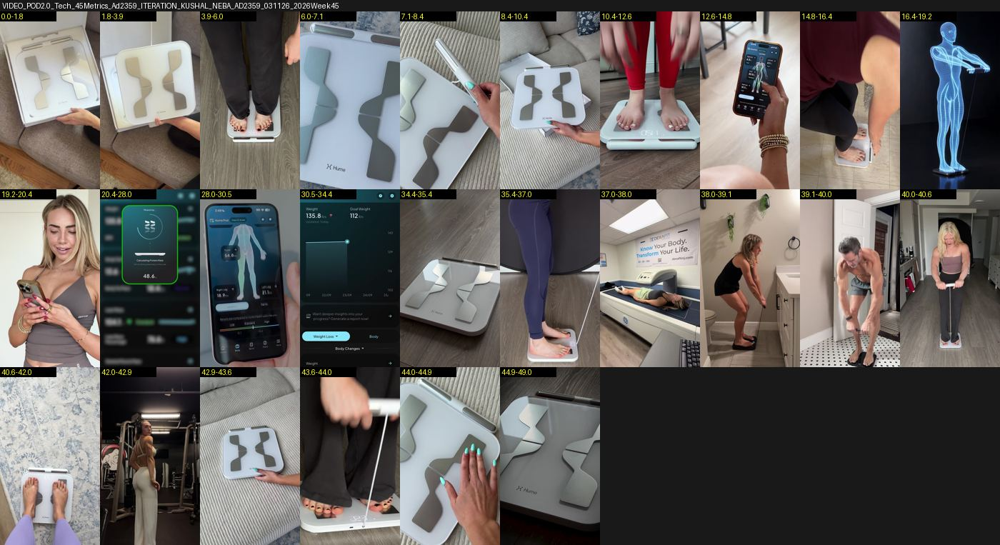

# VIDEO_POD2.0_Tech_45Metrics_Ad2359_ITERATION_KUSHAL_NEBA_AD2359_031126_2026Week45

Master: `VIDEO_POD2.0_Tech_45Metrics_Ad2359_ITERATION_KUSHAL_NEBA_AD2359_031126_2026Week45_9x16_hook1.mp4` · 49.0s · 1080x1920

**Pacing:** 26 shots · avg 1.885s · median 1.5s · 5.1 cuts/10s · first cut 1.76s · 253.0 wpm · talk ratio 0.87 · cuts on word start 88.0% · cuts in speech gaps 72.0%
**Audio:** {'I_lufs': -25.7, 'LRA': 4.1, 'true_peak_db': -9.2} · BPM≈123.0 · music {'speech_rms_db': -30.5, 'pause_seconds': 4.3, 'pause_rms_db': -32.9, 'bed_minus_voice_db': -2.4, 'music_bed_likely': True} · cuts with SFX/transient 60.0%

**Captions:** 92 cards · 1.0 words/card (median) · y≈0.664 of frame height · text height≈0.0246 · colours {'white': 53, 'dark/other': 37, 'blue': 2} · cards crossing a cut: 5
Highlighted: Lean(lbs), Weight Loss
**Headlines:** 12:02# (14.0–14.0s, blue) | EsHumePod (14.0–14.0s, blue) | 6.10 (14.0–14.0s, white) | 53.5os (14.0–14.0s, white) | 13.6% (21.0–21.0s, white) | 18.4ibs (21.0–22.0s, white) | 13.6%+ (22.0–22.0s, white) | Measuring... (23.0–23.0s, dark/other)

**Hook (0–3s) spoken:** My pod from Hume just arrived, and I wanted one of these for so
**Hook on-screen:** Hume / XHume
**CTA (last 5s):** it's awesome. · on-screen: Hume / XHume

## Beat sheet

| # | in–out (s) | dur | transition | spoken | on-screen text |
|---|---|---|---|---|---|
| 1 | 0.00–1.76 | 1.76 |  | My pod from Hume just arrived, | Hume / XHume |
| 2 | 1.76–3.88 | 2.12 | cut | and I wanted one of these for so long. | XHume / Hume / XHume / Hume |
| 3 | 3.88–6.00 | 2.12 | cut +SFX hit | The new Hume Pod 2 .0 just launched with | Hume |
| 4 | 6.00–7.12 | 1.12 | cut +SFX hit | next -gen sensors that use | X Hume |
| 5 | 7.12–8.40 | 1.28 | cut | direct read technology. |  |
| 6 | 8.40–10.36 | 1.96 | cut +SFX hit | Instead of reading your body through a layer of glass, | Hume / XHume |
| 7 | 10.36–12.60 | 2.24 | cut | the sensors now touch your skin directly, which increases | XHume / 051 |
| 8 | 12.60–14.80 | 2.2 | cut +SFX hit | the accuracy and consistency of your results. | 53.5cs / 19.70 / 19.2cc / 12:02# [blue] (HEADLINE) / EsHumePod [blue] (HEADLINE) / 6.10 (HEADLINE) |
| 9 | 14.80–16.44 | 1.64 | cut +SFX hit | Anytime you step on it and hold the handles, | 232 |
| 10 | 16.44–19.20 | 2.76 | cut +SFX hit | it sends a tiny electric current through your entire body. | DFYNE |
| 11 | 19.20–20.36 | 1.16 | cut +SFX hit | In 30 seconds, it shows your | DFYNE |
| 12 | 20.36–27.96 | 7.6 | cut | body fat, how much body water you have, your bone density, protein rate, metabolic age, and visceral fat. It breaks down your entire body into five parts | DFYNE / 13.6% (HEADLINE) / 18.4ibs (HEADLINE) / 13.6%+ (HEADLINE) / BodyWaterPercentage / 61.9% + Standard |
| 13 | 27.96–30.48 | 2.52 | cut +SFX hit | and shows you how much muscle and fat you have separately in | 2:496 [blue] (HEADLINE) / SOS (HEADLINE) / HumePod [blue] (HEADLINE) / Height (HEADLINE) / Age (HEADLINE) / 23yrs (HEADLINE) |
| 14 | 30.48–34.40 | 3.92 | cut | each leg, arm, and your torso. It measures so many things. What really sold me | SOS (HEADLINE) / HumePod [blue] (HEADLINE) / Right Leg / Body / 2:49 (HEADLINE) / LeftArm (HEADLINE) |
| 15 | 34.40–35.44 | 1.04 | cut +SFX hit | was the accuracy. | HumePod (HEADLINE) / StepOnScale [green] (HEADLINE) / Standard / BodyFat Percentage / Verylow / 18.4ibs |
| 16 | 35.44–37.00 | 1.56 | cut +SFX hit | It's 99 % as accurate | Hume |
| 17 | 37.00–37.96 | 0.96 | cut +SFX hit | as a DEXA scan. | XDEXAFIT (HEADLINE) / Know Your Body. (HEADLINE) / Transform Your Life. [blue] (HEADLINE) / dexafitnj.com / 201 -351-1591 |
| 18 | 37.96–39.08 | 1.12 | cut +SFX hit | I've seen a lot of fitness coaches |  |
| 19 | 39.08–39.96 | 0.88 | cut | using this and they |  |
| 20 | 39.96–40.60 | 0.64 | cut +SFX hit | love it, so |  |
| 21 | 40.60–42.04 | 1.44 | cut +SFX hit | I had to try it. So trust me | XHume |
| 22 | 42.04–42.88 | 0.84 | cut | when I say, get |  |
| 23 | 42.88–43.56 | 0.68 | cut | it, try |  |
| 24 | 43.56–44.00 | 0.44 | cut +SFX hit | it, |  |
| 25 | 44.00–44.88 | 0.88 | cut | it's awesome. |  |
| 26 | 44.88–49.00 | 4.12 | cut |  | XHume / Hume / XHume / Hume |

## Hook variants

| hook | file | dur | first cut | spoken 0–3s | on-screen 0–3s |
|---|---|---|---|---|---|
| 1 | `TERATION_KUSHAL_NEBA_AD2359_031126_2026Week45_9x16_hook1.mp4` | 49.0 | 1.76 | My pod from Hume just arrived, and I wanted one of these for so | Hume / XHume |
| 1 | `TERATION_KUSHAL_NEBA_AD2359_031126_2026Week45_9x16_hook1.mp4` | 49.0 | 1.76 |  |  |
| 2 | `TERATION_KUSHAL_NEBA_AD2359_031126_2026Week45_9x16_hook2.mp4` | 48.6 | 1.44 |  |  |
| 2 | `TERATION_KUSHAL_NEBA_AD2359_031126_2026Week45_9x16_hook2.mp4` | 48.6 | 1.44 |  |  |
| 3 | `TERATION_KUSHAL_NEBA_AD2359_031126_2026Week45_9x16_hook3.mp4` | 46.9 | 0.96 |  |  |
| 3 | `TERATION_KUSHAL_NEBA_AD2359_031126_2026Week45_9x16_hook3.mp4` | 46.9 | 0.96 |  |  |

## Full transcript

My pod from Hume just arrived, and I wanted one of these for so long. The new Hume Pod 2.0 just launched with next-gen sensors that use direct read technology. Instead of reading your body through a layer of glass, the sensors now touch your skin directly, which increases the accuracy and consistency of your results. Anytime you step on it and hold the handles, it sends a tiny electric current through your entire body. In 30 seconds, it shows your body fat, how much body water you have, your bone density, protein rate, metabolic age, and visceral fat. It breaks down your entire body into five parts and shows you how much muscle and fat you have separately in each leg, arm, and your torso. It measures so many things. What really sold me was the accuracy. It's 99% as accurate as a DEXA scan. I've seen a lot of fitness coaches using this and they love it, so I had to try it. So trust me when I say, get it, try it, it's awesome.