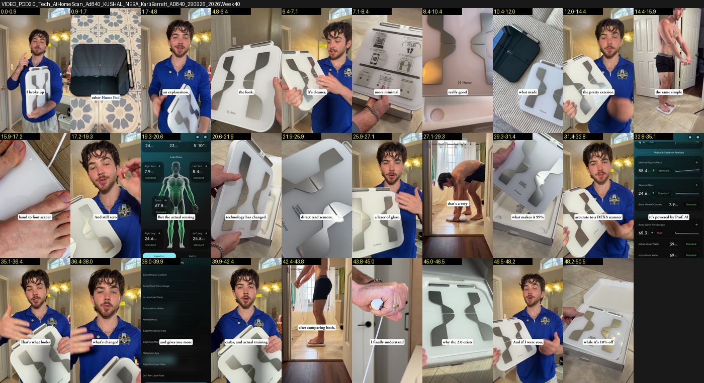

# VIDEO_POD2.0_Tech_AtHomeScan_Ad840_KUSHAL_NEBA_KarliBarrett_AD840_290926_2026Week40

Master: `VIDEO_POD2.0_Tech_AtHomeScan_Ad840_KUSHAL_NEBA_KarliBarrett_AD840_290926_2026Week40_Hook1_9x16.mp4` · 50.5s · 1080x1920

**Pacing:** 29 shots · avg 1.743s · median 1.54s · 5.54 cuts/10s · first cut 0.94s · 219.0 wpm · talk ratio 0.97 · cuts on word start 60.7% · cuts in speech gaps 35.7%
**Audio:** {'I_lufs': -16.1, 'LRA': 4.2, 'true_peak_db': 0.1} · BPM≈123.0 · music {'speech_rms_db': -21.6, 'pause_seconds': 0.0} · cuts with SFX/transient 21.4%

**Captions:** 118 cards · 2.0 words/card (median) · y≈0.656 of frame height · text height≈0.034 · colours {'white': 113, 'dark/other': 3, 'blue': 1, 'red': 1} · cards crossing a cut: 1
Highlighted: Lean(lbs), High
**Headlines:** 8888 (7.0–7.0s, white) | Catibrate the device (8.0–8.0s, white) | 88883 (8.0–8.0s, white) | SCANME (8.0–8.0s, white) | Hume Pod (20.0–20.0s, dark/other) | StepOnScale (20.0–20.0s, green) | LeanMass (20.0–20.0s, white) | Right Arm (20.0–20.0s, white)

**Hook (0–3s) spoken:** I broke up with my other HumePod and honestly it deserves an explanation.
**Hook on-screen:** I broke up / and honestly, / it deserves / otherHumePod / with my
**CTA (last 5s):** exists And if I were you I would definitely take a look especially while it's 10 % off · on-screen: And if I were you, / Hume / XHume / a look, especially / rume / while it's 10% 0ff / while it's 10% off / why the 2.0 exists

## Beat sheet

| # | in–out (s) | dur | transition | spoken | on-screen text |
|---|---|---|---|---|---|
| 1 | 0.00–0.94 | 0.94 |  | I broke up with my other | I broke up / with my |
| 2 | 0.94–1.74 | 0.8 | cut | HumePod and | with my / otherHumePod / and honestly, |
| 3 | 1.74–4.82 | 3.08 | cut +SFX hit | honestly it deserves an explanation. First of all, take a moment | and honestly, / it deserves / WORLOSERIES / an explanation. / First of all, / XHume |
| 4 | 4.82–6.36 | 1.54 | cut | to appreciate the look. | XHume / take a moment / to appreciate / the look. |
| 5 | 6.36–7.12 | 0.76 | cut +SFX hit | It's cleaner, | XHume / the look. / 8888 (HEADLINE) / onsorconcerns?Pleaserea / more minimal, / h.com |
| 6 | 7.12–8.44 | 1.32 | cut | more minimal, and the white makes | 8888 (HEADLINE) / onsorconcerns?Pleaserea / more minimal, / h.com / Catibrate the device (HEADLINE) / 88883 (HEADLINE) |
| 7 | 8.44–10.40 | 1.96 | cut | it look really good just standing out. | Catibrate the device (HEADLINE) / 88883 (HEADLINE) / SCANME (HEADLINE) / Take yourfirst scan / Bare feet are requtred / Questions |
| 8 | 10.40–12.02 | 1.62 | cut | But that's not what made me switch. | just standing out. / what made / XHume / You got look |
| 9 | 12.02–14.38 | 2.36 | cut | You gotta look underneath the pretty exterior. | You got look / the pretty exterior. / Hume |
| 10 | 14.38–15.90 | 1.52 | cut | You still get the same simple hand | the pretty exterior. / Hume / the same simple |
| 11 | 15.90–17.24 | 1.34 | cut | -to -foot scanner and | hand to foot scaner. / And still zero / XHume |
| 12 | 17.24–19.32 | 2.08 | cut | still zero subscription fees. | And still zero / XHume / COLLEBE / WORLD SERIES / OMAHA / COLLEGE |
| 13 | 19.32–20.56 | 1.24 | cut | But the actual sensing technology | COLLEGE / RLDSERIES / subscription fees. / Hume Pod (HEADLINE) / StepOnScale [green] (HEADLINE) / LeanMass (HEADLINE) |
| 14 | 20.56–21.88 | 1.32 | cut | has changed. | technology has changed. / Hume |
| 15 | 21.88–25.92 | 4.04 | cut +SFX hit | The Pod 2 .0 uses direct read sensors so it's not scanning you through a | Hume (HEADLINE) / The Pod 2.0 uses / Balanc / od2.0 / Smartekor / direct read sensors, |
| 16 | 25.92–27.06 | 1.14 | cut +SFX hit | layer of glass. And | a layer of glass. / XHume / And if you don't know, |
| 17 | 27.06–29.30 | 2.24 | cut | if you don't know, that's a very significant change because | And if you don't know, / that's a very / significant change |
| 18 | 29.30–31.38 | 2.08 | cut | that's what makes it 99 % | significant change / XHume (HEADLINE) / what makes it 99% / XHume |
| 19 | 31.38–32.76 | 1.38 | cut | accurate to a DEXA scan And | what makes it 99% / XHume / accurate to a DEXA scanner |
| 20 | 32.76–35.06 | 2.3 | cut | the best part is it's powered by Prof AI That's | HumePod (HEADLINE) / VisceralFatIndex (HEADLINE) / Low (HEADLINE) / Muscle&SkeletonAnalysis (HEADLINE) / Skeletal MuscleMass (HEADLINE) / 88.4ibs |
| 21 | 35.06–36.44 | 1.38 | cut | what looks at your results helps | That's what looks / XHume (HEADLINE) / your results, |
| 22 | 36.44–38.00 | 1.56 | cut +SFX hit | explain what's changed and | your results, / COLLEGE / VORLO SERIES / what's changed |
| 23 | 38.00–39.90 | 1.9 | cut | gives you more personalized insight on | ChartMetric (HEADLINE) / LeanMass (HEADLINE) / LeanMassPercentage (HEADLINE) / BoneMineral Content / BodyWaterPercentage / IntracellularWater |
| 24 | 39.90–42.42 | 2.52 | cut | things like protein Carbs and actual training and | WORIOSERIES / on things like protein, / carbs, and actual training / Hume |
| 25 | 42.42–43.84 | 1.42 | cut | that's why after comparing both I | carbs, and actual training / Hume / after comparing both |
| 26 | 43.84–44.98 | 1.14 | cut | finally understand why | I finally understand |
| 27 | 44.98–46.52 | 1.54 | cut | the 2 .0 exists And | XHume / why the 2.0 exists |
| 28 | 46.52–48.18 | 1.66 | cut +SFX hit | if I were you I would definitely take | And if I were you, / Hume / a look, especially |
| 29 | 48.18–50.54 | 2.36 | cut | a look especially while it's 10 % off | a look, especially / while it's 10% 0ff / rume / while it's 10% off / Hume |

## Hook variants

| hook | file | dur | first cut | spoken 0–3s | on-screen 0–3s |
|---|---|---|---|---|---|
| 1 | `HAL_NEBA_KarliBarrett_AD840_290926_2026Week40_Hook1_9x16.mp4` | 50.5 | 0.94 | I broke up with my other HumePod and honestly it deserves an explanation. | I broke up / and honestly, / it deserves / otherHumePod / with my |
| 2 | `HAL_NEBA_KarliBarrett_AD840_290926_2026Week40_Hook2_9x16.mp4` | 51.0 | 1.84 |  |  |
| 3 | `HAL_NEBA_KarliBarrett_AD840_290926_2026Week40_Hook3_9x16.mp4` | 51.2 | 1.26 | I was loyal to my original humepod until the 2 .0 gave |  |

## Full transcript

I broke up with my other HumePod and honestly it deserves an explanation. First of all, take a moment to appreciate the look. It's cleaner, more minimal, and the white makes it look really good just standing out. But that's not what made me switch. You gotta look underneath the pretty exterior. You still get the same simple hand-to-foot scanner and still zero subscription fees. But the actual sensing technology has changed. The Pod 2.0 uses direct read sensors so it's not scanning you through a layer of glass. And if you don't know, that's a very significant change because that's what makes it 99% accurate to a DEXA scan And the best part is it's powered by Prof AI That's what looks at your results helps explain what's changed and gives you more personalized insight on things like protein Carbs and actual training and that's why after comparing both I finally understand why the 2.0 exists And if I were you I would definitely take a look especially while it's 10% off