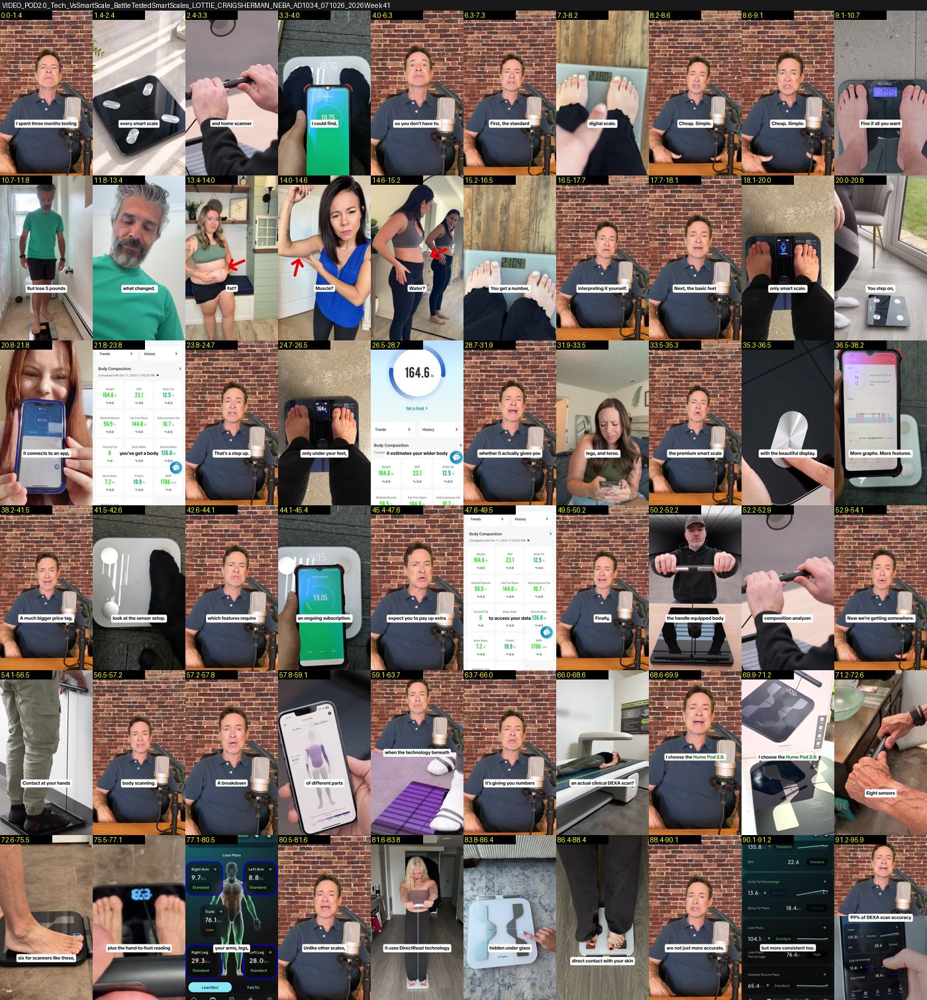

# VIDEO_POD2.0_Tech_VsSmartScale_BattleTestedSmartScales_LOTTIE_CRAIGSHERMAN_NEBA_AD1034_071026_2026Week41

Master: `VIDEO_POD2.0_Tech_VsSmartScale_BattleTestedSmartScales_LOTTIE_CRAIGSHERMAN_NEBA_AD1034_071026_2026Week41_Hook1_9x16.mp4` · 147.1s · 1080x1920

**Pacing:** 82 shots · avg 1.793s · median 1.534s · 5.51 cuts/10s · first cut 1.367s · 213.0 wpm · talk ratio 0.95 · cuts on word start 91.4% · cuts in speech gaps 71.6%
**Audio:** {'I_lufs': -23.1, 'LRA': 3.6, 'true_peak_db': -0.0} · BPM≈112.3 · music {'speech_rms_db': -28.4, 'pause_seconds': 1.0, 'pause_rms_db': -27.4, 'bed_minus_voice_db': 0.9, 'music_bed_likely': True} · cuts with SFX/transient 32.1%

**Captions:** 337 cards · 1 words/card (median) · y≈0.671 of frame height · text height≈0.0293 · colours {'white': 266, 'green': 23, 'blue': 7, 'dark/other': 38, 'red': 3} · cards crossing a cut: 1
Highlighted: 18.25, 199, 80.70, 56.5, 144.0, 10.7, 136.8 ib, 20.0, 7.2, 19.9%, 1786, Set a Goal >, 164.6 lb, 23.1, 12.5
**Headlines:** 18.70 (3.5–3.5s, white) | 2086 (16.0–16.0s, white) | Trends (22.0–23.0s, white) | History (22.0–23.0s, white) | Body Composition (22.0–23.0s, white) | Comparedwith0Oct11,202411:05:20PM (22.0–22.0s, white) | Weight (22.0–23.0s, white) | BMI (22.0–23.0s, white)

**Hook (0–3s) spoken:** I spent three months testing every smart scale and home scanner
**Hook on-screen:** I spent three months testing / andhomescanner / everysmartscale
**CTA (last 5s):** 45 day guarantee. Before you buy another scale, ask what you actually want it to tell you. · on-screen: Before you buy another scale / Want it to tell you. / ask what you actually / witha45dayguarantee.

## Beat sheet

| # | in–out (s) | dur | transition | spoken | on-screen text |
|---|---|---|---|---|---|
| 1 | 0.00–1.37 | 1.37 |  | I spent three months testing | I spent three months testing |
| 2 | 1.37–2.43 | 1.07 | cut +SFX hit | every smart scale and | I spent three months testing / everysmartscale |
| 3 | 2.43–3.27 | 0.83 | cut | home scanner I | everysmartscale / andhomescanner |
| 4 | 3.27–4.03 | 0.77 | cut +SFX hit | could find. | andhomescanner / 18.70 (HEADLINE) / 18.25 [green] / I could find, / side by side, |
| 5 | 4.03–6.33 | 2.3 | cut +SFX hit | Side by side so you don't have to. | side by side, / so you don't have to. |
| 6 | 6.33–7.30 | 0.97 | cut | First the standard digital | so you don't have to. / First, the standard |
| 7 | 7.30–8.17 | 0.87 | cut +SFX hit | scale. | First, the standard / Cheap. Simple. |
| 8 | 8.17–8.57 | 0.4 | cut | Cheap. | Cheap. Simple. |
| 9 | 8.57–9.13 | 0.57 | cut | Simple. | Fine if all you want |
| 10 | 9.13–10.73 | 1.6 | cut | Fine if all you want is your weight. | Fine if all you want / 199 [blue] / is your weight. |
| 11 | 10.73–11.83 | 1.1 | cut +SFX hit | But lose five pounds | But lose 5pounds |
| 12 | 11.83–13.37 | 1.53 | cut | and it can't tell you what changed. | and it can't tell you / what changed. |
| 13 | 13.37–14.00 | 0.63 | cut +SFX hit | Fat. | what changed. |
| 14 | 14.00–14.63 | 0.63 | cut | Muscle. | Muscle? |
| 15 | 14.63–15.17 | 0.53 | cut +SFX hit | Water. | You get a number, |
| 16 | 15.17–16.53 | 1.37 | cut +SFX hit | You get a number and you're left | You get a number, / 2086 (HEADLINE) / and you're left |
| 17 | 16.53–17.67 | 1.13 | cut +SFX hit | interpreting it yourself. | interpreting it yourself. |
| 18 | 17.67–18.07 | 0.4 | cut | Next the | 164.6 / Next, the basic feet |
| 19 | 18.07–20.00 | 1.93 | cut +SFX hit | basic feed only smart scale. | 164.6 / Next, the basic feet / RENPHO / only smart scale. |
| 20 | 20.00–20.83 | 0.83 | cut | You step on, | You step on, |
| 21 | 20.83–21.83 | 1.0 | cut | it connects to an app | 80.70 [blue] / it connects to an app |
| 22 | 21.83–23.80 | 1.97 | cut | and suddenly you've got a body fat percentage. | Trends (HEADLINE) / History (HEADLINE) / Body Composition (HEADLINE) / Comparedwith0Oct11,202411:05:20PM (HEADLINE) / Weight (HEADLINE) / BMI (HEADLINE) |
| 23 | 23.80–24.73 | 0.93 | cut +SFX hit | That's a step up, | That's a step up. |
| 24 | 24.73–26.53 | 1.8 | cut +SFX hit | but with sensors only under your feet it | RENPHC / Butwithsensors / 164.6 / RENPHO / onlyunderyourfeet, |
| 25 | 26.53–28.73 | 2.2 | cut | estimates your wider body composition from | 164.6 (HEADLINE) / Set a Goal > [blue] / History / Trends / BodyComposition / Compal it estimates your wider body |
| 26 | 28.73–31.93 | 3.2 | cut | that measurement. Check whether it actually gives you separate readings for | from that measurement. / whether it actually gives you / separate readings |
| 27 | 31.93–33.53 | 1.6 | cut +SFX hit | your arms, legs, and torso. | for your arms, / legs, and torso. |
| 28 | 33.53–35.27 | 1.73 | cut | Then there's the premium smart scale with | the premium smart scale |
| 29 | 35.27–36.53 | 1.27 | cut | the beautiful display. | the premium smart scale / with the beautiful display. |
| 30 | 36.53–38.20 | 1.67 | cut | More graphs, more features, | Steps (HEADLINE) / Stepdistance0.0mi (HEADLINE) / StepconsumptionO (HEADLINE) / Sleep / Heurtrate / Moregraphs.More features. |
| 31 | 38.20–41.47 | 3.27 | cut +SFX hit | a much bigger price tag. But before you pay for the screen, | A much bigger price tag / But before you pay / for the screen, |
| 32 | 41.47–42.60 | 1.13 | cut | look at the sensor setup, | for the screen, / look at the sensor setup. |
| 33 | 42.60–44.10 | 1.5 | cut +SFX hit | and check which features require an | whichfeatures require / 19.05 [blue] / an ongoing subscription. |
| 34 | 44.10–45.43 | 1.33 | cut | ongoing subscription. | 19.05 [blue] / an ongoing subscription. / 1905 (HEADLINE) |
| 35 | 45.43–47.60 | 2.17 | cut | Nearly all of them expect you to pay up extra to | 19.05 [blue] / an ongoing subscription. / 1905 (HEADLINE) / all of them / expectyoutopayupextra |
| 36 | 47.60–49.53 | 1.93 | cut | access your data in their app. | History (HEADLINE) / Trends (HEADLINE) / BodyComposition (HEADLINE) / ComparedwithOct11,202411:05:20PM (HEADLINE) / Weight (HEADLINE) / Body Fat (HEADLINE) |
| 37 | 49.53–50.17 | 0.63 | cut | Finally, | the handle equipped body |
| 38 | 50.17–52.23 | 2.07 | cut +SFX hit | the handle -equipped body composition analyzer. | the handle equipped body / compositionanalyzer. |
| 39 | 52.23–52.90 | 0.67 | cut |  | compositionanalyzer. |
| 40 | 52.90–54.07 | 1.17 | cut | Now we're getting somewhere. | Now we'regetting somewhere. / Contact at your hands |
| 41 | 54.07–56.47 | 2.4 | cut +SFX hit | Contact at your hands and feet for full body | Contact at your hands / andfeet forfull |
| 42 | 56.47–57.17 | 0.7 | cut +SFX hit | scanning. | andfeet forfull / A breakdown |
| 43 | 57.17–57.80 | 0.63 | cut | A breakdown of | A breakdown |
| 44 | 57.80–59.13 | 1.33 | cut | different parts of your body. But | 11:12 (HEADLINE) / EXPLORER (HEADLINE) / MuscleMass (HEADLINE) / Fat Mass / AVG.ARMS / 16.6% |
| 45 | 59.13–63.67 | 4.53 | cut | it's easy to package these as premium when the technology beneath is anything but. | But it'seasy topackage / these as premium / whenthetechnologybeneath / is anything but. |
| 46 | 63.67–65.97 | 2.3 | cut | So how do you know it's giving you numbers you can trust? | So how do you know / you can trust? |
| 47 | 65.97–68.57 | 2.6 | cut | How does it compare to an actual clinical dexa scan? | WEWILLTRAVELTOGETYOUSO [other-colour] (HEADLINE) / How does it compare to / WEWTLLTRAVELTOGETYOUSO (HEADLINE) / an actual clinical DEXA scan? / WEWILLTRAVELTOGETYOUSO (HEADLINE) |
| 48 | 68.57–69.90 | 1.33 | cut | That's why I'd choose the | IchoosetheHumePod2.0. |
| 49 | 69.90–71.20 | 1.3 | cut | HumePod 2 .0. | IchoosetheHumePod2.0. / 2056. (HEADLINE) / HumePod2.0 / Eightsensors |
| 50 | 71.20–72.60 | 1.4 | cut +SFX hit | Eight sensors across your hands | Eightsensors / across your hands |
| 51 | 72.60–75.53 | 2.93 | cut | and feet instead of the usual six for scanners like these. | and feet instead ofthe usual / six for scanners like these, |
| 52 | 75.53–77.07 | 1.53 | cut +SFX hit | Plus the hand to foot reading that | plus the hand-to-foot reading / Hume...(97%) (HEADLINE) / LeanMass (HEADLINE) / Right Arm (HEADLINE) / Left Arm (HEADLINE) / 9.7lbs (HEADLINE) |
| 53 | 77.07–80.47 | 3.4 | cut | breaks down your arms, legs, and torso separately. | Hume...(97%) (HEADLINE) / LeanMass (HEADLINE) / Right Arm (HEADLINE) / Left Arm (HEADLINE) / 9.7lbs (HEADLINE) / 8.8lbs (HEADLINE) |
| 54 | 80.47–81.60 | 1.13 | cut | Unlike other scales, | LeanMass (HEADLINE) / Right Arm (HEADLINE) / Left Arm (HEADLINE) / 8.8lbs (HEADLINE) / Standard (HEADLINE) / Trunk |
| 55 | 81.60–83.77 | 2.17 | cut | it uses direct read technology. | it uses DirectRead technology |
| 56 | 83.77–86.37 | 2.6 | cut | Basically, the sensors aren't hidden under glass, | - basically, / XHume / hidden under glass |
| 57 | 86.37–88.37 | 2.0 | cut | but come in direct contact with your skin. so | hidden under glass / direct contact with your skin |
| 58 | 88.37–90.07 | 1.7 | cut +SFX hit | readings are not just more accurate but | direct contact with your skin / arenot justmoreaccurate / Weight (HEADLINE) / 135.8bs+ (HEADLINE) / Standard (HEADLINE) / 22.6 (HEADLINE) |
| 59 | 90.07–91.23 | 1.17 | cut | more consistent too. | Weight (HEADLINE) / 135.8bs+ (HEADLINE) / Standard (HEADLINE) / 22.6 (HEADLINE) / BMI (HEADLINE) / BodyFat Percentage (HEADLINE) |
| 60 | 91.23–95.93 | 4.7 | cut | The HumePod 2 .0 comes to within 99 % of DEXA scan accuracy. | TheHumePod2.0 / comestowithin / Wantdeeperinsights inteyur / progress?Generatearepoft Rowl / VeigntLoss / BedyEharges |
| 61 | 95.93–100.23 | 4.3 | cut | That's almost clinical level data right from your bathroom every single morning. | -that's almost clinical / level data / right from your bathroom, / every single morning. / So you can look beyond |
| 62 | 100.23–102.43 | 2.2 | cut +SFX hit | So you can look beyond your total weight and | So you can look beyond / your total weight and follow |
| 63 | 102.43–108.93 | 6.5 | cut +SFX hit | follow estimates of body fat, muscle mass, hydration, visceral fat and metabolic age. Losing weight, | your total weight and follow / estimates of / 13.6%+ (HEADLINE) / 18.4ibs (HEADLINE) / body fat, / 65.4bs+ (HEADLINE) |
| 64 | 108.93–111.87 | 2.93 | cut | you can follow your muscle trend alongside your fat trend. | Hume..（97%） (HEADLINE) / LeanMass (HEADLINE) / Right Arm (HEADLINE) / LeftArm (HEADLINE) / 9.7lbs (HEADLINE) / 8.8lbs (HEADLINE) |
| 65 | 111.87–112.87 | 1.0 | cut | Training consistently but | CHALL / ITWON'T CHA (HEADLINE) / TRAN [blue] (HEADLINE) / Training consistently |
| 66 | 112.87–114.07 | 1.2 | cut +SFX hit | the scale isn't moving? you've | but the scale isn't moving? / You've got more information |
| 67 | 114.07–116.57 | 2.5 | cut | got more information to assess your progress, | You've got more information / to assess your progress. |
| 68 | 116.57–119.90 | 3.33 | cut | and the app uses Prof AI to explain your results and | HealthScore (HEADLINE) / 744 (HEADLINE) / High (HEADLINE) / 744 / HealthScore / Yourhealthmetrics are wellaboveaverage |
| 69 | 119.90–121.60 | 1.7 | cut | suggest what to focus on next based | and suggest / what to focus on next |
| 70 | 121.60–122.57 | 0.97 | cut | on your data. | based on yourdata. |
| 71 | 122.57–124.80 | 2.23 | cut | Because another graph is only useful if | Because another / graph is only useful |
| 72 | 124.80–126.40 | 1.6 | cut | you understand what it means. | if you understand / what it means. |
| 73 | 126.40–127.80 | 1.4 | cut +SFX hit | Unlike those other scales, | what it means. / 10 / Unlike those other scales, |
| 74 | 127.80–130.57 | 2.77 | cut | you don't have to pay a monthly subscription to access your data. | 2:496 [blue] (HEADLINE) / Height (HEADLINE) / Age (HEADLINE) / 165cm (HEADLINE) / 23yrs (HEADLINE) / 25yrs (HEADLINE) |
| 75 | 130.57–133.13 | 2.57 | cut | You buy it once, and the scanning is yours forever. | You buy it once, / is yours forever. / For me, |
| 76 | 133.13–135.33 | 2.2 | cut | For me, that's the upgrade worth paying for. | For me, / that's the upgrade worth / paying for: |
| 77 | 135.33–136.23 | 0.9 | cut +SFX hit | The sensor setup, | paying for: / Age (HEADLINE) / MetabolicAge (HEADLINE) / Height (HEADLINE) / 50yrs (HEADLINE) / 38yrs (HEADLINE) |
| 78 | 136.23–137.57 | 1.33 | cut | the segmental breakdown, | Age (HEADLINE) / MetabolicAge (HEADLINE) / Height (HEADLINE) / 50yrs (HEADLINE) / 38yrs (HEADLINE) / 6'3"ft (HEADLINE) |
| 79 | 137.57–140.73 | 3.17 | cut | and help making sense of the results. Check out the HumePod 2 .0 | sense of the results. / Check out the Hume Pod 2.0 |
| 80 | 140.73–143.47 | 2.73 | cut | at HumeHealth .com with the 45 day guarantee. | at HumeHealth.com / witha45dayguarantee. |
| 81 | 143.47–144.87 | 1.4 | cut | Before you buy another scale, | witha45dayguarantee. / Before you buy another scale |
| 82 | 144.87–147.05 | 2.18 | cut | ask what you actually want it to tell you. | ask what you actually / Want it to tell you. |

## Hook variants

| hook | file | dur | first cut | spoken 0–3s | on-screen 0–3s |
|---|---|---|---|---|---|
| 1 | `IE_CRAIGSHERMAN_NEBA_AD1034_071026_2026Week41_Hook1_9x16.mp4` | 147.1 | 1.367 | I spent three months testing every smart scale and home scanner | I spent three months testing / andhomescanner / everysmartscale |
| 2 | `IE_CRAIGSHERMAN_NEBA_AD1034_071026_2026Week41_Hook2_9x16.mp4` | 145.8 | 1.533 |  |  |
| 3 | `IE_CRAIGSHERMAN_NEBA_AD1034_071026_2026Week41_Hook3_9x16.mp4` | 149.8 | 0.767 |  | Cheap scale. / Eight sensor body analyzer. / Premiumsmartscale. |

## Full transcript

I spent three months testing every smart scale and home scanner I could find. Side by side so you don't have to. First the standard digital scale. Cheap. Simple. Fine if all you want is your weight. But lose five pounds and it can't tell you what changed. Fat. Muscle. Water. You get a number and you're left interpreting it yourself. Next the basic feed only smart scale. You step on, it connects to an app and suddenly you've got a body fat percentage. That's a step up, but with sensors only under your feet it estimates your wider body composition from that measurement. Check whether it actually gives you separate readings for your arms, legs, and torso. Then there's the premium smart scale with the beautiful display. More graphs, more features, a much bigger price tag. But before you pay for the screen, look at the sensor setup, and check which features require an ongoing subscription. Nearly all of them expect you to pay up extra to access your data in their app. Finally, the handle-equipped body composition analyzer. Now we're getting somewhere. Contact at your hands and feet for full body scanning. A breakdown of different parts of your body. But it's easy to package these as premium when the technology beneath is anything but. So how do you know it's giving you numbers you can trust? How does it compare to an actual clinical dexa scan? That's why I'd choose the HumePod 2.0. Eight sensors across your hands and feet instead of the usual six for scanners like these. Plus the hand to foot reading that breaks down your arms, legs, and torso separately. Unlike other scales, it uses direct read technology. Basically, the sensors aren't hidden under glass, but come in direct contact with your skin. so readings are not just more accurate but more consistent too. The HumePod 2.0 comes to within 99% of DEXA scan accuracy. That's almost clinical level data right from your bathroom every single morning. So you can look beyond your total weight and follow estimates of body fat, muscle mass, hydration, visceral fat and metabolic age. Losing weight, you can follow your muscle trend alongside your fat trend. Training consistently but the scale isn't moving? you've got more information to assess your progress, and the app uses Prof AI to explain your results and suggest what to focus on next based on your data. Because another graph is only useful if you understand what it means. Unlike those other scales, you don't have to pay a monthly subscription to access your data. You buy it once, and the scanning is yours forever. For me, that's the upgrade worth paying for. The sensor setup, the segmental breakdown, and help making sense of the results. Check out the HumePod 2.0 at HumeHealth.com with the 45 day guarantee. Before you buy another scale, ask what you actually want it to tell you.