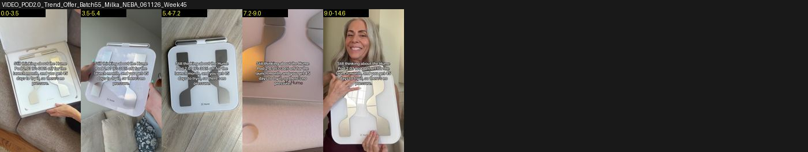

# VIDEO_POD2.0_Trend_Offer_Batch55_Milka_NEBA_061126_Week45

Master: `VIDEO_POD2.0_Trend_Offer_Batch55_Milka_NEBA_061126_Week45_Hook1_9x16.mp4` · 14.6s · 1080x1920

**Pacing:** 5 shots · avg 2.927s · median 1.868s · 2.73 cuts/10s · first cut 3.537s · None wpm · talk ratio 0.08 · cuts on word start 0.0% · cuts in speech gaps 100.0%
**Audio:** {'I_lufs': -14.1, 'LRA': 5.2, 'true_peak_db': -4.1} · BPM≈136.0 · music {'speech_rms_db': -24.5, 'pause_seconds': 12.7, 'pause_rms_db': -16.5, 'bed_minus_voice_db': 8.0, 'music_bed_likely': True} · cuts with SFX/transient 75.0%

**Captions:** 26 cards · 1.0 words/card (median) · y≈0.507 of frame height · text height≈0.0304 · colours {'white': 26} · cards crossing a cut: 7
**Headlines:** XHume (10.0–10.0s, white)

**Hook (0–3s) spoken:** And I don't know
**Hook on-screen:** Hume / HumoPod2.0 / K.Hume / Pod2.0?It's30%offforthe / Stil thinking about the Hume / Still thinking about the Hume / XHume / days to try it, so there's no / launch month, and you get 45 / pressure, / pressure.
**CTA (last 5s):**  · on-screen: Pod2.0?It's30%offforthe / Still thinkingabout the Hume / XHume / days to try it, so there's no / launch month, and you get 45 / pressure,

## Beat sheet

| # | in–out (s) | dur | transition | spoken | on-screen text |
|---|---|---|---|---|---|
| 1 | 0.00–3.54 | 3.54 |  | And I don't know | Still thinking about the Hume / Pod2.0?It's30%offforthe / launch month, and you get 45 / days to try it, so there's no / pressure, / HumoPod2.0 |
| 2 | 3.54–5.41 | 1.87 | cut +SFX hit |  | Pod2.0?It's30%offforthe / launch month, and you get 45 / days to try it, so there's no / XHume / Stil thinking about the Hume / pressure. |
| 3 | 5.41–7.21 | 1.8 | cut +SFX hit |  | Pod2.0?It's30%offforthe / launch month, and you get 45 / days to try it, so there's no / XHume / Still thinking about the Hume / pressure. |
| 4 | 7.21–8.98 | 1.77 | cut |  | Pod2.0?It's30%offforthe / launch month, and you get 45 / days to try it, so there's no / Still thinking about the Hume / pressure. / Hume |
| 5 | 8.98–14.63 | 5.66 | cut +SFX hit |  | Pod2.0?It's30%offforthe / launch month, and you get 45 / days to try it, so there's no / Stil thinking about the Hume / pressure, / Still thinkingabout the Hume |

## Hook variants

| hook | file | dur | first cut | spoken 0–3s | on-screen 0–3s |
|---|---|---|---|---|---|
| 1 | `_Trend_Offer_Batch55_Milka_NEBA_061126_Week45_Hook1_9x16.mp4` | 14.6 | 3.537 | And I don't know | Hume / HumoPod2.0 / K.Hume / Pod2.0?It's30%offforthe / Stil thinking about the Hume / Still thinking about the Hume / XHume / days to try it, so there's no |
| 2 | `_Trend_Offer_Batch55_Milka_NEBA_061126_Week45_Hook2_9x16.mp4` | 14.6 | 5.405 |  |  |
| 3 | `_Trend_Offer_Batch55_Milka_NEBA_061126_Week45_Hook3_9x16.mp4` | 14.6 | 8.876 |  |  |

## Full transcript

And I don't know