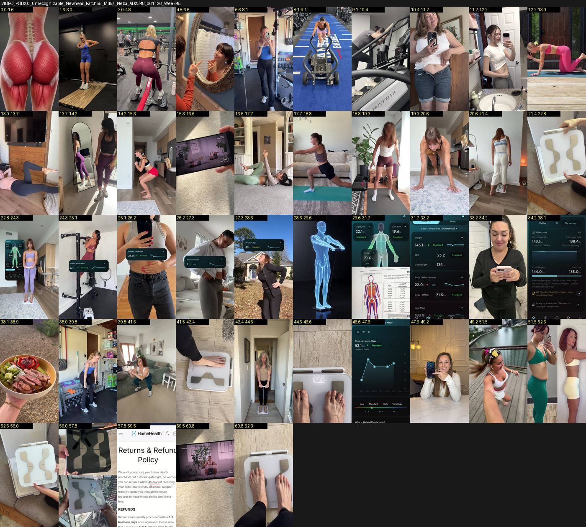

# VIDEO_POD2.0_Unrecognizable_NewYear_Batch55_Milka_Neba_AD2348_061126_Week45

Master: `VIDEO_POD2.0_Unrecognizable_NewYear_Batch55_Milka_Neba_AD2348_061126_Week45_9X16_HOOK1.mp4` · 62.3s · 1080x1920

**Pacing:** 45 shots · avg 1.385s · median 1.267s · 7.06 cuts/10s · first cut 1.633s · 191.0 wpm · talk ratio 0.94 · cuts on word start 84.1% · cuts in speech gaps 72.7%
**Audio:** {'I_lufs': -22.6, 'LRA': 1.3, 'true_peak_db': -8.8} · BPM≈129.2 · music {'speech_rms_db': -26.3, 'pause_seconds': 1.2, 'pause_rms_db': -25.7, 'bed_minus_voice_db': 0.6, 'music_bed_likely': True} · cuts with SFX/transient 65.9%

**Captions:** 121 cards · 1 words/card (median) · y≈0.666 of frame height · text height≈0.0234 · colours {'white': 90, 'green': 1, 'dark/other': 30} · cards crossing a cut: 1
Highlighted: Standard
**Headlines:** MATRIX (9.0–10.0s, white) | UPNEXT (16.0–16.0s, white) | Seal Jacks (16.0–16.0s, white) | 4.6bs (24.0–24.0s, white) | Metabolic Age (28.0–28.0s, white) | Standard (28.0–28.0s, yellow) | HumePod (30.0–32.0s, dark/other) | Connected (30.0–32.0s, green)

**Hook (0–3s) spoken:** If you start scanning by Monday, in the next couple of months, you'll
**Hook on-screen:** 
**CTA (last 5s):** 45 days to try it. Tap to join the challenge and start with your first scan. · on-screen: HalfBu / Move It To Lose It / Policy / REFUNDS / Refundsaretypicallyprocessedwithin5-7 / Returns & Refuno / SET2 / Squats / Wewantyou to loveyour Hume Health / X HumeHealth" / X HumeHealth"g / XHume

## Beat sheet

| # | in–out (s) | dur | transition | spoken | on-screen text |
|---|---|---|---|---|---|
| 1 | 0.00–1.63 | 1.63 |  | If you start scanning by Monday, |  |
| 2 | 1.63–2.97 | 1.33 | cut | in the next couple of months, |  |
| 3 | 2.97–4.80 | 1.83 | cut | you'll be unrecognizable. |  |
| 4 | 4.80–6.57 | 1.77 | cut +SFX hit | Every January, you say, |  |
| 5 | 6.57–8.13 | 1.57 | cut +SFX hit | this is your year. |  |
| 6 | 8.13–9.10 | 0.97 | cut +SFX hit | You start strong and | MATRIX (HEADLINE) |
| 7 | 9.10–10.37 | 1.27 | cut | by February, | MATRIX (HEADLINE) |
| 8 | 10.37–11.17 | 0.8 | cut | you're not sure if | MATRIX (HEADLINE) |
| 9 | 11.17–12.20 | 1.03 | cut | anything worked. |  |
| 10 | 12.20–12.97 | 0.77 | cut | This year, |  |
| 11 | 12.97–13.67 | 0.7 | cut | let's start differently. |  |
| 12 | 13.67–14.23 | 0.57 | cut +SFX hit |  |  |
| 13 | 14.23–15.27 | 1.03 | cut +SFX hit | Monday, we start the |  |
| 14 | 15.27–16.57 | 1.3 | cut +SFX hit | 30 -day challenge. | UPNEXT (HEADLINE) / Seal Jacks (HEADLINE) / :11 / SETI |
| 15 | 16.57–17.67 | 1.1 | cut +SFX hit | Just 15 minutes of |  |
| 16 | 17.67–18.77 | 1.1 | cut +SFX hit | movement a day, |  |
| 17 | 18.77–19.30 | 0.53 | cut +SFX hit | that's it. |  |
| 18 | 19.30–20.57 | 1.27 | cut +SFX hit | But before day one, |  |
| 19 | 20.57–21.37 | 0.8 | cut | you scan. |  |
| 20 | 21.37–22.83 | 1.47 | cut +SFX hit | The HumePod 2 .0 shows | XHume |
| 21 | 22.83–24.33 | 1.5 | cut | you where you're starting. | 14.3m / 4.6bs (HEADLINE) / 40.4ms / 14.3 / 14.5ms |
| 22 | 24.33–25.13 | 0.8 | cut +SFX hit | Your muscle, | 4.6bs (HEADLINE) / 40.4ms / 14.3 / 14.5ms / 28.0%+ / Standard [green] |
| 23 | 25.13–26.20 | 1.07 | cut +SFX hit | your body fat, | 28.0%+ / Standard [green] |
| 24 | 26.20–27.30 | 1.1 | cut +SFX hit | your visceral fat, | Visceral Fat Index |
| 25 | 27.30–28.57 | 1.27 | cut +SFX hit | and your metabolic age in | Visceral Fat Index / Metabolic Age (HEADLINE) / Standard [yellow] (HEADLINE) |
| 26 | 28.57–29.60 | 1.03 | cut | 30 seconds. It's |  |
| 27 | 29.60–31.70 | 2.1 | cut +SFX hit | 99 % DEXA accurate, | HumePod (HEADLINE) / Connected [green] (HEADLINE) / RightArm (HEADLINE) / LeftArm (HEADLINE) / 19.6% (HEADLINE) / 22.1% (HEADLINE) |
| 28 | 31.70–33.17 | 1.47 | cut +SFX hit | so when your numbers move, | HumePod (HEADLINE) / Connected [green] (HEADLINE) / Standard [green] (HEADLINE) / Body (HEADLINE) / Hume [blue] (HEADLINE) / BodyCompositionFundamentals (HEADLINE) |
| 29 | 33.17–34.20 | 1.03 | cut +SFX hit | you know it's real. | Pro.FActivelntelligence (HEADLINE) / Unlockreal-timeinsightsandtimely [blue] (HEADLINE) / recommendationspoweredby (HEADLINE) / continuousmonitoring (HEADLINE) / ActiveIntelligence / Default |
| 30 | 34.20–38.13 | 3.93 | cut | Then HumeProf AI Insights tell you exactly what to change, | Pro.FActivelntelligence (HEADLINE) / Unlockreal-timeinsightsandtimely [blue] (HEADLINE) / recommendationspoweredby (HEADLINE) / continuousmonitoring (HEADLINE) / ActiveIntelligence / Default |
| 31 | 38.13–38.93 | 0.8 | cut +SFX hit | protein, |  |
| 32 | 38.93–39.80 | 0.87 | cut | lifting days, |  |
| 33 | 39.80–41.50 | 1.7 | cut | all based on your own body. |  |
| 34 | 41.50–42.37 | 0.87 | cut +SFX hit | You re -scan every |  |
| 35 | 42.37–44.57 | 2.2 | cut +SFX hit | couple of weeks and keep adjusting, |  |
| 36 | 44.57–46.60 | 2.03 | cut +SFX hit | because even if the scale doesn't move, | 1265 / 1250 (HEADLINE) |
| 37 | 46.60–47.60 | 1.0 | cut | your muscle might, | SkeletalMuscleMass (HEADLINE) / 52.1ibs+ (HEADLINE) / Standard [green] (HEADLINE) / Updated:Today (HEADLINE) / 43 / 18/11 |
| 38 | 47.60–49.20 | 1.6 | cut +SFX hit | and you'll finally see it. |  |
| 39 | 49.20–51.50 | 2.3 | cut +SFX hit | In 30 days, you won't just feel it, |  |
| 40 | 51.50–52.60 | 1.1 | cut +SFX hit | you'll have the proof. The |  |
| 41 | 52.60–55.97 | 3.37 | cut +SFX hit | Hume Pod 2 .0 is 30 % off right now, | XHume |
| 42 | 55.97–57.80 | 1.83 | cut +SFX hit | just $249 with | XHume / Hume |
| 43 | 57.80–59.47 | 1.67 | cut | 45 days to try it. | X HumeHealth"g (HEADLINE) / Returns & Refuno (HEADLINE) / Policy (HEADLINE) / Wewantyou to loveyour Hume Health / purchase! But if it's not quite right, no worrie / youcan return itwithin45daysofreceiving |
| 44 | 59.47–60.77 | 1.3 | cut +SFX hit | Tap to join the challenge and | Returns & Refuno (HEADLINE) / Policy (HEADLINE) / Wewantyou to loveyour Hume Health / purchase! But if it's not quite right, no worrie / youcan return itwithin45daysofreceiving / your order.Ourfriendly CustomerSupport |
| 45 | 60.77–62.32 | 1.55 | cut +SFX hit | start with your first scan. | hme / XHume |

## Hook variants

| hook | file | dur | first cut | spoken 0–3s | on-screen 0–3s |
|---|---|---|---|---|---|
| 1 | `wYear_Batch55_Milka_Neba_AD2348_061126_Week45_9X16_HOOK1.mp4` | 62.3 | 1.633 | If you start scanning by Monday, in the next couple of months, you'll |  |
| 1 | `wYear_Batch55_Milka_Neba_AD2348_061126_Week45_9X16_HOOK1.mp4` | 62.3 | 1.633 |  |  |
| 2 | `wYear_Batch55_Milka_Neba_AD2348_061126_Week45_9X16_HOOK2.mp4` | 63.2 | 1.233 |  |  |
| 2 | `wYear_Batch55_Milka_Neba_AD2348_061126_Week45_9X16_HOOK2.mp4` | 63.2 | 1.233 |  |  |
| 3 | `wYear_Batch55_Milka_Neba_AD2348_061126_Week45_9X16_HOOK3.mp4` | 62.9 | 2.167 |  |  |
| 3 | `wYear_Batch55_Milka_Neba_AD2348_061126_Week45_9X16_HOOK3.mp4` | 62.9 | 2.167 |  |  |
| 4 | `wYear_Batch55_Milka_Neba_AD2348_061126_Week45_9X16_HOOK4.mp4` | 63.3 | 0.867 |  |  |
| 4 | `wYear_Batch55_Milka_Neba_AD2348_061126_Week45_9X16_HOOK4.mp4` | 63.3 | 0.867 |  |  |
| 5 | `wYear_Batch55_Milka_Neba_AD2348_061126_Week45_9X16_HOOK5.mp4` | 62.1 | 0.733 |  |  |
| 5 | `wYear_Batch55_Milka_Neba_AD2348_061126_Week45_9X16_HOOK5.mp4` | 62.1 | 0.733 |  |  |

## Full transcript

If you start scanning by Monday, in the next couple of months, you'll be unrecognizable. Every January, you say, this is your year. You start strong and by February, you're not sure if anything worked. This year, let's start differently. Monday, we start the 30-day challenge. Just 15 minutes of movement a day, that's it. But before day one, you scan. The HumePod 2.0 shows you where you're starting. Your muscle, your body fat, your visceral fat, and your metabolic age in 30 seconds. It's 99% DEXA accurate, so when your numbers move, you know it's real. Then HumeProf AI Insights tell you exactly what to change, protein, lifting days, all based on your own body. You re-scan every couple of weeks and keep adjusting, because even if the scale doesn't move, your muscle might, and you'll finally see it. In 30 days, you won't just feel it, you'll have the proof. The Hume Pod 2.0 is 30% off right now, just $249 with 45 days to try it. Tap to join the challenge and start with your first scan.