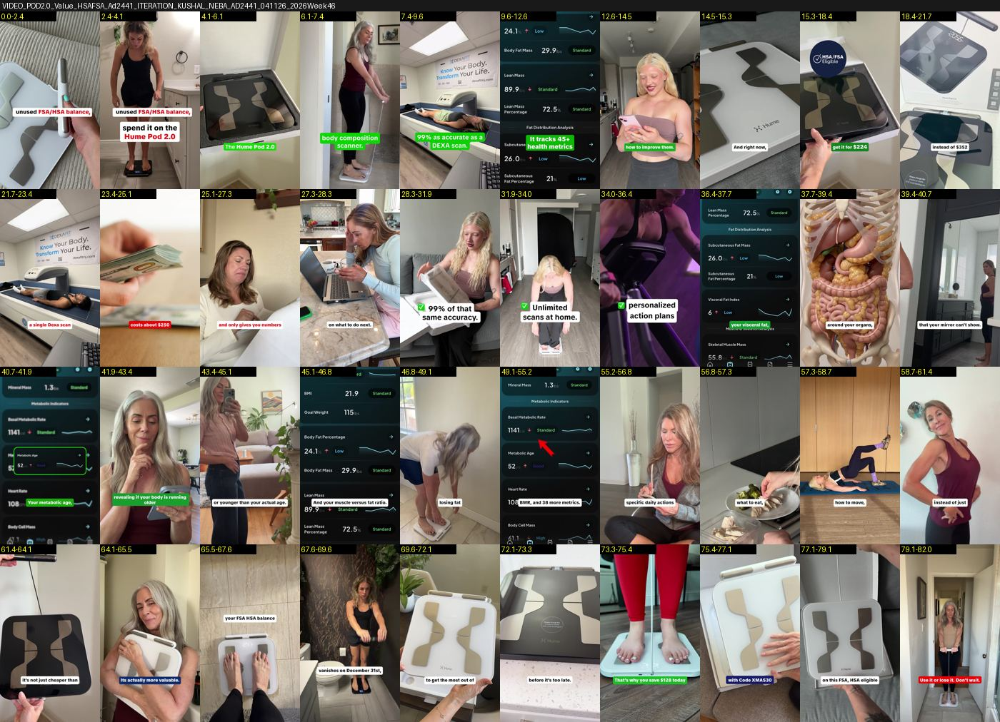

# VIDEO_POD2.0_Value_HSAFSA_Ad2441_ITERATION_KUSHAL_NEBA_AD2441_041126_2026Week46

Master: `VIDEO_POD2.0_Value_HSAFSA_Ad2441_ITERATION_KUSHAL_NEBA_AD2441_041126_2026Week46_9x16_hook1.mp4` · 82.0s · 1080x1920

**Pacing:** 40 shots · avg 2.049s · median 1.92s · 4.76 cuts/10s · first cut 2.36s · 217.0 wpm · talk ratio 0.96 · cuts on word start 89.7% · cuts in speech gaps 64.1%
**Audio:** {'I_lufs': -19.3, 'LRA': 2.0, 'true_peak_db': -3.1} · BPM≈123.0 · music {'speech_rms_db': -22.4, 'pause_seconds': 0.5, 'pause_rms_db': -20.6, 'bed_minus_voice_db': 1.8, 'music_bed_likely': True} · cuts with SFX/transient 82.1%

**Hook (0–3s) spoken:** If you have unused FSA -HSA balance, spend it on the Hume
**Hook on-screen:** 
**CTA (last 5s):** this FSA -HSA -Eligible Hume Pod 2 .0. Use it or lose it. Don't wait. Thanks for watching. I'll see you in the next video. · on-screen: 

## Beat sheet

| # | in–out (s) | dur | transition | spoken | on-screen text |
|---|---|---|---|---|---|
| 1 | 0.00–2.36 | 2.36 |  | If you have unused FSA -HSA balance, |  |
| 2 | 2.36–4.08 | 1.72 | cut | spend it on the Hume Pod 2 .0. |  |
| 3 | 4.08–6.08 | 2.0 | cut +SFX hit | The Hume Pod 2 .0 is your personal body |  |
| 4 | 6.08–7.40 | 1.32 | cut +SFX hit | composition scanner. |  |
| 5 | 7.40–9.56 | 2.16 | cut +SFX hit | 99 % is accurate as a DEXA scan, |  |
| 6 | 9.56–12.60 | 3.04 | cut +SFX hit | and it tracks 45 plus health metrics in 30 seconds and |  |
| 7 | 12.60–14.48 | 1.88 | cut +SFX hit | tells you exactly how to improve them. |  |
| 8 | 14.48–15.28 | 0.8 | cut +SFX hit | And right now, |  |
| 9 | 15.28–18.40 | 3.12 | cut +SFX hit | FSA -HSA holders get it for $224 instead |  |
| 10 | 18.40–21.72 | 3.32 | cut | of $352 with code XMIS30. |  |
| 11 | 21.72–23.40 | 1.68 | cut +SFX hit | Think about it, a single DEXA scan costs |  |
| 12 | 23.40–25.12 | 1.72 | cut | about $250 and |  |
| 13 | 25.12–27.28 | 2.16 | cut +SFX hit | only gives you numbers with zero guidance on |  |
| 14 | 27.28–28.32 | 1.04 | cut +SFX hit | what to do next. The |  |
| 15 | 28.32–31.88 | 3.56 | cut +SFX hit | Pod 2 .0 gives you 99 % of that same accuracy. |  |
| 16 | 31.88–34.04 | 2.16 | cut | Unlimited scans at home whenever you want, and |  |
| 17 | 34.04–36.40 | 2.36 | cut +SFX hit | personalized action plans based on your data. |  |
| 18 | 36.40–37.72 | 1.32 | cut +SFX hit | It measures your visceral fat, |  |
| 19 | 37.72–39.40 | 1.68 | cut +SFX hit | the dangerous fat around your organs, |  |
| 20 | 39.40–40.72 | 1.32 | cut +SFX hit | that your mirror can't show, |  |
| 21 | 40.72–41.92 | 1.2 | cut +SFX hit | your metabolic age, revealing |  |
| 22 | 41.92–43.36 | 1.44 | cut +SFX hit | if your body is running older |  |
| 23 | 43.36–45.08 | 1.72 | cut +SFX hit | or younger than your actual age, |  |
| 24 | 45.08–46.80 | 1.72 | cut +SFX hit | and your muscle versus fat ratio. |  |
| 25 | 46.80–49.12 | 2.32 | cut +SFX hit | So you know if you're losing fat or just losing muscle. |  |
| 26 | 49.12–55.20 | 6.08 | cut +SFX hit | Plus bone density, hydration, protein levels, BMR, and 38 more metrics. The AI in the app gives you specific |  |
| 27 | 55.20–56.76 | 1.56 | cut | daily actions. What |  |
| 28 | 56.76–57.28 | 0.52 | cut +SFX hit | to eat, |  |
| 29 | 57.28–58.68 | 1.4 | cut +SFX hit | how to move, what to change, |  |
| 30 | 58.68–61.36 | 2.68 | cut +SFX hit | so you actually improve instead of just tracking data. That's |  |
| 31 | 61.36–64.12 | 2.76 | cut +SFX hit | why people say it's not just cheaper than DEXA scans, it's |  |
| 32 | 64.12–65.52 | 1.4 | cut +SFX hit | actually more valuable. |  |
| 33 | 65.52–67.64 | 2.12 | cut +SFX hit | But remember, your FSA -HSA balance |  |
| 34 | 67.64–69.60 | 1.96 | cut +SFX hit | vanishes on December 31st. |  |
| 35 | 69.60–72.12 | 2.52 | cut +SFX hit | And Hume wants you to get the most out of your pre -tax health funds |  |
| 36 | 72.12–73.32 | 1.2 | cut | before it's too late. That's |  |
| 37 | 73.32–75.44 | 2.12 | cut +SFX hit | why you save $128 today |  |
| 38 | 75.44–77.08 | 1.64 | cut | with code XMIS30 on |  |
| 39 | 77.08–79.12 | 2.04 | cut +SFX hit | this FSA -HSA -Eligible Hume |  |
| 40 | 79.12–81.96 | 2.84 | cut +SFX hit | Pod 2 .0. Use it or lose it. Don't wait. Thanks for watching. I'll see you in the next video. |  |

## Full transcript

If you have unused FSA-HSA balance, spend it on the Hume Pod 2.0. The Hume Pod 2.0 is your personal body composition scanner. 99% is accurate as a DEXA scan, and it tracks 45 plus health metrics in 30 seconds and tells you exactly how to improve them. And right now, FSA-HSA holders get it for $224 instead of $352 with code XMIS30. Think about it, a single DEXA scan costs about $250 and only gives you numbers with zero guidance on what to do next. The Pod 2.0 gives you 99% of that same accuracy. Unlimited scans at home whenever you want, and personalized action plans based on your data. It measures your visceral fat, the dangerous fat around your organs, that your mirror can't show, your metabolic age, revealing if your body is running older or younger than your actual age, and your muscle versus fat ratio. So you know if you're losing fat or just losing muscle. Plus bone density, hydration, protein levels, BMR, and 38 more metrics. The AI in the app gives you specific daily actions. What to eat, how to move, what to change, so you actually improve instead of just tracking data. That's why people say it's not just cheaper than DEXA scans, it's actually more valuable. But remember, your FSA-HSA balance vanishes on December 31st. And Hume wants you to get the most out of your pre-tax health funds before it's too late. That's why you save $128 today with code XMIS30 on this FSA-HSA-Eligible Hume Pod 2.0. Use it or lose it. Don't wait. Thanks for watching. I'll see you in the next video.