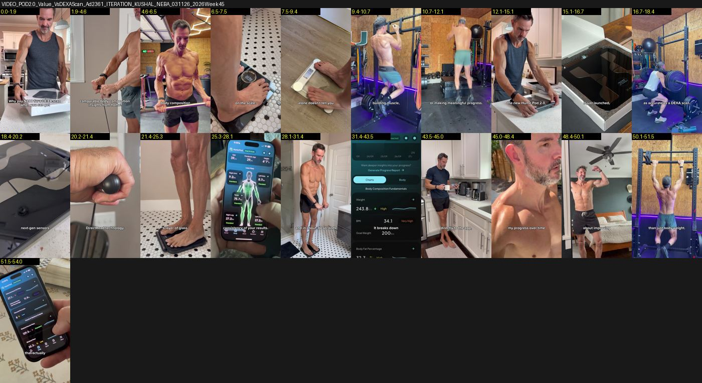

# VIDEO_POD2.0_Value_VsDEXAScan_Ad2361_ITERATION_KUSHAL_NEBA_031126_2026Week45

Master: `VIDEO_POD2.0_Value_VsDEXAScan_Ad2361_ITERATION_KUSHAL_NEBA_031126_2026Week45_Hook1_9x16.mp4` · 54.0s · 1080x1920

**Pacing:** 21 shots · avg 2.571s · median 1.834s · 3.7 cuts/10s · first cut 1.867s · 244.0 wpm · talk ratio 0.95 · cuts on word start 80.0% · cuts in speech gaps 60.0%
**Audio:** {'I_lufs': -19.8, 'LRA': 2.8, 'true_peak_db': -2.3} · BPM≈129.2 · music {'speech_rms_db': -22.9, 'pause_seconds': 0.0} · cuts with SFX/transient 65.0%

**Captions:** 190 cards · 1.0 words/card (median) · y≈0.734 of frame height · text height≈0.0269 · colours {'white': 125, 'yellow': 2, 'red': 4, 'dark/other': 53, 'blue': 6} · cards crossing a cut: 2
Highlighted: H218016, on the scale., touch your skin directly,, Body, andmetabolicage., Charts, Lean(lbs), Lean(bs), soIcan track, my progress over time, 799, Viecsrgl Fatindes
**Headlines:** 1899 (7.0–7.0s, white) | 98881 (8.0–8.0s, white) | 6:256 (26.0–26.0s, blue) | HumePod (26.0–27.0s, blue) | StepOnScale (26.0–27.0s, blue) | Age (26.0–26.0s, blue) | MetabolicAge (26.0–26.0s, blue) | 39yrs (26.0–26.0s, blue)

**Hook (0–3s) spoken:** Why pay $200 for a dexa scan when you can get comparable body
**Hook on-screen:** Why pay $200 for a DEXAscan / Why pay $20O for a DEXA scan / comparable body composition / insights from home? / when you can get
**CTA (last 5s):** improving your health, you need more than just body weight. You need data that actually tells the full story. · on-screen: 11.9% / 129.3bs / 12:30本 / 139:3198 / 27.1个 / BSRS MiRSFsI / Band / CHumePod / Fat Percentage / FatDiatribution Analysis / FatPercentags / More

## Beat sheet

| # | in–out (s) | dur | transition | spoken | on-screen text |
|---|---|---|---|---|---|
| 1 | 0.00–1.87 | 1.87 |  | Why pay $200 for a dexa scan when | Why pay $200 for a DEXAscan / when you can get / Why pay $20O for a DEXA scan / Why pay $200 for a DEXAscan |
| 2 | 1.87–4.57 | 2.7 | cut | you can get comparable body composition insights from home? | when you can get / Why pay $200 for a DEXAscan / comparable body composition / insights from home? / I'mfar more |
| 3 | 4.57–6.47 | 1.9 | cut +SFX hit | I'm far more interested in body composition than | I'mfar more / interestedin / bodycomposition / H218016 [yellow] |
| 4 | 6.47–7.53 | 1.07 | cut +SFX hit | the number on the scale. | bodycomposition / H218016 [yellow] / 1899 (HEADLINE) / on the scale. [red] |
| 5 | 7.53–9.37 | 1.83 | cut +SFX hit | Your weight alone doesn't tell you whether you're losing body | 98881 (HEADLINE) / alone doesn't tell you / whether you're losing |
| 6 | 9.37–10.73 | 1.37 | cut | fat, building muscle, or | whether you're losing / ATNESS / building muscle, |
| 7 | 10.73–12.13 | 1.4 | cut | making meaningful progress. | or making meaningful progress. / That's why I recently |
| 8 | 12.13–15.13 | 3.0 | cut +SFX hit | That's why I recently started using the new HumePod 2 .0. | That's why I recently / TODAY / ISA / GOOD DAY / started using / DDAY |
| 9 | 15.13–16.73 | 1.6 | cut +SFX hit | It just launched, and it's 99 % | It just launched, / XHume / and it's 99% |
| 10 | 16.73–18.37 | 1.63 | cut | as accurate as a dexa scan. | as accurate as a DEXA scan. |
| 11 | 18.37–20.17 | 1.8 | cut +SFX hit | It comes with next -gen sensors that use direct | as accurate as a DEXA scan. / next-gen sensors / DirectRead technology |
| 12 | 20.17–21.40 | 1.23 | cut +SFX hit | read technology. Instead | DirectRead technology / DirectRead technology. |
| 13 | 21.40–25.27 | 3.87 | cut +SFX hit | of reading your body through a layer of glass, the sensors now touch your skin directly, | DirectRead technology. / your body through / a layer of glass, / touch your skin directly, [red] |
| 14 | 25.27–28.13 | 2.87 | cut +SFX hit | which increases the accuracy and consistency of your results. I | touch your skin directly, [red] / 6:256 [blue] (HEADLINE) / HumePod [blue] (HEADLINE) / StepOnScale [blue] (HEADLINE) / Age [blue] (HEADLINE) / MetabolicAge [blue] (HEADLINE) |
| 15 | 28.13–31.37 | 3.23 | cut +SFX hit | step on, hold the handles, and in about 30 seconds it gives me over 45 | Istep.on, / hold the handles, / andinabout30seconds / itgivesme over |
| 16 | 31.37–43.53 | 12.17 | cut | health metrics. Body fat percentage, muscle mass, visceral fat, hydration, and metabolic age. It breaks down your entire body into five parts and shows you how much muscle and fat you have separately in each leg, arm, and your torso. | itgivesme over / Connected [green] (HEADLINE) / HumePod(100%) (HEADLINE) / 34.1 (HEADLINE) / Very High (HEADLINE) / BMI (HEADLINE) |
| 17 | 43.53–45.03 | 1.5 | cut +SFX hit | Everything sinks directly to the app, | directlyto the app, / soIcan track [red] |
| 18 | 45.03–48.43 | 3.4 | cut +SFX hit | so I can track my progress over time instead of relying on a single weigh -in. | soIcan track [red] / my progress over time [red] / instead of relying / 799 [blue] / on a single weigh-in |
| 19 | 48.43–50.07 | 1.63 | cut +SFX hit | If you're serious about improving your health, | 799 [blue] / on a single weigh-in / about improving / you need more |
| 20 | 50.07–51.53 | 1.47 | cut | you need more than just body weight. | you need more / than just body weight. |
| 21 | 51.53–53.99 | 2.45 | cut | You need data that actually tells the full story. | StepOn Scelk [blue] (HEADLINE) / FatDiatribution Analysis [blue] (HEADLINE) / 11.9% / FatPercentags / Muscle&Ske / Skeletal MuscleMass (HEADLINE) |

## Hook variants

| hook | file | dur | first cut | spoken 0–3s | on-screen 0–3s |
|---|---|---|---|---|---|
| 1 | `d2361_ITERATION_KUSHAL_NEBA_031126_2026Week45_Hook1_9x16.mp4` | 54.0 | 1.867 | Why pay $200 for a dexa scan when you can get comparable body | Why pay $200 for a DEXAscan / Why pay $20O for a DEXA scan / comparable body composition / insights from home? / when you can get |
| 2 | `d2361_ITERATION_KUSHAL_NEBA_031126_2026Week45_Hook2_9x16.mp4` | 52.2 | 1.433 |  |  |
| 3 | `d2361_ITERATION_KUSHAL_NEBA_031126_2026Week45_Hook3_9x16.mp4` | 52.2 | 1.533 |  |  |

## Full transcript

Why pay $200 for a dexa scan when you can get comparable body composition insights from home? I'm far more interested in body composition than the number on the scale. Your weight alone doesn't tell you whether you're losing body fat, building muscle, or making meaningful progress. That's why I recently started using the new HumePod 2.0. It just launched, and it's 99% as accurate as a dexa scan. It comes with next-gen sensors that use direct read technology. Instead of reading your body through a layer of glass, the sensors now touch your skin directly, which increases the accuracy and consistency of your results. I step on, hold the handles, and in about 30 seconds it gives me over 45 health metrics. Body fat percentage, muscle mass, visceral fat, hydration, and metabolic age. It breaks down your entire body into five parts and shows you how much muscle and fat you have separately in each leg, arm, and your torso. Everything sinks directly to the app, so I can track my progress over time instead of relying on a single weigh-in. If you're serious about improving your health, you need more than just body weight. You need data that actually tells the full story.