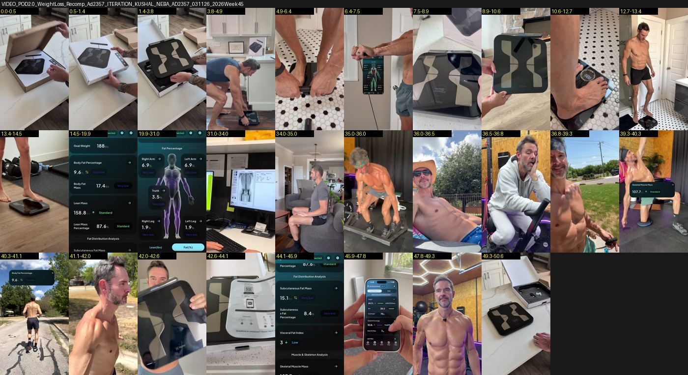

# VIDEO_POD2.0_WeightLoss_Recomp_Ad2357_ITERATION_KUSHAL_NEBA_AD2357_031126_2026Week45

Master: `VIDEO_POD2.0_WeightLoss_Recomp_Ad2357_ITERATION_KUSHAL_NEBA_AD2357_031126_2026Week45_9x16_HOOK1.mp4` · 50.6s · 1080x1920

**Pacing:** 28 shots · avg 1.806s · median 1.187s · 5.34 cuts/10s · first cut 0.533s · 254.0 wpm · talk ratio 0.89 · cuts on word start 92.6% · cuts in speech gaps 63.0%
**Audio:** {'I_lufs': -19.6, 'LRA': 2.2, 'true_peak_db': -3.9} · BPM≈129.2 · music {'speech_rms_db': -23.1, 'pause_seconds': 0.0} · cuts with SFX/transient 63.0%

**Captions:** 99 cards · 1 words/card (median) · y≈0.638 of frame height · text height≈0.0258 · colours {'dark/other': 28, 'white': 67, 'blue': 3, 'red': 1} · cards crossing a cut: 0
Highlighted: Lean(Ibs), Fat(%), Low, Low
**Headlines:** 2056 (0.5–0.5s, white) | HumePod2.0 (8.0–8.0s, white) | 1788 (11.0–11.0s, white) | 1838 (12.0–12.0s, white) | Hume... (97%) (15.0–17.0s, white) | Connected (15.0–17.0s, green) | Weight (15.0–15.0s, white) | 181.2 (15.0–15.0s, white)

**Hook (0–3s) spoken:** My new HumePod 2 .0 just arrived in the mail today, and this is
**Hook on-screen:** 2056
**CTA (last 5s):** and I can track everything from my phone. If you're serious about your fitness, you need one of these. · on-screen: 10.8% / 10.8%+ / 20.2 / 53.9kg / 64.3g* / 64.3kg* / 70kg / XHune

## Beat sheet

| # | in–out (s) | dur | transition | spoken | on-screen text |
|---|---|---|---|---|---|
| 1 | 0.00–0.53 | 0.53 |  | My new HumePod | 2056 (HEADLINE) |
| 2 | 0.53–1.37 | 0.83 | cut +SFX hit | 2 .0 just | 2056 (HEADLINE) |
| 3 | 1.37–3.83 | 2.47 | cut +SFX hit | arrived in the mail today, and this is so exciting. |  |
| 4 | 3.83–4.93 | 1.1 | cut +SFX hit | Let me show you how it works. |  |
| 5 | 4.93–6.43 | 1.5 | cut | So I step on, hold the handles, |  |
| 6 | 6.43–7.47 | 1.03 | cut | and boom. | 50m / 58m |
| 7 | 7.47–8.90 | 1.43 | cut +SFX hit | It comes with next -gen sensors that | 50m / 58m / HumePod2.0 (HEADLINE) / Please chargefor / Sminsermore / ifit'snotturning on |
| 8 | 8.90–10.63 | 1.73 | cut +SFX hit | use direct read technology. Instead |  |
| 9 | 10.63–12.70 | 2.07 | cut +SFX hit | of reading my body through a layer of glass, | 1788 (HEADLINE) / 1838 (HEADLINE) |
| 10 | 12.70–13.40 | 0.7 | cut +SFX hit | the sensors touch |  |
| 11 | 13.40–14.53 | 1.13 | cut | my skin directly, |  |
| 12 | 14.53–19.87 | 5.33 | cut | which increases the accuracy and consistency of my results. In 30 seconds, it measures my body composition. | Hume... (97%) (HEADLINE) / Connected [green] (HEADLINE) / Weight (HEADLINE) / 181.2 (HEADLINE) / Standard (HEADLINE) / 22.7 (HEADLINE) |
| 13 | 19.87–31.03 | 11.17 | cut +SFX hit | It tells me my muscle mass, body fat percentage, even my metabolic rate. It breaks down my entire body into five parts and shows me how much muscle and fat I have separately in each leg, arm, and my torso. | Hume... (97%) (HEADLINE) / Connected [green] (HEADLINE) / LeftLeg (HEADLINE) / Right Leg (HEADLINE) / 29.3ibs (HEADLINE) / 28.0ibs (HEADLINE) |
| 14 | 31.03–33.97 | 2.93 | cut +SFX hit | And it's 99 % as accurate as a DEXA scan. |  |
| 15 | 33.97–35.00 | 1.03 | cut +SFX hit | So I never have to guess if |  |
| 16 | 35.00–35.97 | 0.97 | cut | my workout program is |  |
| 17 | 35.97–36.47 | 0.5 | cut | working or |  |
| 18 | 36.47–36.83 | 0.37 | cut | not. |  |
| 19 | 36.83–39.33 | 2.5 | cut +SFX hit | Because health isn't just about weight, it's about balance. |  |
| 20 | 39.33–40.27 | 0.93 | cut +SFX hit | Getting the muscle up and | 107.7bs+ / Standard |
| 21 | 40.27–41.13 | 0.87 | cut +SFX hit | fat down, | 107.7bs+ / Standard |
| 22 | 41.13–42.00 | 0.87 | cut | that's the goal. |  |
| 23 | 42.00–42.60 | 0.6 | cut +SFX hit | This is why I got |  |
| 24 | 42.60–44.13 | 1.53 | cut +SFX hit | HumePod 2 .0. | Questionsorconcem / Hume... (97%) (HEADLINE) / Connected [green] (HEADLINE) / 158.8bs+ (HEADLINE) / Standard (HEADLINE) / LeanMass (HEADLINE) |
| 25 | 44.13–45.90 | 1.77 | cut | Real data, real progress, | Hume... (97%) (HEADLINE) / Connected [green] (HEADLINE) / 158.8bs+ (HEADLINE) / Standard (HEADLINE) / LeanMass (HEADLINE) / 87.6% (HEADLINE) |
| 26 | 45.90–47.83 | 1.93 | cut +SFX hit | and I can track everything from my phone. | 64.3g* / 20.2 / 70kg / 10.8%+ / 64.3kg* / 10.8% |
| 27 | 47.83–49.33 | 1.5 | cut +SFX hit | If you're serious about your fitness, |  |
| 28 | 49.33–50.57 | 1.24 | cut | you need one of these. | XHune |

## Hook variants

| hook | file | dur | first cut | spoken 0–3s | on-screen 0–3s |
|---|---|---|---|---|---|
| 1 | `TERATION_KUSHAL_NEBA_AD2357_031126_2026Week45_9x16_HOOK1.mp4` | 50.6 | 0.533 | My new HumePod 2 .0 just arrived in the mail today, and this is | 2056 |
| 1 | `TERATION_KUSHAL_NEBA_AD2357_031126_2026Week45_9x16_HOOK1.mp4` | 50.6 | 0.533 |  |  |
| 2 | `TERATION_KUSHAL_NEBA_AD2357_031126_2026Week45_9x16_HOOK2.mp4` | 50.3 | 1.4 |  |  |
| 2 | `TERATION_KUSHAL_NEBA_AD2357_031126_2026Week45_9x16_HOOK2.mp4` | 50.3 | 1.4 |  |  |
| 3 | `TERATION_KUSHAL_NEBA_AD2357_031126_2026Week45_9x16_HOOK3.mp4` | 49.4 | 2.7 |  |  |
| 3 | `TERATION_KUSHAL_NEBA_AD2357_031126_2026Week45_9x16_HOOK3.mp4` | 49.4 | 2.7 |  |  |

## Full transcript

My new HumePod 2.0 just arrived in the mail today, and this is so exciting. Let me show you how it works. So I step on, hold the handles, and boom. It comes with next-gen sensors that use direct read technology. Instead of reading my body through a layer of glass, the sensors touch my skin directly, which increases the accuracy and consistency of my results. In 30 seconds, it measures my body composition. It tells me my muscle mass, body fat percentage, even my metabolic rate. It breaks down my entire body into five parts and shows me how much muscle and fat I have separately in each leg, arm, and my torso. And it's 99% as accurate as a DEXA scan. So I never have to guess if my workout program is working or not. Because health isn't just about weight, it's about balance. Getting the muscle up and fat down, that's the goal. This is why I got HumePod 2.0. Real data, real progress, and I can track everything from my phone. If you're serious about your fitness, you need one of these.