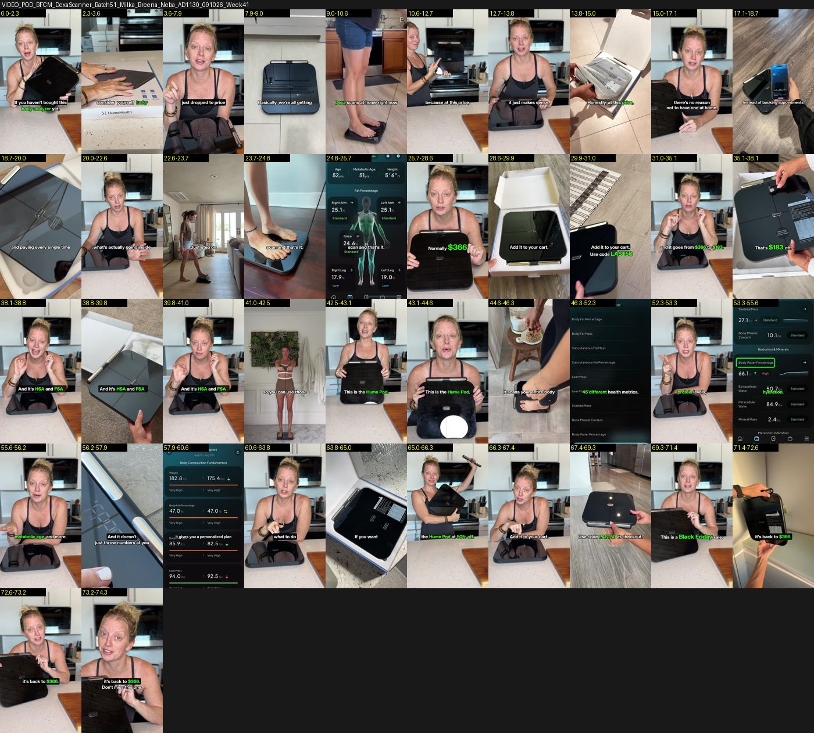

# VIDEO_POD_BFCM_DexaScanner_Batch51_Milka_Breena_Neba_AD1130_091026_Week41

Master: `VIDEO_POD_BFCM_DexaScanner_Batch51_Milka_Breena_Neba_AD1130_091026_Week41_Hook1_9x16.mp4` · 74.3s · 1080x1920

**Pacing:** 42 shots · avg 1.768s · median 1.32s · 5.52 cuts/10s · first cut 2.3s · 184.0 wpm · talk ratio 0.96 · cuts on word start 78.0% · cuts in speech gaps 61.0%
**Audio:** {'I_lufs': -18.2, 'LRA': 5.4, 'true_peak_db': 4.0} · BPM≈117.5 · music {'speech_rms_db': -23.4, 'pause_seconds': 1.6, 'pause_rms_db': -23.1, 'bed_minus_voice_db': 0.3, 'music_bed_likely': True} · cuts with SFX/transient 14.6%

**Captions:** 147 cards · 1 words/card (median) · y≈0.629 of frame height · text height≈0.0316 · colours {'white': 100, 'green': 28, 'dark/other': 17, 'blue': 1, 'other-colour': 1} · cards crossing a cut: 4
Highlighted: body analyzeryet,, consider yourself lucky, becausetheHumePod, using code LAST50., Dexa scans at home right now, Honestly, at this price,, Low, $366, UsecodeLAST50, and it goes from $366to $183., $183 off., $183, 3off., off., And it's HSA and FSA
**Headlines:** (XHume (19.0–19.0s, white) | HumePod (25.0–25.0s, white) | StepOnScale (25.0–25.0s, green) | Age (25.0–25.0s, white) | Metabolic Age (25.0–25.0s, white) | Height (25.0–25.0s, white) | 51yrs (25.0–25.0s, white) | 52yrs (25.0–25.0s, white)

**Hook (0–3s) spoken:** If you haven't bought this body analyzer yet, consider yourself
**Hook on-screen:** HumeHealth / If you haven't bought this / body analyzeryet, / consider yourself lucky
**CTA (last 5s):** is a Black Friday sale, so once it's over, it's back to $366. Don't miss this one. · on-screen: Don't miss this one. / So once it's over, / This is a Black Friday / XHume / it's back to $366. / sale.

## Beat sheet

| # | in–out (s) | dur | transition | spoken | on-screen text |
|---|---|---|---|---|---|
| 1 | 0.00–2.30 | 2.3 |  | If you haven't bought this body analyzer yet, consider | If you haven't bought this / body analyzeryet, [green] |
| 2 | 2.30–3.62 | 1.32 | cut | yourself lucky because | If you haven't bought this / body analyzeryet, [green] / consider yourself lucky [green] / HumeHealth / IND YOURHEALTH / becausetheHumePod [green] |
| 3 | 3.62–7.88 | 4.26 | cut | the Hume Pod just dropped its price using code last 50. | becausetheHumePod [green] / just dropped to price / using code LAST50. [green] |
| 4 | 7.88–9.04 | 1.16 | cut +SFX hit | Basically, we're all getting DEXA | Basically, we're all getting / Dexa scans at home right now [green] |
| 5 | 9.04–10.64 | 1.6 | cut | scans at home right now | Dexa scans at home right now [green] |
| 6 | 10.64–12.68 | 2.04 | cut | whenever we want because at this price, | whenever we want / because at this price, |
| 7 | 12.68–13.82 | 1.14 | cut | it just makes sense. | it just makes sense. |
| 8 | 13.82–14.98 | 1.16 | cut | Honestly, at this price, | Honestly, at this price, [green] |
| 9 | 14.98–17.10 | 2.12 | cut | there is no reason not to have one at home. | there's no reason / not to have one at home. / Insteadof bookingappointments |
| 10 | 17.10–18.74 | 1.64 | cut | Instead of booking appointments and | Insteadof bookingappointments |
| 11 | 18.74–19.96 | 1.22 | cut | paying every single | (XHume (HEADLINE) / and paying every single time |
| 12 | 19.96–22.60 | 2.64 | cut | time you want to know what's actually going inside your body, | and paying every single time / what's actually going inside / your body, |
| 13 | 22.60–23.74 | 1.14 | cut | just step on, scan, | Juststepon |
| 14 | 23.74–24.82 | 1.08 | cut |  | scan and that's it. |
| 15 | 24.82–25.68 | 0.86 | cut | and that's it. | scan and that's it. / HumePod (HEADLINE) / StepOnScale [green] (HEADLINE) / Age (HEADLINE) / Metabolic Age (HEADLINE) / Height (HEADLINE) |
| 16 | 25.68–28.56 | 2.88 | cut | Normally, $366. Add | $366 [green] / Normally |
| 17 | 28.56–29.86 | 1.3 | cut | it to your cart, use | Add it to your cart |
| 18 | 29.86–31.00 | 1.14 | cut | code LAST50, | Add it to your cart, / UsecodeLAST50 [green] |
| 19 | 31.00–35.14 | 4.14 | cut | and it goes from $366 to $183. | and it goes from $366to $183. [green] / XHume / $183 off. [green] / That's |
| 20 | 35.14–38.12 | 2.98 | cut | That is $183 off. | XHume / $183 off. [green] / That's / OETTINGSTARTED (HEADLINE) / Pleasechargefor / Smins ormoro |
| 21 | 38.12–38.78 | 0.66 | cut | And it's | And it's HSA and FSA [green] |
| 22 | 38.78–39.80 | 1.02 | cut | HSA and | And it's HSA and FSA [green] |
| 23 | 39.80–41.04 | 1.24 | cut | FSA approved, | And it's HSA and FSA [green] / so you can use those |
| 24 | 41.04–42.52 | 1.48 | cut | so you can use those funds as well. | so you can use those / funds as well. |
| 25 | 42.52–43.08 | 0.56 | cut | This is | This is the Hume Pod [green] |
| 26 | 43.08–44.60 | 1.52 | cut +SFX hit | the Hume Pod. | This is the Hume Pod [green] |
| 27 | 44.60–46.30 | 1.7 | cut | It scans your entire body in | It scans your entire body |
| 28 | 46.30–52.34 | 6.04 | cut | 30 seconds, giving you 45 different health metrics like muscle mass, visceral fat, | It scans your entire body / Measuring... (HEADLINE) / Measuring Adipose Tissue / Almosin30s,giving you scale [green] / 55.8 / ChartMetric (HEADLINE) |
| 29 | 52.34–53.34 | 1.0 | cut | protein levels, | Low (HEADLINE) / SkeletalMuscleMass / 118.5ibs / Standard / FatDistributionAnalysis (HEADLINE) / SubcutaneousFatMass (HEADLINE) |
| 30 | 53.34–55.58 | 2.24 | cut | hydration, metabolic age, and | protein levels, [green] / SkeletalMass (HEADLINE) / 27.1ibs (HEADLINE) / Standard (HEADLINE) / BoneMineral (HEADLINE) / 10.libs (HEADLINE) |
| 31 | 55.58–56.18 | 0.6 | cut +SFX hit | more. | And it doesn't |
| 32 | 56.18–57.90 | 1.72 | cut | And it doesn't just throw numbers at you. It | And it doesn't / justthrownumbersatyou |
| 33 | 57.90–60.60 | 2.7 | cut | gives you a personalized plan based on your data, | ProgressReport (HEADLINE) / Auglth-Aug3lth (HEADLINE) / Weight (HEADLINE) / Metabolic Age (HEADLINE) / 44yrs ≤ (HEADLINE) / 175.4ibs (HEADLINE) |
| 34 | 60.60–63.76 | 3.16 | cut +SFX hit | so you actually know what to do to hit your next goals. | So you actually know / what to do / to hit your-next goals. [green] |
| 35 | 63.76–65.00 | 1.24 | cut | If you want the Hume Pod | If you want |
| 36 | 65.00–66.32 | 1.32 | cut | at 50 % off, | the Hume Pod at 50%off. [green] |
| 37 | 66.32–67.44 | 1.12 | cut | add it to your cart, | the Hume Pod at 50%off. [green] / Add it to your cart. |
| 38 | 67.44–69.26 | 1.82 | cut | use code LASTFIFTY at checkout. | Add it to your cart. / UsecodeLAST5Oatcheckout. [green] / UsecodeLAST50at checkout. [green] |
| 39 | 69.26–71.40 | 2.14 | cut +SFX hit | This is a Black Friday sale, so once it's over, | UsecodeLAST50at checkout. [green] / This is a Black Friday [green] / sale. / So once it's over, |
| 40 | 71.40–72.62 | 1.22 | cut | it's back to $366. | So once it's over, / it's back to $366. [green] |
| 41 | 72.62–73.24 | 0.62 | cut +SFX hit |  | it's back to $366. [green] / Don't miss this one. / XHume |
| 42 | 73.24–74.26 | 1.02 | cut | Don't miss this one. | it's back to $366. [green] / Don't miss this one. / XHume |

## Hook variants

| hook | file | dur | first cut | spoken 0–3s | on-screen 0–3s |
|---|---|---|---|---|---|
| 1 | `atch51_Milka_Breena_Neba_AD1130_091026_Week41_Hook1_9x16.mp4` | 74.3 | 2.3 | If you haven't bought this body analyzer yet, consider yourself | HumeHealth / If you haven't bought this / body analyzeryet, / consider yourself lucky |
| 2 | `atch51_Milka_Breena_Neba_AD1130_091026_Week41_Hook2_9x16.mp4` | 75.1 | 2.76 |  |  |
| 3 | `atch51_Milka_Breena_Neba_AD1130_091026_Week41_Hook3_9x16.mp4` | 78.6 | 1.48 |  |  |
| 4 | `atch51_Milka_Breena_Neba_AD1130_091026_Week41_Hook4_9x16.mp4` | 72.6 | 1.44 |  |  |

## Full transcript

If you haven't bought this body analyzer yet, consider yourself lucky because the Hume Pod just dropped its price using code last 50. Basically, we're all getting DEXA scans at home right now whenever we want because at this price, it just makes sense. Honestly, at this price, there is no reason not to have one at home. Instead of booking appointments and paying every single time you want to know what's actually going inside your body, just step on, scan, and that's it. Normally, $366. Add it to your cart, use code LAST50, and it goes from $366 to $183. That is $183 off. And it's HSA and FSA approved, so you can use those funds as well. This is the Hume Pod. It scans your entire body in 30 seconds, giving you 45 different health metrics like muscle mass, visceral fat, protein levels, hydration, metabolic age, and more. And it doesn't just throw numbers at you. It gives you a personalized plan based on your data, so you actually know what to do to hit your next goals. If you want the Hume Pod at 50% off, add it to your cart, use code LASTFIFTY at checkout. This is a Black Friday sale, so once it's over, it's back to $366. Don't miss this one.