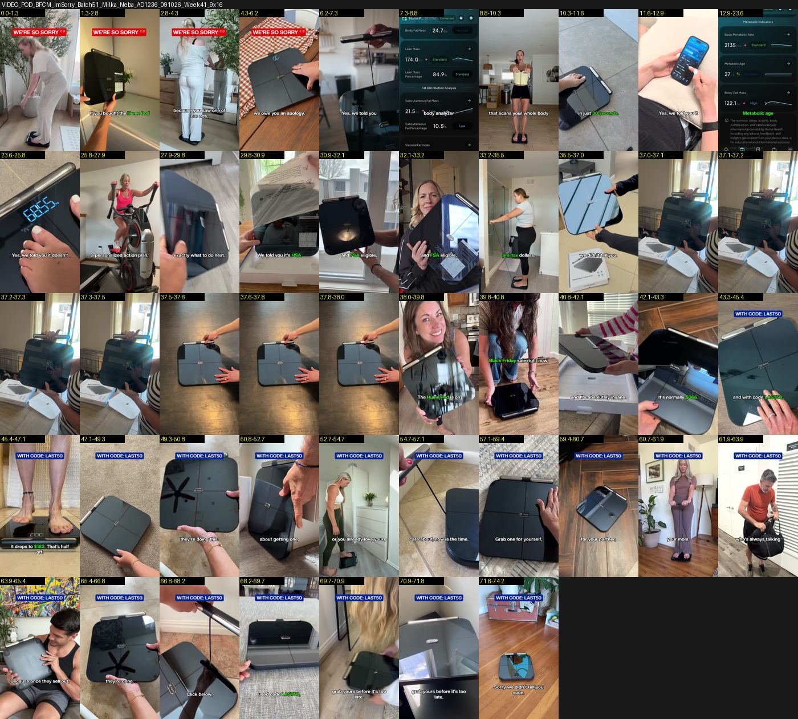

# VIDEO_POD_BFCM_ImSorry_Batch51_Milka_Neba_AD1236_091026_Week41_9x16

Master: `VIDEO_POD_BFCM_ImSorry_Batch51_Milka_Neba_AD1236_091026_Week41_Hook1_9x16.mp4` · 74.2s · 1080x1920

**Pacing:** 47 shots · avg 1.58s · median 1.44s · 6.2 cuts/10s · first cut 1.34s · 227.0 wpm · talk ratio 0.86 · cuts on word start 56.5% · cuts in speech gaps 60.9%
**Audio:** {'I_lufs': -15.4, 'LRA': 3.8, 'true_peak_db': -0.0} · BPM≈117.5 · music {'speech_rms_db': -18.7, 'pause_seconds': 9.5, 'pause_rms_db': -21.0, 'bed_minus_voice_db': -2.3, 'music_bed_likely': True} · cuts with SFX/transient 91.3%

**Captions:** 140 cards · 1.0 words/card (median) · y≈0.717 of frame height · text height≈0.0328 · colours {'green': 16, 'white': 99, 'red': 5, 'dark/other': 20} · cards crossing a cut: 6
Highlighted: If you bought the Hume Pod, we owe you an apology., in just30 seconds., tracks 45health metrics., Musclemassfor strength,, visceral fat for the fat, andhydration, Or just watercweightndard, Yes, wetold you it doesn't, just give you numbers,, We told you it's HSA, and FSA eligible, pre-tax dollars., The Hume Pod is on, Black Friday sale right now,
**Headlines:** WE'RESOSORRY (0.0–5.5s, red) | HumeP...(100%) (8.0–8.0s, dark/other) | Connected (8.0–8.0s, dark/other) | 24.7ibs (8.0–8.0s, white) | Verylow (8.0–8.0s, dark/other) | BodyFat Mass (8.0–8.0s, white) | LeanMass (8.0–8.0s, white) | Progress Report (13.0–14.0s, white)

**Hook (0–3s) spoken:** If you bought the human pod, because
**Hook on-screen:** If you bought the Hume Pod / WE'RESOSORRY
**CTA (last 5s):** Grab yours, before it's too late. Sorry, we didn't tell you sooner. · on-screen: Sorry we didn't tell you / WITHCODE:LAST50 / grab yours before it's too / late. / soon.

## Beat sheet

| # | in–out (s) | dur | transition | spoken | on-screen text |
|---|---|---|---|---|---|
| 1 | 0.00–1.34 | 1.34 |  | If | WE'RESOSORRY [red] (HEADLINE) |
| 2 | 1.34–2.78 | 1.44 | cut +SFX hit | you bought the human pod, | WE'RESOSORRY [red] (HEADLINE) / If you bought the Hume Pod [green] |
| 3 | 2.78–4.32 | 1.54 | cut +SFX hit | because you saw one of our ads, | WE'RESOSORRY [red] (HEADLINE) / If you bought the Hume Pod [green] / because you saw one of / ourads, |
| 4 | 4.32–6.22 | 1.9 | cut +SFX hit | we owe you an apology. Yes, | WE'RESOSORRY [red] (HEADLINE) / because you saw one of / ourads, / we owe you an apology. [red] / XHume / Yes, we told you |
| 5 | 6.22–7.32 | 1.1 | cut +SFX hit | we told you is an | Yes, we told you / it's an at home |
| 6 | 7.32–8.76 | 1.44 | cut +SFX hit | at -home body analyzer that | it's an at home / HumeP...(100%) (HEADLINE) / Connected (HEADLINE) / 24.7ibs (HEADLINE) / Verylow (HEADLINE) / BodyFat Mass (HEADLINE) |
| 7 | 8.76–10.34 | 1.58 | cut +SFX hit | scans your whole body in just 30 | that scans your whole body / in just30 seconds. [green] |
| 8 | 10.34–11.58 | 1.24 | cut +SFX hit | seconds. | in just30 seconds. [green] |
| 9 | 11.58–12.90 | 1.32 | cut +SFX hit | Yes, we told you it tracks 45 | Yes, we told you it |
| 10 | 12.90–23.56 | 10.66 | cut +SFX hit | health metrics, muscle mass for strength, visceral fat for the fat you can't see in the mirror, metabolic age to see how your body is really doing, and hydration to know if it's fat or just waterway. | Progress Report (HEADLINE) / Auglth-Aug3lth (HEADLINE) / Very High (HEADLINE) / Body FatMass (HEADLINE) / 85.9ibs (HEADLINE) / 82.5 ibs (HEADLINE) |
| 11 | 23.56–25.76 | 2.2 | cut +SFX hit | Yes, we told you it doesn't just give you numbers. | 6855 [blue] (HEADLINE) / Yes, wetold you it doesn't [red] / just give you numbers, [red] |
| 12 | 25.76–27.86 | 2.1 | cut | It gives you a personalized action plan so | It gives you / a personalized action plan, |
| 13 | 27.86–29.76 | 1.9 | cut +SFX hit | you know exactly what to do next. We | so you know / exactly what to do next. |
| 14 | 29.76–30.94 | 1.18 | cut | told you it's HSA | We told you it's HSA [green] |
| 15 | 30.94–32.10 | 1.16 | cut +SFX hit | and FSA | and FSA eligible [green] |
| 16 | 32.10–33.22 | 1.12 | cut +SFX hit | eligible, so | and FSA eligible [green] / so you can use your |
| 17 | 33.22–35.46 | 2.24 | cut +SFX hit | you can use your pre -tax dollars, but there's | so you can use your / pre-tax dollars. [green] |
| 18 | 35.46–37.02 | 1.56 | cut +SFX hit | one thing we didn't tell you. | pre-tax dollars. [green] / we didn't tell you. / UNDERSTANDYOURHEALTH / HumeHoalth |
| 19 | 37.02–37.10 | 0.08 | cut |  |  |
| 20 | 37.10–37.22 | 0.12 | cut +SFX hit |  |  |
| 21 | 37.22–37.34 | 0.12 | cut +SFX hit |  |  |
| 22 | 37.34–37.46 | 0.12 | cut +SFX hit |  |  |
| 23 | 37.46–37.58 | 0.12 | cut +SFX hit |  |  |
| 24 | 37.58–37.84 | 0.26 | cut +SFX hit | The |  |
| 25 | 37.84–38.00 | 0.16 | cut +SFX hit |  |  |
| 26 | 38.00–39.78 | 1.78 | cut +SFX hit | human pod is on Black Friday sale | The Hume Pod is on [green] / Black Friday sale right now, [green] |
| 27 | 39.78–40.76 | 0.98 | cut +SFX hit | right now, and | Black Friday sale right now, [green] |
| 28 | 40.76–42.06 | 1.3 | cut +SFX hit | it's absolutely insane. | and It's absolutely insane. |
| 29 | 42.06–43.34 | 1.28 | cut +SFX hit | It's normally 36 | XHurne / It's normally $366. [green] |
| 30 | 43.34–45.44 | 2.1 | cut +SFX hit | .6 and with code last 50, | XHurne / It's normally $366. [green] / WITHCODE:LAST50 [blue] (HEADLINE) / XHume / andwith codeLAST50, [green] |
| 31 | 45.44–47.08 | 1.64 | cut +SFX hit | it drops to 18 .3, | WITHCODE:LAST50 [blue] (HEADLINE) / XHume / andwith codeLAST50, [green] / it drops to $183. That's half [green] / off. |
| 32 | 47.08–49.28 | 2.2 | cut +SFX hit | that's half off. Honestly, | WITHCODE:LAST50 [blue] (HEADLINE) / it drops to $183. That's half [green] / off. / Honestly, |
| 33 | 49.28–50.82 | 1.54 | cut +SFX hit | I don't know how they're doing this, | WITHCODE:LAST50 [blue] (HEADLINE) / Honestly, / XHume / they're doing this. |
| 34 | 50.82–52.74 | 1.92 | cut +SFX hit | so if you've been thinking about getting one, | WITHCODE:LAST50 [blue] (HEADLINE) / So if you've been thinking / about getting one, |
| 35 | 52.74–54.72 | 1.98 | cut | or you already love yours and want one for | WITHCODE:LAST50 [blue] (HEADLINE) / woryoualreadyloveyours / andwantoneforsomeoneyou |
| 36 | 54.72–57.08 | 2.36 | cut +SFX hit | someone you care about, now is the time. | WITHCODE:LAST50 [blue] (HEADLINE) / care about, nowis thetime. / XHume |
| 37 | 57.08–59.38 | 2.3 | cut +SFX hit | Grab one for yourself, and | WITHCODE:LAST50 [blue] (HEADLINE) / XHume / Grab onefor yourself, |
| 38 | 59.38–60.72 | 1.34 | cut +SFX hit | maybe one for your partner, | WITHCODE:LAST50 [blue] (HEADLINE) / XHume / Grab onefor yourself, / foryourpartner, |
| 39 | 60.72–61.90 | 1.18 | cut +SFX hit | your mom, or that | WITHCODE:LAST50 [blue] (HEADLINE) / MOTVAJ8.T2 / yourmom, |
| 40 | 61.90–63.94 | 2.04 | cut +SFX hit | friend who's always talking about their gym progress. | WITHCODE:LAST50 [blue] (HEADLINE) / MECHANIC (HEADLINE) / ROOM (HEADLINE) / who's always talking / MECHANICA (HEADLINE) / about the gym progress |
| 41 | 63.94–65.44 | 1.5 | cut +SFX hit | Because once they sell | WITHCODE:LAST50 [blue] (HEADLINE) / about the gym progress. / Because once they sell out, |
| 42 | 65.44–66.78 | 1.34 | cut +SFX hit | out, they're gone. | WITHCODE:LAST50 [blue] (HEADLINE) / Because once they sell out, / XHume / they're gone. |
| 43 | 66.78–68.22 | 1.44 | cut +SFX hit | Click below. Use code | WITHCODE:LAST50 [blue] (HEADLINE) / Clickbelow, |
| 44 | 68.22–69.70 | 1.48 | cut +SFX hit | LAST50. | WITHCODE:LAST50 [blue] (HEADLINE) / usedcodeLAST50, [green] |
| 45 | 69.70–70.86 | 1.16 | cut +SFX hit | Grab yours, before | WITHCODE:LAST50 [blue] (HEADLINE) / grab yours before it's too / late. |
| 46 | 70.86–71.84 | 0.98 | cut +SFX hit | it's too late. | WITHCODE:LAST50 [blue] (HEADLINE) / grab yours before it's too / late. |
| 47 | 71.84–74.24 | 2.4 | cut +SFX hit | Sorry, we didn't tell you sooner. | WITHCODE:LAST50 [blue] (HEADLINE) / Sorry we didn't tell you [red] / soon. [red] |

## Hook variants

| hook | file | dur | first cut | spoken 0–3s | on-screen 0–3s |
|---|---|---|---|---|---|
| 1 | `Sorry_Batch51_Milka_Neba_AD1236_091026_Week41_Hook1_9x16.mp4` | 74.2 | 1.34 | If you bought the human pod, because | If you bought the Hume Pod / WE'RESOSORRY |
| 2 | `Sorry_Batch51_Milka_Neba_AD1236_091026_Week41_Hook2_9x16.mp4` | 81.4 | 2.2 |  |  |
| 3 | `_Batch51_Milka_Neba_AD1236_091026_Week41_9x16_Hook3_9x16.mp4` | 80.2 | 2.14 |  |  |
| 4 | `_Batch51_Milka_Neba_AD1236_091026_Week41_9x16_Hook4_9x16.mp4` | 88.9 | 1.48 |  |  |

## Full transcript

If you bought the human pod, because you saw one of our ads, we owe you an apology. Yes, we told you is an at-home body analyzer that scans your whole body in just 30 seconds. Yes, we told you it tracks 45 health metrics, muscle mass for strength, visceral fat for the fat you can't see in the mirror, metabolic age to see how your body is really doing, and hydration to know if it's fat or just waterway. Yes, we told you it doesn't just give you numbers. It gives you a personalized action plan so you know exactly what to do next. We told you it's HSA and FSA eligible, so you can use your pre-tax dollars, but there's one thing we didn't tell you. The human pod is on Black Friday sale right now, and it's absolutely insane. It's normally 36.6 and with code last 50, it drops to 18.3, that's half off. Honestly, I don't know how they're doing this, so if you've been thinking about getting one, or you already love yours and want one for someone you care about, now is the time. Grab one for yourself, and maybe one for your partner, your mom, or that friend who's always talking about their gym progress. Because once they sell out, they're gone. Click below. Use code LAST50. Grab yours, before it's too late. Sorry, we didn't tell you sooner.