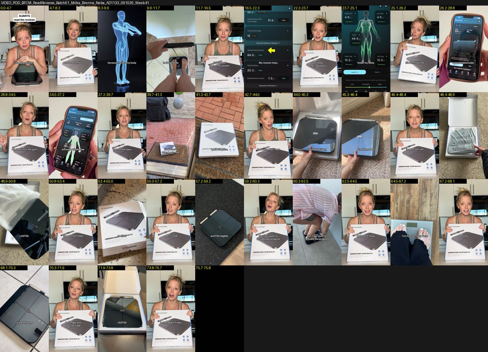

# VIDEO_POD_BFCM_ReadReviews_Batch51_Milka_Brenna_Neba_AD1133_091026_Week41

Master: `VIDEO_POD_BFCM_ReadReviews_Batch51_Milka_Brenna_Neba_AD1133_091026_Week41_Hook1_9x16.mp4` · 75.8s · 1080x1920

**Pacing:** 35 shots · avg 2.166s · median 1.902s · 4.48 cuts/10s · first cut 4.671s · 172.0 wpm · talk ratio 0.97 · cuts on word start 32.4% · cuts in speech gaps 20.6%
**Audio:** {'I_lufs': -18.1, 'LRA': 4.1, 'true_peak_db': 0.0} · BPM≈123.0 · music {'speech_rms_db': -23.6, 'pause_seconds': 1.1, 'pause_rms_db': -24.2, 'bed_minus_voice_db': -0.6, 'music_bed_likely': True} · cuts with SFX/transient 67.6%

**Captions:** 219 cards · 1 words/card (median) · y≈0.645 of frame height · text height≈0.0269 · colours {'white': 197, 'blue': 2, 'dark/other': 17, 'red': 3} · cards crossing a cut: 2
Highlighted: becauseitscansmy body, Lean(lbs), becauseitgivesme, A,Today'sRecu, Your optimal weigh-in.time is5.
**Headlines:** ALWAYS (0.0–4.0s, white) | readthe reviews (0.0–4.0s, white) | CWeight (17.0–17.0s, white) | WeeklyTargets:0/4 (17.0–17.0s, white) | 146.4ibs (17.0–18.0s, white) | High (17.0–19.0s, dark/other) | Updated:Fri18 (17.0–18.0s, dark/other) | 52yrs (17.0–18.0s, white)

**Hook (0–3s) spoken:** Always, always, always read the reviews when you're
**Hook on-screen:** ALWAYS / Always, / readthe reviews / readthereviews
**CTA (last 5s):** you use code last50 and get it before Black Friday is over. · on-screen: HumeHealth / Justmakesure / LAST50 / UNDERSTANDYOURHEALTH / and get it / beforeBlackFriday / isover. / youusecode

## Beat sheet

| # | in–out (s) | dur | transition | spoken | on-screen text |
|---|---|---|---|---|---|
| 1 | 0.00–4.67 | 4.67 |  | Always, always, always read the reviews when you're buying something off the internet. | ALWAYS (HEADLINE) / readthe reviews (HEADLINE) / Always, / readthereviews / whenyou're / buying something |
| 2 | 4.67–8.28 | 3.6 | cut +SFX hit | I wish I could return this so bad. It's not because | HumeHealth / Iwish / UNDERSTANDYOURHEALTH / Icouldreturnthis / LMAETSODYCOUOSITIOSANA(TER / so bad. |
| 3 | 8.28–9.88 | 1.6 | cut +SFX hit | it scans my body every | HumeHealth / UNDERSTANDYOURHEALTH / It'snot / becauseitscansmy body [blue] |
| 4 | 9.88–11.68 | 1.8 | cut +SFX hit | morning in 30 seconds and | 7775. / every morning / in30seconds |
| 5 | 11.68–16.48 | 4.8 | cut +SFX hit | is literally the easiest part of my routine. Definitely not because it shows me | HumeHealth / andisliterally / UNDERSTANDYOURHEALTH / theeasiest / partofmyroutine. / CHumoHoalth |
| 6 | 16.48–22.26 | 5.77 | cut | 45 different health metrics like muscle mass, visceral fat, and metabolic age. So | UNDERSTANDYOURHEALTH / HumeHealth / becauseitshowsme / FALANCEDECOMPOSITIONCOEPOTELLE CONNETIT / CWeight (HEADLINE) / WeeklyTargets:0/4 (HEADLINE) |
| 7 | 22.26–23.72 | 1.47 | cut | I know what's going on inside | High / Body Pod (HEADLINE) / 36.2ibs (HEADLINE) / Standard [green] (HEADLINE) / ExtracellularWater (HEADLINE) / IntracellularWater (HEADLINE) |
| 8 | 23.72–25.09 | 1.37 | cut +SFX hit | my body. It's | Right Arm (HEADLINE) / LeftArm (HEADLINE) / 4.9ibs (HEADLINE) / 4.91bs (HEADLINE) / Standard (HEADLINE) / Torso (HEADLINE) |
| 9 | 25.09–26.16 | 1.07 | cut +SFX hit | definitely not because | HumeHealth / It'sdefinitelynot / UNDERSTANDYOURHEALTH / 1:25 [blue] (HEADLINE) / Body Comp (HEADLINE) / Cweight (HEADLINE) |
| 10 | 26.16–28.76 | 2.6 | cut +SFX hit | it gives me a personalized plan. So | 1:25 [blue] (HEADLINE) / Body Comp (HEADLINE) / Cweight (HEADLINE) / Weekty Targets:1/4 (HEADLINE) / 59.5kg (HEADLINE) / Standard (HEADLINE) |
| 11 | 28.76–34.50 | 5.74 | cut | I know how to make progress whether I'm in the gym or in the kitchen and it's definitely not because | HumeHealth / Solknowhow / tomakeprogress / UNDERSTANDYOURHEALTH / SoIknowhow / HumeHealth |
| 12 | 34.50–37.24 | 2.74 | cut +SFX hit | I finally saw I was building muscle even | 1:25 [blue] (HEADLINE) / CHume Pod [blue] (HEADLINE) / Step On Scale [blue] (HEADLINE) / HumeHealth (HEADLINE) / Body (HEADLINE) / 30yrs |
| 13 | 37.24–39.71 | 2.47 | cut +SFX hit | on the days the scale barely moved It's | HumeHealth / evenonthedays / UNDERSTANDYOURHEALTH / thescalebarelymoved |
| 14 | 39.71–41.34 | 1.63 | cut +SFX hit | because when I got mine, I | It'sbecause / whenIgot mine / when Igotmine, |
| 15 | 41.34–42.71 | 1.37 | cut | paid full price and | It'sbecause / when Igotmine, / xHumeHealth / UNDERSTAN / Ipaid ful price. |
| 16 | 42.71–44.01 | 1.3 | cut +SFX hit | from what I hear this | HumeHealth / Andfromwhat/hear, / UNDERSTANDYOURHEALTH / XHume / this Black Friday, |
| 17 | 44.01–45.31 | 1.3 | cut +SFX hit | black Friday The | XHume / this Black Friday, |
| 18 | 45.31–46.45 | 1.13 | cut +SFX hit | Hume pod is | XHume / this Black Friday, / the Hume Pod |
| 19 | 46.45–48.45 | 2.0 | cut +SFX hit | up to 50 % off when | the Hume Pod / HumeHealth / isupto50%off / UNDERSTANDYOURHEALTH |
| 20 | 48.45–48.92 | 0.47 | cut | you use | HumeHealth / isupto50%off / UNDERSTANDYOURHEALTH |
| 21 | 48.92–50.82 | 1.9 | cut | code last 50 it | ADVERTENGIA (HEADLINE) / reathing.This / wens.Thethin fim / wnblesandchildren.Donot / whenyou use code / LAST50. |
| 22 | 50.82–53.35 | 2.54 | cut +SFX hit | goes from $366 to | HumeHealth / Itgoesfrom$366 / UNDERSTANDYOURHEALTH |
| 23 | 53.35–55.02 | 1.67 | cut +SFX hit | $183 and | HumeHealth / Itgoesfrom$366 / UNDERSTANDYOURHEALTH / xHumeHealth (HEADLINE) / BALANCE DE COMPOSITION CORPORELLE CONNETEE / SMARTBODYCOMPOSITIONANALYZER |
| 24 | 55.02–57.16 | 2.13 | cut | it's HSA and | HumeHealth / andit'sHSA / UNDERSTANDYOURHEALTH / and FSA eligible. |
| 25 | 57.16–59.16 | 2.0 | cut +SFX hit | FSA eligible. | and FSA eligible. / HumeHealth / Soifyouwantto / actuallyseeprogress / UNDERSTANDYOURHEALTH |
| 26 | 59.16–60.26 | 1.1 | cut +SFX hit | So if you want to actually | HumeHealth / Soifyouwantto / actuallyseeprogress / UNDERSTANDYOURHEALTH |
| 27 | 60.26–62.50 | 2.24 | cut | see progress and stop guessing, get | HumeHealth / Soifyouwantto / actuallyseeprogress / UNDERSTANDYOURHEALTH / andstopguessing, |
| 28 | 62.50–64.46 | 1.97 | cut +SFX hit | one of these right now. | andstopguessing, / HumeHealth / getoneofthese / UNDERSTANDYOURHEALTH / rightnow. / AANCEDE CONPOSITION CORPORELLT CONNEIEE |
| 29 | 64.46–67.17 | 2.7 | cut +SFX hit | I've tried so many ways to track my health and | HumeHealth / UNDERSTANDYOURHEALTH / rightnow. / AANCEDE CONPOSITION CORPORELLT CONNEIEE / vetried somanyways / 2168- |
| 30 | 67.17–68.14 | 0.97 | cut | this is | HumeHealth / andthis / UNDERSTANDYOURHEALTH / is the only one |
| 31 | 68.14–70.27 | 2.13 | cut +SFX hit | the only one that has stuck. | is the only one / XHume / XHume (HEADLINE) / thathasstuck. |
| 32 | 70.27–71.87 | 1.6 | cut +SFX hit | Just make sure you use code last50 | XHume (HEADLINE) / thathasstuck. / HumeHealth / Justmakesure / youusecode / UNDERSTANDYOURHEALTH |
| 33 | 71.87–73.84 | 1.97 | cut +SFX hit | and get it before | LAST50 / and get it |
| 34 | 73.84–75.74 | 1.9 | cut | Black Friday is over. | HumeHealth / beforeBlackFriday / UNDERSTANDYOURHEALTH / isover. |
| 35 | 75.74–75.82 | 0.08 | cut |  |  |

## Hook variants

| hook | file | dur | first cut | spoken 0–3s | on-screen 0–3s |
|---|---|---|---|---|---|
| 1 | `atch51_Milka_Brenna_Neba_AD1133_091026_Week41_Hook1_9x16.mp4` | 75.8 | 4.671 | Always, always, always read the reviews when you're | ALWAYS / Always, / readthe reviews / readthereviews |
| 2 | `atch51_Milka_Brenna_Neba_AD1133_091026_Week41_Hook2_9x16.mp4` | 75.5 | 4.404 | Please, please, please, read the reviews before you |  |
| 3 | `atch51_Milka_Brenna_Neba_AD1133_091026_Week41_Hook3_9x16.mp4` | 75.5 | 4.371 | I'm begging you, read the reviews before you buy |  |
| 4 | `atch51_Milka_Brenna_Neba_AD1133_091026_Week41_Hook4_9x16.mp4` | 76.2 | 5.072 | Always read the reviews before you check out. I |  |

## Full transcript

Always, always, always read the reviews when you're buying something off the internet. I wish I could return this so bad. It's not because it scans my body every morning in 30 seconds and is literally the easiest part of my routine. Definitely not because it shows me 45 different health metrics like muscle mass, visceral fat, and metabolic age. So I know what's going on inside my body. It's definitely not because it gives me a personalized plan. So I know how to make progress whether I'm in the gym or in the kitchen and it's definitely not because I finally saw I was building muscle even on the days the scale barely moved It's because when I got mine, I paid full price and from what I hear this black Friday The Hume pod is up to 50% off when you use code last 50 it goes from $366 to $183 and it's HSA and FSA eligible. So if you want to actually see progress and stop guessing, get one of these right now. I've tried so many ways to track my health and this is the only one that has stuck. Just make sure you use code last50 and get it before Black Friday is over.