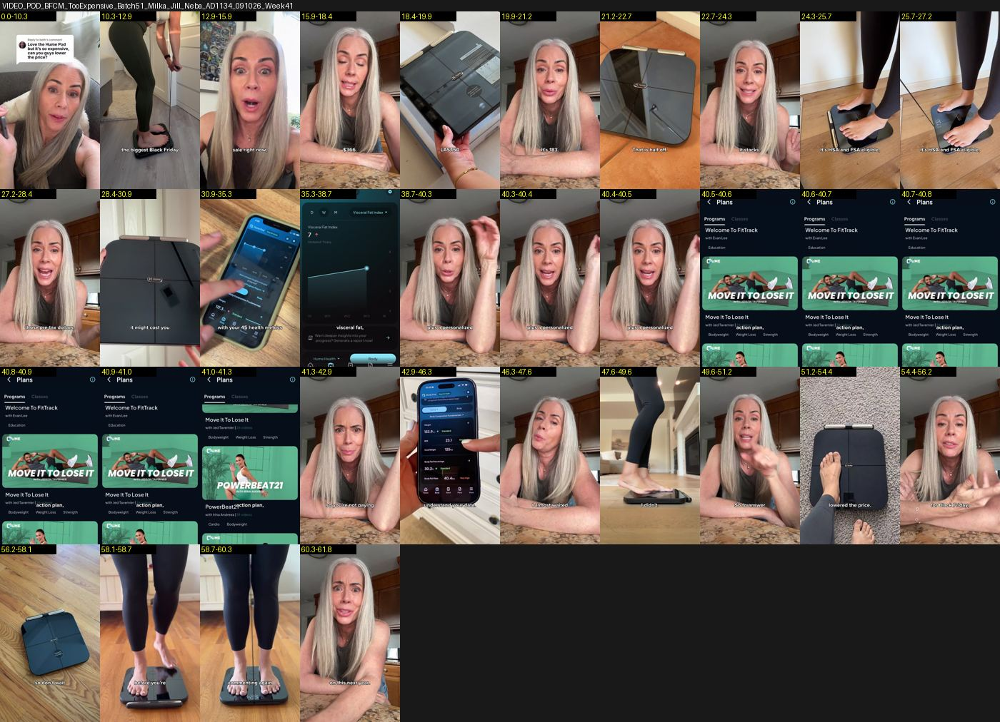

# VIDEO_POD_BFCM_TooExpensive_Batch51_Milka_Jill_Neba_AD1134_091026_Week41

Master: `VIDEO_POD_BFCM_TooExpensive_Batch51_Milka_Jill_Neba_AD1134_091026_Week41_Hook1_9x16.mp4` · 61.8s · 1080x1920

**Pacing:** 34 shots · avg 1.817s · median 1.534s · 5.34 cuts/10s · first cut 10.3s · 155.0 wpm · talk ratio 0.95 · cuts on word start 48.5% · cuts in speech gaps 21.2%
**Audio:** {'I_lufs': -18.6, 'LRA': 3.9, 'true_peak_db': -0.3} · BPM≈129.2 · music {'speech_rms_db': -24.6, 'pause_seconds': 0.4} · cuts with SFX/transient 63.6%

**Captions:** 145 cards · 1 words/card (median) · y≈0.649 of frame height · text height≈0.0281 · colours {'white': 79, 'red': 4, 'other-colour': 1, 'dark/other': 53, 'blue': 5, 'green': 3} · cards crossing a cut: 3
Highlighted: and it's insane., LAST50, That is half off., It's HSA and FSA eligible,, Body, reProgress Report, Metaboilchge, HumeHealth, UME, POWERBEAT21, CUME, Hume, Very High
**Headlines:** LovetheHumePod (0.0–5.5s, white) | butit'ssoexpensive, (0.0–5.5s, white) | canyouguyslower (0.0–5.5s, white) | theprice? (0.0–5.5s, white) | 4:28 (31.0–32.0s, blue) | StepOn Scale (31.0–38.0s, blue) | Android Region (31.0–31.0s, blue) | Fat Mass (31.0–32.0s, blue)

**Hook (0–3s) spoken:** Love the Hume pod, but it's so expensive.
**Hook on-screen:** LovetheHumePod / butit'ssoexpensive, / canyouguyslower / theprice?
**CTA (last 5s):** wait to buy it before you're commenting again on this next year · on-screen: before you're / commenting again / on this next year. / so don't wait

## Beat sheet

| # | in–out (s) | dur | transition | spoken | on-screen text |
|---|---|---|---|---|---|
| 1 | 0.00–10.30 | 10.3 |  | Love the Hume pod, but it's so expensive. Can you guys lower the price? Okay, you commented this at the perfect time because Hume | LovetheHumePod (HEADLINE) / butit'ssoexpensive, (HEADLINE) / canyouguyslower (HEADLINE) / theprice? (HEADLINE) / Okay, / you commented this |
| 2 | 10.30–12.87 | 2.57 | cut +SFX hit | is having the biggest Black | because / Hume is having / the biggest Black Friday |
| 3 | 12.87–15.93 | 3.07 | cut +SFX hit | Friday sale right now, and it's insane. | the biggest Black Friday / sale right now, / and it's insane. [red] |
| 4 | 15.93–18.40 | 2.47 | cut | It's normally $366. With | It's normally / $366 / $366. |
| 5 | 18.40–19.87 | 1.47 | cut +SFX hit | code last 50, it's 183. | $366. / XHume / LAST50 [red] |
| 6 | 19.87–21.23 | 1.37 | cut +SFX hit |  | It's 183. / XHume / That is half off. [red] |
| 7 | 21.23–22.73 | 1.5 | cut +SFX hit | That is half off. | XHume / That is half off. [red] / Hume |
| 8 | 22.73–24.30 | 1.57 | cut | But wait, it stacks. | But wait, / it stacks. |
| 9 | 24.30–25.73 | 1.43 | cut +SFX hit | It's HSA and FSA eligible, | it stacks. / It's HSA and FSA eligible, [other-colour] |
| 10 | 25.73–27.17 | 1.43 | cut +SFX hit | so you can use those | It's HSA and FSA eligible, [other-colour] / those pre-tax dollars, |
| 11 | 27.17–28.43 | 1.27 | cut +SFX hit | pre -tax dollars, Which | those pre-tax dollars, |
| 12 | 28.43–30.90 | 2.47 | cut +SFX hit | means it might cost you even less and | those pre-tax dollars, / it might cost you / XHune |
| 13 | 30.90–35.33 | 4.43 | cut +SFX hit | the Hume app comes included with your 45 health metrics like | 4:28 [blue] (HEADLINE) / StepOn Scale [blue] (HEADLINE) / Android Region [blue] (HEADLINE) / Fat Mass [blue] (HEADLINE) / 8.5ibs (HEADLINE) / Gynoid Region (HEADLINE) |
| 14 | 35.33–38.67 | 3.33 | cut +SFX hit | muscle mass Disceral fat in metabolic age plus | StepOn Scale [blue] (HEADLINE) / Home / Body [blue] / Nutrition / More / 4:29 [blue] (HEADLINE) |
| 15 | 38.67–40.33 | 1.67 | cut +SFX hit | a personalized action | plus a personalized |
| 16 | 40.33–40.43 | 0.1 | cut |  | plus a personalized |
| 17 | 40.43–40.53 | 0.1 | cut |  | plus a personalized |
| 18 | 40.53–40.63 | 0.1 | cut |  |  |
| 19 | 40.63–40.73 | 0.1 | cut |  |  |
| 20 | 40.73–40.83 | 0.1 | cut +SFX hit |  |  |
| 21 | 40.83–40.93 | 0.1 | cut +SFX hit | plan |  |
| 22 | 40.93–41.03 | 0.1 | cut +SFX hit |  | Plans (HEADLINE) / Programs (HEADLINE) / Classes (HEADLINE) / Move It To Lose It (HEADLINE) / withJedTavernier/26videos / Strength |
| 23 | 41.03–41.30 | 0.27 | cut +SFX hit | So | Plans (HEADLINE) / Programs (HEADLINE) / Classes (HEADLINE) / Move It To Lose It (HEADLINE) / withJedTavernier/26videos / Strength |
| 24 | 41.30–42.90 | 1.6 | cut | you're not paying extra | Plans (HEADLINE) / Programs (HEADLINE) / Classes (HEADLINE) / Move It To Lose It (HEADLINE) / withJedTavernier/26videos / Strength |
| 25 | 42.90–46.27 | 3.37 | cut +SFX hit | to actually understand your data I | 10:09 [blue] (HEADLINE) / StepOnScale [blue] (HEADLINE) / Co BodyPod [blue] (HEADLINE) / Updated:fodey (HEADLINE) / 14/01 / 13/01 |
| 26 | 46.27–47.57 | 1.3 | cut +SFX hit | almost waited on this one and | StepOnScale [blue] (HEADLINE) / BodyCompositionFundamentals [blue] (HEADLINE) / 40.4ibs / 10:09 [blue] (HEADLINE) / BodyPod [blue] (HEADLINE) / Very High [red] |
| 27 | 47.57–49.57 | 2.0 | cut | I'm so glad I didn't so | and I'm so glad / I didn't. |
| 28 | 49.57–51.23 | 1.67 | cut | to answer your question. Yes | So to answer / yes they |
| 29 | 51.23–54.40 | 3.17 | cut +SFX hit | They lower the price a lot, but | yes they / XHume / lowered the price. / 84 / A lot. |
| 30 | 54.40–56.23 | 1.83 | cut +SFX hit | it's only for black Friday So | XHume / 84 / A lot. / for Black Friday, / so don't wait |
| 31 | 56.23–58.07 | 1.83 | cut | don't wait to buy it | so don't wait / before you're |
| 32 | 58.07–58.73 | 0.67 | cut | before you're | before you're |
| 33 | 58.73–60.33 | 1.6 | cut | commenting again on | commenting again |
| 34 | 60.33–61.79 | 1.45 | cut +SFX hit | this next year | commenting again / on this next year. |

## Hook variants

| hook | file | dur | first cut | spoken 0–3s | on-screen 0–3s |
|---|---|---|---|---|---|
| 1 | `_Batch51_Milka_Jill_Neba_AD1134_091026_Week41_Hook1_9x16.mp4` | 61.8 | 10.3 | Love the Hume pod, but it's so expensive. | LovetheHumePod / butit'ssoexpensive, / canyouguyslower / theprice? |
| 2 | `_Batch51_Milka_Jill_Neba_AD1134_091026_Week41_Hook2_9x16.mp4` | 60.8 | 6.5 |  |  |
| 3 | `_Batch51_Milka_Jill_Neba_AD1134_091026_Week41_Hook3_9x16.mp4` | 57.7 | 8.3 |  |  |
| 4 | `_Batch51_Milka_Jill_Neba_AD1134_091026_Week41_Hook4_9x16.mp4` | 60.7 | 6.1 |  |  |

## Full transcript

Love the Hume pod, but it's so expensive. Can you guys lower the price? Okay, you commented this at the perfect time because Hume is having the biggest Black Friday sale right now, and it's insane. It's normally $366. With code last 50, it's 183. That is half off. But wait, it stacks. It's HSA and FSA eligible, so you can use those pre-tax dollars, Which means it might cost you even less and the Hume app comes included with your 45 health metrics like muscle mass Disceral fat in metabolic age plus a personalized action plan So you're not paying extra to actually understand your data I almost waited on this one and I'm so glad I didn't so to answer your question. Yes They lower the price a lot, but it's only for black Friday So don't wait to buy it before you're commenting again on this next year