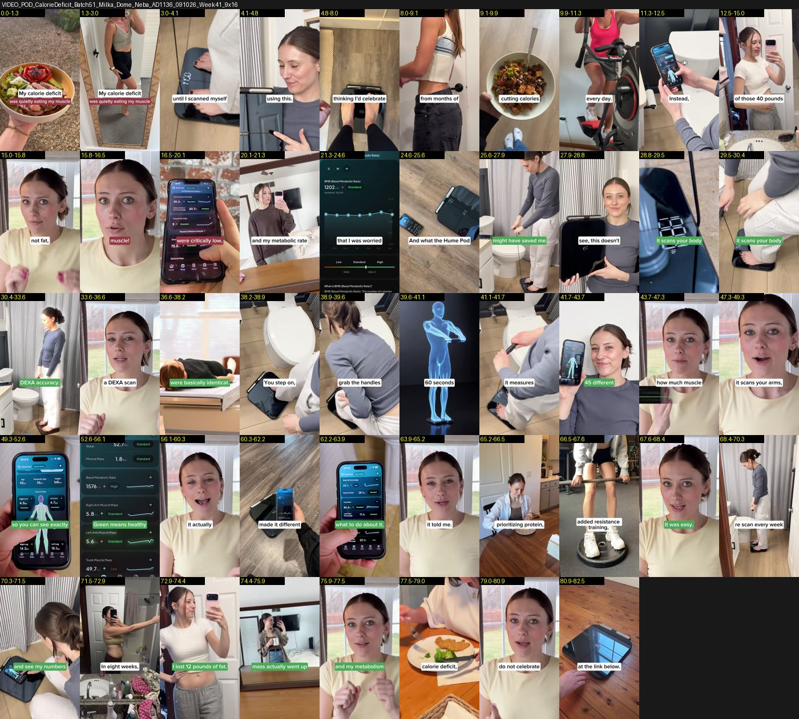

# VIDEO_POD_CalorieDeficit_Batch51_Milka_Dome_Neba_AD1136_091026_Week41_9x16

Master: `VIDEO_POD_CalorieDeficit_Batch51_Milka_Dome_Neba_AD1136_091026_Week41_9x16_HOOK1.mp4` · 82.5s · 1080x1920

**Pacing:** 48 shots · avg 1.718s · median 1.484s · 5.7 cuts/10s · first cut 1.3s · 224.0 wpm · talk ratio 0.94 · cuts on word start 89.4% · cuts in speech gaps 70.2%
**Audio:** {'I_lufs': -23.1, 'LRA': 5.4, 'true_peak_db': -8.4} · BPM≈136.0 · music {'speech_rms_db': -27.3, 'pause_seconds': 0.5, 'pause_rms_db': -27.7, 'bed_minus_voice_db': -0.4, 'music_bed_likely': True} · cuts with SFX/transient 66.0%

**Captions:** 181 cards · 1 words/card (median) · y≈0.612 of frame height · text height≈0.0304 · colours {'white': 124, 'red': 10, 'other-colour': 2, 'dark/other': 19, 'green': 24, 'blue': 2} · cards crossing a cut: 7
Highlighted: was quietly eating my muscle, muscle!, Percentage, subeutaneeusFatMass, 20.7%, VISEBH, Musele&skeleteRAnalysis, Plans, Band, were critically low,, had dropped so much, from disaster., it scans your body, with a98%, DEXA accuracy
**Headlines:** 120.7ms (17.0–17.0s, other-colour) | Standard (17.0–17.0s, white) | 20.7% (19.0–19.0s, blue) | BMR(BasalMetabolicRate) (22.0–24.0s, white) | 1202 cal (22.0–24.0s, white) | Standard (22.0–24.0s, green) | Updated:30/04 (22.0–24.0s, dark/other) | 1274 (22.0–24.0s, dark/other)

**Hook (0–3s) spoken:** My calorie deficit was quietly eating my muscle until
**Hook on-screen:** My calorie deficit / was quietly eating my muscle
**CTA (last 5s):** If you're in a calorie deficit, do not celebrate until you know what you're losing. Check it out at the link below. · on-screen: Check it out / at the link below. / calorie deficit, / do not celebrate / until you know what

## Beat sheet

| # | in–out (s) | dur | transition | spoken | on-screen text |
|---|---|---|---|---|---|
| 1 | 0.00–1.30 | 1.3 |  | My calorie deficit was | My calorie deficit / was quietly eating my muscle [red] |
| 2 | 1.30–3.00 | 1.7 | cut | quietly eating my muscle until | My calorie deficit / was quietly eating my muscle [red] |
| 3 | 3.00–4.13 | 1.13 | cut +SFX hit | I scanned myself using | until I scanned myself / using this. / XHume |
| 4 | 4.13–4.83 | 0.7 | cut | this. | using this. / XHume |
| 5 | 4.83–8.00 | 3.17 | cut +SFX hit | I stepped in my human pod thinking I'd celebrate those 40 pounds I | using this. / XHume / I stepped on my / Hume Pod / thinking I'd celebrate / those 40 pounds |
| 6 | 8.00–9.13 | 1.13 | cut | lost from months of cutting | I lost / cutting calories |
| 7 | 9.13–9.87 | 0.73 | cut +SFX hit | calories and | cutting calories |
| 8 | 9.87–11.27 | 1.4 | cut | doing cardio every day. | and doing cardio / every day. |
| 9 | 11.27–12.53 | 1.27 | cut +SFX hit | Instead, it told me 14 | every day. / it told me 14 |
| 10 | 12.53–15.00 | 2.47 | cut | of those 40 pounds for muscle, | it told me 14 / of those 40 pounds |
| 11 | 15.00–15.77 | 0.77 | cut +SFX hit | not fat, | not fat, |
| 12 | 15.77–16.53 | 0.77 | cut | muscle. | muscle! [red] |
| 13 | 16.53–20.10 | 3.57 | cut +SFX hit | My protein levels were critically low, my hydration was in the red, | 120.7ms [other-colour] (HEADLINE) / Standard (HEADLINE) / 70.8% / Percentage [other-colour] / subeutaneeusFatMass [other-colour] / 20.7% [red] |
| 14 | 20.10–21.30 | 1.2 | cut | and my metabolic rate had | and my metabolic rate / had dropped so much [red] |
| 15 | 21.30–24.60 | 3.3 | cut +SFX hit | dropped so much that I was worried I'd gain it all back. | had dropped so much [red] / BMR(BasalMetabolicRate) (HEADLINE) / 1202 cal (HEADLINE) / Standard [green] (HEADLINE) / Updated:30/04 (HEADLINE) / 1274 (HEADLINE) |
| 16 | 24.60–25.57 | 0.97 | cut | And what the human pod | And what the Hume Pod |
| 17 | 25.57–27.90 | 2.33 | cut | showed me next might have saved me from disaster. | showed me next / from disaster. [green] |
| 18 | 27.90–28.77 | 0.87 | cut +SFX hit | See, this doesn't just | see, this doesn't |
| 19 | 28.77–29.53 | 0.77 | cut | weigh you, it scans | it scans your body [green] |
| 20 | 29.53–30.43 | 0.9 | cut | your body with | with a98% [green] |
| 21 | 30.43–33.63 | 3.2 | cut +SFX hit | a 98 % DEXA accuracy. | with a98% [green] / DEXA accuracy [green] |
| 22 | 33.63–36.63 | 3.0 | cut +SFX hit | I was skeptical, so I paid for a DEXA scan to compare. | I was skeptical, / a DEXA scan / to compare, |
| 23 | 36.63–38.23 | 1.6 | cut +SFX hit | The results were basically identical. | were basically identical. [green] / You step on, |
| 24 | 38.23–38.93 | 0.7 | cut | You step on, | You step on, |
| 25 | 38.93–39.63 | 0.7 | cut | grab the handles, | grab the handles |
| 26 | 39.63–41.13 | 1.5 | cut +SFX hit | and in under 60 seconds, | 60 seconds / it measures |
| 27 | 41.13–41.67 | 0.53 | cut +SFX hit | it measures 45 | it measures |
| 28 | 41.67–43.70 | 2.03 | cut +SFX hit | different health metrics, | 45different [green] / health metrics [green] |
| 29 | 43.70–47.33 | 3.63 | cut +SFX hit | including exactly how much muscle versus fat you're losing. | including exactly / versusfat / >70.1ibs / 73.8lbs / you're losing, / 94.4ibs |
| 30 | 47.33–49.30 | 1.97 | cut +SFX hit | It scans your arms, legs, and torso separately | you're losing, / 94.4ibs / 95.1ibs / it scans your arms. / legs, and torso |
| 31 | 49.30–52.63 | 3.33 | cut +SFX hit | so you can see exactly what's happening in each part of your body. | legs, and torso / 16:14 [blue] (HEADLINE) / Step On Scale [blue] (HEADLINE) / HumePod [blue] (HEADLINE) / Height / 168cm |
| 32 | 52.63–56.13 | 3.5 | cut +SFX hit | And the app color codes everything. Green means healthy and red means danger. | Standard / Standard [green] (HEADLINE) / High / 55.6% (HEADLINE) / Extracellular (HEADLINE) / 31.1ibs (HEADLINE) |
| 33 | 56.13–60.27 | 4.13 | cut +SFX hit | And for every metric that needs work, it actually gives you a plan to fix it. | And for every metric / that needs work, / it actually / givesyouaplan [green] / You'reaginga bitfasterthan you shouldbeduetonot / quicklygetyoubackontrack.FocusonyourDaily |
| 34 | 60.27–62.20 | 1.93 | cut +SFX hit | That's what made it different. The Hume Pod tells | You'reaginga bitfasterthan you shouldbeduetonot / therightamountofactivity. / to fixit. [green] / though-smallincreasesindailymovementcan / made it different / 16:14米 [blue] (HEADLINE) |
| 35 | 62.20–63.90 | 1.7 | cut +SFX hit | you what to do about it. | 16:14米 [blue] (HEADLINE) / 19.5 [blue] / 123ibs / 23.1%+ / 28.1ibs / BodyPat Mars |
| 36 | 63.90–65.20 | 1.3 | cut +SFX hit | So I started following what it told me, | So I started / prioritizing protein, |
| 37 | 65.20–66.47 | 1.27 | cut +SFX hit | prioritizing protein, | prioritizing protein, |
| 38 | 66.47–67.63 | 1.17 | cut +SFX hit | added resistance training. | prioritizing protein, / added resistance / training, |
| 39 | 67.63–68.40 | 0.77 | cut | It was easy. | It was easy. [green] |
| 40 | 68.40–70.33 | 1.93 | cut +SFX hit | And then I'd re -scan every week and | It was easy. [green] / re scan every week |
| 41 | 70.33–71.50 | 1.17 | cut +SFX hit | see my number shift. | re scan every week / shift. [green] |
| 42 | 71.50–72.90 | 1.4 | cut | In eight weeks, I lost 12 | In eight weeks, |
| 43 | 72.90–74.40 | 1.5 | cut +SFX hit | pounds of fat. | I lost 12pounds of fat [green] / lost12poundsoffat. [green] |
| 44 | 74.40–75.93 | 1.53 | cut | My muscle mass actually went up and | lost12poundsoffat. [green] / mass actually went up [green] |
| 45 | 75.93–77.53 | 1.6 | cut +SFX hit | my metabolism improved too. | and my metabolism [green] / improved too. [green] |
| 46 | 77.53–79.00 | 1.47 | cut +SFX hit | If you're in a calorie deficit, | calorie deficit, |
| 47 | 79.00–80.87 | 1.87 | cut +SFX hit | do not celebrate until you know what you're losing. | do not celebrate / until you know what |
| 48 | 80.87–82.45 | 1.59 | cut +SFX hit | Check it out at the link below. | Check it out / at the link below. |

## Hook variants

| hook | file | dur | first cut | spoken 0–3s | on-screen 0–3s |
|---|---|---|---|---|---|
| 1 | `_Batch51_Milka_Dome_Neba_AD1136_091026_Week41_9x16_HOOK1.mp4` | 82.5 | 1.3 | My calorie deficit was quietly eating my muscle until | My calorie deficit / was quietly eating my muscle |
| 1 | `_Batch51_Milka_Dome_Neba_AD1136_091026_Week41_9x16_HOOK1.mp4` | 82.5 | 1.3 | My calorie deficit was quietly eating my muscle until |  |
| 2 | `_Batch51_Milka_Dome_Neba_AD1136_091026_Week41_9x16_HOOK2.mp4` | 80.4 | 1.2 | My calorie deficit worked. That was the problem. I stepped |  |
| 2 | `_Batch51_Milka_Dome_Neba_AD1136_091026_Week41_9x16_HOOK2.mp4` | 80.4 | 1.2 | My calorie deficit worked. That was the problem. I stepped |  |
| 3 | `_Batch51_Milka_Dome_Neba_AD1136_091026_Week41_9x16_HOOK3.mp4` | 83.9 | 2.333 | I lost 40 pounds in a calorie deficit and I was so | Ilost 40pounds / and I was so proud. / in a calorie deficit / in a calorie deficit, |
| 3 | `_Batch51_Milka_Dome_Neba_AD1136_091026_Week41_9x16_HOOK3.mp4` | 83.9 | 2.333 | I lost 40 pounds in a calorie deficit and I was so |  |

## Full transcript

My calorie deficit was quietly eating my muscle until I scanned myself using this. I stepped in my human pod thinking I'd celebrate those 40 pounds I lost from months of cutting calories and doing cardio every day. Instead, it told me 14 of those 40 pounds for muscle, not fat, muscle. My protein levels were critically low, my hydration was in the red, and my metabolic rate had dropped so much that I was worried I'd gain it all back. And what the human pod showed me next might have saved me from disaster. See, this doesn't just weigh you, it scans your body with a 98% DEXA accuracy. I was skeptical, so I paid for a DEXA scan to compare. The results were basically identical. You step on, grab the handles, and in under 60 seconds, it measures 45 different health metrics, including exactly how much muscle versus fat you're losing. It scans your arms, legs, and torso separately so you can see exactly what's happening in each part of your body. And the app color codes everything. Green means healthy and red means danger. And for every metric that needs work, it actually gives you a plan to fix it. That's what made it different. The Hume Pod tells you what to do about it. So I started following what it told me, prioritizing protein, added resistance training. It was easy. And then I'd re-scan every week and see my number shift. In eight weeks, I lost 12 pounds of fat. My muscle mass actually went up and my metabolism improved too. If you're in a calorie deficit, do not celebrate until you know what you're losing. Check it out at the link below.