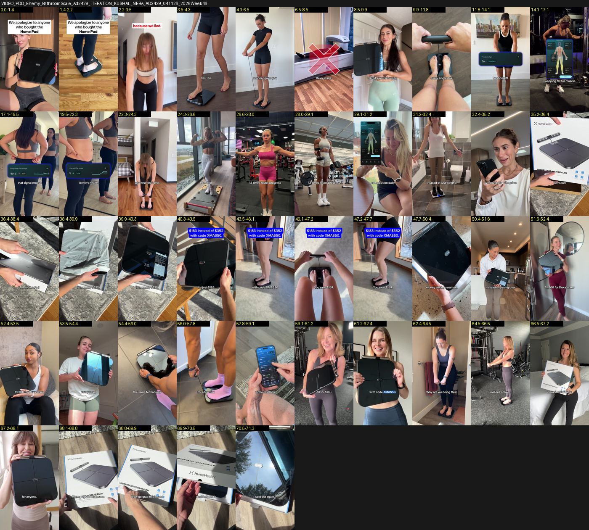

# VIDEO_POD_Enemy_BathroomScale_Ad2429_ITERATION_KUSHAL_NEBA_AD2429_041126_2026Week46

Master: `VIDEO_POD_Enemy_BathroomScale_Ad2429_ITERATION_KUSHAL_NEBA_AD2429_041126_2026Week46_Hook1_9x16.mp4` · 71.3s · 1080x1920

**Pacing:** 45 shots · avg 1.584s · median 1.367s · 6.17 cuts/10s · first cut 1.367s · 191.0 wpm · talk ratio 0.94 · cuts on word start 70.5% · cuts in speech gaps 75.0%
**Audio:** {'I_lufs': -19.0, 'LRA': 2.6, 'true_peak_db': -2.9} · BPM≈123.0 · music {'speech_rms_db': -23.3, 'pause_seconds': 1.2, 'pause_rms_db': -21.7, 'bed_minus_voice_db': 1.6, 'music_bed_likely': True} · cuts with SFX/transient 34.1%

**Captions:** 87 cards · 2 words/card (median) · y≈0.667 of frame height · text height≈0.0293 · colours {'white': 78, 'red': 3, 'dark/other': 3, 'blue': 3} · cards crossing a cut: 4
Highlighted: Dexa scans., 12timesfasterprogress, money backguarantee., 14.5, withcodeXMAS50, withcodeXMAS50.
**Headlines:** We apologize to anyone (0.0–1.5s, white) | who bought the (0.0–1.5s, white) | Hume Pod (0.0–1.5s, white) | before today, (2.0–2.0s, white) | because we lied. (2.5–3.0s, red) | EAT. (27.0–27.0s, white) | SLEEP. (27.0–27.0s, white) | XHumeHealth (35.0–35.0s, white)

**Hook (0–3s) spoken:** We apologize to anyone who bought the HumePod before today because we
**Hook on-screen:** Hume Pod / We apologize to anyone / because we lied. / before today, / who bought the
**CTA (last 5s):** want to make it affordable for anyone. Now go grab this insane deal before it's sold out again. · on-screen: BALANCED / DE COMPOSITION CORPORELLE CONNETE / KOMRHEALTH / LTIONANALYTES / Now gograb thisinsane / Nowgo gfab this insane / ODY COMPOSITIONANAT / ORPERANALYSEWAAGE / UNDERSTAND YOURHEALTH / XHumeHealth / deal before it's / make it affordable

## Beat sheet

| # | in–out (s) | dur | transition | spoken | on-screen text |
|---|---|---|---|---|---|
| 1 | 0.00–1.37 | 1.37 |  | We apologize to anyone who | We apologize to anyone (HEADLINE) / who bought the (HEADLINE) / Hume Pod (HEADLINE) |
| 2 | 1.37–2.23 | 0.87 | cut +SFX hit | bought the HumePod before | We apologize to anyone (HEADLINE) / who bought the (HEADLINE) / Hume Pod (HEADLINE) / before today, (HEADLINE) |
| 3 | 2.23–3.47 | 1.23 | cut +SFX hit | today because we lied. | before today, (HEADLINE) / because we lied. [red] (HEADLINE) |
| 4 | 3.47–4.30 | 0.83 | cut | Yes, it is | because we lied. [red] (HEADLINE) / Yes, it is |
| 5 | 4.30–6.50 | 2.2 | cut | true that our body scanner gives you the same data | Yes, it is / true that our body / scannergivesyou / 6.10 / 19.50 / 18.5m |
| 6 | 6.50–8.53 | 2.03 | cut +SFX hit | as those $200 DEXA scans, | as those$200 / Dexa scans. [red] |
| 7 | 8.53–9.90 | 1.37 | cut | but it's yours forever and | But it's yours forever, |
| 8 | 9.90–11.83 | 1.93 | cut +SFX hit | you can use it every single day. | and you canuseit / every singleday |
| 9 | 11.83–14.13 | 2.3 | cut | Metabolic age to show if you're aging faster. | Metabolic Age / 36yis / Excellent / youragingfaster. / 37.1x / 32.8 |
| 10 | 14.13–17.07 | 2.93 | cut +SFX hit | Body composition to see how you're swapping fat from muscle. | 37.1x / 32.8 / 32.2% / Bodycomposition / 32.2 / to see how you're |
| 11 | 17.07–19.53 | 2.47 | cut +SFX hit | Hydration levels that signal excess water weight. | BodyWaterPercentage / 40.2%+Low / Hydration levels / that signal excess / waterweight. |
| 12 | 19.53–22.33 | 2.8 | cut +SFX hit | Visceral fat to help identify health risks early. | 5+Low / Visceral fat tohelp / identify health / risks early. |
| 13 | 22.33–24.30 | 1.97 | cut +SFX hit | And yes, it's also true that over | 5+Low / risks early. / also truethatover |
| 14 | 24.30–26.57 | 2.27 | cut +SFX hit | 1 .3 million people are | also truethatover / 1.3million / people are making |
| 15 | 26.57–28.00 | 1.43 | cut | making 12 times | EAT. (HEADLINE) / SLEEP. (HEADLINE) / 12timesfasterprogress [red] |
| 16 | 28.00–29.07 | 1.07 | cut | faster progress by | 12timesfasterprogress [red] / bytracking theirbody |
| 17 | 29.07–31.17 | 2.1 | cut | tracking their body composition daily instead | bytracking theirbody / composition daily / instead of just weight. |
| 18 | 31.17–32.40 | 1.23 | cut | of just weight. | instead of just weight. |
| 19 | 32.40–35.20 | 2.8 | cut +SFX hit | But people didn't think we could drop the price even lower. | instead of just weight. / But people didn't think / we could drop the price / XHumeHealth (HEADLINE) / OECONPOSITIONEORPOPECLECONNTTEE / CERANACYSE-WAAST |
| 20 | 35.20–36.40 | 1.2 | cut | Turns out, that was | XHumeHealth (HEADLINE) / OECONPOSITIONEORPOPECLECONNTTEE / CERANACYSE-WAAST / HumeHealth (HEADLINE) / UNDERSTANDYOURHEALTH (HEADLINE) / CECONNETEE |
| 21 | 36.40–38.40 | 2.0 | cut | the lie. The HumePod is normally $352. | HumeHealth (HEADLINE) / UNDERSTANDYOURHEALTH (HEADLINE) / CECONNETEE / thatwasthe lie. / The Hume Pod / is normally $352. |
| 22 | 38.40–39.87 | 1.47 | cut |  | is normally $352. / concheciligCenirioobariandilln do (HEADLINE) / sa wejos do bobhs ynifios.No la use (HEADLINE) / talichen,Der dooneFilmkann / inderbetion,Betten. / Sabys und Kindern fom. |
| 23 | 39.87–40.27 | 0.4 | cut +SFX hit |  | is normally $352. |
| 24 | 40.27–43.47 | 3.2 | cut | Right now, it's just $183, | is normally $352. / $183 insteadof $352 [blue] (HEADLINE) / withcodeXMAS50 [blue] (HEADLINE) / YHume / it's just $183 / Humo |
| 25 | 43.47–46.13 | 2.67 | cut +SFX hit | with code XMIS50. You save $169, | $183 insteadof $352 [blue] (HEADLINE) / withcodeXMAS50 [blue] (HEADLINE) / it's just $183 / Humo / withcodeXMAS50 / You save $169. |
| 26 | 46.13–47.23 | 1.1 | cut |  | $183 insteadof $352 [blue] (HEADLINE) / withcodeXMAS50 [blue] (HEADLINE) / You save $169. |
| 27 | 47.23–47.73 | 0.5 | cut |  | $183 insteadof $352 [blue] (HEADLINE) / withcodeXMAS50 [blue] (HEADLINE) / You save $169. |
| 28 | 47.73–50.37 | 2.63 | cut | and you get a 30 -day money back guarantee. | And youget a 30 day / money backguarantee. [red] |
| 29 | 50.37–51.63 | 1.27 | cut | Instead of paying over $1 | money backguarantee. [red] / Insteadofpayingover |
| 30 | 51.63–52.37 | 0.73 | cut +SFX hit | ,200 | $1,200 for Dexa scans |
| 31 | 52.37–53.47 | 1.1 | cut | for DEXA | $1,200 for Dexa scans |
| 32 | 53.47–54.40 | 0.93 | cut | scans every year, | $1,200 for Dexa scans / every year, |
| 33 | 54.40–56.00 | 1.6 | cut | you can own the same technology at | every year, / the same technology |
| 34 | 56.00–57.80 | 1.8 | cut +SFX hit | home for a fraction of the cost, | at home / of the cost. |
| 35 | 57.80–59.07 | 1.27 | cut | without selling your data. | 14.5 [blue] / 98.2 / without selling / All for $183 |
| 36 | 59.07–61.17 | 2.1 | cut | All for $183 with code | All for $183 / XHume / withcodeXMAS50 [blue] |
| 37 | 61.17–62.43 | 1.27 | cut | XMAS50. | XHume / withcodeXMAS50 [blue] / KHume / withcodeXMAS50. [blue] |
| 38 | 62.43–64.53 | 2.1 | cut | Why are we doing this? Because we've seen it change | KHume / withcodeXMAS50. [blue] / Why are we doing this? / Because we've seenit |
| 39 | 64.53–66.50 | 1.97 | cut | millions of lives, and we want | millions of lives, / andwe wantto |
| 40 | 66.50–67.23 | 0.73 | cut | to make it affordable | make it affordable |
| 41 | 67.23–68.13 | 0.9 | cut | for anyone. | make it affordable / XHumeHealth (HEADLINE) / KOMRHEALTH / Nowgo gfab this insane / ODY COMPOSITIONANAT / DE COMPOSITION CORPORELLE CONNETE |
| 42 | 68.13–68.83 | 0.7 | cut | Now go grab | XHumeHealth (HEADLINE) / KOMRHEALTH / Nowgo gfab this insane / ODY COMPOSITIONANAT / DE COMPOSITION CORPORELLE CONNETE / ORPERANALYSEWAAGE |
| 43 | 68.83–69.87 | 1.03 | cut | this insane deal | XHumeHealth (HEADLINE) / UNDERSTAND YOURHEALTH (HEADLINE) / BALANCED / LTIONANALYTES / Now gograb thisinsane |
| 44 | 69.87–70.47 | 0.6 | cut | before it's | XHumeHealth (HEADLINE) / deal before it's |
| 45 | 70.47–71.28 | 0.81 | cut +SFX hit | sold out again. | XHumeHealth (HEADLINE) / deal before it's / sold out again |

## Hook variants

| hook | file | dur | first cut | spoken 0–3s | on-screen 0–3s |
|---|---|---|---|---|---|
| 1 | `TERATION_KUSHAL_NEBA_AD2429_041126_2026Week46_Hook1_9x16.mp4` | 71.3 | 1.367 | We apologize to anyone who bought the HumePod before today because we | Hume Pod / We apologize to anyone / because we lied. / before today, / who bought the |
| 2 | `TERATION_KUSHAL_NEBA_AD2429_041126_2026Week46_Hook2_9x16.mp4` | 71.1 | 0.567 |  |  |
| 3 | `TERATION_KUSHAL_NEBA_AD2429_041126_2026Week46_Hook3_9x16.mp4` | 70.8 | 3.033 |  |  |

## Full transcript

We apologize to anyone who bought the HumePod before today because we lied. Yes, it is true that our body scanner gives you the same data as those $200 DEXA scans, but it's yours forever and you can use it every single day. Metabolic age to show if you're aging faster. Body composition to see how you're swapping fat from muscle. Hydration levels that signal excess water weight. Visceral fat to help identify health risks early. And yes, it's also true that over 1.3 million people are making 12 times faster progress by tracking their body composition daily instead of just weight. But people didn't think we could drop the price even lower. Turns out, that was the lie. The HumePod is normally $352. Right now, it's just $183, with code XMIS50. You save $169, and you get a 30-day money back guarantee. Instead of paying over $1,200 for DEXA scans every year, you can own the same technology at home for a fraction of the cost, without selling your data. All for $183 with code XMAS50. Why are we doing this? Because we've seen it change millions of lives, and we want to make it affordable for anyone. Now go grab this insane deal before it's sold out again.