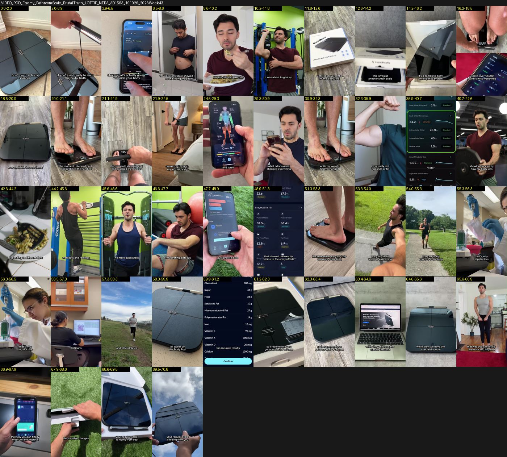

# VIDEO_POD_Enemy_BathroomScale_BrutalTruth_LOTTIE_NEBA_AD1563_191026_2026Week43

Master: `VIDEO_POD_Enemy_BathroomScale_BrutalTruth_LOTTIE_NEBA_AD1563_191026_2026Week43_Hook1_9x16.mp4` · 70.8s · 1080x1920

**Pacing:** 44 shots · avg 1.608s · median 1.35s · 6.08 cuts/10s · first cut 2.033s · 212.0 wpm · talk ratio 0.95 · cuts on word start 76.7% · cuts in speech gaps 58.1%
**Audio:** {'I_lufs': -11.4, 'LRA': 2.4, 'true_peak_db': 0.6} · BPM≈136.0 · music {'speech_rms_db': -14.3, 'pause_seconds': 0.0} · cuts with SFX/transient 79.1%

**Captions:** 245 cards · 1 words/card (median) · y≈0.761 of frame height · text height≈0.0281 · colours {'white': 212, 'dark/other': 27, 'blue': 4, 'red': 2} · cards crossing a cut: 15
Highlighted: Data, itsentsafe, currentsthrough, Excellent, Confirm, 6276.0
**Headlines:** XHume (2.0–2.0s, white) | LeanMass (4.0–4.5s, blue) | 2:500 (4.5–6.0s, blue) | Lean Mass (5.5–6.0s, blue) | 2007cal (17.0–17.0s, dark/other) | 179.5168 (18.0–18.0s, dark/other) | 2007eal (18.0–18.0s, dark/other) | XHumeHealth (25.0–25.0s, white)

**Hook (0–3s) spoken:** Don't buy this body scanner if you're not ready to learn the brutal
**Hook on-screen:** Don't buy this body / XHume / if you'renotreadyto learn / scanner / thebrutaltruth
**CTA (last 5s):** you can finally measure and improve the invisible changes your regular scale is hiding from you. · on-screen: 6276.0 / KHumo / is hiding from you / measureandimprove / that wayyou can finally / theinvisible changes / yourregular scale

## Beat sheet

| # | in–out (s) | dur | transition | spoken | on-screen text |
|---|---|---|---|---|---|
| 1 | 0.00–2.03 | 2.03 |  | Don't buy this body scanner if you're not ready | Don't buy this body / scanner / if you'renotreadyto learn / thebrutaltruth / XHume (HEADLINE) |
| 2 | 2.03–3.90 | 1.87 | cut +SFX hit | to learn the brutal truth about what's | if you'renotreadyto learn / thebrutaltruth / XHume (HEADLINE) / about what's actually going / oninsideyourbody |
| 3 | 3.90–6.50 | 2.6 | cut +SFX hit | actually going on inside your body. | about what's actually going / oninsideyourbody / LeanMass [blue] (HEADLINE) / 164.4bs / High / 143.5 |
| 4 | 6.50–8.57 | 2.07 | cut +SFX hit | For weeks, my scale showed I wasn't losing weight despite | for weeks my scale showed I / wasn'tlosing weight |
| 5 | 8.57–10.17 | 1.6 | cut +SFX hit | diet and exercise. | despite diet and exercise / 40 / I was about to give up |
| 6 | 10.17–11.80 | 1.63 | cut +SFX hit | I was about to give up until I discovered the | 40 / I was about to give up / until I discoveredthe / Hume Body Pod |
| 7 | 11.80–12.60 | 0.8 | cut +SFX hit | Hume Body Pot. | until I discoveredthe / Hume Body Pod |
| 8 | 12.60–14.23 | 1.63 | cut +SFX hit | This isn't just another smart scale. | this isn't just / anothersmartscale / it'sacompletebody / intelligencesystem |
| 9 | 14.23–16.17 | 1.93 | cut +SFX hit | It's a complete body intelligence system used | it'sacompletebody / intelligencesystem / 00 / 1:436 / Data [blue] / Fit Focus |
| 10 | 16.17–18.50 | 2.33 | cut +SFX hit | in over 12 ,000 health clinics worldwide, | 00 / 1:436 / Data [blue] / Fit Focus / Weight / 179. |
| 11 | 18.50–20.00 | 1.5 | cut +SFX hit | now available for your home. The | nowavailableforyourhome |
| 12 | 20.00–21.07 | 1.07 | cut +SFX hit | moment I stepped on it and grabbed | the moment I stepped on it / andgrabbedthehandles |
| 13 | 21.07–21.93 | 0.87 | cut | the handles, | the moment I stepped on it / andgrabbedthehandles |
| 14 | 21.93–24.50 | 2.57 | cut | it sent safe electrical currents through my entire body, | itsentsafe [red] / electrical / currentsthrough [red] / myentirebody |
| 15 | 24.50–29.33 | 4.83 | cut +SFX hit | scanning and analyzing my arms, legs, and torso with 98 % DEXA accuracy. What | XHumeHealth (HEADLINE) / Dashboard (HEADLINE) / 206.7 (HEADLINE) / BodyComposition (HEADLINE) / YourWeekilyTarget / 1of4Welgh-insCompleted |
| 16 | 29.33–30.93 | 1.6 | cut +SFX hit | I discovered changed everything. | Muscle / Measures / with98%DEXAaccuracy / BodyComposition (HEADLINE) / 19.2% (HEADLINE) / 19.6% (HEADLINE) |
| 17 | 30.93–32.33 | 1.4 | cut +SFX hit | While my weight hadn't changed, | while my weight / hadn'tchanged |
| 18 | 32.33–35.90 | 3.57 | cut +SFX hit | I'd actually lost 7 pounds of fat and gained 6 pounds of muscle. | while my weight / hadn'tchanged / I'd actually lost / 7poundsof fat / and gained / 6poundsofmuscle |
| 19 | 35.90–40.70 | 4.8 | cut +SFX hit | The body pod measured body fat, muscle mass, water, metabolic age, and 40 other metrics. | Skeletal MuscleMass (HEADLINE) / 61.8ibs (HEADLINE) / Standard (HEADLINE) / BodyFatPercentage (HEADLINE) / 21.5%个 (HEADLINE) / Low (HEADLINE) |
| 20 | 40.70–42.60 | 1.9 | cut +SFX hit | Showing me exactly how my body was responding | showing me exactly / how mybodywas |
| 21 | 42.60–44.17 | 1.57 | cut +SFX hit | to different diets, workouts, | respondingtodifferentdiets / workoutsandroutines |
| 22 | 44.17–45.60 | 1.43 | cut +SFX hit | and routines. | workoutsandroutines / agon [blue] (HEADLINE) |
| 23 | 45.60–46.57 | 0.97 | cut +SFX hit | No more guesswork or | PRECOR (HEADLINE) / nomoreguesswork |
| 24 | 46.57–47.70 | 1.13 | cut | frustrating plateaus. | orfrustratingplateaus |
| 25 | 47.70–48.90 | 1.2 | cut | Just precise data that | 5:24 (HEADLINE) / BoayComposition (HEADLINE) / 205.4 (HEADLINE) / YourWeeklyTargetO (HEADLINE) / 1of4Weigh-Ins Completed (HEADLINE) / Goals |
| 26 | 48.90–51.30 | 2.4 | cut +SFX hit | showed me exactly where to focus my efforts. | MuscleMass (HEADLINE) / BMR (HEADLINE) / 58.5kg (HEADLINE) / 1726Kcal (HEADLINE) / Excellent [blue] (HEADLINE) / BMI (HEADLINE) |
| 27 | 51.30–53.27 | 1.97 | cut | Because when you can truly measure everything, | that showed me exactly / FatFreeMass / 6.9kg / 62.8kg / High / Very low |
| 28 | 53.27–54.03 | 0.77 | cut +SFX hit | you can finally improve | becausewhen you cantruly / measureeverything / you can finally / improve everything |
| 29 | 54.03–55.27 | 1.23 | cut | everything. That's | you can finally / improve everything |
| 30 | 55.27–56.27 | 1.0 | cut +SFX hit | why top doctors, | you can finally / improve everything / that's why / top doctors |
| 31 | 56.27–56.47 | 0.2 | cut +SFX hit |  | that's why / top doctors |
| 32 | 56.47–57.30 | 0.83 | cut +SFX hit | dietitians, | that's why / top doctors / dietitians |
| 33 | 57.30–58.30 | 1.0 | cut +SFX hit | and elite athletes all | dietitians / and eliteathletes |
| 34 | 58.30–59.93 | 1.63 | cut +SFX hit | swear by the body pod for | and eliteathletes / Hume / all swear by / the Body Pod |
| 35 | 59.93–61.20 | 1.27 | cut | accurate results. | 281g (HEADLINE) / Carbs (HEADLINE) / 169g (HEADLINE) / Protein (HEADLINE) / 50g (HEADLINE) / Fat (HEADLINE) |
| 36 | 61.20–62.30 | 1.1 | cut +SFX hit | So I recommend you get | XHume / Please charge for / 5minsormore / ifit'snotturningon / Questionsorconcerns? Pleaserea (HEADLINE) / support@myhumehealth.com |
| 37 | 62.30–63.40 | 1.1 | cut +SFX hit | your body pod now while | XHume / Please charge for / 5minsormore / ifit'snotturningon / support@myhumehealth.com / soIrecommendyou |
| 38 | 63.40–64.57 | 1.17 | cut | they still have the | XHume / getyour BodyPod now / solrecommendyou / HumeHealth / MeetTheRevolutionary / BodyPod,Yourpersonal |
| 39 | 64.57–65.57 | 1.0 | cut +SFX hit | special discount. | whiletheystill havethe / special discount |
| 40 | 65.57–66.87 | 1.3 | cut +SFX hit | That way you can finally measure | that wayyou can finally / measureandimprove |
| 41 | 66.87–67.93 | 1.07 | cut +SFX hit | and improve the | that wayyou can finally / measureandimprove / 6276.0 [blue] |
| 42 | 67.93–68.63 | 0.7 | cut | invisible changes | theinvisible changes |
| 43 | 68.63–69.50 | 0.87 | cut +SFX hit | your regular scale | yourregular scale / is hiding from you |
| 44 | 69.50–70.75 | 1.25 | cut +SFX hit | is hiding from you. | yourregular scale / is hiding from you / KHumo |

## Hook variants

| hook | file | dur | first cut | spoken 0–3s | on-screen 0–3s |
|---|---|---|---|---|---|
| 1 | `talTruth_LOTTIE_NEBA_AD1563_191026_2026Week43_Hook1_9x16.mp4` | 70.8 | 2.033 | Don't buy this body scanner if you're not ready to learn the brutal | Don't buy this body / XHume / if you'renotreadyto learn / scanner / thebrutaltruth |
| 2 | `talTruth_LOTTIE_NEBA_AD1563_191026_2026Week43_Hook2_9x16.mp4` | 70.5 | 2.133 | Stepped on the humepod expecting a pat on the back for my hard | Steppedon the Hume Pod / a pat ontheback formy / expecting / hardwork |
| 3 | `talTruth_LOTTIE_NEBA_AD1563_191026_2026Week43_Hook3_9x16.mp4` | 71.5 | 1.167 | If you're on a weight loss or fitness journey right now, ask yourself, | If you're on a weight loss or / fitness / journey right now ask / yourself |

## Full transcript

Don't buy this body scanner if you're not ready to learn the brutal truth about what's actually going on inside your body. For weeks, my scale showed I wasn't losing weight despite diet and exercise. I was about to give up until I discovered the Hume Body Pot. This isn't just another smart scale. It's a complete body intelligence system used in over 12,000 health clinics worldwide, now available for your home. The moment I stepped on it and grabbed the handles, it sent safe electrical currents through my entire body, scanning and analyzing my arms, legs, and torso with 98% DEXA accuracy. What I discovered changed everything. While my weight hadn't changed, I'd actually lost 7 pounds of fat and gained 6 pounds of muscle. The body pod measured body fat, muscle mass, water, metabolic age, and 40 other metrics. Showing me exactly how my body was responding to different diets, workouts, and routines. No more guesswork or frustrating plateaus. Just precise data that showed me exactly where to focus my efforts. Because when you can truly measure everything, you can finally improve everything. That's why top doctors, dietitians, and elite athletes all swear by the body pod for accurate results. So I recommend you get your body pod now while they still have the special discount. That way you can finally measure and improve the invisible changes your regular scale is hiding from you.