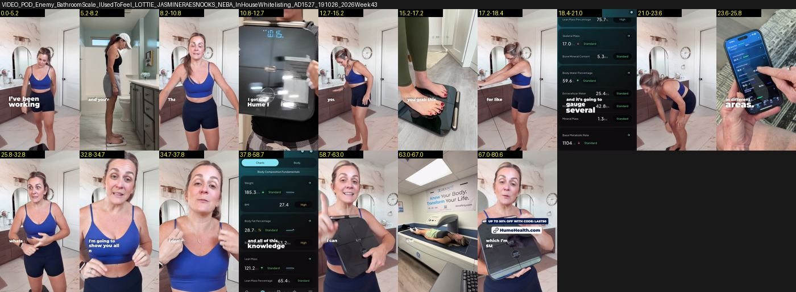

# VIDEO_POD_Enemy_BathroomScale_IUsedToFeel_LOTTIE_JASMINERAESNOOKS_NEBA_InHouseWhitelisting_AD1527_191026_2026Week43

Master: `VIDEO_POD_Enemy_BathroomScale_IUsedToFeel_LOTTIE_JASMINERAESNOOKS_NEBA_InHouseWhitelisting_AD1527_191026_2026Week43_hook1.mp4` · 80.6s · 1080x1920

**Pacing:** 17 shots · avg 4.742s · median 2.64s · 1.98 cuts/10s · first cut 5.16s · 279.0 wpm · talk ratio 0.94 · cuts on word start 87.5% · cuts in speech gaps 75.0%
**Audio:** {'I_lufs': -18.7, 'LRA': 8.4, 'true_peak_db': -1.3} · BPM≈123.0 · music {'speech_rms_db': -24.8, 'pause_seconds': 0.7, 'pause_rms_db': -26.8, 'bed_minus_voice_db': -2.0, 'music_bed_likely': True} · cuts with SFX/transient 43.8%

**Captions:** 292 cards · 1.0 words/card (median) · y≈0.651 of frame height · text height≈0.0304 · colours {'white': 242, 'blue': 11, 'dark/other': 38, 'green': 1} · cards crossing a cut: 0
Highlighted: I should be, SkeletaiHuscleMass, Standard, 52.9gs, BodyfatPercentage, Standerd, 52.9m, 18.8+, show you all, my nitty gritty, I'm just going to, Lean(lbs)
**Headlines:** lighter (4.5–4.5s, blue) | 025. (11.0–11.0s, blue) | Body Pod (19.0–20.0s, dark/other) | StepOnScale (19.0–20.0s, dark/other) | 18.8% + (19.0–19.0s, white) | Verylaw (19.0–19.0s, dark/other) | 21.61bs (19.0–19.0s, white) | BodyFatMass (19.0–19.0s, white)

**Hook (0–3s) spoken:** Yeah, yeah, let's go. I'm working out all
**Hook on-screen:** I've been / Lets go. / Yeah. / working
**CTA (last 5s):** single day. It gives you total 50 % off. So if you've been wanting one of these, use that discount and don't miss it. · on-screen: HumeHealth.com / It gives youx / UPTO5O%OFFWITHCODE:LAST50 / a total of / and don't / andluseit / been wanting / day. / discount / every single / one of these / soif you've

## Beat sheet

| # | in–out (s) | dur | transition | spoken | on-screen text |
|---|---|---|---|---|---|
| 1 | 0.00–5.16 | 5.16 |  | Yeah, yeah, let's go. I'm working out all week. I should be lighter, right? And | Yeah. / Lets go. / I've been / working / out / all wee |
| 2 | 5.16–8.16 | 3.0 | cut | then you get on a scale and you're not or you're heavier, | and then / you geton / the s / the scale / and you're not / or you' |
| 3 | 8.16–10.80 | 2.64 | cut | have you forbid? That's how I used to feel before I | Heaven / Tha / That's how / I used to feel |
| 4 | 10.80–12.72 | 1.92 | cut | got the human health body pod. | 025. [blue] (HEADLINE) / I got the / HumeHealth / bo |
| 5 | 12.72–15.16 | 2.44 | cut | This is how it works. You step on it with bare feet. | This is / how it / works, / you step on it |
| 6 | 15.16–17.16 | 2.0 | cut | You grab this and you hold it up for | you grab this |
| 7 | 17.16–18.44 | 1.28 | cut +SFX hit | like eight seconds and | forlike / 30 seconds |
| 8 | 18.44–21.04 | 2.6 | cut | it's going to gauge several different things. The biggest | forlike / 30 seconds / Body Pod (HEADLINE) / StepOnScale (HEADLINE) / 18.8% + (HEADLINE) / Verylaw (HEADLINE) |
| 9 | 21.04–23.60 | 2.56 | cut +SFX hit | thing for me is I want to know if I'm having | The bigges / I want to know |
| 10 | 23.60–25.80 | 2.2 | cut | progress in different areas. You don't want | EBody Pod [blue] (HEADLINE) / Goar Weigt [blue] (HEADLINE) / SkeletaiHuscleMass [blue] / Standard [blue] / 52.9gs [blue] / BodyfatPercentage [blue] |
| 11 | 25.80–32.80 | 7.0 | cut | to lose your muscle as you age. You want to have lean muscle because that's what's going to carry you throughout your days, okay? And that's what's most important to me. | You don't want / to lose / your / You want to have / leanI / whats |
| 12 | 32.80–34.72 | 1.92 | cut +SFX hit | And I'm going to show you all my nitty gritty numbers, | I'm going to / show you all [blue] / my nitty gritty [blue] |
| 13 | 34.72–37.84 | 3.12 | cut +SFX hit | but I'm just going to show because I don't really care at this point. So here we go. | I'm just going to [blue] |
| 14 | 37.84–58.68 | 20.84 | cut +SFX hit | Okay, so the scale has eight different sensors, which is really incredible. And it can measure your upper body and your lower body. Over here, you can do your fat percentage for the exact areas of your body. This is super cool stuff to know. And all of this knowledge is power, you guys. And it's going to help you know if you're losing muscle, how where you can work on different areas and how you can improve. And it explains these different things to you so that you can learn more about where you should be out for your age and whatnot. | Want deeperinsights into your progress? (HEADLINE) / GenerateProgress Report → (HEADLINE) / Body (HEADLINE) / Charts [blue] (HEADLINE) / BodyCompositionFundamentals (HEADLINE) / Weight (HEADLINE) |
| 15 | 58.68–62.96 | 4.28 | cut +SFX hit | And it's 98 % accurate, which I can attest to that because I'm nosy enough that | and its 98%x / and its 98% / accurate / which / ican / attest |
| 16 | 62.96–66.96 | 4.0 | cut | I went and got a DEXA scan, a full inch, a lot of really expensive DEXA scan, and | XDEXAFIT (HEADLINE) / Know Your Body. (HEADLINE) / Transform Your Life. [blue] (HEADLINE) / dexafitnj.com / 201-351-1591 / that |
| 17 | 66.96–80.62 | 13.66 | cut +SFX hit | the results were very similar. The 98 % I can vouch for, for sure. They also gave me killer discount code, which I'm super excited about because I really love this thing and I use it every single day. It gives you total 50 % off. So if you've been wanting one of these, use that discount and don't miss it. | and the re / and the results / were / very similar / the / the 98% |

## Hook variants

| hook | file | dur | first cut | spoken 0–3s | on-screen 0–3s |
|---|---|---|---|---|---|
| 1 | `_NEBA_InHouseWhitelisting_AD1527_191026_2026Week43_hook1.mp4` | 80.6 | 5.16 | Yeah, yeah, let's go. I'm working out all | I've been / Lets go. / Yeah. / working |
| 2 | `_NEBA_InHouseWhitelisting_AD1527_191026_2026Week43_hook2.mp4` | 83.2 | 5.12 | I just turned 40, I want to be strong and healthy. I |  |
| 3 | `_NEBA_InHouseWhitelisting_AD1527_191026_2026Week43_hook3.mp4` | 91.0 | 15.52 | This thing has changed the way I feel about | I fee / This thing / changed / has / the / the way |

## Full transcript

Yeah, yeah, let's go. I'm working out all week. I should be lighter, right? And then you get on a scale and you're not or you're heavier, have you forbid? That's how I used to feel before I got the human health body pod. This is how it works. You step on it with bare feet. You grab this and you hold it up for like eight seconds and it's going to gauge several different things. The biggest thing for me is I want to know if I'm having progress in different areas. You don't want to lose your muscle as you age. You want to have lean muscle because that's what's going to carry you throughout your days, okay? And that's what's most important to me. And I'm going to show you all my nitty gritty numbers, but I'm just going to show because I don't really care at this point. So here we go. Okay, so the scale has eight different sensors, which is really incredible. And it can measure your upper body and your lower body. Over here, you can do your fat percentage for the exact areas of your body. This is super cool stuff to know. And all of this knowledge is power, you guys. And it's going to help you know if you're losing muscle, how where you can work on different areas and how you can improve. And it explains these different things to you so that you can learn more about where you should be out for your age and whatnot. And it's 98% accurate, which I can attest to that because I'm nosy enough that I went and got a DEXA scan, a full inch, a lot of really expensive DEXA scan, and the results were very similar. The 98% I can vouch for, for sure. They also gave me killer discount code, which I'm super excited about because I really love this thing and I use it every single day. It gives you total 50% off. So if you've been wanting one of these, use that discount and don't miss it.