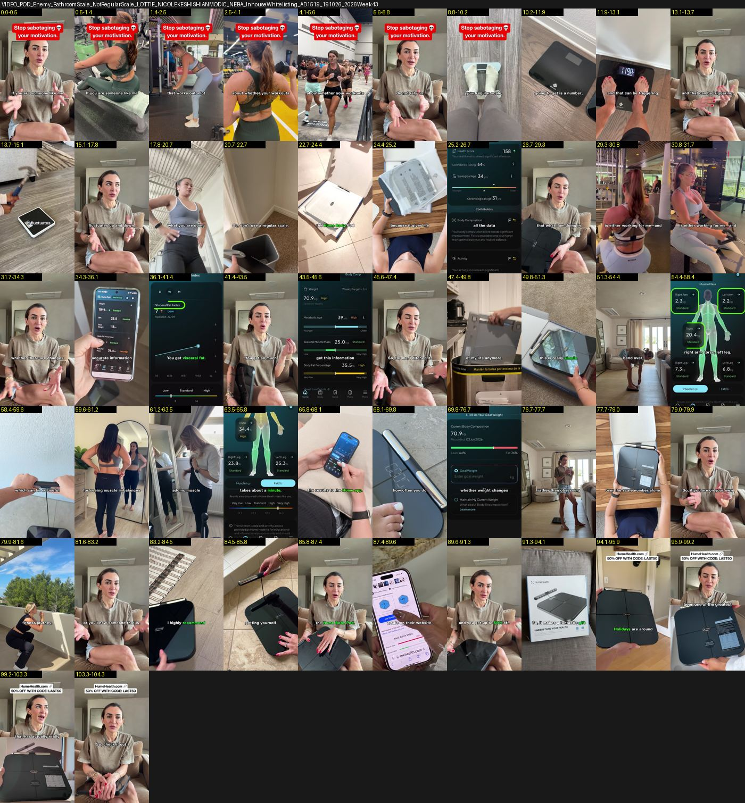

# VIDEO_POD_Enemy_BathroomScale_NotRegularScale_LOTTIE_NICOLEKESHISHIANMODIC_NEBA_InhouseWhitelisting_AD1519_191026_2026Week43

Master: `VIDEO_POD_Enemy_BathroomScale_NotRegularScale_LOTTIE_NICOLEKESHISHIANMODIC_NEBA_InhouseWhitelisting_AD1519_191026_2026Week43_Hook1_9x16.mp4` · 104.3s · 1080x1920

**Pacing:** 52 shots · avg 2.006s · median 1.69s · 4.89 cuts/10s · first cut 0.48s · 212.0 wpm · talk ratio 0.96 · cuts on word start 54.9% · cuts in speech gaps 43.1%
**Audio:** {'I_lufs': -23.8, 'LRA': 3.2, 'true_peak_db': -3.9} · BPM≈95.7 · music {'speech_rms_db': -28.1, 'pause_seconds': 0.2} · cuts with SFX/transient 58.8%

**Captions:** 256 cards · 1.0 words/card (median) · y≈0.624 of frame height · text height≈0.0287 · colours {'white': 177, 'red': 4, 'green': 13, 'dark/other': 54, 'yellow': 1, 'blue': 7} · cards crossing a cut: 12
Highlighted: about whether your workouts, the Hume Body Pod, Very High, your body fat., You get visceral fat., Mineyou.get water percentageard, more information., Manten la bolsa por encima de la, this is really simple., Muscle(kg), Fat(%), Results atakes about a minutes like you., takes about a minute,, the results to the Hume app., Body
**Headlines:** Stop sabotaging (0.0–9.0s, red) | your motivation. (0.0–7.0s, red) | your motivation (8.0–8.0s, red) | your motivation. (9.0–9.0s, red) | 1198. (12.0–12.0s, white) | HealthScore (25.0–25.0s, dark/other) | 158 (25.0–25.0s, white) | Low (25.0–25.0s, dark/other)

**Hook (0–3s) spoken:** If you are someone like me that works out a lot and you are curious about
**Hook on-screen:** If you are someone like me / Stop sabotaging / and you are curious / that works out a lot / your motivation.
**CTA (last 5s):** my repertoire that has actually really added value. So check it out. · on-screen: 50%OFFWITHCODE:LAST50 / HumeHealth.com / Humee / So,checkitout / added value. / inmyrepertoire / that has actually really

## Beat sheet

| # | in–out (s) | dur | transition | spoken | on-screen text |
|---|---|---|---|---|---|
| 1 | 0.00–0.48 | 0.48 |  | If you are someone | Stop sabotaging [red] (HEADLINE) / your motivation. [red] (HEADLINE) / If you are someone like me |
| 2 | 0.48–1.42 | 0.94 | cut +SFX hit | like me that works | Stop sabotaging [red] (HEADLINE) / your motivation. [red] (HEADLINE) / If you are someone like me / that works out a lot |
| 3 | 1.42–2.54 | 1.12 | cut +SFX hit | out a lot and you are curious | Stop sabotaging [red] (HEADLINE) / your motivation. [red] (HEADLINE) / that works out a lot / and you are curious |
| 4 | 2.54–4.10 | 1.56 | cut +SFX hit | about whether your | Stop sabotaging [red] (HEADLINE) / your motivation. [red] (HEADLINE) / and you are curious / about whether your workouts [red] |
| 5 | 4.10–5.62 | 1.52 | cut +SFX hit | workouts are working for | Stop sabotaging [red] (HEADLINE) / your motivation. [red] (HEADLINE) / about whether your workouts [red] / are working for you, |
| 6 | 5.62–8.84 | 3.22 | cut +SFX hit | you, I would say do not rely on your | Stop sabotaging [red] (HEADLINE) / your motivation. [red] (HEADLINE) / are working for you, / do not rely on / your motivation [red] (HEADLINE) |
| 7 | 8.84–10.20 | 1.36 | cut | regular scale because | Stop sabotaging [red] (HEADLINE) / your motivation. [red] (HEADLINE) / your regular scale, / Because all you're |
| 8 | 10.20–11.92 | 1.72 | cut +SFX hit | all you're gonna get is a number and | Because all you're / TEKCITY / going to get is a number, |
| 9 | 11.92–13.10 | 1.18 | cut +SFX hit | that can be triggering, | 1198. (HEADLINE) / and that can be triggering / ETEKCITY / and that can be triggering. |
| 10 | 13.10–13.68 | 0.58 | cut +SFX hit |  | and that can be triggering. |
| 11 | 13.68–15.10 | 1.42 | cut | it fluctuates, your weight | Itfluctuates / fluctuates up and down, |
| 12 | 15.10–17.80 | 2.7 | cut | fluctuates up and down and it really gives you no data into | fluctuates up and down, / no data into whether |
| 13 | 17.80–20.72 | 2.92 | cut +SFX hit | whether what you are doing is actually working. | no data into whether / what you are doing / is actually working |
| 14 | 20.72–22.66 | 1.94 | cut | So I don't use a regular scale, but | So, don't use a regular scale, |
| 15 | 22.66–24.36 | 1.7 | cut +SFX hit | I do use the Hume Body Pod | the Hume Body Pod [green] |
| 16 | 24.36–25.16 | 0.8 | cut +SFX hit | because it gives me all | the Hume Body Pod [green] / HealthScore (HEADLINE) / 158 (HEADLINE) / Low (HEADLINE) / 158+ / HealthScore |
| 17 | 25.16–26.66 | 1.5 | cut +SFX hit | the data that I need to | HealthScore (HEADLINE) / 158 (HEADLINE) / Low (HEADLINE) / 158+ / HealthScore / Yourhealthmetricsneedsignificantattention |
| 18 | 26.66–29.34 | 2.68 | cut +SFX hit | make sure that what I am doing in | to make sure / that what I am doing in |
| 19 | 29.34–30.78 | 1.44 | cut +SFX hit | the gym is either working for | that what I am doing in / is either working for me-and |
| 20 | 30.78–31.68 | 0.9 | cut | me and if it's | is either working for me-and |
| 21 | 31.68–34.30 | 2.62 | cut +SFX hit | not, whether there are changes that need to be made. | whether there are changes / that need to be made. |
| 22 | 34.30–36.08 | 1.78 | cut +SFX hit | You get very accurate information when | that need to be made. / CHumePod [blue] (HEADLINE) / StepOnScale [green] (HEADLINE) / Weight (HEADLINE) / BMI (HEADLINE) / 23.5 (HEADLINE) |
| 23 | 36.08–41.38 | 5.3 | cut | it comes to your body fat. You get visceral fat, you get water percentage, | Weight (HEADLINE) / Standard / BodyFatPercentage / Very High [red] / LeanMass / Hume Pod (HEADLINE) |
| 24 | 41.38–43.54 | 2.16 | cut +SFX hit | you get so much more information and | Standard / High / HumePod (HEADLINE) / StepOnScale [green] (HEADLINE) / Bone Mineral (HEADLINE) / 8.2ibs (HEADLINE) |
| 25 | 43.54–45.64 | 2.1 | cut | you will not get this information from | BodyComp (HEADLINE) / Weight (HEADLINE) / WeeklyTargets:1/4 (HEADLINE) / 70.9kg (HEADLINE) / High (HEADLINE) / Updated:Wed03 (HEADLINE) |
| 26 | 45.64–47.38 | 1.74 | cut | a regular scale. So for me, | from a regular scale. / So, for me, I ditched it. |
| 27 | 47.38–49.80 | 2.42 | cut +SFX hit | I ditched it. It's not part of my life anymore. | So, for me, I ditched it. / It's not part / Fabovetheline / Manten la bolsa por encima de la [yellow] / ofmy life anymore. / abovetheline |
| 28 | 49.80–51.30 | 1.5 | cut | Okay, so using this is really simple. | Okay, so using / this is really simple. [green] |
| 29 | 51.30–54.44 | 3.14 | cut | You just step on, bend over and hold the handles. It | this is really simple. [green] / You just step on, / and hold the handles. |
| 30 | 54.44–58.40 | 3.96 | cut +SFX hit | measures your left arm, right arm, torso, left leg, and right leg separately, | and hold the handles. / HumePod (HEADLINE) / MuscleMass (HEADLINE) / RightArm (HEADLINE) / LeftArm (HEADLINE) / 2.3kg (HEADLINE) |
| 31 | 58.40–59.60 | 1.2 | cut +SFX hit | which can be so useful | HumePod (HEADLINE) / MuscleMass (HEADLINE) / RightArm (HEADLINE) / LeftArm (HEADLINE) / 2.3kg (HEADLINE) / 2.2kg (HEADLINE) |
| 32 | 59.60–61.18 | 1.58 | cut +SFX hit | for seeing muscle imbalances or | for seeing muscle imbalances / or whether you're |
| 33 | 61.18–63.48 | 2.3 | cut | whether you're adding muscle in specific areas. | or whether you're / adding muscle / in specific areas. |
| 34 | 63.48–65.82 | 2.34 | cut | Whole process takes about a minute and it automatically | in specific areas. / Connected [green] (HEADLINE) / HumePod (HEADLINE) / Trunk (HEADLINE) / 34.4% (HEADLINE) / High (HEADLINE) |
| 35 | 65.82–68.10 | 2.28 | cut +SFX hit | syncs the results to the Hume app. | and it automatically syncs / the results to the Hume app. [green] / Depending on |
| 36 | 68.10–69.78 | 1.68 | cut | Depending on how often you do this, the | Depending on / how often you do |
| 37 | 69.78–76.66 | 6.88 | cut +SFX hit | app lets you follow changes weekly and monthly so you can really see whether weight changes are coming from fat, muscle, or water rather | Younger (HEADLINE) / Older (HEADLINE) / Chronological Age 31 yrs (HEADLINE) / Contributors (HEADLINE) / BodyComposition (HEADLINE) / Yourbodycompositionscoreneedssignificant (HEADLINE) |
| 38 | 76.66–77.70 | 1.04 | cut | than obsessing | rather than obsessing |
| 39 | 77.70–79.04 | 1.34 | cut +SFX hit | over the scale number alone. | over the scale number alone. / So,if you are on your own |
| 40 | 79.04–79.86 | 0.82 | cut | So if you | So,if you are on your own |
| 41 | 79.86–81.60 | 1.74 | cut +SFX hit | are on your own fitness journey or | So,if you are on your own / fitness journey, [red] |
| 42 | 81.60–83.20 | 1.6 | cut | you know someone that is highly | or you know someone thatis, / Ihighly recommend [green] |
| 43 | 83.20–84.46 | 1.26 | cut | recommend | Ihighly recommend [green] |
| 44 | 84.46–85.82 | 1.36 | cut +SFX hit | getting yourself the | Ihighly recommend [green] / getting yourself |
| 45 | 85.82–87.44 | 1.62 | cut | Hume Body Pod. They are already | the Hume Body Pod. [green] / They are already having |
| 46 | 87.44–89.64 | 2.2 | cut +SFX hit | having a sale on their website and | They are already having / l 50 (HEADLINE) / oFree Woridwide Shipping / 80-DayReturnPolicy / ooseWarrantyProtection: / 10 Years S35 |
| 47 | 89.64–91.28 | 1.64 | cut | you get up to 50 % off. | and you get up to 50% off. [green] |
| 48 | 91.28–94.12 | 2.84 | cut +SFX hit | So it makes a fantastic gift for someone. | and you get up to 50% off. [green] / XHumeHealth (HEADLINE) / So, it makes a fantastic gift / UNDERSTANDYOURHEALTH / HumeHealth.com (HEADLINE) / 50%OFFWITHCODE:LAST50 (HEADLINE) |
| 49 | 94.12–95.92 | 1.8 | cut | Holidays are around the corner. | HumeHealth.com (HEADLINE) / 50%OFFWITHCODE:LAST50 (HEADLINE) / Holidays are around [green] |
| 50 | 95.92–99.18 | 3.26 | cut | Yeah, it's been one of the greatest little tools in | HumeHealth.com (HEADLINE) / 50%OFFWITHCODE:LAST50 (HEADLINE) / Yeah,it's / KHume / beenoneofthegreatest / XHume |
| 51 | 99.18–103.30 | 4.12 | cut +SFX hit | my repertoire that has actually really added value. | HumeHealth.com (HEADLINE) / 50%OFFWITHCODE:LAST50 (HEADLINE) / inmyrepertoire / that has actually really / added value. / Humee |
| 52 | 103.30–104.30 | 1.0 | cut +SFX hit | So check it out. | HumeHealth.com (HEADLINE) / 50%OFFWITHCODE:LAST50 (HEADLINE) / added value. / Humee / So,checkitout |

## Hook variants

| hook | file | dur | first cut | spoken 0–3s | on-screen 0–3s |
|---|---|---|---|---|---|
| 1 | `_InhouseWhitelisting_AD1519_191026_2026Week43_Hook1_9x16.mp4` | 104.3 | 0.48 | If you are someone like me that works out a lot and you are curious about | If you are someone like me / Stop sabotaging / and you are curious / that works out a lot / your motivation. |
| 2 | `_InhouseWhitelisting_AD1519_191026_2026Week43_Hook2_9x16.mp4` | 101.4 | 1.42 | This is your reminder to ditch the scale that you've | Bathroom scale → / This is your reminder / to ditchthescale |
| 3 | `_InhouseWhitelisting_AD1519_191026_2026Week43_Hook3_9x16.mp4` | 97.1 | 2.98 | do not rely on your regular scale because |  |

## Full transcript

If you are someone like me that works out a lot and you are curious about whether your workouts are working for you, I would say do not rely on your regular scale because all you're gonna get is a number and that can be triggering, it fluctuates, your weight fluctuates up and down and it really gives you no data into whether what you are doing is actually working. So I don't use a regular scale, but I do use the Hume Body Pod because it gives me all the data that I need to make sure that what I am doing in the gym is either working for me and if it's not, whether there are changes that need to be made. You get very accurate information when it comes to your body fat. You get visceral fat, you get water percentage, you get so much more information and you will not get this information from a regular scale. So for me, I ditched it. It's not part of my life anymore. Okay, so using this is really simple. You just step on, bend over and hold the handles. It measures your left arm, right arm, torso, left leg, and right leg separately, which can be so useful for seeing muscle imbalances or whether you're adding muscle in specific areas. Whole process takes about a minute and it automatically syncs the results to the Hume app. Depending on how often you do this, the app lets you follow changes weekly and monthly so you can really see whether weight changes are coming from fat, muscle, or water rather than obsessing over the scale number alone. So if you are on your own fitness journey or you know someone that is highly recommend getting yourself the Hume Body Pod. They are already having a sale on their website and you get up to 50% off. So it makes a fantastic gift for someone. Holidays are around the corner. Yeah, it's been one of the greatest little tools in my repertoire that has actually really added value. So check it out.