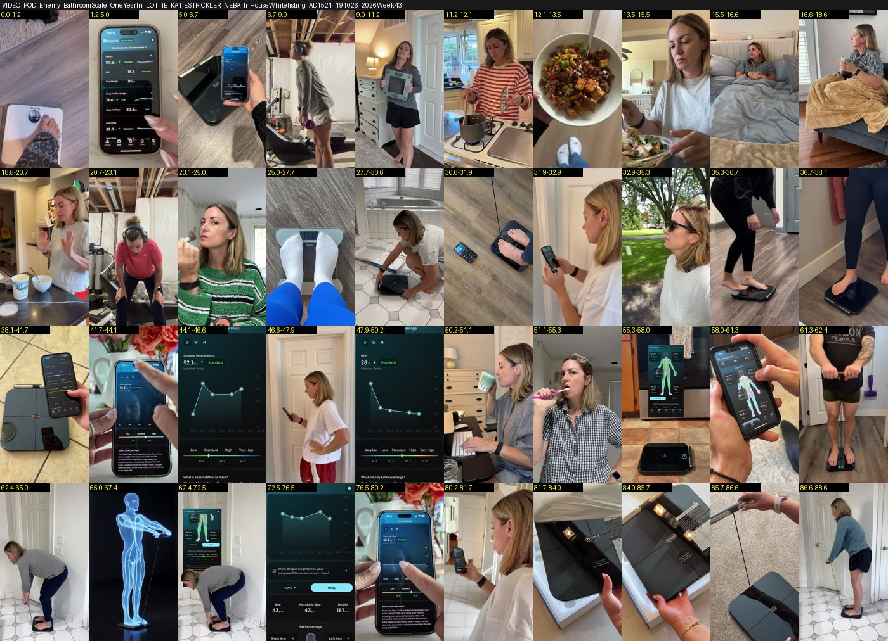

# VIDEO_POD_Enemy_BathroomScale_OneYearIn_LOTTIE_KATIESTRICKLER_NEBA_InHouseWhitelisting_AD1521_191026_2026Week43

Master: `VIDEO_POD_Enemy_BathroomScale_OneYearIn_LOTTIE_KATIESTRICKLER_NEBA_InHouseWhitelisting_AD1521_191026_2026Week43_9X16_HOOK1.mp4` · 88.6s · 1080x1920

**Pacing:** 40 shots · avg 2.215s · median 2.133s · 4.4 cuts/10s · first cut 1.2s · 251.0 wpm · talk ratio 0.97 · cuts on word start 69.2% · cuts in speech gaps 41.0%
**Audio:** {'I_lufs': -18.6, 'LRA': 4.0, 'true_peak_db': -2.9} · BPM≈117.5 · music {'speech_rms_db': -22.9, 'pause_seconds': 0.0} · cuts with SFX/transient 59.0%

**Captions:** 179 cards · 1 words/card (median) · y≈0.653 of frame height · text height≈0.0222 · colours {'white': 141, 'dark/other': 33, 'green': 2, 'blue': 1, 'yellow': 1, 'red': 1} · cards crossing a cut: 1
Highlighted: Standard, Body, High, Standard, XHume
**Headlines:** 9:476 (1.0–1.5s, blue) | BodyCompositionFundamentals (1.0–3.0s, blue) | Weight (1.0–3.5s, white) | 110.5ibs+Standard (1.0–1.0s, white) | BodyPod (1.5–2.5s, blue) | Standard (1.5–3.0s, dark/other) | 110.5bs+ (1.5–2.0s, white) | 9:47L (2.5–2.5s, blue)

**Hook (0–3s) spoken:** If you're still in that way yourself, I just think you could get a lot more information
**Hook on-screen:** 110.5bs+ / 110.5ibs / 110.5ibs+Standard / 115ibs / 18. / 18.6%+ / 18.8 / 20.6ibs / 20.6lbs / 70 5% / 74 / 82.3ibs / 82.3is / 9:476 / 9:47L / BMI / Body / BodyCompositionFundamentals / BodyFat / BodyFatMass / BodyFatPercentage / BodyPod / Goal Weight / LeanMass / Plans / SALTER / Standard / StepOnScale / Weight / n0.6lbs
**CTA (last 5s):** with code last 50 and it's also HSA and FSA eligible. · on-screen: 00 / GETTING STARTED / TED / XHume

## Beat sheet

| # | in–out (s) | dur | transition | spoken | on-screen text |
|---|---|---|---|---|---|
| 1 | 0.00–1.20 | 1.2 |  | If you're still in that way yourself, | SALTER / 9:476 [blue] (HEADLINE) / BodyCompositionFundamentals [blue] (HEADLINE) / Weight (HEADLINE) / 110.5ibs+Standard (HEADLINE) / 18.8 |
| 2 | 1.20–5.00 | 3.8 | cut +SFX hit | I just think you could get a lot more information and a lot more helpful information than | 9:476 [blue] (HEADLINE) / BodyCompositionFundamentals [blue] (HEADLINE) / Weight (HEADLINE) / 110.5ibs+Standard (HEADLINE) / 18.8 / 115ibs |
| 3 | 5.00–6.67 | 1.67 | cut | just a number on a scale. |  |
| 4 | 6.67–9.03 | 2.37 | cut +SFX hit | I've been on like just a strength journey. |  |
| 5 | 9.03–11.20 | 2.17 | cut +SFX hit | I really wasn't using a traditional scale. |  |
| 6 | 11.20–12.13 | 0.93 | cut +SFX hit | I was like, what did |  |
| 7 | 12.13–13.47 | 1.33 | cut +SFX hit | I eat a big meal |  |
| 8 | 13.47–15.50 | 2.03 | cut +SFX hit | last night that had a bunch of sodium? And |  |
| 9 | 15.50–16.57 | 1.07 | cut +SFX hit | maybe I'm heavier because |  |
| 10 | 16.57–18.57 | 2.0 | cut +SFX hit | I'm like retaining more water or |  |
| 11 | 18.57–20.67 | 2.1 | cut | am I losing weight but |  |
| 12 | 20.67–23.13 | 2.47 | cut | also losing valuable muscle mass that |  |
| 13 | 23.13–25.03 | 1.9 | cut | I want to have as I age? |  |
| 14 | 25.03–27.70 | 2.67 | cut | This one number wasn't really giving me anything. |  |
| 15 | 27.70–30.60 | 2.9 | cut +SFX hit | But a year ago, guys, it has been a year that I have been using the |  |
| 16 | 30.60–31.87 | 1.27 | cut | Hume body pod. |  |
| 17 | 31.87–32.93 | 1.07 | cut +SFX hit | I just really like it. |  |
| 18 | 32.93–35.33 | 2.4 | cut +SFX hit | For me, it has been so rewarding to |  |
| 19 | 35.33–36.67 | 1.33 | cut +SFX hit | like once or twice a month hop |  |
| 20 | 36.67–38.07 | 1.4 | cut +SFX hit | on this thing and be like, | 360 (HEADLINE) / 32.9 / 23.0x |
| 21 | 38.07–41.73 | 3.67 | cut | I can see. I'm not even like so dialed in on like a specific number. | 360 (HEADLINE) / 32.9 / 23.0x / 72.24 / 23.0% / 32.9m (HEADLINE) |
| 22 | 41.73–44.10 | 2.37 | cut +SFX hit | I actually look at it over the month and I like to see an | 48.31bs / WhatisTrunkLeanMass? / Trunk Lean Mass:Trunk LeanMass is theshareofyour / includingthemuscle,boneorgans,waterand / connectivetissueofyourcore.Becausethetrunk / holdsalargeportionofyourbody'stissue,changes |
| 23 | 44.10–46.57 | 2.47 | cut +SFX hit | upward trend in muscle mass. | High / SkeletalMuscleMass (HEADLINE) / 52.1ibs (HEADLINE) / Standard [green] (HEADLINE) / Updated:Today (HEADLINE) / 48 |
| 24 | 46.57–47.93 | 1.37 | cut +SFX hit | That's the main one I'm looking at. |  |
| 25 | 47.93–50.17 | 2.23 | cut | And then obviously a flat to lower trend in body fat | BodyFatPercentage (HEADLINE) / BFP (HEADLINE) / 28% + (HEADLINE) / Standard [green] (HEADLINE) / Updated:Today (HEADLINE) / 19/1120/121/1122/1123/1124/125/11 |
| 26 | 50.17–51.10 | 0.93 | cut | is a good feeling too. |  |
| 27 | 51.10–55.33 | 4.23 | cut +SFX hit | And how it works, I do it first thing in the morning. I'm gonna do it when I have no food and I smell like no water. |  |
| 28 | 55.33–57.97 | 2.63 | cut | I hop on it, it connects to the app on my phone. So | 4.6ms (HEADLINE) / 4.6mm (HEADLINE) / 40.4g (HEADLINE) / 14.3ibs / 14.5ms / 157cm (HEADLINE) |
| 29 | 57.97–61.30 | 3.33 | cut | if your like spouse wanted to use it, they could have the app on their phone and | 10:52 [blue] (HEADLINE) / NoDevicePaired [blue] (HEADLINE) / Heigt (HEADLINE) / MetabolcAge (HEADLINE) / 26s (HEADLINE) / MuacleMass (HEADLINE) |
| 30 | 61.30–62.40 | 1.1 | cut | they could connect to it So | 10:52 [blue] (HEADLINE) / Standard / Right Leg / Muscle Mass (HEADLINE) / RightArm (HEADLINE) / High |
| 31 | 62.40–65.00 | 2.6 | cut | I step on and I pull up the handle bar and | PATRON (HEADLINE) / TEQUILA (HEADLINE) / 00 (HEADLINE) |
| 32 | 65.00–67.43 | 2.43 | cut +SFX hit | in like 30 to 40 seconds It |  |
| 33 | 67.43–72.47 | 5.03 | cut | reads all of these different numbers and then I just go on to the app and | Body Pod (HEADLINE) / 20.7% (HEADLINE) / 40.4bs (HEADLINE) / 14.3ms (HEADLINE) / 14.5ibs (HEADLINE) / 4.6i0s (HEADLINE) |
| 34 | 72.47–76.47 | 4.0 | cut +SFX hit | that's where I can look at just that day I can look at a breakdown of my body and then I can also look | Body Pod (HEADLINE) / 4.6bs (HEADLINE) / 40.4s / 14.5bs / Weight (HEADLINE) / GoalWeight (HEADLINE) |
| 35 | 76.47–80.20 | 3.73 | cut +SFX hit | at like over days weeks months of time of like What | Body Pod (HEADLINE) / Connected [green] (HEADLINE) / FatPercentage / RightArm / LeftArm / 25.8% |
| 36 | 80.20–81.73 | 1.53 | cut | is changing in my body? You |  |
| 37 | 81.73–83.97 | 2.23 | cut +SFX hit | can get 50 % off right now with | GETTING STARTED (HEADLINE) / XHume / 5minsormore / ifit'snottuming on |
| 38 | 83.97–85.73 | 1.77 | cut | code last 50 and | GETTING STARTED (HEADLINE) / XHume (HEADLINE) / TED (HEADLINE) / XHume [red] |
| 39 | 85.73–86.63 | 0.9 | cut +SFX hit | it's also HSA |  |
| 40 | 86.63–88.61 | 1.97 | cut +SFX hit | and FSA eligible. | 00 (HEADLINE) |

## Hook variants

| hook | file | dur | first cut | spoken 0–3s | on-screen 0–3s |
|---|---|---|---|---|---|
| 1 | `_InHouseWhitelisting_AD1521_191026_2026Week43_9X16_HOOK1.mp4` | 88.6 | 1.2 | If you're still in that way yourself, I just think you could get a lot more information | 110.5bs+ / 110.5ibs / 110.5ibs+Standard / 115ibs / 18. / 18.6%+ / 18.8 / 20.6ibs |
| 1 | `_InHouseWhitelisting_AD1521_191026_2026Week43_9X16_HOOK1.mp4` | 88.6 | 1.2 | If you're someone that weighs yourself, I just think you could get a lot more information | 110.5bs+ / 110.5ibsStandard / 110.5lbs+ / 115ibs / 18. / 18.6%+ / 18.8 / 70 5% |
| 2 | `_InHouseWhitelisting_AD1521_191026_2026Week43_9X16_HOOK2.mp4` | 89.9 | 3.5 | I kind of gave up on the traditional scale a very long time |  |
| 2 | `_InHouseWhitelisting_AD1521_191026_2026Week43_9X16_HOOK2.mp4` | 89.9 | 3.5 | I kind of gave up on the traditional scale a very long time | I kind of gave up on the / a very long time ago / traditionalscale |
| 3 | `_InHouseWhitelisting_AD1521_191026_2026Week43_9X16_HOOK3.mp4` | 90.0 | 2.0 | But as I like had goals in mind and I like been wanting to |  |
| 3 | `_InHouseWhitelisting_AD1521_191026_2026Week43_9X16_HOOK3.mp4` | 90.0 | 2.0 | But as I like had goals in mind and I like been wanting to | AsI've likehad / and I've been wanting / goals in mind / to get stronger, |

## Full transcript

If you're still in that way yourself, I just think you could get a lot more information and a lot more helpful information than just a number on a scale. I've been on like just a strength journey. I really wasn't using a traditional scale. I was like, what did I eat a big meal last night that had a bunch of sodium? And maybe I'm heavier because I'm like retaining more water or am I losing weight but also losing valuable muscle mass that I want to have as I age? This one number wasn't really giving me anything. But a year ago, guys, it has been a year that I have been using the Hume body pod. I just really like it. For me, it has been so rewarding to like once or twice a month hop on this thing and be like, I can see. I'm not even like so dialed in on like a specific number. I actually look at it over the month and I like to see an upward trend in muscle mass. That's the main one I'm looking at. And then obviously a flat to lower trend in body fat is a good feeling too. And how it works, I do it first thing in the morning. I'm gonna do it when I have no food and I smell like no water. I hop on it, it connects to the app on my phone. So if your like spouse wanted to use it, they could have the app on their phone and they could connect to it So I step on and I pull up the handle bar and in like 30 to 40 seconds It reads all of these different numbers and then I just go on to the app and that's where I can look at just that day I can look at a breakdown of my body and then I can also look at like over days weeks months of time of like What is changing in my body? You can get 50% off right now with code last 50 and it's also HSA and FSA eligible.