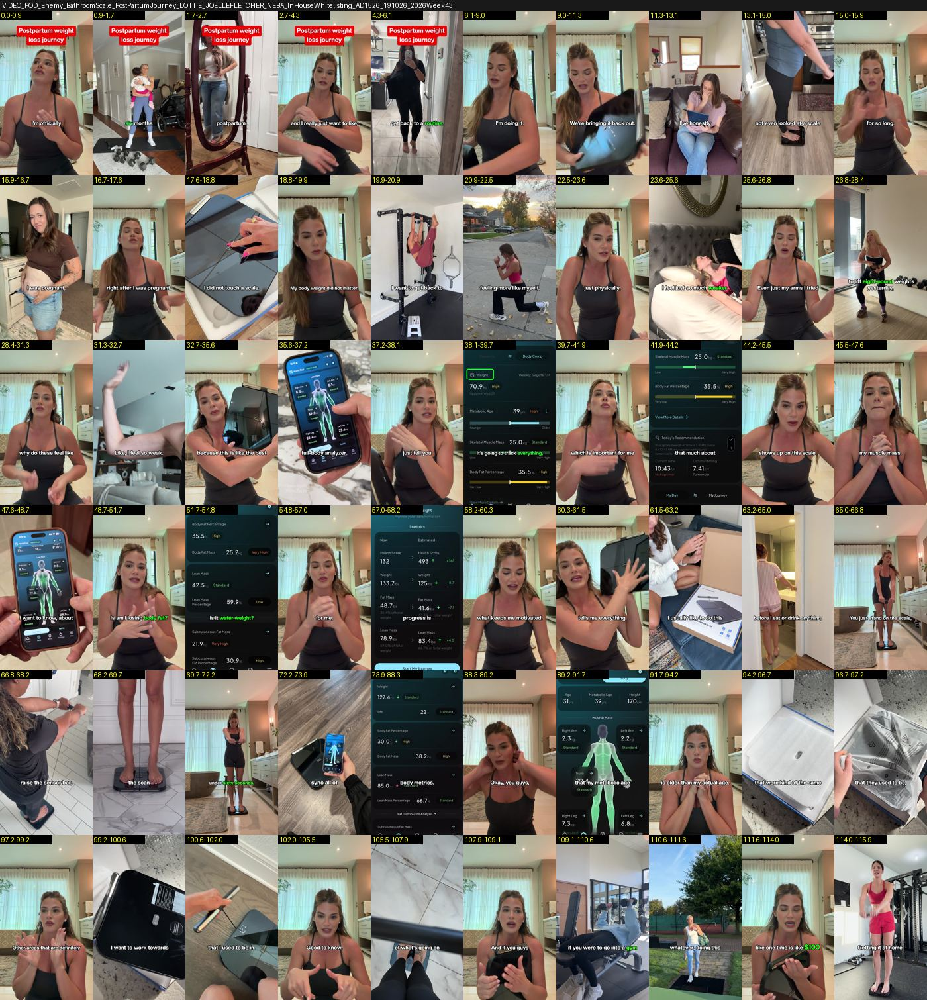

# VIDEO_POD_Enemy_BathroomScale_PostPartumJourney_LOTTIE_JOELLEFLETCHER_NEBA_InHouseWhitelisting_AD1526_191026_2026Week43

Master: `VIDEO_POD_Enemy_BathroomScale_PostPartumJourney_LOTTIE_JOELLEFLETCHER_NEBA_InHouseWhitelisting_AD1526_191026_2026Week43_Hook1_9x16.mp4` · 126.5s · 1080x1920

**Pacing:** 68 shots · avg 1.86s · median 1.59s · 5.3 cuts/10s · first cut 0.9s · 247.0 wpm · talk ratio 0.97 · cuts on word start 74.6% · cuts in speech gaps 46.3%
**Audio:** {'I_lufs': -15.9, 'LRA': 4.7, 'true_peak_db': 0.6} · BPM≈103.4 · music {'speech_rms_db': -21.2, 'pause_seconds': 0.3} · cuts with SFX/transient 41.8%

**Captions:** 291 cards · 1 words/card (median) · y≈0.666 of frame height · text height≈0.0316 · colours {'white': 216, 'green': 25, 'red': 14, 'dark/other': 35, 'blue': 1} · cards crossing a cut: 2
Highlighted: sixmonths, get back to aroutine., Okay,you guys,, I'm doing it., Ifeel just so much weaker., to lift eight-pound weights, why do these feel like, Ipulled out the Hume Pod, because thisis like the best, High, It'sgoing totrack everything,, which is important for me, if Iend up gaining weight, Is am I losing body fat?, Istitiwaterweight?
**Headlines:** Postpartum weight (0.0–5.5s, red) | lossjourney (0.0–5.5s, red) | 10:180 (36.0–36.0s, blue) | StepOnScale (36.0–36.0s, blue) | HumePod (36.0–36.0s, blue) | LeanMass (36.0–36.0s, blue) | Left Arm (36.0–36.0s, white) | 8.1ibs (36.0–36.0s, white)

**Hook (0–3s) spoken:** I'm officially six months postpartum and I really
**Hook on-screen:** I'mofficially / Postpartum weight / and I reallyjust want to like, / lossjourney / postpartum, / sixmonths
**CTA (last 5s):** % off right now. This code lasts 50 and it's also HSA and SSA eligible. · on-screen: 50%off / HSA and FSA eligfible. / HSA and FSAeligible. / HumeHealth.com / LAST5O,andit'salso / UPTO50%OFFWITHCODE:LAST50 / Withcode / Youcanget / rightnow.

## Beat sheet

| # | in–out (s) | dur | transition | spoken | on-screen text |
|---|---|---|---|---|---|
| 1 | 0.00–0.90 | 0.9 |  | I'm officially six | Postpartum weight [red] (HEADLINE) / lossjourney [red] (HEADLINE) / I'mofficially |
| 2 | 0.90–1.72 | 0.82 | cut | months postpartum | Postpartum weight [red] (HEADLINE) / lossjourney [red] (HEADLINE) / I'mofficially / sixmonths [green] / postpartum, |
| 3 | 1.72–2.70 | 0.98 | cut | and I | Postpartum weight [red] (HEADLINE) / lossjourney [red] (HEADLINE) / postpartum, / and I reallyjust want to like, |
| 4 | 2.70–4.34 | 1.64 | cut | really just want to like get | Postpartum weight [red] (HEADLINE) / lossjourney [red] (HEADLINE) / and I reallyjust want to like, / and I reallyjust wantto like / and I really just want to like, |
| 5 | 4.34–6.12 | 1.78 | cut | back to a routine Okay, | Postpartum weight [red] (HEADLINE) / lossjourney [red] (HEADLINE) / and I really just want to like, / get back to aroutine. [green] / Okay,you guys, [red] |
| 6 | 6.12–9.02 | 2.9 | cut +SFX hit | you guys I'm doing it dusting off the | Okay,you guys, [red] / I'm doing it. [red] / Dusting off / the scale. |
| 7 | 9.02–11.28 | 2.26 | cut | scale bringing it back back out I'm | the scale. / We're bringing it back out. |
| 8 | 11.28–13.06 | 1.78 | cut +SFX hit | honestly not even | We're bringing it back out. / 've honestly / notevenlookedatascale |
| 9 | 13.06–14.96 | 1.9 | cut +SFX hit | looked at a scale for | notevenlookedatascale |
| 10 | 14.96–15.90 | 0.94 | cut +SFX hit | so long I | for so long. |
| 11 | 15.90–16.70 | 0.8 | cut +SFX hit | was pregnant right | Iwas pregnant, |
| 12 | 16.70–17.60 | 0.9 | cut | after I was pregnant did | right afterIwas pregnant, |
| 13 | 17.60–18.78 | 1.18 | cut | not touch the scale my | I did not toucha scale. |
| 14 | 18.78–19.92 | 1.14 | cut | body weight do not matter | My body weight did not matter. |
| 15 | 19.92–20.92 | 1.0 | cut | I want to get back to feeling | Iwantto getback to |
| 16 | 20.92–22.54 | 1.62 | cut | more like myself just | feeling more like myself, |
| 17 | 22.54–23.62 | 1.08 | cut | physically. I | just physically |
| 18 | 23.62–25.64 | 2.02 | cut +SFX hit | feel just so much weaker You | Ifeel just so much weaker. [green] |
| 19 | 25.64–26.80 | 1.16 | cut +SFX hit | can just my arms. I tried to lift | Even just my arms I tried |
| 20 | 26.80–28.38 | 1.58 | cut +SFX hit | like eight pound weights yesterday and | to lift eight-pound weights [green] / yesterday, |
| 21 | 28.38–31.28 | 2.9 | cut | I was like, why do these feel like 30 pound weights? | to lift eight-pound weights [green] / yesterday, / why do these feel like [red] / like thirty-pound weights? |
| 22 | 31.28–32.72 | 1.44 | cut +SFX hit | And I feel so weak. | like thirty-pound weights? / Like, Ifeel so weak |
| 23 | 32.72–35.60 | 2.88 | cut | I pulled out the human pod because this is like the best full | Ipulled out the Hume Pod [green] / because thisis like the best [red] |
| 24 | 35.60–37.24 | 1.64 | cut | body analyzer. So | 10:180 [blue] (HEADLINE) / StepOnScale [blue] (HEADLINE) / HumePod [blue] (HEADLINE) / LeanMass [blue] (HEADLINE) / Left Arm (HEADLINE) / 8.1ibs (HEADLINE) |
| 25 | 37.24–38.08 | 0.84 | cut | I'm gonna just tell you, | It's not going to / BodyComp (HEADLINE) / Capacity (HEADLINE) / Weight (HEADLINE) / Weekly Targets:1/4 (HEADLINE) / 70.9kg (HEADLINE) |
| 26 | 38.08–39.68 | 1.6 | cut | your weight is going to track | BodyComp (HEADLINE) / Capacity (HEADLINE) / Weight (HEADLINE) / Weekly Targets:1/4 (HEADLINE) / 70.9kg (HEADLINE) / High (HEADLINE) |
| 27 | 39.68–41.94 | 2.26 | cut | everything which is important for me, because like I said, | which is important for me [red] |
| 28 | 41.94–44.18 | 2.24 | cut | I truly don't care that much about whatever number shows | 25.0 (HEADLINE) / SkeletalMuscleMass (HEADLINE) / Standard (HEADLINE) / Low (HEADLINE) / Very High (HEADLINE) / 35.5% High (HEADLINE) |
| 29 | 44.18–45.48 | 1.3 | cut | up on this scale. | showsup onthisscale |
| 30 | 45.48–47.56 | 2.08 | cut | I wanna know about my muscle mass. | showsup onthisscale / I want to know about / my muscle mass. |
| 31 | 47.56–48.68 | 1.12 | cut +SFX hit | I wanna know about if I end | 5:066 [blue] (HEADLINE) / StepOn Scale [blue] (HEADLINE) / HumePod [blue] (HEADLINE) / MetabollcAge [blue] (HEADLINE) / 5'10"" (HEADLINE) / 38yrs (HEADLINE) |
| 32 | 48.68–51.74 | 3.06 | cut | up gaining weight or losing weight, is I am I losing body fat? | if Iend up gaining weight [red] / Is am I losing body fat? [green] |
| 33 | 51.74–54.76 | 3.02 | cut +SFX hit | Am I losing muscle? Is it water weight? I want to know everything about | HumePod (HEADLINE) / BodyCompositionFundamentals (HEADLINE) / Weight (HEADLINE) / 70.9 (HEADLINE) / High (HEADLINE) / 24.5 |
| 34 | 54.76–56.98 | 2.22 | cut | this because for me seeing how | about this because, / seeing how I'm making [red] |
| 35 | 56.98–58.24 | 1.26 | cut +SFX hit | I'm making progress is | Successin Sight (HEADLINE) / Previewyourtransformation (HEADLINE) / Statistics (HEADLINE) / Now (HEADLINE) / Estimated (HEADLINE) / HealthScore (HEADLINE) |
| 36 | 58.24–60.26 | 2.02 | cut | what keeps me motivated and this guy tells | what keeps me motivated. / And this guy [red] |
| 37 | 60.26–61.46 | 1.2 | cut | me everything For | And this guy [red] / tells me everything. [red] |
| 38 | 61.46–63.22 | 1.76 | cut +SFX hit | me, I usually like to do this first | tells me everything. [red] / HumeHealth / Iusually like to do this / YOURHEALTH / first thing in the morning |
| 39 | 63.22–64.98 | 1.76 | cut +SFX hit | thing in the morning before I eat or drink | first thing in the morning / before Ieat or drink anything. |
| 40 | 64.98–66.84 | 1.86 | cut | anything Just stand on the scale raise | before Ieat or drink anything. / You just stand on the scale, |
| 41 | 66.84–68.16 | 1.32 | cut +SFX hit | the sensor bar and in | raise the sensor bar, / and in total, |
| 42 | 68.16–69.68 | 1.52 | cut +SFX hit | total the scan probably takes under | and in total, / probablytakes |
| 43 | 69.68–72.16 | 2.48 | cut +SFX hit | 60 seconds And then once you step off | undersixty seconds. [green] / And then, once you start off, / it will immediately |
| 44 | 72.16–73.88 | 1.72 | cut | it will nearly sink all the | it will immediately / sync all of |
| 45 | 73.88–88.34 | 14.46 | cut +SFX hit | data to your app where you can see everything right here Which if you're a visual person like me you'll love being able to see the body breakdown but it gives you so many different body metrics. Weight, body fat percentage, lean mass, subcontainment fat, shows your visceral fat, skeletal muscle, shows hydration. | Height (HEADLINE) / Age (HEADLINE) / MetabolicAge (HEADLINE) / 5'4"ft (HEADLINE) / 38yrs (HEADLINE) / 35yrs (HEADLINE) |
| 46 | 88.34–89.20 | 0.86 | cut | Okay, guys, | Standard / Standard (HEADLINE) / SkeletalMass (HEADLINE) / High [blue] (HEADLINE) / Bone Mineral / 2.5kg |
| 47 | 89.20–91.66 | 2.46 | cut | don't love the fact that my metabolic age is | Standard / Connected [green] (HEADLINE) / HumePod (HEADLINE) / Age (HEADLINE) / MetabolicAge (HEADLINE) / Height (HEADLINE) |
| 48 | 91.66–94.22 | 2.56 | cut | older than my actual age. That, I jump, look, | is older than my actual age. [red] / That I don't love. / HumeHealth (HEADLINE) / YOUR HEALTH (HEADLINE) / UNDERSTAY (HEADLINE) / BOD |
| 49 | 94.22–96.66 | 2.44 | cut | there were other areas that were kind of the same as they | HumeHealth (HEADLINE) / YOUR HEALTH (HEADLINE) / UNDERSTAY (HEADLINE) / BOD / SMARTE / BAL |
| 50 | 96.66–97.20 | 0.54 | cut +SFX hit | used to be, | like pre-baby. [green] |
| 51 | 97.20–99.22 | 2.02 | cut | like pre -baby, other areas that are definitely higher | like pre-baby. [green] / Other areas that are definitely / WARNING: / inaMundfe (HEADLINE) / ewnH / higher that |
| 52 | 99.22–100.58 | 1.36 | cut | that I wanna work towards getting back | WARNING: / inaMundfe (HEADLINE) / ewnH / higher that / GETTING STARTED (HEADLINE) / getting back into the range |
| 53 | 100.58–102.00 | 1.42 | cut +SFX hit | into the range that I used to be in. | that I used to be in. |
| 54 | 102.00–105.50 | 3.5 | cut +SFX hit | But overall, good starting point, good to know. That's why I love this thing. It just gives you | But overall, good starting point. / That's why I love this thing. [red] / It just gives you |
| 55 | 105.50–107.86 | 2.36 | cut | all of the insights of what's going on in your body. | 95 0 / all of the insights / 0.56. / of what's going on |
| 56 | 107.86–109.06 | 1.2 | cut +SFX hit | And if you guys have never done | And if you guys / one of these, |
| 57 | 109.06–110.62 | 1.56 | cut +SFX hit | one of these, If you were to go into a gym or | one of these, / if you were to go into a gym [green] |
| 58 | 110.62–111.60 | 0.98 | cut | a med spot, whatever, | whatever, doing this |
| 59 | 111.60–114.00 | 2.4 | cut +SFX hit | doing this like one time is like $100. Getting | $100 [green] / likeonetimeis like / like one time is like $100 [green] |
| 60 | 114.00–115.94 | 1.94 | cut | it at home if you really plan to use it | Getting it at home / if you really plan to use it |
| 61 | 115.94–116.98 | 1.04 | cut +SFX hit | and want something like this is | and want something |
| 62 | 116.98–118.60 | 1.62 | cut +SFX hit | like such a way better deal. | such a way better deal |
| 63 | 118.60–119.62 | 1.02 | cut | So you guys do something like this, | UPTO50%OFFWITHCODE:LAST50 [blue] (HEADLINE) / HumeHealth.com (HEADLINE) / likethis,I'mgoingto linkit [red] |
| 64 | 119.62–121.04 | 1.42 | cut +SFX hit | I'm gonna only get with my code right here. | UPTO50%OFFWITHCODE:LAST50 [blue] (HEADLINE) / HumeHealth.com (HEADLINE) / HumeHealth (HEADLINE) / UNDERSTANDYOURHEALTH / BMATIODYCOVPOXITIONAN / withmy coderight here. |
| 65 | 121.04–122.50 | 1.46 | cut | You can get 50 % off right | UPTO50%OFFWITHCODE:LAST50 [blue] (HEADLINE) / HumeHealth.com (HEADLINE) / You.canget50%off [green] / rightnow. [red] / 50%off [green] / Youcanget |
| 66 | 122.50–123.96 | 1.46 | cut | now. This code lasts 50 | UPTO50%OFFWITHCODE:LAST50 [blue] (HEADLINE) / HumeHealth.com (HEADLINE) / Withcode |
| 67 | 123.96–125.30 | 1.34 | cut +SFX hit | and it's also HSA and | UPTO50%OFFWITHCODE:LAST50 [blue] (HEADLINE) / HumeHealth.com (HEADLINE) / LAST5O,andit'salso [green] / HSA and FSA eligfible. [green] |
| 68 | 125.30–126.51 | 1.21 | cut | SSA eligible. | UPTO50%OFFWITHCODE:LAST50 [blue] (HEADLINE) / HumeHealth.com (HEADLINE) / HSA and FSA eligfible. [green] / HSA and FSAeligible. [green] |

## Hook variants

| hook | file | dur | first cut | spoken 0–3s | on-screen 0–3s |
|---|---|---|---|---|---|
| 1 | `_InHouseWhitelisting_AD1526_191026_2026Week43_Hook1_9x16.mp4` | 126.5 | 0.9 | I'm officially six months postpartum and I really | I'mofficially / Postpartum weight / and I reallyjust want to like, / lossjourney / postpartum, / sixmonths |
| 2 | `_InHouseWhitelisting_AD1526_191026_2026Week43_Hook2_9x16.mp4` | 128.4 | 1.66 | We are going to start this postpartum recovery, | How I'm staying accountable / We are going to start this / postpartum recovery, |
| 3 | `_InHouseWhitelisting_AD1526_191026_2026Week43_Hook3_9x16.mp4` | 125.3 | 0.54 | I'm gonna start tracking |  |
| 4 | `_InHouseWhitelisting_AD1526_191026_2026Week43_Hook4_9x16.mp4` | 119.4 | 0.86 | okay guys don't love the fact that my metabolic age |  |

## Full transcript

I'm officially six months postpartum and I really just want to like get back to a routine Okay, you guys I'm doing it dusting off the scale bringing it back back out I'm honestly not even looked at a scale for so long I was pregnant right after I was pregnant did not touch the scale my body weight do not matter I want to get back to feeling more like myself just physically. I feel just so much weaker You can just my arms. I tried to lift like eight pound weights yesterday and I was like, why do these feel like 30 pound weights? And I feel so weak. I pulled out the human pod because this is like the best full body analyzer. So I'm gonna just tell you, your weight is going to track everything which is important for me, because like I said, I truly don't care that much about whatever number shows up on this scale. I wanna know about my muscle mass. I wanna know about if I end up gaining weight or losing weight, is I am I losing body fat? Am I losing muscle? Is it water weight? I want to know everything about this because for me seeing how I'm making progress is what keeps me motivated and this guy tells me everything For me, I usually like to do this first thing in the morning before I eat or drink anything Just stand on the scale raise the sensor bar and in total the scan probably takes under 60 seconds And then once you step off it will nearly sink all the data to your app where you can see everything right here Which if you're a visual person like me you'll love being able to see the body breakdown but it gives you so many different body metrics. Weight, body fat percentage, lean mass, subcontainment fat, shows your visceral fat, skeletal muscle, shows hydration. Okay, guys, don't love the fact that my metabolic age is older than my actual age. That, I jump, look, there were other areas that were kind of the same as they used to be, like pre-baby, other areas that are definitely higher that I wanna work towards getting back into the range that I used to be in. But overall, good starting point, good to know. That's why I love this thing. It just gives you all of the insights of what's going on in your body. And if you guys have never done one of these, If you were to go into a gym or a med spot, whatever, doing this like one time is like $100. Getting it at home if you really plan to use it and want something like this is like such a way better deal. So you guys do something like this, I'm gonna only get with my code right here. You can get 50% off right now. This code lasts 50 and it's also HSA and SSA eligible.