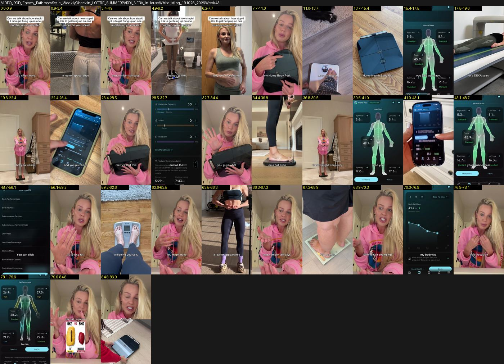

# VIDEO_POD_Enemy_BathroomScale_WeeklyCheckIn_LOTTIE_SUMMERPARDI_NEBA_InHouseWhitelisting_191026_2026Week43

Master: `VIDEO_POD_Enemy_BathroomScale_WeeklyCheckIn_LOTTIE_SUMMERPARDI_NEBA_InHouseWhitelisting_191026_2026Week43_Hook1_9x16.mp4` · 86.9s · 1080x1920

**Pacing:** 33 shots · avg 2.633s · median 2.133s · 3.68 cuts/10s · first cut 0.867s · 283.0 wpm · talk ratio 0.92 · cuts on word start 75.0% · cuts in speech gaps 50.0%
**Audio:** {'I_lufs': -18.8, 'LRA': 2.5, 'true_peak_db': -1.6} · BPM≈152.0 · music {'speech_rms_db': -23.5, 'pause_seconds': 1.1, 'pause_rms_db': -25.2, 'bed_minus_voice_db': -1.7, 'music_bed_likely': True} · cuts with SFX/transient 43.8%

**Captions:** 299 cards · 1 words/card (median) · y≈0.762 of frame height · text height≈0.0281 · colours {'red': 21, 'white': 169, 'dark/other': 89, 'green': 5, 'blue': 15} · cards crossing a cut: 2
Highlighted: You might have, MIC, and number still says,, VOIAM, youknow,, Standard, you 98% accuracy,, similar to, Muscle(lbs), Fat Mass, SkeletalMuscleMass, Body, progress?, Charts, Lean Mass
**Headlines:** Can we talk about how stupid (0.0–7.0s, white) | it is to get hung up on one (0.0–7.0s, white) | number on your scale? (0.0–7.0s, white) | HumePod (16.0–17.0s, white) | StepOnScale (16.0–17.0s, green) | MuscleMass (16.0–17.0s, white) | Right Arm (16.0–17.0s, white) | LeftArm (16.0–17.0s, white)

**Hook (0–3s) spoken:** and you might have a leaner appearance and be more toned.
**Hook on-screen:** Can we talk about how stupid / MIC / You might have / aleanerappearance / and be more toned, / it is to get hung up on one / number on your scale?
**CTA (last 5s):** take up more actual space. I'll link up for you guys so you can get up to 50 % off the human body part. · on-screen: 5KG vS 5KG / FAT / I'll link it / MUSCLE / actual space. / the Hume Body Pod / the fat is gonna / up-to

## Beat sheet

| # | in–out (s) | dur | transition | spoken | on-screen text |
|---|---|---|---|---|---|
| 1 | 0.00–0.87 | 0.87 |  | and you might have a | Can we talk about how stupid (HEADLINE) / it is to get hung up on one (HEADLINE) / number on your scale? (HEADLINE) / You might have [red] / MIC [red] |
| 2 | 0.87–3.37 | 2.5 | cut +SFX hit | leaner appearance and be more toned. | Can we talk about how stupid (HEADLINE) / it is to get hung up on one (HEADLINE) / number on your scale? (HEADLINE) / You might have [red] / MIC [red] / aleanerappearance |
| 3 | 3.37–4.93 | 1.57 | cut | And number still says, you know, | Can we talk about how stupid (HEADLINE) / it is to get hung up on one (HEADLINE) / number on your scale? (HEADLINE) / and be more toned, / and number still says, [red] / VOIAM [red] |
| 4 | 4.93–6.20 | 1.27 | cut | 140 pounds and | Can we talk about how stupid (HEADLINE) / it is to get hung up on one (HEADLINE) / number on your scale? (HEADLINE) / VOIAM [red] / youknow, [red] / 14opounds. |
| 5 | 6.20–7.67 | 1.47 | cut | you're like, why isn't it changing? | Can we talk about how stupid (HEADLINE) / it is to get hung up on one (HEADLINE) / number on your scale? (HEADLINE) / Andyou're like, / "Why isn't it changing?" |
| 6 | 7.67–11.03 | 3.37 | cut | About to do my weekly check -in with my human body pod and I wanted to take you guys along. | my weekly / my Hume Body Pod, / to take you / SALTER / This does so much |
| 7 | 11.03–13.73 | 2.7 | cut +SFX hit | It does so much more than just give you your weight. | SALTER / This does so much / more than just / your weight. |
| 8 | 13.73–15.37 | 1.63 | cut +SFX hit | This human body pod is gonna give you | XHume / Hume Health Body Pod / itit snat tuninga / is gonna give |
| 9 | 15.37–17.47 | 2.1 | cut | 98 % accuracy similar to an | XHume / itit snat tuninga / is gonna give / HumePod (HEADLINE) / StepOnScale [green] (HEADLINE) / MuscleMass (HEADLINE) |
| 10 | 17.47–19.60 | 2.13 | cut +SFX hit | in -body scan or a dexa scan, but you're | HumePod (HEADLINE) / StepOnScale [green] (HEADLINE) / MuscleMass (HEADLINE) / Right Arm (HEADLINE) / LeftArm (HEADLINE) / Standard [green] |
| 11 | 19.60–22.40 | 2.8 | cut | not gonna have to pay every single time that you wanna do one of those scans. You have | have to pay / that you wanna / You have this |
| 12 | 22.40–26.40 | 4.0 | cut | this in the comfort of your home and you purchase it one time, which is fantastic. So many | You have this / 4:28 [blue] (HEADLINE) / Hume Pod [blue] (HEADLINE) / StepOnScale [blue] (HEADLINE) / 50 [blue] (HEADLINE) / Android Region [blue] (HEADLINE) |
| 13 | 26.40–28.53 | 2.13 | cut | different metrics that this will show you and then you can actually | StepOnScale [blue] (HEADLINE) / Standard / Home / Body [blue] / Nutrition / More |
| 14 | 28.53–32.70 | 4.17 | cut | see the breakdown down and the progress and all the charts and things. So let me hop | Generateyour HealthReport by (HEADLINE) / upgradingtoHumePlus (HEADLINE) / MetabolicMomentum (HEADLINE) / Capacity / BodyComp / 30 |
| 15 | 32.70–34.43 | 1.73 | cut | on and I'll show you guys what my looks like. | and I'll show / mine looks like. |
| 16 | 34.43–36.77 | 2.33 | cut +SFX hit | See, I always want to start barefoot on a flat even surface. You hold | mine looks like. / start barefoot / on a flat even |
| 17 | 36.77–39.50 | 2.73 | cut | the handlebars and there's eight frequency sensors in those handlebars. They're | handlebars,and / there's eight frequency / those handlebars. |
| 18 | 39.50–40.97 | 1.47 | cut | going to read you all your metrics and | Hume Pod (HEADLINE) / StepOnScale [green] (HEADLINE) / LeanMass (HEADLINE) / RightArm (HEADLINE) / LeftArm (HEADLINE) / 5.61bs (HEADLINE) |
| 19 | 40.97–43.07 | 2.1 | cut +SFX hit | it'll populate into an app that looks like this. | StepOnScale [green] (HEADLINE) / 10:09元 [blue] (HEADLINE) / BodyPod [blue] (HEADLINE) / Welght (HEADLINE) / GoalWelght (HEADLINE) / Weight (HEADLINE) |
| 20 | 43.07–48.70 | 5.63 | cut +SFX hit | The Body Diagram is my favorite. This shows you your muscle mass as well as your body found on each of these limbs in your torso. | StepOnScale [green] (HEADLINE) / HumePod (HEADLINE) / MuscleMass (HEADLINE) / Right Arm (HEADLINE) / LeftArm (HEADLINE) / 5.3ibs (HEADLINE) |
| 21 | 48.70–56.13 | 7.43 | cut +SFX hit | And then further on, you can see each of these categories here and the breakdown you can click on these. It'll give you more detail. Just a great way to track your progress. | 5:29 (HEADLINE) / HumePod(100%) (HEADLINE) / Connected [green] (HEADLINE) / 229 (HEADLINE) / 215 / 24/09 |
| 22 | 56.13–59.17 | 3.03 | cut | So say your goal is to lose fat and gain muscle. the | So, say your goal [red] / LIOV [red] / is to lose fat / and gain muscle. [red] / TAMITA / The number |
| 23 | 59.17–62.63 | 3.47 | cut | number on the scale, if you're just weighing yourself, that number might not really change. | TAMITA / The number / TARGTA / If you're just / TANOTA / weighing yourself, |
| 24 | 62.63–63.50 | 0.87 | cut | You might have a | You might have [red] |
| 25 | 63.50–66.27 | 2.77 | cut +SFX hit | leaner appearance and be more toned and number | a leaner appearance / and be more toned, / and number still says, |
| 26 | 66.27–67.27 | 1.0 | cut +SFX hit | still says, you | and number still says, / ICE'C [red] (HEADLINE) |
| 27 | 67.27–68.93 | 1.67 | cut +SFX hit | know, 140 pounds and | and number still says, / ICE'C [red] (HEADLINE) / 140 pounds |
| 28 | 68.93–70.30 | 1.37 | cut | you're like, why isn't it changing? | MOIAM [red] / "Why isn't it changing?" [red] / VOIAM [red] |
| 29 | 70.30–76.93 | 6.63 | cut +SFX hit | I look at the muscle mass, my visceral fat, my body fat, my hydration. Those are all the things that I | "Why isn't it changing?" [red] / VOIAM [red] / LeftLegMuscleMass (HEADLINE) / 14.4 bs (HEADLINE) / Standard [green] (HEADLINE) / Updated:Today (HEADLINE) |
| 30 | 76.93–78.13 | 1.2 | cut +SFX hit | focus on because that's | thatI focus on [red] / FatPercentage (HEADLINE) / RightArm (HEADLINE) / LeftArm (HEADLINE) / 26.9% (HEADLINE) / 27.5% (HEADLINE) |
| 31 | 78.13–79.57 | 1.43 | cut | to me what really matters. | FatPercentage (HEADLINE) / RightArm (HEADLINE) / LeftArm (HEADLINE) / 26.9% (HEADLINE) / 27.5% (HEADLINE) / High (HEADLINE) |
| 32 | 79.57–84.83 | 5.27 | cut +SFX hit | If you have a pound of muscle and a pound of fat, the fat is gonna take up more actual space. I'll link up for you guys so | a pound of muscle [red] / 5KG vS 5KG [red] / FAT / MUSCLE / and a pound of fat, [red] / the fat is gonna [red] |
| 33 | 84.83–86.89 | 2.06 | cut | you can get up to 50 % off the human body part. | up-to [red] / the Hume Body Pod [red] |

## Hook variants

| hook | file | dur | first cut | spoken 0–3s | on-screen 0–3s |
|---|---|---|---|---|---|
| 1 | `DI_NEBA_InHouseWhitelisting_191026_2026Week43_Hook1_9x16.mp4` | 86.9 | 0.867 | and you might have a leaner appearance and be more toned. | Can we talk about how stupid / MIC / You might have / aleanerappearance / and be more toned, / it is to get hung up on one / number on your scale? |
| 2 | `DI_NEBA_InHouseWhitelisting_191026_2026Week43_Hook2_9x16.mp4` | 85.6 | 0.7 | to say your goal is to lose fat and gain muscle. The | AM / Me trying to grow my glutes / Sayyour goal / and gain muscle. / butpanicking / is to lose fat / when the scalegoes up |
| 3 | `DI_NEBA_InHouseWhitelisting_191026_2026Week43_Hook3_9x16.mp4` | 83.8 | 7.9 | If you have a pound of muscle and a pound of fat, that is gonna take up more |  |

## Full transcript

and you might have a leaner appearance and be more toned. And number still says, you know, 140 pounds and you're like, why isn't it changing? About to do my weekly check-in with my human body pod and I wanted to take you guys along. It does so much more than just give you your weight. This human body pod is gonna give you 98% accuracy similar to an in-body scan or a dexa scan, but you're not gonna have to pay every single time that you wanna do one of those scans. You have this in the comfort of your home and you purchase it one time, which is fantastic. So many different metrics that this will show you and then you can actually see the breakdown down and the progress and all the charts and things. So let me hop on and I'll show you guys what my looks like. See, I always want to start barefoot on a flat even surface. You hold the handlebars and there's eight frequency sensors in those handlebars. They're going to read you all your metrics and it'll populate into an app that looks like this. The Body Diagram is my favorite. This shows you your muscle mass as well as your body found on each of these limbs in your torso. And then further on, you can see each of these categories here and the breakdown you can click on these. It'll give you more detail. Just a great way to track your progress. So say your goal is to lose fat and gain muscle. the number on the scale, if you're just weighing yourself, that number might not really change. You might have a leaner appearance and be more toned and number still says, you know, 140 pounds and you're like, why isn't it changing? I look at the muscle mass, my visceral fat, my body fat, my hydration. Those are all the things that I focus on because that's to me what really matters. If you have a pound of muscle and a pound of fat, the fat is gonna take up more actual space. I'll link up for you guys so you can get up to 50% off the human body part.