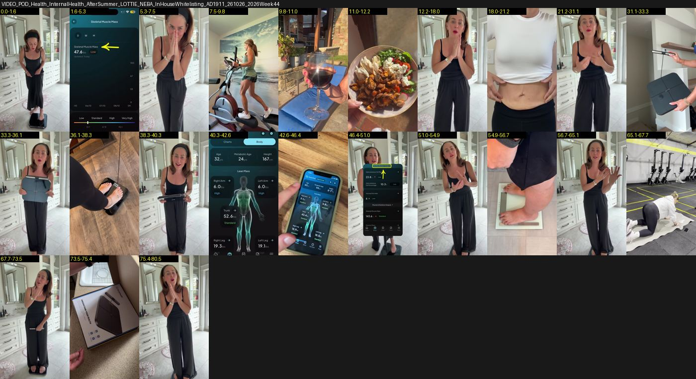

# VIDEO_POD_Health_InternalHealth_AfterSummer_LOTTIE_NEBA_InHouseWhitelisting_AD1911_261026_2026Week44

Master: `VIDEO_POD_Health_InternalHealth_AfterSummer_LOTTIE_NEBA_InHouseWhitelisting_AD1911_261026_2026Week44_Hook1_9x16.mov` · 80.5s · 1080x1920

**Pacing:** 23 shots · avg 3.501s · median 2.534s · 2.73 cuts/10s · first cut 1.6s · 207.0 wpm · talk ratio 0.94 · cuts on word start 68.2% · cuts in speech gaps 45.5%
**Audio:** {'I_lufs': -24.6, 'LRA': 7.2, 'true_peak_db': -3.6} · BPM≈112.3 · music {'speech_rms_db': -30.8, 'pause_seconds': 1.4, 'pause_rms_db': -32.7, 'bed_minus_voice_db': -1.9, 'music_bed_likely': True} · cuts with SFX/transient 54.5%

**Captions:** 97 cards · 1 words/card (median) · y≈0.637 of frame height · text height≈0.0246 · colours {'dark/other': 55, 'white': 26, 'blue': 15, 'red': 1} · cards crossing a cut: 6
Highlighted: CoHumePod, StepOnScale, GenerateProgress Heport, Charts, Body, Age, MetabolicAge, CHumePod, 54yrs, Ago, 54ys, aht Leg, 4:28, CHumePod, Age
**Headlines:** MetabolicAge (1.5–2.5s, white) | 44yrs ≤ (1.5–1.5s, white) | High (1.5–2.5s, dark/other) | Updated:Today (1.5–2.5s, dark/other) | 44yrs (2.0–2.0s, white) | 44yrs ≤ (2.5–2.5s, white) | 10:44 (3.0–3.5s, blue) | 70 (3.0–3.5s, yellow)

**Hook (0–3s) spoken:** This is how I track things like my metabolic age,
**Hook on-screen:** 28 / 33 / 44yrs / 44yrs ≤ / 46 / 50 / Excellent / Good / High / MetabolicAge / Standard / Updated:Today / VeryHigh / W34 / W35 / W36
**CTA (last 5s):** So click the link here to auto apply the discount and save · on-screen: 

## Beat sheet

| # | in–out (s) | dur | transition | spoken | on-screen text |
|---|---|---|---|---|---|
| 1 | 0.00–1.60 | 1.6 |  | This is how I track things like my | MetabolicAge (HEADLINE) / 44yrs ≤ (HEADLINE) / High (HEADLINE) / Updated:Today (HEADLINE) / 46 / W35 |
| 2 | 1.60–5.27 | 3.67 | cut | metabolic age, my muscle mass, and my visceral fat. | MetabolicAge (HEADLINE) / 44yrs ≤ (HEADLINE) / High (HEADLINE) / Updated:Today (HEADLINE) / 46 / W35 |
| 3 | 5.27–7.53 | 2.27 | cut +SFX hit | Now, honest with you, I have definitely been | Standard / High / Low / 10:47 (HEADLINE) / VisceralFatIndex (HEADLINE) / Standard (HEADLINE) |
| 4 | 7.53–9.83 | 2.3 | cut +SFX hit | out of my usual workout routine this summer. |  |
| 5 | 9.83–11.00 | 1.17 | cut +SFX hit | And the rosé and |  |
| 6 | 11.00–12.23 | 1.23 | cut | all the good food, I |  |
| 7 | 12.23–17.97 | 5.73 | cut | have not been on track. And even when my weight didn't change much, I just felt different. |  |
| 8 | 17.97–21.23 | 3.27 | cut | Whether I was retaining water or feeling swollen. |  |
| 9 | 21.23–31.07 | 9.83 | cut | And that's just because body changes really can affect things like muscle mass, body fat, overall body composition, water retention. And one of the ways I've been tracking these changes is |  |
| 10 | 31.07–33.33 | 2.27 | cut | with the Hume Pod. |  |
| 11 | 33.33–36.07 | 2.73 | cut +SFX hit | It is the world's first portable body analyzer. |  |
| 12 | 36.07–38.27 | 2.2 | cut +SFX hit | It uses 8 frequency sensors. It delivers 98 | 2006 |
| 13 | 38.27–40.33 | 2.07 | cut | % accurate weight. |  |
| 14 | 40.33–42.63 | 2.3 | cut +SFX hit | Full body composition and heart health data comes | HumePod (HEADLINE) / Connected [green] (HEADLINE) / Body [blue] (HEADLINE) / Charts (HEADLINE) / Metabolic Age (HEADLINE) / Age (HEADLINE) |
| 15 | 42.63–46.43 | 3.8 | cut | with a free app, which helps you easily set goals, track progress. | RightArm / LeftArm / Standard / Left Leg / Right Leg / LeanMass |
| 16 | 46.43–51.00 | 4.57 | cut +SFX hit | And when you track things like visual fat and fat distribution and metabolic age, | RightArm / LeftArm / Standard / Left Leg / LeanMass / StepOnScale [blue] |
| 17 | 51.00–54.93 | 3.93 | cut +SFX hit | it actually gives you a much more clear picture of your overall health than |  |
| 18 | 54.93–56.67 | 1.73 | cut +SFX hit | just tracking your weight. You |  |
| 19 | 56.67–65.13 | 8.47 | cut | could lose weight but actually be losing muscle and you can gain weight and actually be increasing muscle So really being able to figure out what's changing the on weight is super important So |  |
| 20 | 65.13–67.67 | 2.53 | cut | it's been a game changer in my fitness and health journey If |  |
| 21 | 67.67–73.47 | 5.8 | cut +SFX hit | you are interested in tracking this type of information on your health journey I have a discount code you save actually up |  |
| 22 | 73.47–75.43 | 1.97 | cut +SFX hit | to 50 % off total which | UNDERSTAND YOUR HEALTH (HEADLINE) / XHumeHealth (HEADLINE) |
| 23 | 75.43–80.53 | 5.1 | cut +SFX hit | is incredible So click the link here to auto apply the discount and save | UNDERSTAND YOUR HEALTH (HEADLINE) / XHumeHealth (HEADLINE) |

## Hook variants

| hook | file | dur | first cut | spoken 0–3s | on-screen 0–3s |
|---|---|---|---|---|---|
| 1 | `_InHouseWhitelisting_AD1911_261026_2026Week44_Hook1_9x16.mp4` | 80.5 | 1.6 |  |  |
| 1 | `_InHouseWhitelisting_AD1911_261026_2026Week44_Hook1_9x16.mov` | 80.5 | 1.6 | This is how I track things like my metabolic age, | 28 / 33 / 44yrs / 44yrs ≤ / 46 / 50 / Excellent / Good |
| 2 | `_InHouseWhitelisting_AD1911_261026_2026Week44_Hook2_9x16.mp4` | 81.5 | 1.933 |  |  |
| 2 | `_InHouseWhitelisting_AD1911_261026_2026Week44_Hook2_9x16.mov` | 81.5 | 1.933 |  |  |
| 3 | `_InHouseWhitelisting_AD1911_261026_2026Week44_Hook3_9x16.mp4` | 83.8 | 3.767 |  |  |
| 3 | `_InHouseWhitelisting_AD1911_261026_2026Week44_Hook3_9x16.mov` | 83.8 | 3.767 |  |  |

## Full transcript

This is how I track things like my metabolic age, my muscle mass, and my visceral fat. Now, honest with you, I have definitely been out of my usual workout routine this summer. And the rosé and all the good food, I have not been on track. And even when my weight didn't change much, I just felt different. Whether I was retaining water or feeling swollen. And that's just because body changes really can affect things like muscle mass, body fat, overall body composition, water retention. And one of the ways I've been tracking these changes is with the Hume Pod. It is the world's first portable body analyzer. It uses 8 frequency sensors. It delivers 98% accurate weight. Full body composition and heart health data comes with a free app, which helps you easily set goals, track progress. And when you track things like visual fat and fat distribution and metabolic age, it actually gives you a much more clear picture of your overall health than just tracking your weight. You could lose weight but actually be losing muscle and you can gain weight and actually be increasing muscle So really being able to figure out what's changing the on weight is super important So it's been a game changer in my fitness and health journey If you are interested in tracking this type of information on your health journey I have a discount code you save actually up to 50% off total which is incredible So click the link here to auto apply the discount and save