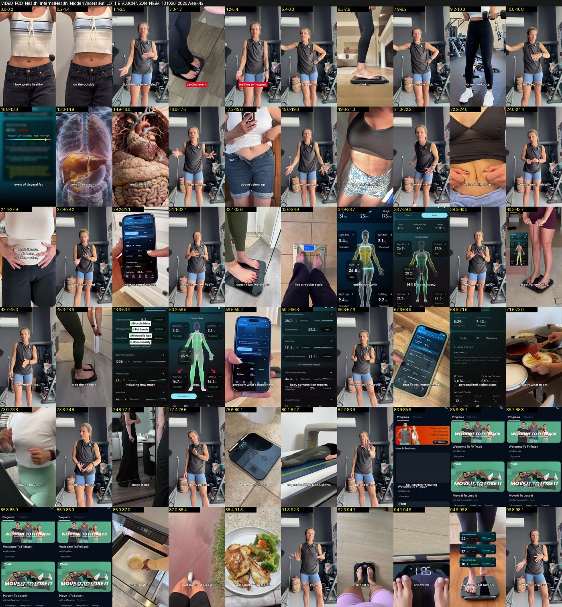

# VIDEO_POD_Health_InternalHealth_HiddenVisceralFat_LOTTIE_AJJOHNSON_NEBA_131026_2026Week42

Master: `VIDEO_POD_Health_InternalHealth_HiddenVisceralFat_LOTTIE_AJJOHNSON_NEBA_131026_2026Week42_Hook1_9x16.mp4` · 122.7s · 1080x1920

**Pacing:** 72 shots · avg 1.704s · median 1.4s · 5.79 cuts/10s · first cut 0.233s · 192.0 wpm · talk ratio 0.96 · cuts on word start 74.6% · cuts in speech gaps 54.9%
**Audio:** {'I_lufs': -17.3, 'LRA': 4.1, 'true_peak_db': -0.2} · BPM≈123.0 · music {'speech_rms_db': -22.6, 'pause_seconds': 0.2} · cuts with SFX/transient 54.9%

**Captions:** 352 cards · 1.0 words/card (median) · y≈0.726 of frame height · text height≈0.0281 · colours {'white': 244, 'red': 19, 'dark/other': 71, 'yellow': 5, 'blue': 8, 'green': 4, 'other-colour': 1} · cards crossing a cut: 9
Highlighted: cardiac event, waiting to happen., stepped on, I'd get a nice, Instead,itsaid, Morning weigh-ins(afterusingthe bathroom but, beforebreakfast)giveyouthemostconsistent, andaccuratebodyfatreadings.Yourbody's, hydrationlevelsnaturallyfluctuatethroughoutthe, day!, I had no idea,, you can't see, But it's the fat, that actually drives, 88889
**Headlines:** YourBody'sStory (11.0–11.0s, white) | app.notion.com-Toexitfullscreen,press (11.0–11.0s, white) | BodyFatPercentage (11.0–11.0s, white) | 44.4% (11.0–11.0s, white) | Very High (11.0–11.0s, red) | Verylow Low Standard High VeryHigh (11.0–13.0s, white) | 10:09 (29.0–29.0s, blue) | StepOnScale (29.0–30.0s, blue)

**Hook (0–3s) spoken:** I look pretty healthy on the outside, but this scan revealed I was a
**Hook on-screen:** I look pretty healthy / Iwasa / butthis scan revealed / on the outside,
**CTA (last 5s):** eligible. Go get yours before the sale ends because it could change your life too. · on-screen: Go get yours / HSA and FSA eligible / XHume / becauseit could / before the sale ends, / change your life too.

## Beat sheet

| # | in–out (s) | dur | transition | spoken | on-screen text |
|---|---|---|---|---|---|
| 1 | 0.00–0.23 | 0.23 |  | I look | I look pretty healthy |
| 2 | 0.23–1.43 | 1.2 | cut +SFX hit | pretty healthy on the outside, | I look pretty healthy / on the outside, |
| 3 | 1.43–2.27 | 0.83 | cut +SFX hit | but this scan revealed | on the outside, / butthis scan revealed |
| 4 | 2.27–4.23 | 1.97 | cut | I was a cardiac event waiting | butthis scan revealed / Iwasa / cardiac event [red] / waiting to happen. [red] |
| 5 | 4.23–5.40 | 1.17 | cut +SFX hit | to happen. | waiting to happen. [red] |
| 6 | 5.40–6.30 | 0.9 | cut +SFX hit | I stepped on my Hume | waiting to happen. [red] / stepped on [red] |
| 7 | 6.30–7.93 | 1.63 | cut | Pod, thinking I'd get | stepped on [red] / thinking |
| 8 | 7.93–9.17 | 1.23 | cut +SFX hit | a nice pad on the back for | I'd get a nice [red] / for my workouts. |
| 9 | 9.17–10.00 | 0.83 | cut | my workouts. | for my workouts. |
| 10 | 10.00–10.80 | 0.8 | cut +SFX hit | Instead, | Instead,itsaid [red] |
| 11 | 10.80–13.60 | 2.8 | cut +SFX hit | it said I had dangerous levels of visceral fat wrapped | YourBody'sStory (HEADLINE) / app.notion.com-Toexitfullscreen,press (HEADLINE) / BodyFatPercentage (HEADLINE) / 44.4% (HEADLINE) / Very High [red] (HEADLINE) / Verylow Low Standard High VeryHigh (HEADLINE) |
| 12 | 13.60–14.87 | 1.27 | cut +SFX hit | around my liver, | wrapped around |
| 13 | 14.87–16.03 | 1.17 | cut +SFX hit | heart, and pancreas. | and pancreas. / I had no idea, [red] |
| 14 | 16.03–17.20 | 1.17 | cut | I had no idea because | I had no idea, [red] / because visceralfat |
| 15 | 17.20–18.97 | 1.77 | cut | visceral fat doesn't show up | because visceralfat / doesn't show up |
| 16 | 18.97–19.60 | 0.63 | cut +SFX hit | on your body. | on your body. |
| 17 | 19.60–20.97 | 1.37 | cut | You can't pinch it. You can't | You can't pinch it, |
| 18 | 20.97–22.23 | 1.27 | cut | see it in the mirror, but | you can't see [red] / But it's the fat [red] |
| 19 | 22.23–24.00 | 1.77 | cut +SFX hit | it's the fat that actually drives | But it's the fat [red] / that actually drives [red] |
| 20 | 24.00–24.43 | 0.43 | cut +SFX hit | heart | that actually drives [red] |
| 21 | 24.43–27.90 | 3.47 | cut | disease, diabetes, inflammation, and even cancer. And | that actually drives [red] / heart disease, / diabetes, / inflammation, |
| 22 | 27.90–29.17 | 1.27 | cut +SFX hit | what the Hume Pod told | And what / 10:09 [blue] (HEADLINE) / StepOnScale [blue] (HEADLINE) / BodyPod [blue] (HEADLINE) / Weight* (HEADLINE) / GealWeight (HEADLINE) |
| 23 | 29.17–31.07 | 1.9 | cut | me to do next changed my life. | 10:09 [blue] (HEADLINE) / StepOnScale [blue] (HEADLINE) / BodyPod [blue] (HEADLINE) / Weight* (HEADLINE) / GealWeight (HEADLINE) / Weight (HEADLINE) |
| 24 | 31.07–32.43 | 1.37 | cut | See, the Hume Pod doesn't | See the Hume Pod |
| 25 | 32.43–33.57 | 1.13 | cut | just weigh you like | See the Hume Pod / doesn't just weigh you |
| 26 | 33.57–34.87 | 1.3 | cut +SFX hit | a regular scale. | 88889 [blue] / like a regular scale. |
| 27 | 34.87–36.73 | 1.87 | cut | It scans your entire body with | 31 yrs (HEADLINE) / 23 yrs (HEADLINE) / 175 (HEADLINE) / ght Arm (HEADLINE) / Left Arm (HEADLINE) / .4kg (HEADLINE) |
| 28 | 36.73–39.33 | 2.6 | cut +SFX hit | 98 % dexat accuracy. | Left Arm (HEADLINE) / Standard / Age (HEADLINE) / MetabolicAge (HEADLINE) / Height (HEADLINE) / Right Arm (HEADLINE) |
| 29 | 39.33–40.33 | 1.0 | cut +SFX hit | They were basically exactly | Standard / High / Body [blue] (HEADLINE) / Charts (HEADLINE) / 98% Dexa accuracy. / BodyCompositionFundamentals (HEADLINE) |
| 30 | 40.33–43.73 | 3.4 | cut | the same except for one thing which I'll explain. | Theywere basically / exactlythe same, / except for one thing, / which I'll explain |
| 31 | 43.73–45.33 | 1.6 | cut | To use the Hume Pod, | To use [red] / the Hume Pod, |
| 32 | 45.33–48.63 | 3.3 | cut | you just step on it, grab the handles, and in 30 seconds it | the Hume Pod, / you just step on it, / grab the handles, / and in 30 seconds |
| 33 | 48.63–53.17 | 4.53 | cut +SFX hit | measures 45 different metrics, including how much visceral fat you're hiding. | 51 (HEADLINE) / MuscleMass [green] (HEADLINE) / 48 (HEADLINE) / 26/ (HEADLINE) / 60. (HEADLINE) / 23/09 (HEADLINE) |
| 34 | 53.17–56.47 | 3.3 | cut +SFX hit | It scans your arms, legs, and torso separately so you | Standard / MuscleMass [green] (HEADLINE) / HumePod (HEADLINE) / StepOnScale [green] (HEADLINE) / LeftArm (HEADLINE) / RightArm (HEADLINE) |
| 35 | 56.47–59.20 | 2.73 | cut | know precisely what's happening inside your body. | Standard / MuscleMass [green] (HEADLINE) / HumePod (HEADLINE) / StepOnScale [green] (HEADLINE) / LeftArm (HEADLINE) / RightArm (HEADLINE) |
| 36 | 59.20–66.77 | 7.57 | cut | The app breaks everything down in color -coded body composition reports. Green means you're good, red means you need to work on it. | Standard / BodyFatPercentage / Weight (HEADLINE) / 185.3ibs (HEADLINE) / Standard (HEADLINE) / 27.4 (HEADLINE) |
| 37 | 66.77–67.63 | 0.87 | cut +SFX hit | And for every metric | And for every metric |
| 38 | 67.63–68.90 | 1.27 | cut | that needs improvement it gives | 4:28 [blue] (HEADLINE) / Hume Pod [blue] (HEADLINE) / Step On Scale [blue] (HEADLINE) / Android Region [blue] (HEADLINE) / FatMass [blue] (HEADLINE) / 8.5ibs (HEADLINE) |
| 39 | 68.90–71.60 | 2.7 | cut +SFX hit | you personalized action plans right in the app. | Recovery (HEADLINE) / 100 (HEADLINE) / ViewMoreDetails→ (HEADLINE) / ☆,Today'sRecommendation (HEADLINE) / Youroptimalweigh-intimeis7:43AM. (HEADLINE) / Sinceit's5:29PM,wesuggestwaiting |
| 40 | 71.60–72.97 | 1.37 | cut +SFX hit | Exactly what to eat, | exactly what to eat, |
| 41 | 72.97–73.80 | 0.83 | cut +SFX hit | how to move, | howto move, |
| 42 | 73.80–74.83 | 1.03 | cut +SFX hit | what to change. | what to change. |
| 43 | 74.83–77.37 | 2.53 | cut +SFX hit | And that's what made it not only different but | And that's what / made it not / only different |
| 44 | 77.37–78.60 | 1.23 | cut | in my opinion better | only different / but in my opinion, |
| 45 | 78.60–80.07 | 1.47 | cut | than those expensive $250 | better than those / expensive $250 DEXA scans, |
| 46 | 80.07–82.67 | 2.6 | cut | dexa scans because the clinic doesn't | expensive $250 DEXA scans, / because the clinic |
| 47 | 82.67–83.90 | 1.23 | cut +SFX hit | tell you what to do. | doesn't tell you |
| 48 | 83.90–85.57 | 1.67 | cut +SFX hit | So I started following what | Today [blue] (HEADLINE) / day (HEADLINE) / 1,809 (HEADLINE) / Caloriesleft (HEADLINE) / Ocal (HEADLINE) / Eaten. (HEADLINE) |
| 49 | 85.57–85.73 | 0.17 | cut +SFX hit | it told |  |
| 50 | 85.73–85.83 | 0.1 | cut |  |  |
| 51 | 85.83–85.93 | 0.1 | cut | me. |  |
| 52 | 85.93–86.03 | 0.1 | cut +SFX hit |  | more protein |
| 53 | 86.03–87.00 | 0.97 | cut +SFX hit | More protein, | more protein |
| 54 | 87.00–88.43 | 1.43 | cut | short bursts of cardio, added | short bursts of cardio, [red] / added green tea [red] |
| 55 | 88.43–91.33 | 2.9 | cut | green tea and colorful vegetables. | added green tea [red] / and colorful vegetables. / and colorful vegetables |
| 56 | 91.33–92.30 | 0.97 | cut +SFX hit | It was easy. | and colorful vegetables / It was easy. |
| 57 | 92.30–94.13 | 1.83 | cut | Then I'd re -scan every week and | It was easy. / Then I'd rescan / and watch |
| 58 | 94.13–94.60 | 0.47 | cut +SFX hit | watch my | and watch |
| 59 | 94.60–96.83 | 2.23 | cut +SFX hit | visceral fat number drop on the graph. | Visceral FatIndex (HEADLINE) / 22 (HEADLINE) / VeryHigh [red] (HEADLINE) / VisceralFatIndex / Low [red] / Standard [green] |
| 60 | 96.83–98.13 | 1.3 | cut +SFX hit | Within 10 weeks, | Within 10 weeks / my visceral fat dropped |
| 61 | 98.13–101.47 | 3.33 | cut | my visceral fat dropped below the danger range. | my visceral fat dropped / below the danger range, |
| 62 | 101.47–104.77 | 3.3 | cut | My metabolic age went from 55, 43, | below the danger range, / MetabolicAge (HEADLINE) / 43/ (HEADLINE) / Excellent [green] (HEADLINE) / 175 (HEADLINE) / Acomparisonofyourmetabolismtotheaverage |
| 63 | 104.77–106.90 | 2.13 | cut | and I finally had energy again. | and I finally had / energy again. |
| 64 | 106.90–107.73 | 0.83 | cut +SFX hit | The human pods technology | HumeHoalth / The Hume Pod's |
| 65 | 107.73–109.17 | 1.43 | cut +SFX hit | is using over | technology is used in [red] / over12,000health clinics, [other-colour] |
| 66 | 109.17–111.17 | 2.0 | cut +SFX hit | 12 ,000 health clinics, | over12,000health clinics, [other-colour] / but now you can |
| 67 | 111.17–112.70 | 1.53 | cut +SFX hit | but now you can have it at home. | but now you can / have it at home. |
| 68 | 112.70–114.60 | 1.9 | cut +SFX hit | It's up to 50 % off right now with | XHume / XHume (HEADLINE) / 50%off right now [red] |
| 69 | 114.60–116.40 | 1.8 | cut | code LAST 50 and | withcodeLAST50 / with codeLAST5O, |
| 70 | 116.40–118.33 | 1.93 | cut +SFX hit | it's HSA and FSA eligible. | with codeLAST5O, / XHume / HSA and FSA eligible [red] |
| 71 | 118.33–120.97 | 2.63 | cut | Go get yours before the sale ends because it | XHume / HSA and FSA eligible [red] / Go get yours / before the sale ends, |
| 72 | 120.97–122.67 | 1.7 | cut | could change your life too. | becauseit could / change your life too. |

## Hook variants

| hook | file | dur | first cut | spoken 0–3s | on-screen 0–3s |
|---|---|---|---|---|---|
| 1 | `alFat_LOTTIE_AJJOHNSON_NEBA_131026_2026Week42_Hook1_9x16.mp4` | 122.7 | 0.233 | I look pretty healthy on the outside, but this scan revealed I was a | I look pretty healthy / Iwasa / butthis scan revealed / on the outside, |
| 2 | `alFat_LOTTIE_AJJOHNSON_NEBA_131026_2026Week42_Hook2_9x16.mp4` | 122.9 | 1.267 | I was exercising, eating pretty well, and still |  |
| 3 | `alFat_LOTTIE_AJJOHNSON_NEBA_131026_2026Week42_Hook3_9x16.mp4` | 124.5 | 0.733 | This is how you can be a size 4 active and |  |
| 4 | `alFat_LOTTIE_AJJOHNSON_NEBA_131026_2026Week42_Hook4_9x16.mp4` | 120.1 | 0.9 |  |  |

## Full transcript

I look pretty healthy on the outside, but this scan revealed I was a cardiac event waiting to happen. I stepped on my Hume Pod, thinking I'd get a nice pad on the back for my workouts. Instead, it said I had dangerous levels of visceral fat wrapped around my liver, heart, and pancreas. I had no idea because visceral fat doesn't show up on your body. You can't pinch it. You can't see it in the mirror, but it's the fat that actually drives heart disease, diabetes, inflammation, and even cancer. And what the Hume Pod told me to do next changed my life. See, the Hume Pod doesn't just weigh you like a regular scale. It scans your entire body with 98% dexat accuracy. They were basically exactly the same except for one thing which I'll explain. To use the Hume Pod, you just step on it, grab the handles, and in 30 seconds it measures 45 different metrics, including how much visceral fat you're hiding. It scans your arms, legs, and torso separately so you know precisely what's happening inside your body. The app breaks everything down in color-coded body composition reports. Green means you're good, red means you need to work on it. And for every metric that needs improvement it gives you personalized action plans right in the app. Exactly what to eat, how to move, what to change. And that's what made it not only different but in my opinion better than those expensive $250 dexa scans because the clinic doesn't tell you what to do. So I started following what it told me. More protein, short bursts of cardio, added green tea and colorful vegetables. It was easy. Then I'd re-scan every week and watch my visceral fat number drop on the graph. Within 10 weeks, my visceral fat dropped below the danger range. My metabolic age went from 55, 43, and I finally had energy again. The human pods technology is using over 12,000 health clinics, but now you can have it at home. It's up to 50% off right now with code LAST 50 and it's HSA and FSA eligible. Go get yours before the sale ends because it could change your life too.