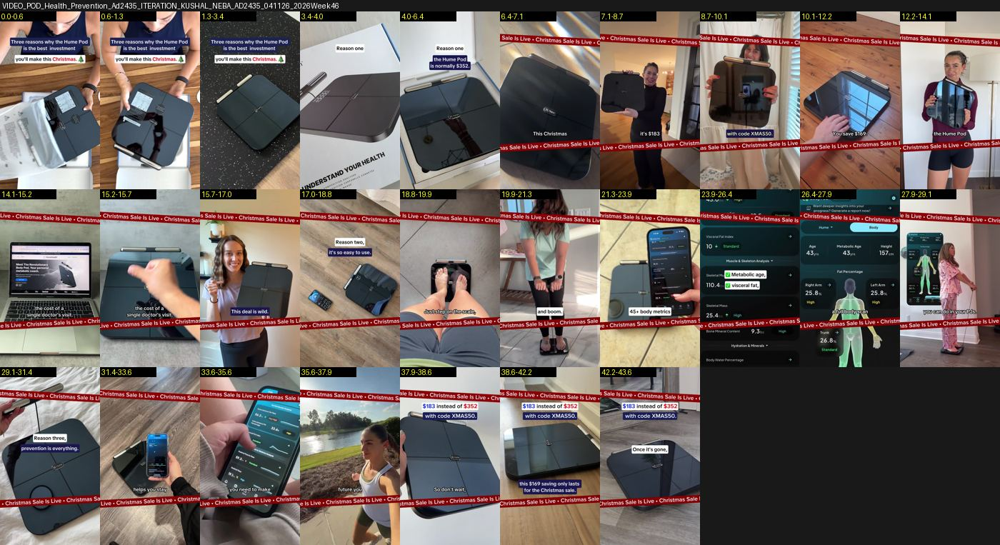

# VIDEO_POD_Health_Prevention_Ad2435_ITERATION_KUSHAL_NEBA_AD2435_041126_2026Week46

Master: `VIDEO_POD_Health_Prevention_Ad2435_ITERATION_KUSHAL_NEBA_AD2435_041126_2026Week46_9X16_HOOK1.mp4` · 43.6s · 1080x1920

**Pacing:** 27 shots · avg 1.614s · median 1.566s · 5.97 cuts/10s · first cut 0.633s · 222.0 wpm · talk ratio 0.9 · cuts on word start 96.2% · cuts in speech gaps 73.1%
**Audio:** {'I_lufs': -19.7, 'LRA': 2.0, 'true_peak_db': -3.7} · BPM≈117.5 · music {'speech_rms_db': -23.7, 'pause_seconds': 0.8, 'pause_rms_db': -24.1, 'bed_minus_voice_db': -0.4, 'music_bed_likely': True} · cuts with SFX/transient 53.8%

**Captions:** 128 cards · 1.0 words/card (median) · y≈0.675 of frame height · text height≈0.034 · colours {'white': 86, 'red': 31, 'dark/other': 8, 'green': 3} · cards crossing a cut: 2
Highlighted: aleIsLive.ChristmasSalelsLive.Ch, ChristmasSaleIsLive.ChristmasSa, asSaleIsLive.ChristmasSaleIsLive, Live·ChristmasSaleIsLive·Christma, istmasSaleIsLive·ChristmasSalels, ChristmasSaleIsLive·ChristmasSal, Live·ChristmasSaleIsLive·Christmas, stmasSaleIsLive:ChristmasSaleIsLi, elsLive.ChristmasSaleIsLive.Chris, ChristmasSaleIsLive.ChristmasSale, SaleIsLive.ChristmasSalelsLive., ve·ChristmasSaleIsLive·Christmas, tmasSaleIsLive·ChristmasSaleIsLiv, IsLive·ChristmasSaleIsLive.Christ, christmasSaleIsLiveChristmasSaleI
**Headlines:** Three reasons whytheHume Pod (0.0–3.0s, white) | isthebest investment (0.0–3.0s, white) | you'll make this Christmas. (0.0–3.0s, red) | Reasonone (3.5–6.0s, white) | IDERSTANDYOURHEALTH (3.5–3.5s, white) | TION CORPORELLE CONNETEE (3.5–3.5s, white) | MPOSITIONANALYZER (3.5–3.5s, white) | the Hume Pod (4.0–6.0s, white)

**Hook (0–3s) spoken:** three reasons why the Hume Pod is the best investment you'll make this Christmas.
**Hook on-screen:** Three reasons whytheHume Pod / isthebest investment / you'll make this Christmas.
**CTA (last 5s):** This $169 saving only lasts for the Christmas sale. Once it's gone, it's gone. · on-screen: $183insteadof$352 / .ChristmasSaleIsLive·ChristmasSa / ChristmasSalelsLive·ChristmasSale / IsLive.ChristmasSaleIsLive.Chris / Live.ChristmasSaleIsLive.Christmas / Onceit's gone, / SaleIsLive.ChristmasSalelsLive.C / asSalelsLive.ChristmasSaleIsLive / fortheChristmassale. / it's gone. / masSaleIsLive·ChristmasSaleIsLiv / stmasSaleIsLive.ChristmasSaleIsLi

## Beat sheet

| # | in–out (s) | dur | transition | spoken | on-screen text |
|---|---|---|---|---|---|
| 1 | 0.00–0.63 | 0.63 |  | three reasons why | Three reasons whytheHume Pod (HEADLINE) / isthebest investment (HEADLINE) / you'll make this Christmas. [red] (HEADLINE) |
| 2 | 0.63–1.33 | 0.7 | cut +SFX hit | the Hume Pod is | Three reasons whytheHume Pod (HEADLINE) / isthebest investment (HEADLINE) / you'll make this Christmas. [red] (HEADLINE) |
| 3 | 1.33–3.40 | 2.07 | cut | the best investment you'll make this Christmas. | Three reasons whytheHume Pod (HEADLINE) / isthebest investment (HEADLINE) / you'll make this Christmas. [red] (HEADLINE) |
| 4 | 3.40–3.97 | 0.57 | cut | Reason one, | Three reasons whytheHume Pod (HEADLINE) / isthebest investment (HEADLINE) / you'll make this Christmas. [red] (HEADLINE) / Reasonone (HEADLINE) / IDERSTANDYOURHEALTH (HEADLINE) / TION CORPORELLE CONNETEE (HEADLINE) |
| 5 | 3.97–6.43 | 2.47 | cut +SFX hit | the Hume Pod is normally $352. | Reasonone (HEADLINE) / IDERSTANDYOURHEALTH (HEADLINE) / TION CORPORELLE CONNETEE (HEADLINE) / MPOSITIONANALYZER (HEADLINE) / WAAGE / the Hume Pod (HEADLINE) |
| 6 | 6.43–7.07 | 0.63 | cut | This Christmas, | Reasonone (HEADLINE) / the Hume Pod (HEADLINE) / isnormally$352 (HEADLINE) / Hume / IsLive.ChristmasSaleIsLiveChrist [red] (HEADLINE) / it's$183 |
| 7 | 7.07–8.73 | 1.67 | cut | it's $183 with | IsLive.ChristmasSaleIsLiveChrist [red] (HEADLINE) / it's$183 / aleIsLive.ChristmasSalelsLive.Ch [red] / ChristmasSaleIsLive.ChristmasSale [red] (HEADLINE) / ChristmasSaleIsLive.ChristmasSa [red] |
| 8 | 8.73–10.07 | 1.33 | cut +SFX hit | code XMAS50. | SaleIsLiveChristmasSaleIsLive·C [red] (HEADLINE) / XHume / withcodeXMAS50 / asSaleIsLive.ChristmasSaleIsLive [red] / e.ChristmasSalelsLive·ChristmasS [red] (HEADLINE) / Yousave$169 |
| 9 | 10.07–12.20 | 2.13 | cut | You save $169. | e.ChristmasSalelsLive·ChristmasS [red] (HEADLINE) / Yousave$169 / Live·ChristmasSaleIsLive·Christma [red] / nasSaleIsLive·ChristmasSaleIsLive [red] (HEADLINE) / istmasSaleIsLive·ChristmasSalels [red] / Live.ChristmasSalelsLive.Christm [red] (HEADLINE) |
| 10 | 12.20–14.13 | 1.93 | cut | Yep, you can get the Hume Pod for less than the | Live.ChristmasSalelsLive.Christm [red] (HEADLINE) / Yep. / leIsLive.ChristmasSaleIsLive.Chri / ristmasSalelsLiveChristmasSalels [red] (HEADLINE) / theHumePod / ChristmasSaleIsLive·ChristmasSal [red] |
| 11 | 14.13–15.17 | 1.03 | cut +SFX hit | cost of a single doctor's | leIsLiveChristmasSaleIsLive.Chri [red] (HEADLINE) / MeetTheRevolutionary / BodyPod,Yourpersonal / the.costofa / single,doctor'svisit / s SaleIs Live.Christmas SaleIs Live: |
| 12 | 15.17–15.73 | 0.57 | cut +SFX hit | visit. | ChristmasSaleIsLive·ChristmasSal [red] (HEADLINE) / thecostof a / singledoctor'svisit. / Live·ChristmasSaleIsLive·Christmas [red] |
| 13 | 15.73–17.00 | 1.27 | cut +SFX hit | This deal is wild. | s SaleIsLive·ChristmasSaleIsLive: [red] (HEADLINE) / Thisdealiswild / stmasSaleIsLive:ChristmasSaleIsLi [red] |
| 14 | 17.00–18.77 | 1.77 | cut | Reason two, it's so easy to use. | ive.ChristmasSaleIsLive·Christmas [red] (HEADLINE) / Reasontwo, (HEADLINE) / elsLive.ChristmasSaleIsLive.Chris [red] / stmasSalelsLive.ChristmasSaleIsLi [red] (HEADLINE) / it'ssoeasytouse / ChristmasSaleIsLive.ChristmasSale [red] |
| 15 | 18.77–19.87 | 1.1 | cut +SFX hit | Just step on the scale, hold | IsLive.ChristmasSaleIsLive.Christ [red] (HEADLINE) / Juststeponthescale, / SaleIsLive.ChristmasSalelsLive. [red] |
| 16 | 19.87–21.30 | 1.43 | cut +SFX hit | the sensors and boom. | ChristmasSaleIsLive.ChristmasSale [red] (HEADLINE) / holdthesensors, / ve·ChristmasSaleIsLive·Christmas [red] / SaleIsLive·ChristmasSalelsLive·C [red] (HEADLINE) / andboom. / tmasSaleIsLive·ChristmasSaleIsLiv [red] |
| 17 | 21.30–23.93 | 2.63 | cut +SFX hit | 45 plus body metrics right at your fingertips. | SaleIsLive·ChristmasSalelsLive·C [red] (HEADLINE) / andboom. / tmasSaleIsLive·ChristmasSaleIsLiv [red] / e.ChristmasSaleIsLive·ChristmasS [red] (HEADLINE) / BodyPod [blue] (HEADLINE) / 23.0 (HEADLINE) |
| 18 | 23.93–26.37 | 2.43 | cut +SFX hit | Metabolic age, visceral fat, muscle mass. | Metaboliclndicators (HEADLINE) / Live·ChristmasSaleIsLive.Christm [red] (HEADLINE) / 2001cal (HEADLINE) / High [blue] (HEADLINE) / MetabolicAge (HEADLINE) / 31yrs Excellent |
| 19 | 26.37–27.93 | 1.57 | cut +SFX hit | It's basically a full body scan you | Metabolic age, / High / VisceralFatIndex (HEADLINE) / Standard [green] (HEADLINE) / visceral fat, / Hydration&Minerals |
| 20 | 27.93–29.13 | 1.2 | cut | can do in your PJs. And | IsSalelsLive·ChristmasSaleIsLive [red] (HEADLINE) / 43m (HEADLINE) / youcandoinyourPJs. / nristmasSaleIsLive.ChristmasSalels [red] / ive.ChristmasSaleIsLive·Christmas [red] (HEADLINE) / XHume |
| 21 | 29.13–31.37 | 2.23 | cut +SFX hit | reason three, prevention is everything. | ive.ChristmasSaleIsLive·Christmas [red] (HEADLINE) / XHume / And / aleIsLive.ChristmasSalelsLive.Chi [red] / stmasSaleIsLive.ChristmasSaleIsLi [red] (HEADLINE) / Reasonthree, |
| 22 | 31.37–33.57 | 2.2 | cut +SFX hit | The Hume Pod helps you stay ahead of health issues with | Reasonthree, / preventioniseverything / lIsLive.ChristmasSaleIsLive.Christ [red] (HEADLINE) / XHume / asSaleIsLive·ChristmasSaleIsLive [red] / ChristmasSaleIsLive·ChristmasSale [red] (HEADLINE) |
| 23 | 33.57–35.63 | 2.07 | cut | the data you need to make smarter choices. | e·ChristmasSaleIsLive.ChristmasS [red] (HEADLINE) / LesnMass [blue] (HEADLINE) / Percentage [blue] (HEADLINE) / 57.4% (HEADLINE) / FatDistribution Anslysis [blue] (HEADLINE) / 56.20s (HEADLINE) |
| 24 | 35.63–37.90 | 2.27 | cut | Seriously, future you will thank you for this. | sLive.ChristmasSalelsLive.Christm [red] (HEADLINE) / futureyou / sSaleIsLive.ChristmasSaleIsLive: [red] / ristmasSaleIsLiveChristmasSalels [red] (HEADLINE) / will thankyouforthis. / ive.ChristmasSaleIsLive·Christmas [red] |
| 25 | 37.90–38.63 | 0.73 | cut | So don't wait. | aleIsLive.ChristmasSalelsLive.Chr [red] (HEADLINE) / $183insteadof$352 [other-colour] (HEADLINE) / withcodeXMAS50 (HEADLINE) / KHume / Sodon'twait, / stmasSaleIsLive·ChristmasSaleIsLi |
| 26 | 38.63–42.17 | 3.53 | cut +SFX hit | This $169 saving only lasts for the Christmas sale. | $183insteadof$352 [other-colour] (HEADLINE) / withcodeXMAS50 (HEADLINE) / .ChristmasSaleIsLive·ChristmasSa [red] (HEADLINE) / this$169savingonlylasts / fortheChristmassale. / IsLive.ChristmasSaleIsLive.Chris [red] |
| 27 | 42.17–43.58 | 1.42 | cut | Once it's gone, it's gone. | $183insteadof$352 [other-colour] (HEADLINE) / withcodeXMAS50 (HEADLINE) / stmasSaleIsLive.ChristmasSaleIsLi [red] (HEADLINE) / Onceit's gone, / ve·ChristmasSaleIsLive.Christmas / IsLive.ChristmasSaleIsLive.Chris [red] (HEADLINE) |

## Full transcript

three reasons why the Hume Pod is the best investment you'll make this Christmas. Reason one, the Hume Pod is normally $352. This Christmas, it's $183 with code XMAS50. You save $169. Yep, you can get the Hume Pod for less than the cost of a single doctor's visit. This deal is wild. Reason two, it's so easy to use. Just step on the scale, hold the sensors and boom. 45 plus body metrics right at your fingertips. Metabolic age, visceral fat, muscle mass. It's basically a full body scan you can do in your PJs. And reason three, prevention is everything. The Hume Pod helps you stay ahead of health issues with the data you need to make smarter choices. Seriously, future you will thank you for this. So don't wait. This $169 saving only lasts for the Christmas sale. Once it's gone, it's gone.