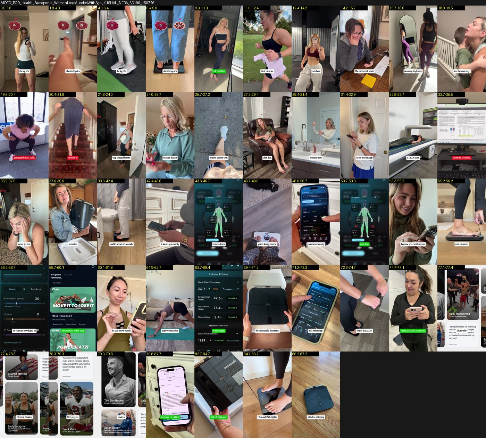

# VIDEO_POD_Health_Sarcopenia_WomenLoseMusclesWithAge_KUSHAL_NEBA_AD196_150726

Master: `VIDEO_POD_Health_Sarcopenia_WomenLoseMusclesWithAge_KUSHAL_NEBA_AD196_150726_9x16.mp4` · 87.2s · 1080x1920

**Pacing:** 47 shots · avg 1.855s · median 1.833s · 5.28 cuts/10s · first cut 1.833s · 230.0 wpm · talk ratio 0.95 · cuts on word start 87.0% · cuts in speech gaps 50.0%
**Audio:** {'I_lufs': -19.8, 'LRA': 2.5, 'true_peak_db': -2.9} · BPM≈112.3 · music {'speech_rms_db': -24.1, 'pause_seconds': 0.2} · cuts with SFX/transient 78.3%

**Hook (0–3s) spoken:** This is the leg of a 30 -year -old woman. And this is also the leg
**Hook on-screen:** 
**CTA (last 5s):** It's on 35 % off right now. HSA and FSA eligible with free shipping. · on-screen: 

## Beat sheet

| # | in–out (s) | dur | transition | spoken | on-screen text |
|---|---|---|---|---|---|
| 1 | 0.00–1.83 | 1.83 |  | This is the leg of a 30 -year -old woman. |  |
| 2 | 1.83–4.30 | 2.47 | cut +SFX hit | And this is also the leg of a 30 -year -old woman. |  |
| 3 | 4.30–6.37 | 2.07 | cut +SFX hit | This is the leg of a 70 -year -old woman. |  |
| 4 | 6.37–8.97 | 2.6 | cut +SFX hit | And this is also the leg of a 70 -year -old woman. |  |
| 5 | 8.97–11.00 | 2.03 | cut +SFX hit | The ones that look healthier belong to the women who |  |
| 6 | 11.00–12.40 | 1.4 | cut | never lost their muscles. |  |
| 7 | 12.40–14.17 | 1.77 | cut +SFX hit | And it's not just about how it looks. |  |
| 8 | 14.17–15.70 | 1.53 | cut +SFX hit | The moment it starts, the things you do |  |
| 9 | 15.70–17.97 | 2.27 | cut +SFX hit | every single day begin to get harder. |  |
| 10 | 17.97–19.47 | 1.5 | cut +SFX hit | And then one day, things like getting |  |
| 11 | 19.47–20.43 | 0.97 | cut +SFX hit | up from a chair, |  |
| 12 | 20.43–21.77 | 1.33 | cut | climbing a flight of stairs, or carrying |  |
| 13 | 21.77–23.97 | 2.2 | cut +SFX hit | groceries, stop being effortless. |  |
| 14 | 23.97–25.70 | 1.73 | cut | But this doesn't start at 70. |  |
| 15 | 25.70–27.17 | 1.47 | cut +SFX hit | It starts in your 30s. |  |
| 16 | 27.17–29.40 | 2.23 | cut +SFX hit | And every decade after that, you keep losing more |  |
| 17 | 29.40–31.40 | 2.0 | cut +SFX hit | muscle whether you feel it or not. |  |
| 18 | 31.40–32.93 | 1.53 | cut +SFX hit | The only way to see it is through a dexa |  |
| 19 | 32.93–33.67 | 0.73 | cut +SFX hit | scan but |  |
| 20 | 33.67–35.50 | 1.83 | cut +SFX hit | those cost hundreds of dollars which |  |
| 21 | 35.50–37.60 | 2.1 | cut | is why most people never get one. |  |
| 22 | 37.60–39.63 | 2.03 | cut +SFX hit | That's exactly what the hume pod solves. |  |
| 23 | 39.63–42.43 | 2.8 | cut | Step on it grab the handles and in under 60 seconds it |  |
| 24 | 42.43–43.57 | 1.13 | cut +SFX hit | shows you exactly how |  |
| 25 | 43.57–46.67 | 3.1 | cut | much muscle you have broken down by each limb separately. |  |
| 26 | 46.67–48.60 | 1.93 | cut +SFX hit | So instead of just knowing your losing muscle you |  |
| 27 | 48.60–50.73 | 2.13 | cut | can see exactly where you're losing it whether |  |
| 28 | 50.73–53.27 | 2.53 | cut +SFX hit | that's your arms your legs or your torso and |  |
| 29 | 53.27–55.20 | 1.93 | cut +SFX hit | that's important because you can't improve what |  |
| 30 | 55.20–56.20 | 1.0 | cut +SFX hit | you can't measure. |  |
| 31 | 56.20–58.67 | 2.47 | cut | It's Harvard developed AI then builds a fully personalized |  |
| 32 | 58.67–60.07 | 1.4 | cut +SFX hit | action plan so |  |
| 33 | 60.07–61.87 | 1.8 | cut | you know exactly what to do to improve |  |
| 34 | 61.87–63.70 | 1.83 | cut | the areas that need it most. |  |
| 35 | 63.70–69.43 | 5.73 | cut +SFX hit | It also measures your visceral fat, body fat, water weight, metabolic age, and 40 plus other metrics. |  |
| 36 | 69.43–71.20 | 1.77 | cut +SFX hit | It uses the same multi -frequency BIA |  |
| 37 | 71.20–72.27 | 1.07 | cut +SFX hit | technology found |  |
| 38 | 72.27–74.70 | 2.43 | cut +SFX hit | in 12 ,000 plus medical clinics and |  |
| 39 | 74.70–77.07 | 2.37 | cut +SFX hit | is 98 % DEXA accurate. That's |  |
| 40 | 77.07–77.43 | 0.37 | cut +SFX hit | why Olympic |  |
| 41 | 77.43–78.33 | 0.9 | cut +SFX hit | athletes, |  |
| 42 | 78.33–79.27 | 0.93 | cut +SFX hit | NFL players, |  |
| 43 | 79.27–79.83 | 0.57 | cut +SFX hit | doctors, |  |
| 44 | 79.83–82.67 | 2.83 | cut +SFX hit | and over 1 .2 million people trust Hume. |  |
| 45 | 82.67–84.67 | 2.0 | cut +SFX hit | It's on 35 % off right now. HSA |  |
| 46 | 84.67–86.23 | 1.57 | cut +SFX hit | and FSA eligible with |  |
| 47 | 86.23–87.17 | 0.94 | cut +SFX hit | free shipping. |  |

## Full transcript

This is the leg of a 30-year-old woman. And this is also the leg of a 30-year-old woman. This is the leg of a 70-year-old woman. And this is also the leg of a 70-year-old woman. The ones that look healthier belong to the women who never lost their muscles. And it's not just about how it looks. The moment it starts, the things you do every single day begin to get harder. And then one day, things like getting up from a chair, climbing a flight of stairs, or carrying groceries, stop being effortless. But this doesn't start at 70. It starts in your 30s. And every decade after that, you keep losing more muscle whether you feel it or not. The only way to see it is through a dexa scan but those cost hundreds of dollars which is why most people never get one. That's exactly what the hume pod solves. Step on it grab the handles and in under 60 seconds it shows you exactly how much muscle you have broken down by each limb separately. So instead of just knowing your losing muscle you can see exactly where you're losing it whether that's your arms your legs or your torso and that's important because you can't improve what you can't measure. It's Harvard developed AI then builds a fully personalized action plan so you know exactly what to do to improve the areas that need it most. It also measures your visceral fat, body fat, water weight, metabolic age, and 40 plus other metrics. It uses the same multi-frequency BIA technology found in 12,000 plus medical clinics and is 98% DEXA accurate. That's why Olympic athletes, NFL players, doctors, and over 1.2 million people trust Hume. It's on 35% off right now. HSA and FSA eligible with free shipping.