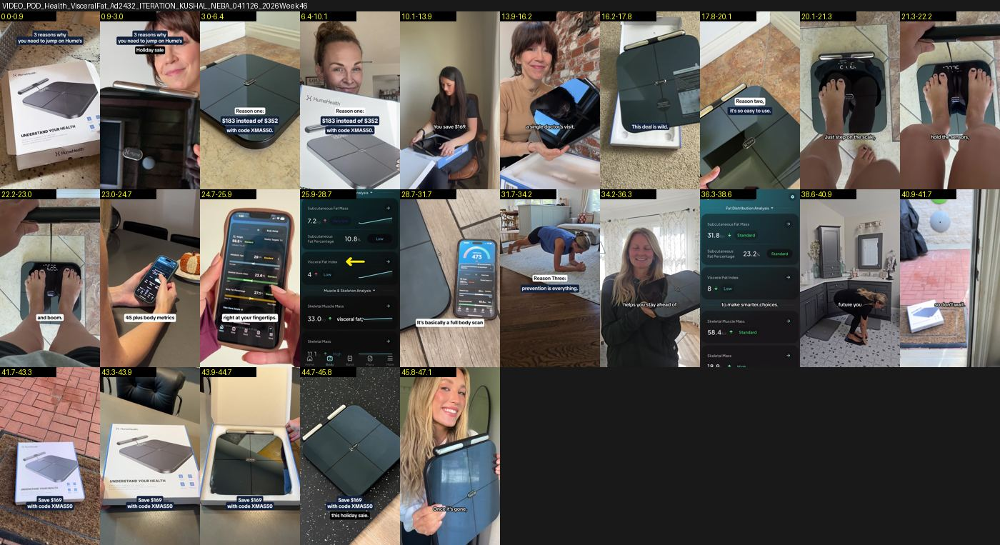

# VIDEO_POD_Health_VisceralFat_Ad2432_ITERATION_KUSHAL_NEBA_041126_2026Week46

Master: `VIDEO_POD_Health_VisceralFat_Ad2432_ITERATION_KUSHAL_NEBA_041126_2026Week46_Hook1_9x16.mp4` · 47.1s · 1080x1920

**Pacing:** 25 shots · avg 1.883s · median 1.702s · 5.1 cuts/10s · first cut 0.934s · 206.0 wpm · talk ratio 0.89 · cuts on word start 70.8% · cuts in speech gaps 62.5%
**Audio:** {'I_lufs': -17.9, 'LRA': 2.5, 'true_peak_db': -1.8} · BPM≈99.4 · music {'speech_rms_db': -21.4, 'pause_seconds': 1.8, 'pause_rms_db': -22.4, 'bed_minus_voice_db': -1.0, 'music_bed_likely': True} · cuts with SFX/transient 79.2%

**Captions:** 119 cards · 1 words/card (median) · y≈0.635 of frame height · text height≈0.0281 · colours {'white': 102, 'dark/other': 11, 'blue': 3, 'yellow': 1, 'red': 1, 'green': 1} · cards crossing a cut: 10
Highlighted: asingle doctor's visit., Standard, Standa., 473, Standard, Once it'sgone,
**Headlines:** 3reasonswhy (0.0–2.5s, white) | youneedtojumponHume's (0.0–2.5s, white) | UNDERSTANDYOURHEALTH (0.0–0.5s, white) | XHumeHealth (0.5–0.5s, white) | Holiday sale (1.5–2.5s, white) | XHume (2.0–2.5s, white) | rightnow. (2.5–2.5s, white) | XHumeHealth (8.0–8.0s, white)

**Hook (0–3s) spoken:** Three reasons why you need to jump on Hume's holiday sale right now.
**Hook on-screen:** 3reasonswhy / BAEANCEOECOMPOSITIONCORPORELLECONNETEE / BALANCE DECOMPOSITION CORPORELLECONNETEE / Holiday sale / SMARTE XORPERANALYSE-WAAGE / SMARTRODYCOMPOSITIONANALYZER / SMARTRODYCOMPOSITIONANASYZER / SMARTRSORPERANALYSL-WAAOC / UNDERSTANDYOURHEALTH / XHume / XHumeHealth / rightnow. / youneedtojumponHume's
**CTA (last 5s):** with code XMAS50 this holiday sale. Once it's gone, it's gone. · on-screen: HumeHealth / Once it'sgone, / Save$169 / UNDERSTANDYOURHEALTH / this holiday sale. / withcodeXMAS50

## Beat sheet

| # | in–out (s) | dur | transition | spoken | on-screen text |
|---|---|---|---|---|---|
| 1 | 0.00–0.93 | 0.93 |  | Three reasons why you need to | 3reasonswhy (HEADLINE) / youneedtojumponHume's (HEADLINE) / XHumeHealth / UNDERSTANDYOURHEALTH (HEADLINE) / BAEANCEOECOMPOSITIONCORPORELLECONNETEE / SMARTRODYCOMPOSITIONANASYZER |
| 2 | 0.93–2.97 | 2.04 | cut +SFX hit | jump on Hume's holiday sale right now. | 3reasonswhy (HEADLINE) / youneedtojumponHume's (HEADLINE) / XHumeHealth / UNDERSTANDYOURHEALTH (HEADLINE) / XHumeHealth (HEADLINE) / BALANCE DECOMPOSITION CORPORELLECONNETEE |
| 3 | 2.97–6.44 | 3.47 | cut +SFX hit | Reason one, the Hume Pod is normally $352. Right | 3reasonswhy (HEADLINE) / youneedtojumponHume's (HEADLINE) / Holiday sale (HEADLINE) / XHume (HEADLINE) / rightnow. (HEADLINE) / Reason one: |
| 4 | 6.44–10.14 | 3.7 | cut +SFX hit | now, it's $183 with code XMAS50. | Reason one: / $183insteadof $352 / withcodeXMAS50. / LOV / FAMILYRULES / Health |
| 5 | 10.14–13.88 | 3.74 | cut | You save $169. Yep, you can get the Hume Pod for | You save $169. / you cangettheHumepod |
| 6 | 13.88–16.25 | 2.37 | cut +SFX hit | less than the cost of a single doctor's visit. | forless than the cost of / asingle doctor's visit. [blue] / This deal is wild |
| 7 | 16.25–17.78 | 1.53 | cut +SFX hit | This deal is wild. | This deal is wild / This deal is wild. |
| 8 | 17.78–20.12 | 2.34 | cut +SFX hit | Reason two, it's so easy to use. | Reason two, / XHume / it's so easy to use. / Just step on the scale, |
| 9 | 20.12–21.32 | 1.2 | cut +SFX hit | Just step on the scale, hold | Just step on the scale, / 72.15. (HEADLINE) |
| 10 | 21.32–22.22 | 0.9 | cut +SFX hit | the sensors, | Just step on the scale, / 72.15. (HEADLINE) / 6995 (HEADLINE) / and boom. |
| 11 | 22.22–23.02 | 0.8 | cut +SFX hit | and boom! | 6995 (HEADLINE) / and boom. / 45 plus body metrics |
| 12 | 23.02–24.73 | 1.7 | cut +SFX hit | 45 plus body metrics right | 45 plus body metrics |
| 13 | 24.73–25.93 | 1.2 | cut +SFX hit | at your fingertips. | 1:25 (HEADLINE) / BodyComp (HEADLINE) / woight (HEADLINE) / WeeklyTargets:1/4 (HEADLINE) / 59.5kg (HEADLINE) / Standard (HEADLINE) |
| 14 | 25.93–28.73 | 2.8 | cut +SFX hit | Metabolic age, visceral fat, muscle mass. It's | Standard (HEADLINE) / Metabolic Age / Standard [yellow] / Home / Plans / More |
| 15 | 28.73–31.70 | 2.97 | cut +SFX hit | basically a full body scan you can do in your PJs. | Hume / 210.1 / It's basically a full body scan / 473 [blue] / WeetyTergetxV4 / 210.1ba |
| 16 | 31.70–34.17 | 2.47 | cut +SFX hit | And reason three, prevention is everything. | Reason Three: / preventionis everything / The Hume pod |
| 17 | 34.17–36.30 | 2.14 | cut +SFX hit | The HumePod helps you stay ahead of health issues with | The Hume pod / helps youstay ahead of / with the data you need |
| 18 | 36.30–38.60 | 2.3 | cut | the data you need to make smarter choices. | with the data you need / Body Pod (HEADLINE) / Connected [green] (HEADLINE) / FatDistributionAnalysis (HEADLINE) / SubcutaneousFatMass (HEADLINE) / 31.8ibs (HEADLINE) |
| 19 | 38.60–40.91 | 2.3 | cut | Seriously, future you will thank you for this. | Seriously, / will thank you for this, |
| 20 | 40.91–41.74 | 0.84 | cut +SFX hit | So don't wait. | so don't wait. |
| 21 | 41.74–43.28 | 1.54 | cut +SFX hit | Save $169 with | UNDERSTANDYOURHEALTH / Save$169 / withcodeXMAS50 / HumeHealth |
| 22 | 43.28–43.94 | 0.67 | cut | code XMAS50 | UNDERSTANDYOURHEALTH / Save$169 / withcodeXMAS50 / HumeHealth |
| 23 | 43.94–44.74 | 0.8 | cut +SFX hit | this | Save$169 / withcodeXMAS50 |
| 24 | 44.74–45.78 | 1.03 | cut | holiday sale. | Save$169 / withcodeXMAS50 / this holiday sale. |
| 25 | 45.78–47.08 | 1.3 | cut +SFX hit | Once it's gone, it's gone. | Once it'sgone, [blue] |

## Hook variants

| hook | file | dur | first cut | spoken 0–3s | on-screen 0–3s |
|---|---|---|---|---|---|
| 1 | `d2432_ITERATION_KUSHAL_NEBA_041126_2026Week46_Hook1_9x16.mp4` | 47.1 | 0.934 | Three reasons why you need to jump on Hume's holiday sale right now. | 3reasonswhy / BAEANCEOECOMPOSITIONCORPORELLECONNETEE / BALANCE DECOMPOSITION CORPORELLECONNETEE / Holiday sale / SMARTE XORPERANALYSE-WAAGE / SMARTRODYCOMPOSITIONANALYZER / SMARTRODYCOMPOSITIONANASYZER / SMARTRSORPERANALYSL-WAAOC |
| 2 | `d2432_ITERATION_KUSHAL_NEBA_041126_2026Week46_Hook2_9x16.mp4` | 48.3 | 1.768 |  |  |
| 3 | `d2432_ITERATION_KUSHAL_NEBA_041126_2026Week46_Hook3_9x16.mp4` | 48.2 | 1.134 |  |  |

## Full transcript

Three reasons why you need to jump on Hume's holiday sale right now. Reason one, the Hume Pod is normally $352. Right now, it's $183 with code XMAS50. You save $169. Yep, you can get the Hume Pod for less than the cost of a single doctor's visit. This deal is wild. Reason two, it's so easy to use. Just step on the scale, hold the sensors, and boom! 45 plus body metrics right at your fingertips. Metabolic age, visceral fat, muscle mass. It's basically a full body scan you can do in your PJs. And reason three, prevention is everything. The HumePod helps you stay ahead of health issues with the data you need to make smarter choices. Seriously, future you will thank you for this. So don't wait. Save $169 with code XMAS50 this holiday sale. Once it's gone, it's gone.