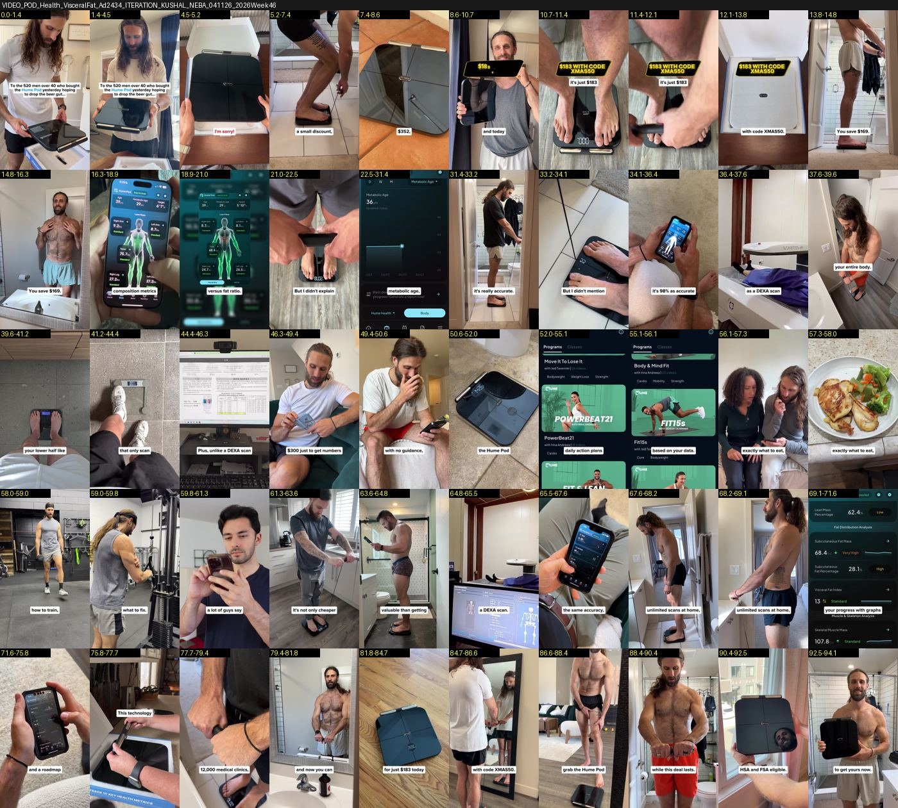

# VIDEO_POD_Health_VisceralFat_Ad2434_ITERATION_KUSHAL_NEBA_041126_2026Week46

Master: `VIDEO_POD_Health_VisceralFat_Ad2434_ITERATION_KUSHAL_NEBA_041126_2026Week46_Hook1_9x16.mp4` · 94.1s · 1080x1920

**Pacing:** 50 shots · avg 1.883s · median 1.683s · 5.21 cuts/10s · first cut 1.433s · 177.0 wpm · talk ratio 0.95 · cuts on word start 67.3% · cuts in speech gaps 42.9%
**Audio:** {'I_lufs': -19.6, 'LRA': 2.9, 'true_peak_db': -3.8} · BPM≈99.4 · music {'speech_rms_db': -24.5, 'pause_seconds': 1.3, 'pause_rms_db': -20.6, 'bed_minus_voice_db': 3.9, 'music_bed_likely': True} · cuts with SFX/transient 61.2%

**Captions:** 254 cards · 1.0 words/card (median) · y≈0.738 of frame height · text height≈0.0269 · colours {'white': 185, 'blue': 5, 'red': 2, 'yellow': 2, 'dark/other': 53, 'green': 7} · cards crossing a cut: 9
Highlighted: the Hume Pod yesterdayhoping, I'm sorry!, $183WITHCODE, XMAS50, Fat(%), Body, High, Body, UME, POWERBEAT21, WITHIRINAANDREEA, FIT&LEAN, MUME, CUME, BODY&MINDFIT
**Headlines:** MGISTERIMOES (1.5–1.5s, white) | HINGSTERENA (2.0–2.0s, white) | MACLSTERENUUR (2.5–2.5s, white) | ALIGRISTERENAE (3.0–3.0s, white) | ALIGISTERENONE (3.5–3.5s, white) | ALGLSTERENONEIO (4.0–4.0s, white) | alvinKlein (5.5–5.5s, red) | 5:256 (17.0–18.0s, blue)

**Hook (0–3s) spoken:** To the 520 men over 40 who bought the Hume Pod yesterday,
**Hook on-screen:** HINGSTERENA / MACLSTERENUUR / MGISTERIMOES / Tothe520menover40whobought / the Hume Pod yesterdayhoping / to dropthebeergut...
**CTA (last 5s):** It's also HSA and FSA eligible. Click below to get yours now. · on-screen: HSA and FSA eligible. / it's also / to get yours now.

## Beat sheet

| # | in–out (s) | dur | transition | spoken | on-screen text |
|---|---|---|---|---|---|
| 1 | 0.00–1.43 | 1.43 |  | To the 520 men over 40 | Tothe520menover40whobought / the Hume Pod yesterdayhoping [blue] / to dropthebeergut... |
| 2 | 1.43–4.47 | 3.03 | cut +SFX hit | who bought the Hume Pod yesterday, hoping to drop the beer gut, | Tothe520menover40whobought / the Hume Pod yesterdayhoping [blue] / to dropthebeergut... / MGISTERIMOES (HEADLINE) / HINGSTERENA (HEADLINE) / MACLSTERENUUR (HEADLINE) |
| 3 | 4.47–5.23 | 0.77 | cut +SFX hit | I'm sorry. | Tothe520menover40whobought / the Hume Pod yesterdayhoping [blue] / to dropthebeergut... / ALGLSTERENONEIO (HEADLINE) / I'm sorry! [red] / I said it was |
| 4 | 5.23–7.40 | 2.17 | cut +SFX hit | I said it was a small discount, but I was wrong. | I said it was / alvinKlein [red] (HEADLINE) / asmall discount, / butIwas wrong |
| 5 | 7.40–8.63 | 1.23 | cut +SFX hit | It's normally $352, | butIwas wrong / XHume / $352, |
| 6 | 8.63–10.70 | 2.07 | cut | and today it's just $183, | $352, / $183WITHCODE [yellow] / XMAS50 [yellow] / it's just $183 |
| 7 | 10.70–11.37 | 0.67 | cut +SFX hit |  | $183WITHCODE [yellow] / XMAS50 [yellow] / it's just $183 |
| 8 | 11.37–12.13 | 0.77 | cut |  | $183WITHCODE [yellow] / XMAS50 [yellow] / it's just $183 / Humeloalth / withcodeXMAS50 |
| 9 | 12.13–13.77 | 1.63 | cut | with code XMAS50. | $183WITHCODE [yellow] / XMAS50 [yellow] / Humeloalth / withcodeXMAS50 |
| 10 | 13.77–14.83 | 1.07 | cut +SFX hit | You save $169. | You save $169 |
| 11 | 14.83–16.27 | 1.43 | cut | And | You save $169. |
| 12 | 16.27–18.93 | 2.67 | cut +SFX hit | I said it tracks your body composition metrics like | You save $169. / 5:256 [blue] (HEADLINE) / HumePod [blue] (HEADLINE) / Step On Scale [blue] (HEADLINE) / Age [blue] (HEADLINE) / Metabolic Age [blue] (HEADLINE) |
| 13 | 18.93–21.03 | 2.1 | cut +SFX hit | your muscle versus fat ratio. But | LeftLeg / Height (HEADLINE) / 29 yrs (HEADLINE) / 5'10"tt (HEADLINE) / 39yrs (HEADLINE) / 8.3 ibs |
| 14 | 21.03–22.50 | 1.47 | cut +SFX hit | I didn't explain it tracks over | But Ididn't explain / 20:5 / it tracks |
| 15 | 22.50–31.43 | 8.93 | cut | 45 metrics, like your visceral fat, metabolic age, bone density, hydration, protein levels, BMR, and more. | HumePod(00%) (HEADLINE) / 200ibs (HEADLINE) / Goal Weight (HEADLINE) / BodyFat Percentage (HEADLINE) / 32.3%High (HEADLINE) / 78.7lbs |
| 16 | 31.43–33.17 | 1.73 | cut +SFX hit | And I said it's really accurate. But | BMR(BasalMetabolicRate) (HEADLINE) / 2125 (HEADLINE) / High [blue] (HEADLINE) / cal (HEADLINE) / Updated:Today / 2280 |
| 17 | 33.17–34.13 | 0.97 | cut +SFX hit | I didn't mention it's | But I didn't mention / it's 98% as accurate |
| 18 | 34.13–36.37 | 2.23 | cut +SFX hit | 98 % as accurate as | it's 98% as accurate |
| 19 | 36.37–37.63 | 1.27 | cut +SFX hit | a DEXA scan and | it's 98% as accurate / STRATOSOR / as aDEXAscan |
| 20 | 37.63–39.60 | 1.97 | cut +SFX hit | measures your entire body. | and measures / your entire body. |
| 21 | 39.60–41.20 | 1.6 | cut +SFX hit | Not just your lower half like those | your lower half like / thoseothersmartscales |
| 22 | 41.20–44.43 | 3.23 | cut +SFX hit | other smart scales that only scan through your feet. | thoseothersmartscales / that only scan / 77002 / through your feet |
| 23 | 44.43–46.33 | 1.9 | cut +SFX hit | Plus, unlike a DEXA scan where | 77002 / through your feet / Plus,unlikeaDEXAscan |
| 24 | 46.33–49.40 | 3.07 | cut | you pay $300 just to get numbers with | Plus,unlikeaDEXAscan / $300 just to get numbers |
| 25 | 49.40–50.63 | 1.23 | cut | no guidance, | $300 just to get numbers / with no guidance, |
| 26 | 50.63–51.97 | 1.33 | cut +SFX hit | the HumePod gives you | the Hume Pod |
| 27 | 51.97–55.13 | 3.17 | cut | personalized daily action plans based on | Plans (HEADLINE) / Programs (HEADLINE) / Classes (HEADLINE) / TryHumeHealth [red] (HEADLINE) / forfreebody [red] (HEADLINE) / metricfocused [red] (HEADLINE) |
| 28 | 55.13–56.10 | 0.97 | cut +SFX hit | your data. It | Plans (HEADLINE) / Programs (HEADLINE) / Classes (HEADLINE) / Cardio / Fit&Lean (HEADLINE) / HIT (HEADLINE) |
| 29 | 56.10–57.30 | 1.2 | cut +SFX hit | tells you exactly what | It tells you / exactly what to eat, |
| 30 | 57.30–58.00 | 0.7 | cut | to eat, | exactly what to eat, |
| 31 | 58.00–58.97 | 0.97 | cut | how to train, what | how to train, |
| 32 | 58.97–59.83 | 0.87 | cut +SFX hit | to fix. | what to fix. |
| 33 | 59.83–61.30 | 1.47 | cut +SFX hit | That's why a lot of guys say it's | That's why / a lot of guys say |
| 34 | 61.30–63.60 | 2.3 | cut | not only cheaper, but actually more valuable | a lot of guys say / it's not only cheaper / but actually more |
| 35 | 63.60–64.80 | 1.2 | cut | than getting a DEXA | valuable than getting |
| 36 | 64.80–65.50 | 0.7 | cut +SFX hit | scan. | a DEXA scan. |
| 37 | 65.50–67.57 | 2.07 | cut | You get nearly the same accuracy, | 6n38m (HEADLINE) / 96.6m / 18.1 / You get nearly / 2:00 [blue] (HEADLINE) / 96.6mm |
| 38 | 67.57–68.20 | 0.63 | cut +SFX hit | unlimited scans | unlimited scans at home, |
| 39 | 68.20–69.07 | 0.87 | cut | at home, | unlimited scans at home, / HumePod(100%) (HEADLINE) / LeanMass (HEADLINE) / 152.2ibs (HEADLINE) / Standard (HEADLINE) / 62.4% (HEADLINE) |
| 40 | 69.07–71.60 | 2.53 | cut | an app that tracks your progress with graphs so | HumePod(100%) (HEADLINE) / LeanMass (HEADLINE) / 152.2ibs (HEADLINE) / Standard (HEADLINE) / 62.4% (HEADLINE) / Low (HEADLINE) |
| 41 | 71.60–75.80 | 4.2 | cut | you can see what's working and a roadmap to actually improve. | HumeBand 50 [blue] (HEADLINE) / 7.3m / 65cm / 96.8元 / see what's working, / 10:43 [blue] (HEADLINE) |
| 42 | 75.80–77.67 | 1.87 | cut +SFX hit | This technology is used in over 12 | Thistechnology / TRACK56 KEYHEALTHMETRICS [blue] (HEADLINE) / isusedinover |
| 43 | 77.67–79.40 | 1.73 | cut +SFX hit | ,000 medical clinics | 12,000 medical clinics, |
| 44 | 79.40–81.80 | 2.4 | cut +SFX hit | and now you can have it at home for | 12,000 medical clinics, / and now you can / have it at home |
| 45 | 81.80–84.70 | 2.9 | cut +SFX hit | for just $183 today with | for just $183 today / XHume |
| 46 | 84.70–86.60 | 1.9 | cut +SFX hit | code XMAS50. So I | STEREN (HEADLINE) / withcodeXMAS50 / withcodeXMAS50. |
| 47 | 86.60–88.40 | 1.8 | cut | recommend you grab the HumePod while | So I recommend you / grab the Hume Pod |
| 48 | 88.40–90.43 | 2.03 | cut | this deal lasts. It's also HSA | grab the Hume Pod / whilethisdeal lasts. / it's also |
| 49 | 90.43–92.50 | 2.07 | cut | and FSA eligible. | it's also / HSA and FSA eligible. |
| 50 | 92.50–94.13 | 1.63 | cut +SFX hit | Click below to get yours now. | to get yours now. |

## Hook variants

| hook | file | dur | first cut | spoken 0–3s | on-screen 0–3s |
|---|---|---|---|---|---|
| 1 | `d2434_ITERATION_KUSHAL_NEBA_041126_2026Week46_Hook1_9x16.mp4` | 94.1 | 1.433 | To the 520 men over 40 who bought the Hume Pod yesterday, | HINGSTERENA / MACLSTERENUUR / MGISTERIMOES / Tothe520menover40whobought / the Hume Pod yesterdayhoping / to dropthebeergut... |
| 2 | `d2434_ITERATION_KUSHAL_NEBA_041126_2026Week46_Hook2_9x16.mp4` | 93.0 | 2.967 |  |  |
| 3 | `d2434_ITERATION_KUSHAL_NEBA_041126_2026Week46_Hook3_9x16.mp4` | 92.3 | 1.4 |  |  |

## Full transcript

To the 520 men over 40 who bought the Hume Pod yesterday, hoping to drop the beer gut, I'm sorry. I said it was a small discount, but I was wrong. It's normally $352, and today it's just $183, with code XMAS50. You save $169. And I said it tracks your body composition metrics like your muscle versus fat ratio. But I didn't explain it tracks over 45 metrics, like your visceral fat, metabolic age, bone density, hydration, protein levels, BMR, and more. And I said it's really accurate. But I didn't mention it's 98% as accurate as a DEXA scan and measures your entire body. Not just your lower half like those other smart scales that only scan through your feet. Plus, unlike a DEXA scan where you pay $300 just to get numbers with no guidance, the HumePod gives you personalized daily action plans based on your data. It tells you exactly what to eat, how to train, what to fix. That's why a lot of guys say it's not only cheaper, but actually more valuable than getting a DEXA scan. You get nearly the same accuracy, unlimited scans at home, an app that tracks your progress with graphs so you can see what's working and a roadmap to actually improve. This technology is used in over 12,000 medical clinics and now you can have it at home for for just $183 today with code XMAS50. So I recommend you grab the HumePod while this deal lasts. It's also HSA and FSA eligible. Click below to get yours now.