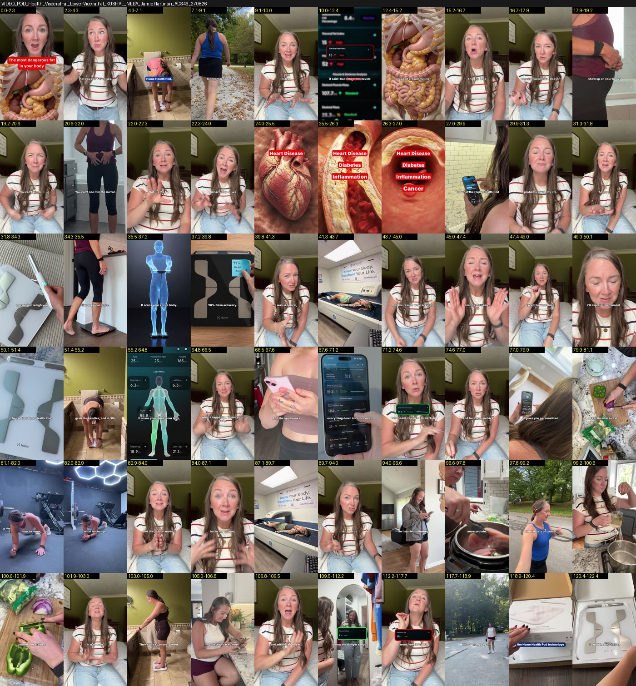

# VIDEO_POD_Health_VisceralFat_LowerViceralFat_KUSHAL_NEBA_JamieHartman_AD346_270826

Master: `VIDEO_POD_Health_VisceralFat_LowerViceralFat_KUSHAL_NEBA_JamieHartman_AD346_270826_16x9_hook1.mp4` · 133.8s · 1080x1920

**Pacing:** 65 shots · avg 2.059s · median 1.68s · 4.78 cuts/10s · first cut 2.28s · 194.0 wpm · talk ratio 0.99 · cuts on word start 73.4% · cuts in speech gaps 48.4%
**Audio:** {'I_lufs': -18.1, 'LRA': 5.8, 'true_peak_db': -2.4} · BPM≈123.0 · music {'speech_rms_db': -24.3, 'pause_seconds': 1.1, 'pause_rms_db': -21.7, 'bed_minus_voice_db': 2.6, 'music_bed_likely': True} · cuts with SFX/transient 54.7%

**Captions:** 212 cards · 1.0 words/card (median) · y≈0.621 of frame height · text height≈0.0269 · colours {'red': 21, 'white': 153, 'blue': 6, 'dark/other': 31, 'yellow': 1} · cards crossing a cut: 2
Highlighted: The most dangerous fat, in your body, HumeHealth Pod,, it said I had dangerous levels, 15个High, 15 + High, wrapped aroundmy liver,, heart,and pancreas., I had no idea, Diabetes, Inflammation, like aregular scale., It scans your entire body., accura, scan at the clinic
**Headlines:** 15 (11.0–12.0s, white) | 8.4 (12.0–12.0s, white) | Heart Disease (24.0–26.0s, red) | 98% (37.0–38.0s, blue) | Dexa (37.0–39.0s, blue) | XDEXAFIT (42.0–43.0s, white) | Know Your Body. (42.0–43.0s, white) | Transform Your Life. (42.0–43.0s, blue)

**Hook (0–3s) spoken:** The most dangerous fat in your body is the fat that
**Hook on-screen:** The most dangerous fat / in your body / is the fat
**CTA (last 5s):** eligible. Go get yours before the sale ends because it could take your life too. · on-screen: And it's HSA and FSA eligible. / Go getyours / becauseit could / before thesaleends / save your life too

## Beat sheet

| # | in–out (s) | dur | transition | spoken | on-screen text |
|---|---|---|---|---|---|
| 1 | 0.00–2.28 | 2.28 |  | The most dangerous fat in your body is | The most dangerous fat [red] / in your body [red] |
| 2 | 2.28–4.28 | 2.0 | cut +SFX hit | the fat that you can't even see. | The most dangerous fat [red] / in your body [red] / is the fat / that you can'teven see. |
| 3 | 4.28–7.08 | 2.8 | cut +SFX hit | I stepped on my Hume Health Pod thinking I'd get a nice pad | that you can'teven see. / Isteppedonmy / HumeHealth Pod, [blue] / thinking I'd get a nice / pat on the back |
| 4 | 7.08–9.08 | 2.0 | cut +SFX hit | on the back for my morning walks. | pat on the back / for my morning walks |
| 5 | 9.08–10.00 | 0.92 | cut | Instead, it |  |
| 6 | 10.00–12.36 | 2.36 | cut +SFX hit | said I had dangerous levels of visceral fat wrapped | 52 / it said I had dangerous levels [red] / 107.7m / 15 (HEADLINE) / Visceral FatIndex / 15个High [red] |
| 7 | 12.36–15.16 | 2.8 | cut | around my liver, heart, and pancreas. | 52 / 15 (HEADLINE) / Visceral FatIndex / 107.7 / 8.4 (HEADLINE) / 15 + High [red] |
| 8 | 15.16–16.68 | 1.52 | cut +SFX hit | I had no idea. | I had no idea [red] |
| 9 | 16.68–17.88 | 1.2 | cut | Because visceral fat doesn't | because visceral fat doesn't |
| 10 | 17.88–19.16 | 1.28 | cut +SFX hit | show up on your body, | show up on your body. / You can'tpinch it. |
| 11 | 19.16–20.60 | 1.44 | cut | you can't pinch it, | You can'tpinch it. / You can'tpinch it |
| 12 | 20.60–21.96 | 1.36 | cut +SFX hit | you can't see it in the mirror. | You can't see it in the mirror. |
| 13 | 21.96–22.32 | 0.36 | cut | But it's | But it's the fat |
| 14 | 22.32–24.04 | 1.72 | cut +SFX hit | the fat that actually drives heart | But it's the fat / that actually drives / Heart Disease [red] (HEADLINE) |
| 15 | 24.04–25.52 | 1.48 | cut | disease, diabetes, | Heart Disease [red] (HEADLINE) / Diabetes [red] |
| 16 | 25.52–26.32 | 0.8 | cut +SFX hit | inflammation, and | Heart Disease [red] (HEADLINE) / Diabetes [red] / Inflammation [red] |
| 17 | 26.32–27.04 | 0.72 | cut +SFX hit | even cancer. and | Heart Disease [red] (HEADLINE) / Diabetes [red] / Inflammation [red] / And whattheHume Health Pod |
| 18 | 27.04–29.92 | 2.88 | cut +SFX hit | what the Hume Health Pod told me to do next probably | And whattheHume Health Pod / told me to do next |
| 19 | 29.92–31.32 | 1.4 | cut | saved my life. | probablysaved my life. |
| 20 | 31.32–31.76 | 0.44 | cut | So see the | probablysaved my life. |
| 21 | 31.76–34.32 | 2.56 | cut | Hume Health Pod doesn't just weigh you like | the Hume Health Pod / doesn'tjust weigh you |
| 22 | 34.32–35.48 | 1.16 | cut | a regular scale. | doesn'tjust weigh you / like aregular scale. [red] |
| 23 | 35.48–37.24 | 1.76 | cut | It scans your entire body 98 | like aregular scale. [red] / It scans your entire body. [blue] / 98% [blue] (HEADLINE) / Dexa [blue] (HEADLINE) / accura [blue] / 98%Dexaaccuracy. |
| 24 | 37.24–39.76 | 2.52 | cut | % Daxa accuracy. | 98% [blue] (HEADLINE) / Dexa [blue] (HEADLINE) / accura [blue] / 98%Dexaaccuracy. / XHume |
| 25 | 39.76–41.28 | 1.52 | cut +SFX hit | I was skeptical so I went and | Iwasskeptical, / soIwent |
| 26 | 41.28–43.72 | 2.44 | cut +SFX hit | I paid for a Daxa scan at the clinic to make sure that | soIwent / XDEXAFIT (HEADLINE) / Know Your Body. (HEADLINE) / Transform Your Life. [blue] (HEADLINE) / dexafitnj.com / 201 -351 -1591 |
| 27 | 43.72–44.96 | 1.24 | cut | the results were accurate. | that the results were accurate. |
| 28 | 44.96–47.40 | 2.44 | cut | They are basically exactly the same | They werebasically / exactly thesame, |
| 29 | 47.40–49.00 | 1.6 | cut +SFX hit | except for one thing which I'll | exactly thesame, / except for one thing. |
| 30 | 49.00–50.12 | 1.12 | cut | explain in a moment. | I'll explainina moment. / To use the Hume Health Pod, / X Hume |
| 31 | 50.12–51.40 | 1.28 | cut +SFX hit | To use the Hume Health Pod you | To use the Hume Health Pod, / X Hume |
| 32 | 51.40–55.20 | 3.8 | cut +SFX hit | just step on it and grab the handles and in 30 seconds it measures 45 | To use the Hume Health Pod, / X Hume / you just step on it, / grab the handles, and in 30s / HumePod (HEADLINE) / StepOnScale [green] (HEADLINE) |
| 33 | 55.20–64.80 | 9.6 | cut | different health metrics including how much your visceral fat you're hiding. It scans your arms, your legs, your torso all separately so you know precisely what's | HumePod (HEADLINE) / StepOnScale [green] (HEADLINE) / Weight (HEADLINE) / GoalWeight (HEADLINE) / 112 ibs (HEADLINE) / 135.8 bs (HEADLINE) |
| 34 | 64.80–66.48 | 1.68 | cut | happening inside your body and | what's happening inside your / bodyo [red] |
| 35 | 66.48–67.64 | 1.16 | cut +SFX hit | the app breaks everything | what's happening inside your / bodyo [red] / Andtheappbreaks |
| 36 | 67.64–71.24 | 3.6 | cut +SFX hit | down in color -coded body composition reports. | 2:49 [blue] (HEADLINE) / SOS (HEADLINE) / Hume Pod [blue] (HEADLINE) / 226 (HEADLINE) / Standard (HEADLINE) / verylow |
| 37 | 71.24–74.56 | 3.32 | cut +SFX hit | The green means you're good, red means you need to work on it | bodycompositionreports. / So green meansyou're good. / High [red] / Red meansyou need toworkon / 15个 [red] / it. [yellow] |
| 38 | 74.56–77.04 | 2.48 | cut +SFX hit | and for every metric that needs improvement it | And for every metric / that needsimprovement, / itgives you personalized |
| 39 | 77.04–79.92 | 2.88 | cut | gives you personalized action plans right in the app. exactly | itgives you personalized / action plans right in the app. |
| 40 | 79.92–81.08 | 1.16 | cut +SFX hit | what to eat, | Exactly what to eat, / how to move, |
| 41 | 81.08–81.96 | 0.88 | cut +SFX hit | how to move, | how to move, |
| 42 | 81.96–82.92 | 0.96 | cut +SFX hit | what to change. | what to change. |
| 43 | 82.92–84.00 | 1.08 | cut +SFX hit | And that's what made it | And that'swhat madeit |
| 44 | 84.00–87.12 | 3.12 | cut +SFX hit | not only different, but in my opinion, better than those expensive | not only different, / butin my opinion, / XDEXAFIT (HEADLINE) / Know Your Body. (HEADLINE) / Transform Your Life. [blue] (HEADLINE) / dexafitnj.com |
| 45 | 87.12–89.72 | 2.6 | cut +SFX hit | $250 DEXA scans. Because | XDEXAFIT (HEADLINE) / Know Your Body. (HEADLINE) / Transform Your Life. [blue] (HEADLINE) / dexafitnj.com / 201-351-1591 / expensive$250 [red] |
| 46 | 89.72–94.04 | 4.32 | cut +SFX hit | the clinic doesn't tell you what to do to improve your metrics day by day. | becausetheclinic / doesn'ttell you / to improve / your metrics day by day. / So I started following |
| 47 | 94.04–96.56 | 2.52 | cut | So I started following what it told me to do. | So I started following / what it told me to do |
| 48 | 96.56–97.76 | 1.2 | cut | More protein, short | more protein, |
| 49 | 97.76–99.20 | 1.44 | cut | burst of cardio, | short bursts of cardio. [blue] / I added green tea, |
| 50 | 99.20–100.64 | 1.44 | cut +SFX hit | I added green tea, colorful | I added green tea, |
| 51 | 100.64–101.88 | 1.24 | cut | vegetables. | colorful vegetables. |
| 52 | 101.88–103.04 | 1.16 | cut | It was easy. | It waseasy. / ThenI'd re scanevery week |
| 53 | 103.04–105.00 | 1.96 | cut +SFX hit | Then I'd re -scan every week and | ThenI'd re scanevery week |
| 54 | 105.00–106.76 | 1.76 | cut +SFX hit | I'd watch my visceral fat number drop | andI'd watch / my visceral fat number |
| 55 | 106.76–109.48 | 2.72 | cut | on the graph. And within 10 weeks visceral | droponthegraph, / and within ten weeks, |
| 56 | 109.48–112.20 | 2.72 | cut +SFX hit | fat dropped below the danger range. | and within ten weeks, / visceralfat dropped / +8 / below the danger range. / My metabolic age |
| 57 | 112.20–117.68 | 5.48 | cut +SFX hit | My metabolic age went from 55 to 43 and I finally feel like | My metabolic age / wentfrom55to43 / MetabolicAge / 55yrs / 43yrs / andIfinallyfeel like |
| 58 | 117.68–118.88 | 1.2 | cut +SFX hit | I have energy again. | have energy again. |
| 59 | 118.88–120.40 | 1.52 | cut +SFX hit | The hume health pod technology is | ><HumeHonlth (HEADLINE) / HumePod2.0 / the Hume Health Pod technology / FC Ro (HEADLINE) |
| 60 | 120.40–122.44 | 2.04 | cut | used in over 12 ,000 health clinics but | the Hume Health Pod technology / FC Ro (HEADLINE) / 12,000healthclinics, / XHue / Please charge for / Sminsormore |
| 61 | 122.44–122.96 | 0.52 | cut | now you | Please charge for / Sminsormore / ifit'snot turningon / 12.000 health clinics, / XHume |
| 62 | 122.96–124.08 | 1.12 | cut +SFX hit | can have it at home and | but now you can haveit at home / and it'supto30%offright now |
| 63 | 124.08–126.52 | 2.44 | cut | it's up to 30 % off right now and | and it'supto30%offright now / andit'supto30%offrightnow. / andit'supto3o%offrightnow. |
| 64 | 126.52–130.68 | 4.16 | cut | it's HSA and FSA eligible. Go get yours before | And it's HSA and FSA eligible. / Go getyours [red] |
| 65 | 130.68–133.80 | 3.12 | cut | the sale ends because it could take your life too. | before thesaleends / becauseit could / save your life too [red] |

## Hook variants

| hook | file | dur | first cut | spoken 0–3s | on-screen 0–3s |
|---|---|---|---|---|---|
| 1 | `eralFat_KUSHAL_NEBA_JamieHartman_AD346_270826_16x9_hook1.mp4` | 133.8 | 2.28 | The most dangerous fat in your body is the fat that | The most dangerous fat / in your body / is the fat |
| 2 | `eralFat_KUSHAL_NEBA_JamieHartman_AD346_270826_16x9_hook2.mp4` | 135.9 | 2.0 | You can look healthy on the outside while dangerous fat |  |
| 3 | `eralFat_KUSHAL_NEBA_JamieHartman_AD346_270826_16x9_hook3.mp4` | 135.9 | 1.76 | If you're only tracking your weight, you could be completely missing |  |
| 4 | `eralFat_KUSHAL_NEBA_JamieHartman_AD346_270826_16x9_hook4.mp4` | 135.9 | 3.88 | The fastest way for you to shrink your visceral | Chcying / Thefastest way / chcying / chiccying / chicying / hcartbeat / hcartbtat / ncartbiat |

## Full transcript

The most dangerous fat in your body is the fat that you can't even see. I stepped on my Hume Health Pod thinking I'd get a nice pad on the back for my morning walks. Instead, it said I had dangerous levels of visceral fat wrapped around my liver, heart, and pancreas. I had no idea. Because visceral fat doesn't show up on your body, you can't pinch it, you can't see it in the mirror. But it's the fat that actually drives heart disease, diabetes, inflammation, and even cancer. and what the Hume Health Pod told me to do next probably saved my life. So see the Hume Health Pod doesn't just weigh you like a regular scale. It scans your entire body 98% Daxa accuracy. I was skeptical so I went and I paid for a Daxa scan at the clinic to make sure that the results were accurate. They are basically exactly the same except for one thing which I'll explain in a moment. To use the Hume Health Pod you just step on it and grab the handles and in 30 seconds it measures 45 different health metrics including how much your visceral fat you're hiding. It scans your arms, your legs, your torso all separately so you know precisely what's happening inside your body and the app breaks everything down in color-coded body composition reports. The green means you're good, red means you need to work on it and for every metric that needs improvement it gives you personalized action plans right in the app. exactly what to eat, how to move, what to change. And that's what made it not only different, but in my opinion, better than those expensive $250 DEXA scans. Because the clinic doesn't tell you what to do to improve your metrics day by day. So I started following what it told me to do. More protein, short burst of cardio, I added green tea, colorful vegetables. It was easy. Then I'd re-scan every week and I'd watch my visceral fat number drop on the graph. And within 10 weeks visceral fat dropped below the danger range. My metabolic age went from 55 to 43 and I finally feel like I have energy again. The hume health pod technology is used in over 12,000 health clinics but now you can have it at home and it's up to 30% off right now and it's HSA and FSA eligible. Go get yours before the sale ends because it could take your life too.