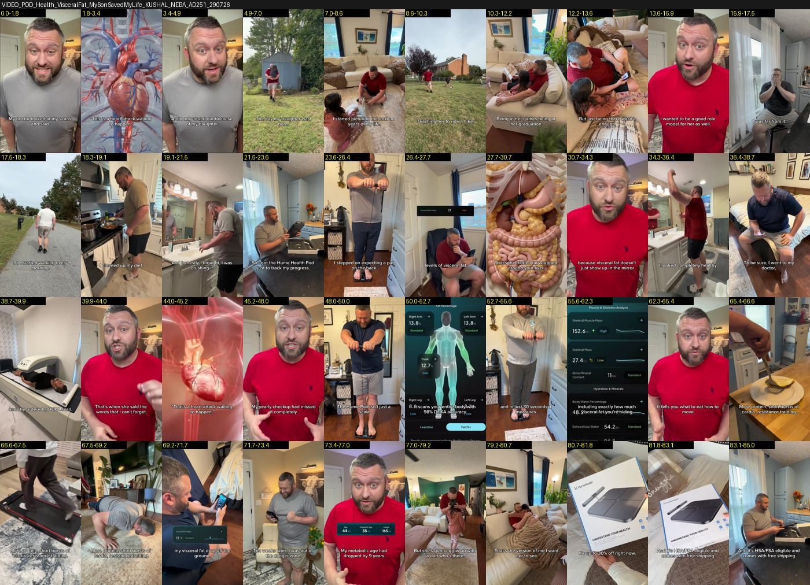

# VIDEO_POD_Health_VisceralFat_MySonSavedMyLife_KUSHAL_NEBA_AD251_290726

Master: `VIDEO_POD_Health_VisceralFat_MySonSavedMyLife_KUSHAL_NEBA_AD251_290726_Hook1_9x16.mp4` · 85.0s · 1080x1920

**Pacing:** 40 shots · avg 2.125s · median 1.9s · 4.59 cuts/10s · first cut 1.833s · 300.0 wpm · talk ratio 0.95 · cuts on word start 92.3% · cuts in speech gaps 71.8%
**Audio:** {'I_lufs': -9.6, 'LRA': 2.4, 'true_peak_db': 1.2} · BPM≈112.3 · music {'speech_rms_db': -14.0, 'pause_seconds': 0.0} · cuts with SFX/transient 66.7%

**Captions:** 166 cards · 1.5 words/card (median) · y≈0.749 of frame height · text height≈0.0304 · colours {'white': 116, 'red': 32, 'other-colour': 2, 'dark/other': 12, 'blue': 3, 'yellow': 1} · cards crossing a cut: 7
Highlighted: to happen., born,, But just being there wasn't, I wanted to be a good role, model for her aswell., But when it came to health, That's the hidden fat wrapped, around your liver,, your heart and your pancreas., Ihad no idea., because visceral fat doesn't, just showupinthe mirror, you can't just pinch it., Andtheresultscameback, almostidentical.
**Headlines:** Lean Mass (50.0–50.0s, dark/other) | RightArm (50.0–52.0s, white) | LeftArm (50.0–52.0s, white) | 10.5ibs (50.0–50.0s, white) | 10.2ibs (50.0–50.0s, white) | Standard (50.0–52.0s, dark/other) | FatPercentage (51.0–52.0s, dark/other) | 13.8% (51.0–52.0s, white)

**Hook (0–3s) spoken:** My doctor looked at my scans and said, this is a heart attack waiting to
**Hook on-screen:** "This is a heart attack waiting / My doctor looked at my scans / and said, / to happen. / to happen."
**CTA (last 5s):** her to see. It's up to 30 % off right now, and it's HSA and FSA -eligible and comes with free shipping. · on-screen: And it's HSA/FSA eligible and / And it's HSAVFSA eligible and / HumeHealth / It'supto30%off rightnow. / UNDERSTANDYOURHEALTH / XHumeHealth / comes with free shipping / comes with free shipping.

## Beat sheet

| # | in–out (s) | dur | transition | spoken | on-screen text |
|---|---|---|---|---|---|
| 1 | 0.00–1.83 | 1.83 |  | My doctor looked at my scans and said, this is | My doctor looked at my scans / and said, / "This is a heart attack waiting / to happen." |
| 2 | 1.83–3.43 | 1.6 | cut +SFX hit | a heart attack waiting to happen. | "This is a heart attack waiting / to happen." / to happen. [red] |
| 3 | 3.43–4.90 | 1.47 | cut | And I only found out because of my daughter. | "This is a heart attack waiting / to happen. [red] / And I only found out because / of my daughter. |
| 4 | 4.90–6.97 | 2.07 | cut +SFX hit | The day my daughter was born, I started picturing the | And I only found out because / of my daughter. / The day my daughter was / born, [other-colour] |
| 5 | 6.97–8.57 | 1.6 | cut | next 30 years of my life. Teacher heard | I started picturing the next 30 / years of my life. |
| 6 | 8.57–10.30 | 1.73 | cut | her ride a bike, being at her games, | Teaching her to ride a bike / Being at her games being at / hergraduation |
| 7 | 10.30–12.17 | 1.87 | cut +SFX hit | being at her graduation, and I couldn't wait for any of | Being at her games being at / hergraduation / hergraduation. / And I couldn't wait for any of / it |
| 8 | 12.17–13.63 | 1.47 | cut +SFX hit | it. But just being there wasn't enough, I | And I couldn't wait for any of / it / But just being there wasn't [red] / enoughote |
| 9 | 13.63–15.93 | 2.3 | cut +SFX hit | wanted to be a good role model for her as well. But when it came to health, | I wanted to be a good role [red] / model for her aswell. [red] / But when it came to health [red] |
| 10 | 15.93–17.47 | 1.53 | cut | I was far from it. So I started walking | I was far from it. / So I started walking every / morning |
| 11 | 17.47–18.27 | 0.8 | cut +SFX hit | every morning. | So I started walking every / morning / morning. |
| 12 | 18.27–19.10 | 0.83 | cut +SFX hit | I cleaned up my diet, I dropped | So I started walking every / morning. / I dropped a few pounds |
| 13 | 19.10–21.53 | 2.43 | cut +SFX hit | a few pounds and honestly I thought I was crushing it. So | I dropped a few pounds / And honestly I thought, I was / crushing it. |
| 14 | 21.53–23.57 | 2.03 | cut +SFX hit | I got the Hume Health Pod just to track my progress. I | So I got the Hume Health Pod / just to track my progress. |
| 15 | 23.57–26.37 | 2.8 | cut +SFX hit | stepped on expecting a pat on the back, instead of like dangerous | Istepped on expecting a pat / ontheback. / Instead of dangerous |
| 16 | 26.37–27.73 | 1.37 | cut | levels of visceral fat. That's | Instead of dangerous / 17 / High / levels of visceral fat. |
| 17 | 27.73–30.67 | 2.93 | cut +SFX hit | the hidden fat wrapped around your liver, your heart, and your pancreas. I | That's the hidden fat wrapped [other-colour] / around your liver, [red] / your heart and your pancreas. [red] |
| 18 | 30.67–34.30 | 3.63 | cut +SFX hit | had no idea. Because visceral fat doesn't just show up in the mirror, you can't just pinch it. | Ihad no idea. [red] / because visceral fat doesn't [red] / just showupinthe mirror [red] / you can't just pinch it. [red] |
| 19 | 34.30–36.40 | 2.1 | cut +SFX hit | I looked completely healthy, but this said other ones. At first | you can't just pinch it. [red] / Ilooked completely healthy, / but this said otherwise. |
| 20 | 36.40–38.73 | 2.33 | cut +SFX hit | I thought the thing was broken. To be sure I went to my doctor and she | but this said otherwise. / At firs i thought the thing was / broken. / To be sure, I went to my / doctor, |
| 21 | 38.73–39.90 | 1.17 | cut +SFX hit | ordered a dexa scan, and | and she ordered a DEXA scan. |
| 22 | 39.90–44.00 | 4.1 | cut +SFX hit | the results came back almost identical. That's when she said the words that I can't forget. That's a heart | Andtheresultscameback [red] / almostidentical. [red] / That's when she said the [red] / words that I can't forget. [red] |
| 23 | 44.00–45.23 | 1.23 | cut | attack waiting to happen. No | "That's a heart attack waiting [red] / to happen." [red] / No symptoms.no warning. [red] |
| 24 | 45.23–48.03 | 2.8 | cut +SFX hit | symptoms, no warning. My yearly checkup had missed it completely. | No symptoms.no warning. [red] / Myyearlycheckuphad missed [red] / it completely. [red] / The Hume Pod isn't just a / scale |
| 25 | 48.03–49.97 | 1.93 | cut | The human pot isn't just a scale. It scans your entire | The Hume Pod isn't just a / scale |
| 26 | 49.97–52.67 | 2.7 | cut | body with 98 % dex accuracy. | Lean Mass (HEADLINE) / RightArm (HEADLINE) / LeftArm (HEADLINE) / 10.5ibs (HEADLINE) / 10.2ibs (HEADLINE) / Standard (HEADLINE) |
| 27 | 52.67–55.63 | 2.97 | cut +SFX hit | You step on, grab the handles, and in just 30 seconds, it measures 45 | You step on, grab the handles, / and in just30 seconds it / measures |
| 28 | 55.63–62.27 | 6.63 | cut | different health metrics, including exactly how much visceral fat you're hiding. It doesn't just show you the problem. It gives you a personalized action plan. | SubcutaneousFat (HEADLINE) / 28% (HEADLINE) / High (HEADLINE) / Percentage (HEADLINE) / VisceralFatIndex (HEADLINE) / 17 + (HEADLINE) |
| 29 | 62.27–65.37 | 3.1 | cut +SFX hit | It tells you what to eat, how to move, and what to fit. So I followed | Standard / SkeletalMass (HEADLINE) / BodyWaterPercentage / IntracellularWater / Low (HEADLINE) / BoneMineral (HEADLINE) |
| 30 | 65.37–66.63 | 1.27 | cut | it. More protein, short bursts | So I followed it. [red] / More protein,short bursts of [yellow] / cardio, resistance training. [red] |
| 31 | 66.63–67.53 | 0.9 | cut +SFX hit | of cardio, resistance | More protein,short bursts of [yellow] / cardio, resistance training. [red] |
| 32 | 67.53–69.23 | 1.7 | cut +SFX hit | training. I re -skinned every | More protein,short bursts of [yellow] / cardio, resistance training. [red] / 12$Standard / I re-scanned every week and [red] / watch [red] |
| 33 | 69.23–71.73 | 2.5 | cut +SFX hit | week and watched my visceral fat drop off the grass. | 12$Standard / I re-scanned every week and [red] / watch [red] / my visceral fat drop off the / ground. [red] / 12Standard |
| 34 | 71.73–73.37 | 1.63 | cut | Two weeks later, I was out of the danger zone. | Ten weeks later,Iwasout of / the danger zone. |
| 35 | 73.37–76.97 | 3.6 | cut +SFX hit | My metabolic age had dropped by nine years. My daughter will never remember any of | Ten weeks later,Iwasout of / the danger zone. / My metabolic age had [red] / dropped by 9 years. [red] / Metabolic Age / Age |
| 36 | 76.97–79.23 | 2.27 | cut | this, but she's going to grow up with the dad who's there. That's the version | My daughter will never [red] / remember any of this. [red] / But she's gonna grow up with / a dad who's there. / That's the version of me I want / herto see. |
| 37 | 79.23–80.67 | 1.43 | cut | of me I want her to see. It's | That's the version of me I want / herto see. |
| 38 | 80.67–81.83 | 1.17 | cut +SFX hit | up to 30 % off right now, | XHumeHealth (HEADLINE) / UNDERSTANDYOURHEALTH (HEADLINE) / It'supto30%off rightnow. |
| 39 | 81.83–83.07 | 1.23 | cut +SFX hit | and it's HSA and FSA | UNDERSTANDYOURHEALTH (HEADLINE) / HumeHealth / And it's HSAVFSA eligible and / comes with free shipping / And it's HSA/FSA eligible and / comes with free shipping. |
| 40 | 83.07–85.00 | 1.93 | cut +SFX hit | -eligible and comes with free shipping. | And it's HSA/FSA eligible and / comes with free shipping. |

## Hook variants

| hook | file | dur | first cut | spoken 0–3s | on-screen 0–3s |
|---|---|---|---|---|---|
| 1 | `Fat_MySonSavedMyLife_KUSHAL_NEBA_AD251_290726_Hook1_9x16.mp4` | 85.0 | 1.833 | My doctor looked at my scans and said, this is a heart attack waiting to | "This is a heart attack waiting / My doctor looked at my scans / and said, / to happen. / to happen." |
| 2 | `Fat_MySonSavedMyLife_KUSHAL_NEBA_AD251_290726_Hook2_9x16.mp4` | 83.9 | 2.1 | While I was planning my daughter's first birthday, my body was planning |  |
| 3 | `Fat_MySonSavedMyLife_KUSHAL_NEBA_AD251_290726_Hook3_9x16.mp4` | 83.6 | 3.533 | Becoming a dad didn't just change my life, it's the reason I'm still |  |

## Full transcript

My doctor looked at my scans and said, this is a heart attack waiting to happen. And I only found out because of my daughter. The day my daughter was born, I started picturing the next 30 years of my life. Teacher heard her ride a bike, being at her games, being at her graduation, and I couldn't wait for any of it. But just being there wasn't enough, I wanted to be a good role model for her as well. But when it came to health, I was far from it. So I started walking every morning. I cleaned up my diet, I dropped a few pounds and honestly I thought I was crushing it. So I got the Hume Health Pod just to track my progress. I stepped on expecting a pat on the back, instead of like dangerous levels of visceral fat. That's the hidden fat wrapped around your liver, your heart, and your pancreas. I had no idea. Because visceral fat doesn't just show up in the mirror, you can't just pinch it. I looked completely healthy, but this said other ones. At first I thought the thing was broken. To be sure I went to my doctor and she ordered a dexa scan, and the results came back almost identical. That's when she said the words that I can't forget. That's a heart attack waiting to happen. No symptoms, no warning. My yearly checkup had missed it completely. The human pot isn't just a scale. It scans your entire body with 98% dex accuracy. You step on, grab the handles, and in just 30 seconds, it measures 45 different health metrics, including exactly how much visceral fat you're hiding. It doesn't just show you the problem. It gives you a personalized action plan. It tells you what to eat, how to move, and what to fit. So I followed it. More protein, short bursts of cardio, resistance training. I re-skinned every week and watched my visceral fat drop off the grass. Two weeks later, I was out of the danger zone. My metabolic age had dropped by nine years. My daughter will never remember any of this, but she's going to grow up with the dad who's there. That's the version of me I want her to see. It's up to 30% off right now, and it's HSA and FSA-eligible and comes with free shipping.