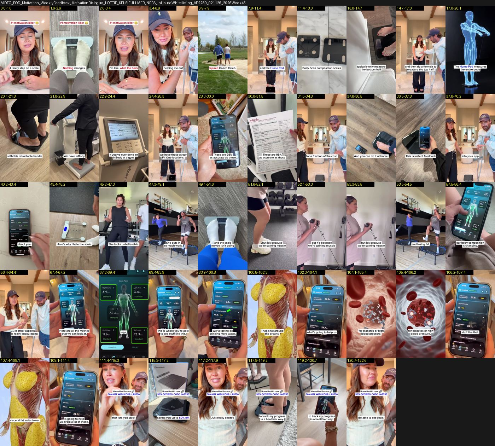

# VIDEO_POD_Motivation_WeeklyFeedback_MotivationDialogue_LOTTIE_KELSIFULLMER_NEBA_InHouseWhitelisting_AD2280_021126_2026Week45

Master: `VIDEO_POD_Motivation_WeeklyFeedback_MotivationDialogue_LOTTIE_KELSIFULLMER_NEBA_InHouseWhitelisting_AD2280_021126_2026Week45_9X16_HOOK1.mp4` · 122.6s · 1080x1920

**Pacing:** 48 shots · avg 2.555s · median 1.75s · 3.83 cuts/10s · first cut 1.567s · 231.0 wpm · talk ratio 0.93 · cuts on word start 72.3% · cuts in speech gaps 48.9%
**Audio:** {'I_lufs': -21.2, 'LRA': 10.9, 'true_peak_db': -0.5} · BPM≈103.4 · music {'speech_rms_db': -27.7, 'pause_seconds': 3.8, 'pause_rms_db': -31.8, 'bed_minus_voice_db': -4.1, 'music_bed_likely': True} · cuts with SFX/transient 46.8%

**Captions:** 433 cards · 1 words/card (median) · y≈0.618 of frame height · text height≈0.0281 · colours {'white': 380, 'red': 6, 'blue': 19, 'dark/other': 15, 'yellow': 10, 'green': 3} · cards crossing a cut: 14
Highlighted: Nothing changes., I'm like, what the heck, Injured Coach Caleb., and the Hume Pod., The Hume Pod measures, The Hume Pod, They're so expensive., gBodyPod, EBodyPod, Lean, Lean(lbs), 38yrs, LeanMass, LeanMass, That might hurt a little
**Headlines:** #1motivationkiller (0.0–3.0s, red) | InBody770 (22.0–22.0s, white) | 12:34 (29.0–29.0s, blue) | StepOnScae (29.0–29.0s, dark/other) | HumePod (29.0–29.0s, blue) | InBody (30.0–31.0s, white) | fBodyFaf-LsanBodyMaseCaetro (30.0–30.0s, white) | Boty Farhane (30.0–30.0s, white)

**Hook (0–3s) spoken:** I rarely step on a scale. Nothing changes. I'm like, what the
**Hook on-screen:** #1motivationkiller / I rarely step on a scale / I rarely step on a scale. / I'm like, what the heck / Nothing changes. / TAYLOR,
**CTA (last 5s):** to track my progress in a healthier way. Be able to set goals, see goals. · on-screen: 12:018 / 174cm / 19.70 / 50%OFFWITHCODE:LAST50 / 53.50 / Be ableto set goals, / HumeHealth.com / HumeHealth.com? / in a healthier way. / see goals. / to track my progress

## Beat sheet

| # | in–out (s) | dur | transition | spoken | on-screen text |
|---|---|---|---|---|---|
| 1 | 0.00–1.57 | 1.57 |  | I rarely step on a scale. | #1motivationkiller [red] (HEADLINE) / I rarely step on a scale. / I rarely step on a scale / Nothing changes. [red] |
| 2 | 1.57–2.60 | 1.03 | cut | Nothing changes. | #1motivationkiller [red] (HEADLINE) / Nothing changes. [red] / TAYLOR, / I'm like, what the heck [red] |
| 3 | 2.60–3.43 | 0.83 | cut | I'm like, what the heck? | #1motivationkiller [red] (HEADLINE) / I'm like, what the heck [red] |
| 4 | 3.43–6.93 | 3.5 | cut +SFX hit | So not only do we have Coach K, helping me out, because he's got all the time in the world. Injured | #1motivationkiller [red] (HEADLINE) / I'm like, what the heck [red] / So, not only do / we have Coach Caleb / helping me out / because he's got all the |
| 5 | 6.93–7.93 | 1.0 | cut | Coach K. And | Injured Coach Caleb. [red] |
| 6 | 7.93–11.40 | 3.47 | cut | the Hume Pod. Body | and the Hume Pod. [blue] |
| 7 | 11.40–13.03 | 1.63 | cut | scan composition skills typically | and the Hume Pod. [blue] / Body Scan composition scales / typically only measure / thebottomhalf |
| 8 | 13.03–14.73 | 1.7 | cut | only measure the bottom half and | typically only measure / thebottomhalf |
| 9 | 14.73–17.03 | 2.3 | cut | then do a four blood to measure the top half. | and then do a formula to / measure the top half. / The Hume Pod measures [blue] / the entirebody |
| 10 | 17.03–20.07 | 3.03 | cut | The Hume Pod measures the entire body with | The Hume Pod measures [blue] / the entirebody / The Hume Pod [blue] / measures / with this retractable handle |
| 11 | 20.07–21.83 | 1.77 | cut +SFX hit | this retractable handle right here. | with this retractable handle |
| 12 | 21.83–22.90 | 1.07 | cut +SFX hit | We have in body, | InBody770 (HEADLINE) / We have InBody |
| 13 | 22.90–24.43 | 1.53 | cut | if you ever done an in body at a gym, | Weightcn / Leg Lean Mass fte) / 45% / if you've ever done an / InBody at a gym, / LegLean Mass |
| 14 | 24.43–28.27 | 3.83 | cut | we have those that are fit one locations. They're so expensive. These | if you've ever done an / InBody at a gym, / LegLean Mass / ￥50% / we have those at our / FitOnelocations. |
| 15 | 28.27–30.03 | 1.77 | cut | are 98 % as | They're so expensive. [red] / 12:34 [blue] (HEADLINE) / StepOnScae (HEADLINE) / HumePod [blue] (HEADLINE) / Height / MetabolicAge |
| 16 | 30.03–31.53 | 1.5 | cut +SFX hit | accurate as those for | These are 98% / asaccurate as those / InBody (HEADLINE) / fBodyFaf-LsanBodyMaseCaetro (HEADLINE) / Boty Farhane (HEADLINE) / Lm BodyMas (HEADLINE) |
| 17 | 31.53–34.77 | 3.23 | cut | a fraction of the cost and way easier to do | for a fraction of the cost. / And way easier to do |
| 18 | 34.77–36.47 | 1.7 | cut | Yeah, this | And you can do it at home. / Yeah. |
| 19 | 36.47–37.80 | 1.33 | cut +SFX hit | is instant feedback We're | Yeah. / This is instant feedback |
| 20 | 37.80–40.20 | 2.4 | cut | gonna show you it into your app that gives you everything | we're gonna show you / into your app / 110.5b+ / 18.8 / 115ibs / 18.6%* |
| 21 | 40.20–43.37 | 3.17 | cut +SFX hit | you need to know about your body composition Here's | 110.5b+ / 18.8 / 115ibs / 18.6%* / 20.610s / everything |
| 22 | 43.37–45.23 | 1.87 | cut +SFX hit | why I hate the scale. | EBodyPod [blue] / 115ibs / 18.6* / 20.6bm / 82.3.. / 74.5% |
| 23 | 45.23–47.33 | 2.1 | cut | He looks Unbelievable she | She looks unbelievable. / She looks unbelievable |
| 24 | 47.33–49.07 | 1.73 | cut +SFX hit | puts in so much work and | She looks unbelievable / She puts in / so much work. / andthescale / maybe isn't going |
| 25 | 49.07–51.63 | 2.57 | cut +SFX hit | the scale maybe isn't going what she wanted it to but | andthescale / maybe isn't going / TAYLOR. / where she wanted it to, |
| 26 | 51.63–52.13 | 0.5 | cut | it's because | butit'sbecause / we're gaining muscle |
| 27 | 52.13–53.27 | 1.13 | cut +SFX hit | we're gaining muscle | butit'sbecause / we're gaining muscle |
| 28 | 53.27–53.53 | 0.27 | cut | and | butit'sbecause / we're gaining muscle |
| 29 | 53.53–54.47 | 0.93 | cut | losing Fat and | and losing fat, |
| 30 | 54.47–56.40 | 1.93 | cut | so our body composition is changing and | and losing fat, / 3:54 [blue] (HEADLINE) / CHumePod [blue] (HEADLINE) / StepOnScale [blue] (HEADLINE) / MetabolicAge [blue] (HEADLINE) / 43ys [blue] (HEADLINE) |
| 31 | 56.40–64.43 | 8.03 | cut | being able to see some improvements in other aspects is really encouraging. You gotta have something like that to fuel you. | 3:54 [blue] (HEADLINE) / CHumePod [blue] (HEADLINE) / StepOnScale [blue] (HEADLINE) / MetabolicAge [blue] (HEADLINE) / LeanMass [blue] (HEADLINE) / LeftArm (HEADLINE) |
| 32 | 64.43–67.23 | 2.8 | cut +SFX hit | It's all the metrics that we can look at that picks the body scan of | something like that / to fuel you. / 3:144 [blue] (HEADLINE) / StepOnScale [blue] (HEADLINE) / HumePod [blue] (HEADLINE) / Height (HEADLINE) |
| 33 | 67.23–69.40 | 2.17 | cut | your arms, legs, torso, | StepOnScale [blue] (HEADLINE) / Lean Mass [blue] (HEADLINE) / Left Leg / Standard / Right Leg / HumePod (HEADLINE) |
| 34 | 69.40–83.90 | 14.5 | cut | everything your lean muscle mass. We can see imbalances in there too, but then we have our metabolic age. That hurt my heart a little bit. But listen, this is where you're able to see stuff like this. And this is what's going to drive us because you're gonna drive that metabolic age down and it's gonna be a huge help to you. | StepOnScale [blue] (HEADLINE) / Lean Mass [blue] (HEADLINE) / Left Leg / Standard / Right Leg / HumePod (HEADLINE) |
| 35 | 83.90–100.83 | 16.93 | cut +SFX hit | You can be able to track it week by week. our skeletal mass that we have right here. So we're going to try and drive that up. Body water percentage. Low. We got to be drinking more water. You're dehydrated. Up a little bit, just a titch, and I want to show them the visceral fat. Visceral fat is something that we're going to work on too. | Standard / Home / Body / More / Nutrition / HumePod [blue] (HEADLINE) |
| 36 | 100.83–102.33 | 1.5 | cut +SFX hit | Did that as fat around the organ. | That is fat around / the organs. |
| 37 | 102.33–104.10 | 1.77 | cut +SFX hit | So that's what's going to help us wear on track for | That is fat around / the organs. / 3:16满 [blue] (HEADLINE) / HumePod [blue] (HEADLINE) / Subcutaneous [blue] (HEADLINE) / 32.8% (HEADLINE) |
| 38 | 104.10–105.37 | 1.27 | cut +SFX hit | diabetes or high | for diabetes or high / blood pressure, |
| 39 | 105.37–106.17 | 0.8 | cut +SFX hit | blood pressure, | for diabetes or high / blood pressure, / 3:16次 [blue] (HEADLINE) / HumePod [blue] (HEADLINE) / Step On Scale [blue] (HEADLINE) / Subcutaneous [blue] (HEADLINE) |
| 40 | 106.17–107.37 | 1.2 | cut +SFX hit | stuff like that. Getting our | 3:16次 [blue] (HEADLINE) / HumePod [blue] (HEADLINE) / Step On Scale [blue] (HEADLINE) / Subcutaneous [blue] (HEADLINE) / 32.8% (HEADLINE) / FatPercentage (HEADLINE) |
| 41 | 107.37–109.10 | 1.73 | cut | visceral fat index lower is | HumePod [blue] (HEADLINE) / Subcutaneous [blue] (HEADLINE) / 32.8% (HEADLINE) / FatPercentage (HEADLINE) / VisceralFatIndex / 15 |
| 42 | 109.10–111.37 | 2.27 | cut | going to help us avoid a lot of those. | 3:16 [blue] (HEADLINE) / HumePod [blue] (HEADLINE) / StepOnScale [blue] (HEADLINE) / Subcutaneous [blue] (HEADLINE) / FatPercentage (HEADLINE) / 32.8% (HEADLINE) |
| 43 | 111.37–115.27 | 3.9 | cut +SFX hit | They gave us a discount that lets you stack on top of their current sell, | HumePod [blue] (HEADLINE) / StepOnScale [blue] (HEADLINE) / Subcutaneous [blue] (HEADLINE) / FatPercentage (HEADLINE) / 32.8% (HEADLINE) / VisceralFat Index |
| 44 | 115.27–117.17 | 1.9 | cut +SFX hit | saving you up to 50 % off. | 50%OFFWITHCODE:LAST50 [blue] / HumeHealth.com ? / on top oftheir / current sale, / XHumeHealth (HEADLINE) / HumeHealth.com |
| 45 | 117.17–117.90 | 0.73 | cut +SFX hit | Just really excited to | 50%OFFWITHCODE:LAST50 [blue] / HumeHealth.com ? / Justreallyexcited |
| 46 | 117.90–119.20 | 1.3 | cut +SFX hit | track my progress in | 50%OFFWITHCODE:LAST50 [blue] / HumeHealth.com / to track my progress / in a healthier way. / 53.50 / 19.70 |
| 47 | 119.20–120.67 | 1.47 | cut +SFX hit | a healthier way. | 50%OFFWITHCODE:LAST50 [blue] / HumeHealth.com / to track my progress / in a healthier way. / 53.50 / 19.70 |
| 48 | 120.67–122.65 | 1.98 | cut | Be able to set goals, see goals. | 50%OFFWITHCODE:LAST50 [blue] / HumeHealth.com / Be ableto set goals, / HumeHealth.com? / see goals. |

## Hook variants

| hook | file | dur | first cut | spoken 0–3s | on-screen 0–3s |
|---|---|---|---|---|---|
| 1 | `_InHouseWhitelisting_AD2280_021126_2026Week45_9X16_HOOK1.mp4` | 122.6 | 1.567 | I rarely step on a scale. Nothing changes. I'm like, what the | #1motivationkiller / I rarely step on a scale / I rarely step on a scale. / I'm like, what the heck / Nothing changes. / TAYLOR, |
| 1 | `_InHouseWhitelisting_AD2280_021126_2026Week45_9X16_HOOK1.mp4` | 122.6 | 1.567 |  |  |
| 2 | `_InHouseWhitelisting_AD2280_021126_2026Week45_9X16_HOOK2.mp4` | 123.3 | 2.0 |  |  |
| 2 | `_InHouseWhitelisting_AD2280_021126_2026Week45_9X16_HOOK2.mp4` | 123.3 | 2.0 |  |  |
| 3 | `_InHouseWhitelisting_AD2280_021126_2026Week45_9X16_HOOK3.mp4` | 132.5 | 1.4 |  |  |
| 3 | `_InHouseWhitelisting_AD2280_021126_2026Week45_9X16_HOOK3.mp4` | 132.5 | 1.4 |  |  |

## Full transcript

I rarely step on a scale. Nothing changes. I'm like, what the heck? So not only do we have Coach K, helping me out, because he's got all the time in the world. Injured Coach K. And the Hume Pod. Body scan composition skills typically only measure the bottom half and then do a four blood to measure the top half. The Hume Pod measures the entire body with this retractable handle right here. We have in body, if you ever done an in body at a gym, we have those that are fit one locations. They're so expensive. These are 98% as accurate as those for a fraction of the cost and way easier to do Yeah, this is instant feedback We're gonna show you it into your app that gives you everything you need to know about your body composition Here's why I hate the scale. He looks Unbelievable she puts in so much work and the scale maybe isn't going what she wanted it to but it's because we're gaining muscle and losing Fat and so our body composition is changing and being able to see some improvements in other aspects is really encouraging. You gotta have something like that to fuel you. It's all the metrics that we can look at that picks the body scan of your arms, legs, torso, everything your lean muscle mass. We can see imbalances in there too, but then we have our metabolic age. That hurt my heart a little bit. But listen, this is where you're able to see stuff like this. And this is what's going to drive us because you're gonna drive that metabolic age down and it's gonna be a huge help to you. You can be able to track it week by week. our skeletal mass that we have right here. So we're going to try and drive that up. Body water percentage. Low. We got to be drinking more water. You're dehydrated. Up a little bit, just a titch, and I want to show them the visceral fat. Visceral fat is something that we're going to work on too. Did that as fat around the organ. So that's what's going to help us wear on track for diabetes or high blood pressure, stuff like that. Getting our visceral fat index lower is going to help us avoid a lot of those. They gave us a discount that lets you stack on top of their current sell, saving you up to 50% off. Just really excited to track my progress in a healthier way. Be able to set goals, see goals.