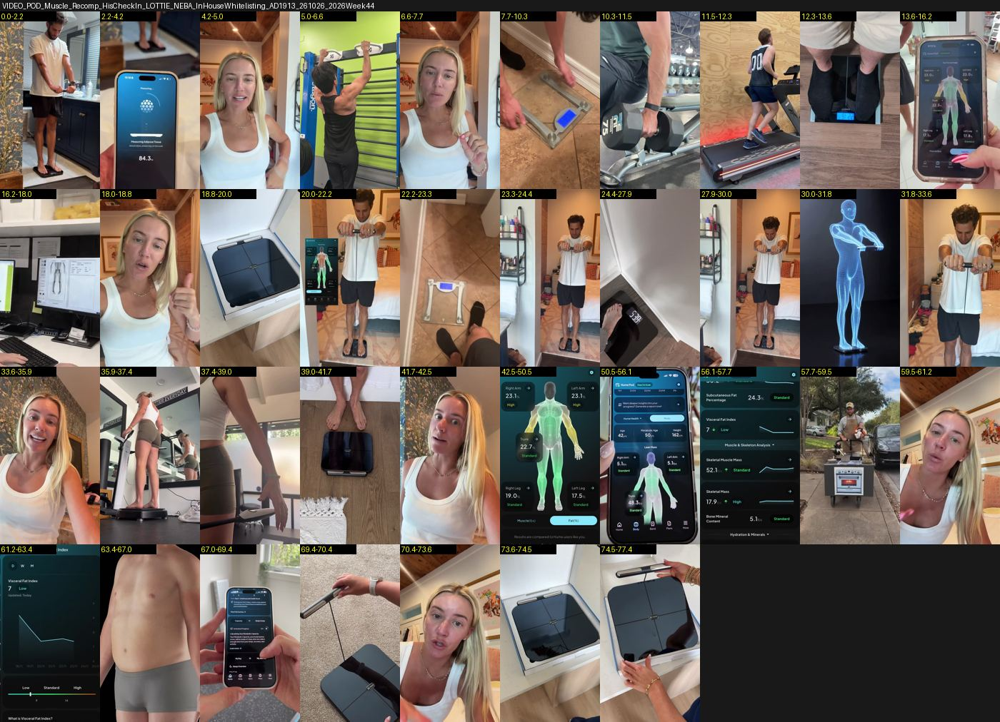

# VIDEO_POD_Muscle_Recomp_HisCheckIn_LOTTIE_NEBA_InHouseWhitelisting_AD1913_261026_2026Week44

Master: `VIDEO_POD_Muscle_Recomp_HisCheckIn_LOTTIE_NEBA_InHouseWhitelisting_AD1913_261026_2026Week44_9X16_HOOK1.mp4` · 77.4s · 1080x1920

**Pacing:** 37 shots · avg 2.091s · median 1.8s · 4.65 cuts/10s · first cut 2.167s · 246.0 wpm · talk ratio 0.97 · cuts on word start 88.9% · cuts in speech gaps 58.3%
**Audio:** {'I_lufs': -16.4, 'LRA': 6.8, 'true_peak_db': -0.1} · BPM≈129.2 · music {'speech_rms_db': -23.7, 'pause_seconds': 0.0} · cuts with SFX/transient 50.0%

**Captions:** 127 cards · 1 words/card (median) · y≈0.677 of frame height · text height≈0.0222 · colours {'blue': 9, 'white': 86, 'dark/other': 29, 'green': 3} · cards crossing a cut: 5
Highlighted: Measuring.o, 10:184, Measuring.., 10:18%, Measuring..., 10:182%, 9122, Fat(%), Standard, Muscle(lbs), Standard, 7 + Low
**Headlines:** agon (5.0–5.0s, blue) | tagon (5.5–5.5s, blue) | 9:536 (14.0–14.0s, dark/other) | CHumePod (14.0–14.0s, dark/other) | HumePod (15.0–15.0s, dark/other) | 538 (26.0–26.0s, white) | TEREVERYDAY (36.0–36.0s, white) | TTEREVERYDAY (37.0–37.0s, white)

**Hook (0–3s) spoken:** We're doing the Hume Body Analyzer. Harrison's doing his
**Hook on-screen:** 10:184 / 84.3g / AimostdonsDluasustynthuscalo / Measuring BodyWater / Measuring.. / Measuring.o
**CTA (last 5s):** take care of your health too and it's HSA and FSA eligible so you can use that card and check out. · on-screen: Hume / XHume

## Beat sheet

| # | in–out (s) | dur | transition | spoken | on-screen text |
|---|---|---|---|---|---|
| 1 | 0.00–2.17 | 2.17 |  | We're doing the Hume Body Analyzer. | Measuring.o [blue] / Measuring BodyWater / AimostdonsDluasustynthuscalo |
| 2 | 2.17–4.17 | 2.0 | cut | Harrison's doing his weekly weigh in. | Measuring.o [blue] / Measuring BodyWater / AimostdonsDluasustynthuscalo / 10:184 [blue] / Measuring.. [blue] / 84.3g |
| 3 | 4.17–5.03 | 0.87 | cut +SFX hit | Okay, you guys know Harrison | agon [blue] (HEADLINE) |
| 4 | 5.03–6.63 | 1.6 | cut +SFX hit | has been on a health kick and | agon [blue] (HEADLINE) / tagon [blue] (HEADLINE) |
| 5 | 6.63–7.73 | 1.1 | cut +SFX hit | one thing we've noticed is |  |
| 6 | 7.73–10.27 | 2.53 | cut | the scale tells you absolutely nothing. |  |
| 7 | 10.27–11.53 | 1.27 | cut | You can be building muscle, |  |
| 8 | 11.53–12.30 | 0.77 | cut | losing fat, |  |
| 9 | 12.30–13.57 | 1.27 | cut +SFX hit | and the number won't even change. | 9122 [blue] |
| 10 | 13.57–16.17 | 2.6 | cut +SFX hit | He wanted to get real answers about what was going on with his body without | 9:536 (HEADLINE) / CHumePod (HEADLINE) / 22.5% / Right Leg / 17.1x / 17.8% |
| 11 | 16.17–18.00 | 1.83 | cut | having to go somewhere every time. |  |
| 12 | 18.00–18.80 | 0.8 | cut | So we found the |  |
| 13 | 18.80–20.00 | 1.2 | cut +SFX hit | Hume Body Pod. | XHume |
| 14 | 20.00–22.17 | 2.17 | cut +SFX hit | It's a body analyzer, you guys, |  |
| 15 | 22.17–23.27 | 1.1 | cut | not a scale. |  |
| 16 | 23.27–24.37 | 1.1 | cut | And what's cool about it, |  |
| 17 | 24.37–27.93 | 3.57 | cut +SFX hit | most smart scales, only read your lower half and guess the rest, but | 538 (HEADLINE) |
| 18 | 27.93–29.97 | 2.03 | cut +SFX hit | he holds these handles right here, |  |
| 19 | 29.97–31.80 | 1.83 | cut | these. So it reads his whole body, which |  |
| 20 | 31.80–33.60 | 1.8 | cut | means he can actually trust the numbers. |  |
| 21 | 33.60–35.87 | 2.27 | cut | It's 98 % as accurate as those |  |
| 22 | 35.87–37.43 | 1.57 | cut +SFX hit | in -body scans at the gym, but those | TEREVERYDAY (HEADLINE) / TTEREVERYDAY (HEADLINE) |
| 23 | 37.43–39.03 | 1.6 | cut | cost like a hundreds of dollars. | TTEREVERYDAY (HEADLINE) |
| 24 | 39.03–41.67 | 2.63 | cut +SFX hit | And with this, he gets it at home in about a minute, which |  |
| 25 | 41.67–42.47 | 0.8 | cut +SFX hit | is incredible. |  |
| 26 | 42.47–50.50 | 8.03 | cut +SFX hit | It shows you your body scan by region, allowing you to see how muscle and fat are distributed throughout your arms, legs, and torso, which makes it really easy to | HumePod (HEADLINE) / Standard [green] (HEADLINE) / Trunk (HEADLINE) / 83.8ibs (HEADLINE) / LeftLeg / Right Leg |
| 27 | 50.50–56.13 | 5.63 | cut +SFX hit | identify the changes and the imbalances that you have, and then you can see what areas you wanna focus on over time. | LeftLeg / Right Leg / Standard [green] / RightArm (HEADLINE) / 5:51 [blue] (HEADLINE) / 42yrs [blue] (HEADLINE) |
| 28 | 56.13–57.70 | 1.57 | cut | The thing he's watching is muscle mass because | Standard [green] / Standard (HEADLINE) / High / Low / Body Pod (HEADLINE) / Connected [green] (HEADLINE) |
| 29 | 57.70–59.50 | 1.8 | cut | it naturally drops as you get older and |  |
| 30 | 59.50–61.23 | 1.73 | cut +SFX hit | it shows if your workouts are working and | Body Pod (HEADLINE) / LeanMass (HEADLINE) / 68.8% (HEADLINE) / Standard [green] (HEADLINE) / Percentage (HEADLINE) / FatDistributionAnalysis (HEADLINE) |
| 31 | 61.23–63.43 | 2.2 | cut +SFX hit | also tracking visceral fat because | Body Pod (HEADLINE) / LeanMass (HEADLINE) / 68.8% (HEADLINE) / Standard [green] (HEADLINE) / Percentage (HEADLINE) / FatDistributionAnalysis (HEADLINE) |
| 32 | 63.43–66.97 | 3.53 | cut | that's the fat that's around your organs that can be linked to heart disease. | Standard [green] / VisceralFatIndex (HEADLINE) / Low [blue] (HEADLINE) / Updated:Today (HEADLINE) / 18/11 / 20/11 |
| 33 | 66.97–69.43 | 2.47 | cut +SFX hit | He gets all of this in a weekly report which is incredible and | Duringyourfirst 5days,metricsmayappear (HEADLINE) / ActivationProgress: / CtDuringyourfirst 5days,metricsmayappear (HEADLINE) / CtDuringyourfist5days,metricsmayappear (HEADLINE) / CActivationProgress: / SleepOverview |
| 34 | 69.43–70.40 | 0.97 | cut +SFX hit | we can do it right at home so | CtDuringyourfist5days,metricsmayappear (HEADLINE) / CActivationProgress: / SleepOverview |
| 35 | 70.40–73.57 | 3.17 | cut | I ask for a code for you guys so you can take care of your health too and |  |
| 36 | 73.57–74.47 | 0.9 | cut | it's HSA and |  |
| 37 | 74.47–77.37 | 2.9 | cut | FSA eligible so you can use that card and check out. | Hume / XHume |

## Hook variants

| hook | file | dur | first cut | spoken 0–3s | on-screen 0–3s |
|---|---|---|---|---|---|
| 1 | `_InHouseWhitelisting_AD1913_261026_2026Week44_9X16_HOOK1.mp4` | 77.4 | 2.167 | We're doing the Hume Body Analyzer. Harrison's doing his | 10:184 / 84.3g / AimostdonsDluasustynthuscalo / Measuring BodyWater / Measuring.. / Measuring.o |
| 1 | `_InHouseWhitelisting_AD1913_261026_2026Week44_9X16_HOOK1.mp4` | 77.4 | 2.167 |  |  |
| 2 | `_InHouseWhitelisting_AD1913_261026_2026Week44_9X16_HOOK2.mp4` | 77.9 | 0.767 |  |  |
| 2 | `_InHouseWhitelisting_AD1913_261026_2026Week44_9X16_HOOK2.mp4` | 77.9 | 0.767 |  |  |
| 3 | `_InHouseWhitelisting_AD1913_261026_2026Week44_9X16_HOOK3.mp4` | 79.8 | 1.4 |  |  |
| 3 | `_InHouseWhitelisting_AD1913_261026_2026Week44_9X16_HOOK3.mp4` | 79.8 | 1.4 |  |  |

## Full transcript

We're doing the Hume Body Analyzer. Harrison's doing his weekly weigh in. Okay, you guys know Harrison has been on a health kick and one thing we've noticed is the scale tells you absolutely nothing. You can be building muscle, losing fat, and the number won't even change. He wanted to get real answers about what was going on with his body without having to go somewhere every time. So we found the Hume Body Pod. It's a body analyzer, you guys, not a scale. And what's cool about it, most smart scales, only read your lower half and guess the rest, but he holds these handles right here, these. So it reads his whole body, which means he can actually trust the numbers. It's 98% as accurate as those in-body scans at the gym, but those cost like a hundreds of dollars. And with this, he gets it at home in about a minute, which is incredible. It shows you your body scan by region, allowing you to see how muscle and fat are distributed throughout your arms, legs, and torso, which makes it really easy to identify the changes and the imbalances that you have, and then you can see what areas you wanna focus on over time. The thing he's watching is muscle mass because it naturally drops as you get older and it shows if your workouts are working and also tracking visceral fat because that's the fat that's around your organs that can be linked to heart disease. He gets all of this in a weekly report which is incredible and we can do it right at home so I ask for a code for you guys so you can take care of your health too and it's HSA and FSA eligible so you can use that card and check out.