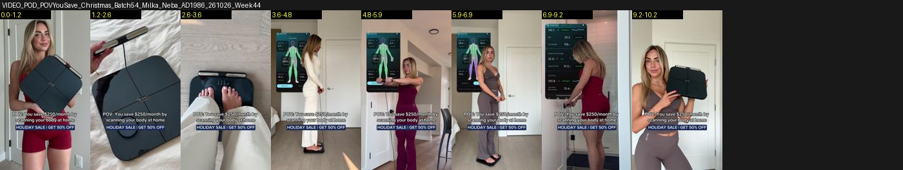

# VIDEO_POD_POVYouSave_Christmas_Batch54_Milka_Neba_AD1986_261026_Week44

Master: `VIDEO_POD_POVYouSave_Christmas_Batch54_Milka_Neba_AD1986_261026_Week44_9X16_HOOK1.mp4` · 10.2s · 1080x1920

**Pacing:** 8 shots · avg 1.28s · median 1.15s · 6.84 cuts/10s · first cut 1.2s · 35.0 wpm · talk ratio 1.0 · cuts on word start 0.0% · cuts in speech gaps 71.4%
**Audio:** {'I_lufs': -13.4, 'LRA': 0.6, 'true_peak_db': 0.1} · BPM≈107.7 · music {'speech_rms_db': -18.6, 'pause_seconds': 6.8, 'pause_rms_db': -16.4, 'bed_minus_voice_db': 2.2, 'music_bed_likely': True} · cuts with SFX/transient 85.7%

**Captions:** 20 cards · 1.0 words/card (median) · y≈0.653 of frame height · text height≈0.0234 · colours {'white': 20} · cards crossing a cut: 5
**Headlines:** 5.7m (4.0–4.0s, white) | 23.2 (7.0–8.0s, white) | 135ibs (7.0–7.0s, white) | 22.0%+ (7.0–7.0s, white) | 143.1b (8.0–8.0s, white) | 22.0%+Low (8.0–8.0s, white)

**Hook (0–3s) spoken:** Now I'm on
**Hook on-screen:** HOLIDAYSALEIGET50%OFF / HOLIDAYSALEIGET5O%OFF / POV:Yousave$250/monthby / XHume / scanning your body at home
**CTA (last 5s):** my side in... · on-screen: 103.8 / 13.5 / 135ibs / 143.1b / 22.0%+ / 22.0%+Low / 23.2 / 31.5bs / 72.6% / HOLIDAYSALEIGET50%OFF / HOLIDAYSALEIGET5O%OFF / POV:You save$250/monthby

## Beat sheet

| # | in–out (s) | dur | transition | spoken | on-screen text |
|---|---|---|---|---|---|
| 1 | 0.00–1.20 | 1.2 |  | Now I'm | POV:Yousave$250/monthby / scanning your body at home / HOLIDAYSALEIGET5O%OFF / HOLIDAYSALEIGET50%OFF / XHume / HOLIDAYSALEIGET5O%OFF |
| 2 | 1.20–2.60 | 1.4 | cut | on | POV:Yousave$250/monthby / scanning your body at home / XHume / HOLIDAYSALEIGET5O%OFF / HOLIDAYSALEIGET50%OFF |
| 3 | 2.60–3.63 | 1.03 | cut +SFX hit |  | POV:Yousave$250/monthby / scanning your body at home / HOLIDAYSALEIGET50%OFF / POV:You save$25o/monthby |
| 4 | 3.63–4.80 | 1.17 | cut +SFX hit |  | scanning your body at home / HOLIDAYSALEIGET50%OFF / POV:You save$25o/monthby / 5.7m (HEADLINE) / 17.9ms / 18.3ms |
| 5 | 4.80–5.93 | 1.13 | cut +SFX hit |  | scanning your body at home / POV:You save$250/monthby / HOLIDAYSALEIGET5O%OFF / 13.5 / HOLIDAYSALEIGET50%OFF |
| 6 | 5.93–6.93 | 1.0 | cut +SFX hit |  | scanning your body at home / POV:You save$250/monthby / 13.5 / HOLIDAYSALEIGET50%OFF / HOLIDAYSALEIGET5O%OFF |
| 7 | 6.93–9.20 | 2.27 | cut +SFX hit | my side | scanning your body at home / POV:You save$250/monthby / 23.2 (HEADLINE) / 135ibs (HEADLINE) / 22.0%+ (HEADLINE) / 31.5bs |
| 8 | 9.20–10.24 | 1.04 | cut +SFX hit | in... | scanning your body at home / POV:You save$250/monthby / HOLIDAYSALEIGET5O%OFF |

## Hook variants

| hook | file | dur | first cut | spoken 0–3s | on-screen 0–3s |
|---|---|---|---|---|---|
| 1 | `stmas_Batch54_Milka_Neba_AD1986_261026_Week44_9X16_HOOK1.mp4` | 10.2 | 1.2 | Now I'm on | HOLIDAYSALEIGET50%OFF / HOLIDAYSALEIGET5O%OFF / POV:Yousave$250/monthby / XHume / scanning your body at home |
| 1 | `stmas_Batch54_Milka_Neba_AD1986_261026_Week44_9X16_HOOK1.mp4` | 10.2 | 1.2 |  |  |
| 2 | `stmas_Batch54_Milka_Neba_AD1986_261026_Week44_9X16_HOOK2.mp4` | 13.0 | 2.6 |  |  |
| 2 | `stmas_Batch54_Milka_Neba_AD1986_261026_Week44_9X16_HOOK2.mp4` | 13.0 | 2.6 |  |  |
| 3 | `stmas_Batch54_Milka_Neba_AD1986_261026_Week44_9X16_HOOK3.mp4` | 12.9 | 1.767 |  |  |
| 3 | `stmas_Batch54_Milka_Neba_AD1986_261026_Week44_9X16_HOOK3.mp4` | 12.9 | 1.767 |  |  |
| 4 | `stmas_Batch54_Milka_Neba_AD1986_261026_Week44_9X16_HOOK4.mp4` | 10.2 | 2.6 |  |  |
| 4 | `stmas_Batch54_Milka_Neba_AD1986_261026_Week44_9X16_HOOK4.mp4` | 10.2 | 2.6 |  |  |
| 5 | `stmas_Batch54_Milka_Neba_AD1986_261026_Week44_9X16_HOOK5.mp4` | 12.9 | 2.6 |  |  |
| 5 | `stmas_Batch54_Milka_Neba_AD1986_261026_Week44_9X16_HOOK5.mp4` | 12.9 | 2.6 |  |  |

## Full transcript

Now I'm on my side in...