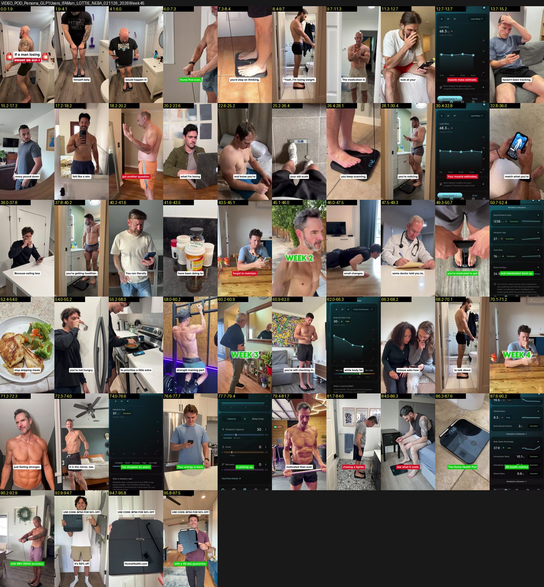

# VIDEO_POD_Persona_GLP1Users_IfAMan_LOTTIE_NEBA_021126_2026Week45

Master: `VIDEO_POD_Persona_GLP1Users_IfAMan_LOTTIE_NEBA_021126_2026Week45_Hook1_9x16.mp4` · 97.5s · 1080x1920

**Pacing:** 54 shots · avg 1.805s · median 1.705s · 5.44 cuts/10s · first cut 1.867s · 227.0 wpm · talk ratio 0.94 · cuts on word start 81.1% · cuts in speech gaps 67.9%
**Audio:** {'I_lufs': -19.6, 'LRA': 2.6, 'true_peak_db': -3.5} · BPM≈123.0 · music {'speech_rms_db': -24.2, 'pause_seconds': 0.4} · cuts with SFX/transient 58.5%

**Captions:** 198 cards · 1.0 words/card (median) · y≈0.745 of frame height · text height≈0.0263 · colours {'white': 107, 'red': 11, 'green': 14, 'dark/other': 63, 'blue': 3} · cards crossing a cut: 0
Highlighted: WEIGHT ON GLP-1, withthe Hume Pod, Hume Pod scan,, musclemassestimate, HumeHealth, got another question., Your body fat trend., HumeHealth, Yourmuscleestimates,, doesn'tautomatically mean, forgot to maintain., you're motivated to get, andmetabolismbackup, Musclemass, istrendinginthegreen,
**Headlines:** PATRON (2.0–2.0s, dark/other) | TEQULA (2.0–2.0s, dark/other) | PATRON (3.0–3.5s, dark/other) | FEQUILA (3.0–3.0s, dark/other) | TEQUILA (3.5–3.5s, dark/other) | 4 WEEKS (5.5–5.5s, green) | HumePod (13.0–13.0s, dark/other) | StepOnScale (13.0–13.0s, green)

**Hook (0–3s) spoken:** If a man losing weight on GLP -1 started measuring himself daily
**Hook on-screen:** If a man losing / PATRON / TEQULA / WEIGHT ON GLP-1 / himself daily / started measuring
**CTA (last 5s):** It's 50 % off right now at HumeHealth .com with a 45 -day guarantee. · on-screen: HumeHealth.com / It's50%off / USECODE:BF50FOR50%OFF / USECODE:BF5OFOR50%OFF / USECODE:BF5OFOR5O%OFF / XHume / right now at / witha45-dayguarantee

## Beat sheet

| # | in–out (s) | dur | transition | spoken | on-screen text |
|---|---|---|---|---|---|
| 1 | 0.00–1.87 | 1.87 |  | If a man losing weight on GLP -1 started | If a man losing / WEIGHT ON GLP-1 [red] |
| 2 | 1.87–4.13 | 2.27 | cut | measuring himself daily with the humepod, | If a man losing / WEIGHT ON GLP-1 [red] / PATRON (HEADLINE) / TEQULA (HEADLINE) / started measuring / himself daily |
| 3 | 4.13–6.00 | 1.87 | cut | this is what would happen in four weeks. | RAVENS / FOOTBALL / this is what / would happen in / 4 WEEKS [green] (HEADLINE) |
| 4 | 6.00–7.30 | 1.3 | cut +SFX hit | On the first humepod scan, | On the first / Hume Pod scan, [green] |
| 5 | 7.30–8.43 | 1.13 | cut | you'd step on thinking, | Hume Pod scan, [green] / you'd step on thinking, |
| 6 | 8.43–9.67 | 1.23 | cut | yeah, I'm losing weight. | you'd step on thinking, / "Yeah, I'm losing weight. |
| 7 | 9.67–11.30 | 1.63 | cut +SFX hit | The medication is clearly working. | Themedicationis / clearly working." |
| 8 | 11.30–12.70 | 1.4 | cut +SFX hit | Then you open the app and look at your muscle | clearly working." / look at your |
| 9 | 12.70–13.67 | 0.97 | cut +SFX hit | mass estimate, | HumePod (HEADLINE) / StepOnScale [green] (HEADLINE) / LeanMass (HEADLINE) / 68.3kg (HEADLINE) / Updated:Today (HEADLINE) / 70 |
| 10 | 13.67–15.23 | 1.57 | cut +SFX hit | a number you haven't been tracking. | haven't been tracking, / because until now |
| 11 | 15.23–17.20 | 1.97 | cut +SFX hit | Because until now, every pound down felt | because until now / everypounddown / felt like a win. |
| 12 | 17.20–18.17 | 0.97 | cut | like a win. | felt like a win. / And suddenly, you've |
| 13 | 18.17–20.20 | 2.03 | cut +SFX hit | And suddenly, you've got another question. | And suddenly, you've / got another question. [red] / "How much of |
| 14 | 20.20–22.63 | 2.43 | cut | How much of what I'm losing is actually fat. | "How much of / what I'm losing / is actually fat?" |
| 15 | 22.63–25.17 | 2.53 | cut | That's day one. And know you're questioning everything your | That's day one, / questioning everything / 000 (HEADLINE) / your old scale |
| 16 | 25.17–26.40 | 1.23 | cut | old scale told you. But | 000 (HEADLINE) / your old scale / 761522 / told you. |
| 17 | 26.40–28.10 | 1.7 | cut +SFX hit | then you keep scanning. And by the end | 761522 / told you. / you keep scanning, / and by the end of |
| 18 | 28.10–30.43 | 2.33 | cut +SFX hit | of week one, you're noticing other things, | and by the end of / you're noticing / other things. |
| 19 | 30.43–32.77 | 2.33 | cut +SFX hit | your body fat trend, your muscle estimates. | other things. / HumePod (HEADLINE) / StepOnScale [green] (HEADLINE) / BFP (HEADLINE) / 9.4% 4 (HEADLINE) / Updated:Today (HEADLINE) |
| 20 | 32.77–35.97 | 3.2 | cut +SFX hit | Whether the changes you're seeing match what you're actually trying to achieve, | whether the changes / match what you're / actually trying to achieve. |
| 21 | 35.97–37.83 | 1.87 | cut +SFX hit | because eating less and getting lighter doesn't | Because eating less / and getting lighter |
| 22 | 37.83–40.20 | 2.37 | cut | automatically mean you're getting healthier. | doesn'tautomatically mean [red] / you're getting healthier. / You can literally |
| 23 | 40.20–41.60 | 1.4 | cut | You can literally see what the | You can literally / see what the |
| 24 | 41.60–43.47 | 1.87 | cut +SFX hit | months of medication have been doing to the muscle | HOLD / TABDOWN / TURN / months of medication / have been doing to |
| 25 | 43.47–45.10 | 1.63 | cut +SFX hit | you forgot to maintain. | HOLD / TABDOWN / TURN / have been doing to / forgot to maintain. [red] / WEEK 2 [green] (HEADLINE) |
| 26 | 45.10–46.00 | 0.9 | cut +SFX hit | By week two, you | WEEK 2 [green] (HEADLINE) |
| 27 | 46.00–47.50 | 1.5 | cut +SFX hit | start making small changes, | you start making / small changes. |
| 28 | 47.50–49.33 | 1.83 | cut | not because some doctor told you to, | some doctor told you to, / Blane St |
| 29 | 49.33–50.73 | 1.4 | cut +SFX hit | but because you're motivated to get your | some doctor told you to, / Blane St / you're motivated to get [green] |
| 30 | 50.73–52.43 | 1.7 | cut | muscle and metabolism back up. | 0.6kg (HEADLINE) / Mineral Mass (HEADLINE) / Standard (HEADLINE) / MetabolicIndicators (HEADLINE) / BasalMetabolicRate (HEADLINE) / 1238 (HEADLINE) |
| 31 | 52.43–53.97 | 1.53 | cut | So maybe you stop skipping meals just | Standard (HEADLINE) / BasalMetabolicRate (HEADLINE) / 1238 (HEADLINE) / Standard / HeartRate / 76BPM |
| 32 | 53.97–55.23 | 1.27 | cut +SFX hit | because you're not hungry. The | justbecause / The app tells you |
| 33 | 55.23–58.03 | 2.8 | cut +SFX hit | app tells you to prioritize a little extra protein and | The app tells you / to prioritize a little extra / ATNESS / protein and make |
| 34 | 58.03–60.17 | 2.13 | cut +SFX hit | make strength training part of your routine. | ATNESS / protein and make / GUEFITNESS / strength training part / WEEK 3 [green] (HEADLINE) |
| 35 | 60.17–60.90 | 0.73 | cut | Week 3, | WEEK 3 [green] (HEADLINE) |
| 36 | 60.90–62.00 | 1.1 | cut +SFX hit | you're still checking in. | you're still checking in. |
| 37 | 62.00–66.27 | 4.27 | cut | Muscle mass is trending in the green, while body fat percentage is still falling. | RightArmMuscleMass (HEADLINE) / 4.4 ibs (HEADLINE) / Standard [green] (HEADLINE) / Updated:Today (HEADLINE) / Mar / Musclemass [green] |
| 38 | 66.27–68.23 | 1.97 | cut +SFX hit | So when your Mrs. asks how much you've lost, | Updated:Today (HEADLINE) / Trunk Fat Rate (HEADLINE) / Trunk Fat Percent... (HEADLINE) / BodyFatRateTrunk (HEADLINE) / High (HEADLINE) / 34 |
| 39 | 68.23–70.07 | 1.83 | cut +SFX hit | you've got more to talk about than pounds. | you've got more / to talk about / WEEK4 [green] (HEADLINE) |
| 40 | 70.07–71.23 | 1.17 | cut +SFX hit | By week 4, you're not just | WEEK4 [green] (HEADLINE) / just feeling stronger, |
| 41 | 71.23–72.33 | 1.1 | cut +SFX hit | feeling stronger but | just feeling stronger, |
| 42 | 72.33–74.00 | 1.67 | cut +SFX hit | seeing it in the mirror too. | just feeling stronger, / it in the mirror, too. |
| 43 | 74.00–76.63 | 2.63 | cut | Your metabolic age has dropped 6 years. | Metabolic Age (HEADLINE) / 37 yrs (HEADLINE) / Standard (HEADLINE) / Updated:Today (HEADLINE) / 39 / 35 |
| 44 | 76.63–77.73 | 1.1 | cut +SFX hit | Your energy is back, | Your energy is back, [green] |
| 45 | 77.73–79.40 | 1.67 | cut | your metabolism is picking up, | WMetabolicMomentum (HEADLINE) / Capacity / BodyComp / 30 / MetabolicCapacity / 100 |
| 46 | 79.40–81.67 | 2.27 | cut | and you're more motivated than ever to keep it up. You | 100 / Strain / Target / Recovery / Capacity (HEADLINE) / Body Comp (HEADLINE) |
| 47 | 81.67–84.03 | 2.37 | cut | just stop chasing a lighter number on the scale because | You just stopped / numberonthescale [red] / because you can finally |
| 48 | 84.03–86.33 | 2.3 | cut +SFX hit | you can finally see what it costs. | because you can finally / see what it costs [red] |
| 49 | 86.33–87.63 | 1.3 | cut +SFX hit | The Hume Health Pod shows you | see what it costs [red] / 1426- (HEADLINE) / The Hume HealthPod [green] |
| 50 | 87.63–90.23 | 2.6 | cut | 45 health metrics in 30 seconds with | SkeletalMuscleMass (HEADLINE) / 19.5kg (HEADLINE) / Low (HEADLINE) / SkeletalMass (HEADLINE) / 8.2kg / High [blue] |
| 51 | 90.23–92.87 | 2.63 | cut | 98 % DEXA accuracy. | with98%DEXAaccuracy [green] |
| 52 | 92.87–94.70 | 1.83 | cut +SFX hit | It's 50 % off right now at HumeHealth | USECODE:BF5OFOR5O%OFF (HEADLINE) / It's50%off / USECODE:BF5OFOR50%OFF (HEADLINE) / right now at |
| 53 | 94.70–95.77 | 1.07 | cut | .com with | USECODE:BF50FOR50%OFF (HEADLINE) / XHume / HumeHealth.com |
| 54 | 95.77–97.48 | 1.71 | cut +SFX hit | a 45 -day guarantee. | USECODE:BF5OFOR50%OFF (HEADLINE) / witha45-dayguarantee [green] |

## Hook variants

| hook | file | dur | first cut | spoken 0–3s | on-screen 0–3s |
|---|---|---|---|---|---|
| 1 | `LP1Users_IfAMan_LOTTIE_NEBA_021126_2026Week45_Hook1_9x16.mp4` | 97.5 | 1.867 | If a man losing weight on GLP -1 started measuring himself daily | If a man losing / PATRON / TEQULA / WEIGHT ON GLP-1 / himself daily / started measuring |
| 2 | `LP1Users_IfAMan_LOTTIE_NEBA_021126_2026Week45_Hook2_9x16.mp4` | 96.5 | 1.333 |  |  |
| 3 | `LP1Users_IfAMan_LOTTIE_NEBA_021126_2026Week45_Hook3_9x16.mp4` | 95.3 | 2.2 |  |  |

## Full transcript

If a man losing weight on GLP-1 started measuring himself daily with the humepod, this is what would happen in four weeks. On the first humepod scan, you'd step on thinking, yeah, I'm losing weight. The medication is clearly working. Then you open the app and look at your muscle mass estimate, a number you haven't been tracking. Because until now, every pound down felt like a win. And suddenly, you've got another question. How much of what I'm losing is actually fat. That's day one. And know you're questioning everything your old scale told you. But then you keep scanning. And by the end of week one, you're noticing other things, your body fat trend, your muscle estimates. Whether the changes you're seeing match what you're actually trying to achieve, because eating less and getting lighter doesn't automatically mean you're getting healthier. You can literally see what the months of medication have been doing to the muscle you forgot to maintain. By week two, you start making small changes, not because some doctor told you to, but because you're motivated to get your muscle and metabolism back up. So maybe you stop skipping meals just because you're not hungry. The app tells you to prioritize a little extra protein and make strength training part of your routine. Week 3, you're still checking in. Muscle mass is trending in the green, while body fat percentage is still falling. So when your Mrs. asks how much you've lost, you've got more to talk about than pounds. By week 4, you're not just feeling stronger but seeing it in the mirror too. Your metabolic age has dropped 6 years. Your energy is back, your metabolism is picking up, and you're more motivated than ever to keep it up. You just stop chasing a lighter number on the scale because you can finally see what it costs. The Hume Health Pod shows you 45 health metrics in 30 seconds with 98% DEXA accuracy. It's 50% off right now at HumeHealth.com with a 45-day guarantee.