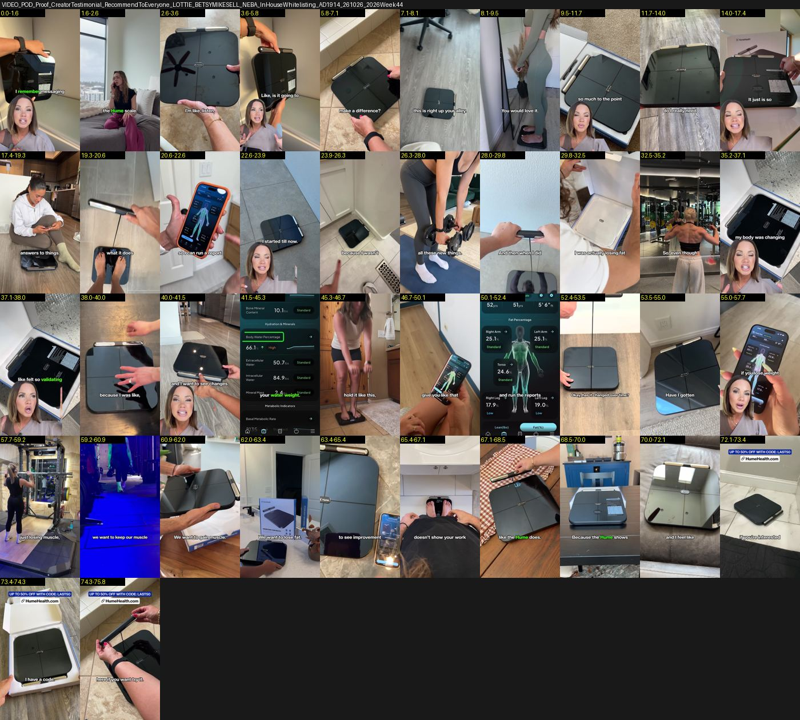

# VIDEO_POD_Proof_CreatorTestimonial_RecommendToEveryone_LOTTIE_BETSYMIKESELL_NEBA_InHouseWhitelisting_AD1914_261026_2026Week44

Master: `VIDEO_POD_Proof_CreatorTestimonial_RecommendToEveryone_LOTTIE_BETSYMIKESELL_NEBA_InHouseWhitelisting_AD1914_261026_2026Week44_HOOK1_9X16.mp4` · 75.8s · 1080x1920

**Pacing:** 42 shots · avg 1.805s · median 1.6s · 5.41 cuts/10s · first cut 1.58s · 264.0 wpm · talk ratio 0.94 · cuts on word start 75.6% · cuts in speech gaps 65.9%
**Audio:** {'I_lufs': -13.6, 'LRA': 5.1, 'true_peak_db': 0.1} · BPM≈129.2 · music {'speech_rms_db': -18.6, 'pause_seconds': 0.6, 'pause_rms_db': -20.5, 'bed_minus_voice_db': -1.9, 'music_bed_likely': True} · cuts with SFX/transient 36.6%

**Captions:** 167 cards · 1 words/card (median) · y≈0.636 of frame height · text height≈0.0328 · colours {'green': 12, 'white': 119, 'dark/other': 24, 'blue': 6, 'red': 6} · cards crossing a cut: 2
Highlighted: Iremember messaging, the Hume scale., is it really good?, the Hume scale?, Muscie Hass, soIcan run areport, MurcleMass, from the firstday, the Hume Scale,, like felt so validating, Subcutaneouyourbody fat,, High, your bone density,, musclermass., and then.it will
**Headlines:** HumeHealth (14.0–14.0s, white) | HHumeHealth (15.0–15.0s, white) | HumeHealth (16.0–16.0s, white) | XHumaHealth (17.0–17.0s, white) | 11:480 (21.0–22.0s, blue) | 66m (21.0–22.0s, dark/other) | HumeHoalth (30.0–30.0s, white) | DYOURHEALTH (30.0–30.0s, white)

**Hook (0–3s) spoken:** I remember messaging my friend, Mallory, I would talk about the Hume Scale. I'm
**Hook on-screen:** Iremember messaging / XHume / my friend Malorie / she would talk.about / the Hume scale.
**CTA (last 5s):** I feel like that's so important. Anyways, if you're interested, I have a code, so I'll link it all here if you want to try it. · on-screen: Anyways, / HumeHealth.com / Solink.itall / UPTO50%OFFWITHCODE:LAST50 / UPTO5O%OFFWITHCODE:LAST50 / XHume / and Ifeel like / hereifyouwanttryit. / ifyoureinterested

## Beat sheet

| # | in–out (s) | dur | transition | spoken | on-screen text |
|---|---|---|---|---|---|
| 1 | 0.00–1.58 | 1.58 |  | I remember messaging my friend, Mallory, | Iremember messaging [green] / my friend Malorie / she would talk.about |
| 2 | 1.58–2.62 | 1.04 | cut | I would talk about the Hume | she would talk.about / the Hume scale. [green] / XHume |
| 3 | 2.62–3.60 | 0.98 | cut +SFX hit | Scale. I'm like, listen, | the Hume scale. [green] / XHume / I'm like, listen, / is it really good? [green] |
| 4 | 3.60–5.78 | 2.18 | cut | is it really good? Like, is it going to make | is it really good? [green] / Like, is it going to / XHime |
| 5 | 5.78–7.10 | 1.32 | cut | a difference? And she's like, | Like, is it going to / XHime / make a difference? / And she's like,Betsy |
| 6 | 7.10–8.12 | 1.02 | cut +SFX hit | Betsy, this is right up your | And she's like,Betsy / this is right up your alley. |
| 7 | 8.12–9.48 | 1.36 | cut | alley. You would love it. | this is right up your alley. / You would love it. |
| 8 | 9.48–11.70 | 2.22 | cut | I talked about this so much to the point that my sister's like, | You would love it. / so much to the point / that my sister's like, |
| 9 | 11.70–14.02 | 2.32 | cut | okay, Betsy, do I really need the Hume Scale? I'm like, | do Ireally need / Hume / the Hume scale? [green] / HumeHealth (HEADLINE) / listen, we don't need it. |
| 10 | 14.02–17.38 | 3.36 | cut | listen, we don't need it. It just is so nice | HumeHealth (HEADLINE) / listen, we don't need it. / HHumeHealth (HEADLINE) / HumeHealth (HEADLINE) / It just is so / XHumaHealth (HEADLINE) |
| 11 | 17.38–19.34 | 1.96 | cut | to have answers to things. | It just is so / XHumaHealth (HEADLINE) / answers to things |
| 12 | 19.34–20.58 | 1.24 | cut +SFX hit | What it does is it runs a | answers to things / is it runs a report, / 1287 |
| 13 | 20.58–22.58 | 2.0 | cut +SFX hit | report. So I can run a report from the first day | 11:480 [blue] (HEADLINE) / 66m (HEADLINE) / Muscie Hass [blue] / 4.6m / LeftArm / Standard |
| 14 | 22.58–23.86 | 1.28 | cut +SFX hit | I started till now it | I started till now. |
| 15 | 23.86–26.30 | 2.44 | cut +SFX hit | is so nice because I wasn't losing weight and | Itis sonice / becauseIwasn't / losing weight |
| 16 | 26.30–28.00 | 1.7 | cut | I was like trying all these new things. And | losing weight / all these new things. |
| 17 | 28.00–29.78 | 1.78 | cut | then when I did the Hume Scale, it | AndthenwhenI did / XHume / the Hume Scale, [green] |
| 18 | 29.78–32.52 | 2.74 | cut | told me that I was actually losing fat | HumeHoalth (HEADLINE) / DYOURHEALTH (HEADLINE) / XHumeHealth (HEADLINE) / it told me that / Iwas actually losing fat |
| 19 | 32.52–35.16 | 2.64 | cut +SFX hit | and gaining muscle. So even though the scale stayed the same, | and gaining muscle. / the scale stayed / my body was changing |
| 20 | 35.16–37.14 | 1.98 | cut | my body was changing. And so it felt | my body was changing / like felt so validating [green] |
| 21 | 37.14–38.00 | 0.86 | cut | so validating | like felt so validating [green] |
| 22 | 38.00–39.96 | 1.96 | cut | because I was like, I'm working hard and | like felt so validating [green] / XHume / I'm working hard, |
| 23 | 39.96–41.46 | 1.5 | cut | I wanna see changes. | and I wantto see changes. |
| 24 | 41.46–45.26 | 3.8 | cut | Measures like your body fat, your water weight, your bone density, muscle mass, | and I wantto see changes. / HumeP...(100%) (HEADLINE) / Connected (HEADLINE) / 12.1% + (HEADLINE) / Low [blue] (HEADLINE) / 24.7ibs (HEADLINE) |
| 25 | 45.26–46.72 | 1.46 | cut | total like this, of course. | Standard / BoneMineral / Content / Hydration&Minerals / FatPercentage (HEADLINE) / VisceralFatIndex (HEADLINE) |
| 26 | 46.72–50.06 | 3.34 | cut | And then it will give you that day your results but | and then.it will [red] / 5.70 / give youslike that [red] / 11.1x / day, your results. [green] / HumePod (HEADLINE) |
| 27 | 50.06–52.36 | 2.3 | cut +SFX hit | then you can go back and run the reports to be like, | HumePod (HEADLINE) / StepOnScale [green] (HEADLINE) / Age (HEADLINE) / MetabolicAge (HEADLINE) / Height (HEADLINE) / 52yrs (HEADLINE) |
| 28 | 52.36–53.50 | 1.14 | cut | okay, has it changed over | HumePod (HEADLINE) / StepOnScale [green] (HEADLINE) / Fat Percentage (HEADLINE) / Standard / Torso / 24.6% |
| 29 | 53.50–55.04 | 1.54 | cut | time? Have I gotten improvements? | XHume / Have I gotten / 4:40 [blue] (HEADLINE) / HumePod [blue] (HEADLINE) / nunsemeann [blue] (HEADLINE) / StepOn Scale (HEADLINE) |
| 30 | 55.04–57.74 | 2.7 | cut +SFX hit | Because sometimes if you lose weight and you're like, yay, I'm losing weight, | 4:40 [blue] (HEADLINE) / HumePod [blue] (HEADLINE) / nunsemeann [blue] (HEADLINE) / StepOn Scale (HEADLINE) / 40yrs / MetabolicAge |
| 31 | 57.74–59.24 | 1.5 | cut | but you're just losing muscle and like | ASERPLICEWEIGHTSAFTE (HEADLINE) / just losing muscle, / and like, [blue] |
| 32 | 59.24–60.86 | 1.62 | cut +SFX hit | we want to keep our muscle as we're aging. | and like, [blue] / wewant tokeep ourmuscle [blue] |
| 33 | 60.86–62.04 | 1.18 | cut | We want to gain muscle. | We want to gain muscle. / HHumeHealh / UNDERSTANDYOURHEALTH / Wewant to losefat. |
| 34 | 62.04–63.38 | 1.34 | cut | We want to lose fat and | HHumeHealh / UNDERSTANDYOURHEALTH / Wewant to losefat. / HHumeHealth |
| 35 | 63.38–65.42 | 2.04 | cut +SFX hit | exciting to see improvements because at | UNDERSTANDYOURHEALTH / Wewant to losefat. / HHumeHealth / (Hume / to see improvement / XHume |
| 36 | 65.42–67.06 | 1.64 | cut +SFX hit | the scale doesn't show your work | XHume / because it's the scale / doesn't show your work / XHume / like the Hume does. [green] |
| 37 | 67.06–68.52 | 1.46 | cut | like the Hume does because | XHume / like the Hume does. [green] |
| 38 | 68.52–69.98 | 1.46 | cut | the Hume shows the details of | Because the Hume shows [green] |
| 39 | 69.98–72.06 | 2.08 | cut | all the things. And I feel like that's so important. | of all the things, / XHume / and Ifeel like / UPTO50%OFFWITHCODE:LAST50 [blue] (HEADLINE) / HumeHealth.com (HEADLINE) / Anyways, |
| 40 | 72.06–73.36 | 1.3 | cut +SFX hit | Anyways, if you're interested, | UPTO50%OFFWITHCODE:LAST50 [blue] (HEADLINE) / HumeHealth.com (HEADLINE) / Anyways, / ifyoureinterested |
| 41 | 73.36–74.34 | 0.98 | cut +SFX hit | I have a code, so I'll | UPTO50%OFFWITHCODE:LAST50 [blue] (HEADLINE) / HumeHealth.com (HEADLINE) / ifyoureinterested / UPTO5O%OFFWITHCODE:LAST50 [blue] (HEADLINE) / Solink.itall |
| 42 | 74.34–75.82 | 1.48 | cut +SFX hit | link it all here if you want to try it. | HumeHealth.com (HEADLINE) / UPTO5O%OFFWITHCODE:LAST50 [blue] (HEADLINE) / Solink.itall / UPTO50%OFFWITHCODE:LAST50 [blue] (HEADLINE) / hereifyouwanttryit. |

## Hook variants

| hook | file | dur | first cut | spoken 0–3s | on-screen 0–3s |
|---|---|---|---|---|---|
| 1 | `_InHouseWhitelisting_AD1914_261026_2026Week44_HOOK1_9X16.mp4` | 75.8 | 1.58 | I remember messaging my friend, Mallory, I would talk about the Hume Scale. I'm | Iremember messaging / XHume / my friend Malorie / she would talk.about / the Hume scale. |
| 2 | `_InHouseWhitelisting_AD1914_261026_2026Week44_HOOK2_9X16.mp4` | 73.6 | 0.94 |  |  |
| 3 | `_InHouseWhitelisting_AD1914_261026_2026Week44_HOOK3_9X16.mp4` | 68.5 | 2.16 |  |  |

## Full transcript

I remember messaging my friend, Mallory, I would talk about the Hume Scale. I'm like, listen, is it really good? Like, is it going to make a difference? And she's like, Betsy, this is right up your alley. You would love it. I talked about this so much to the point that my sister's like, okay, Betsy, do I really need the Hume Scale? I'm like, listen, we don't need it. It just is so nice to have answers to things. What it does is it runs a report. So I can run a report from the first day I started till now it is so nice because I wasn't losing weight and I was like trying all these new things. And then when I did the Hume Scale, it told me that I was actually losing fat and gaining muscle. So even though the scale stayed the same, my body was changing. And so it felt so validating because I was like, I'm working hard and I wanna see changes. Measures like your body fat, your water weight, your bone density, muscle mass, total like this, of course. And then it will give you that day your results but then you can go back and run the reports to be like, okay, has it changed over time? Have I gotten improvements? Because sometimes if you lose weight and you're like, yay, I'm losing weight, but you're just losing muscle and like we want to keep our muscle as we're aging. We want to gain muscle. We want to lose fat and exciting to see improvements because at the scale doesn't show your work like the Hume does because the Hume shows the details of all the things. And I feel like that's so important. Anyways, if you're interested, I have a code, so I'll link it all here if you want to try it.