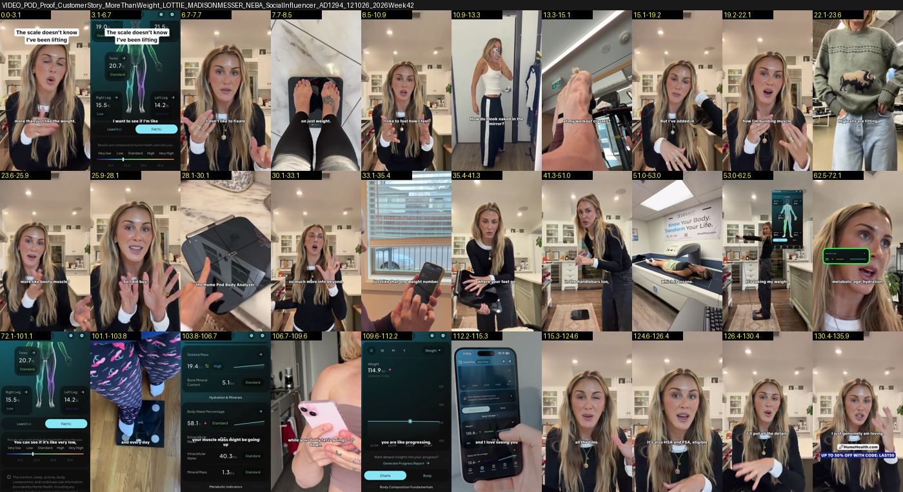

# VIDEO_POD_Proof_CustomerStory_MoreThanWeight_LOTTIE_MADISONMESSER_NEBA_SocialInfluencer_AD1294_121026_2026Week42

Master: `VIDEO_POD_Proof_CustomerStory_MoreThanWeight_LOTTIE_MADISONMESSER_NEBA_SocialInfluencer_AD1294_121026_2026Week42_9x16_hook1.mp4` · 135.9s · 1080x1920

**Pacing:** 30 shots · avg 4.528s · median 2.88s · 2.13 cuts/10s · first cut 3.08s · 246.0 wpm · talk ratio 0.93 · cuts on word start 89.7% · cuts in speech gaps 75.9%
**Audio:** {'I_lufs': -13.0, 'LRA': 7.4, 'true_peak_db': 0.2} · BPM≈123.0 · music {'speech_rms_db': -19.0, 'pause_seconds': 1.8, 'pause_rms_db': -19.4, 'bed_minus_voice_db': -0.4, 'music_bed_likely': True} · cuts with SFX/transient 27.6%

**Captions:** 308 cards · 1.0 words/card (median) · y≈0.677 of frame height · text height≈0.0269 · colours {'white': 243, 'dark/other': 54, 'blue': 9, 'red': 2} · cards crossing a cut: 3
Highlighted: Fat(%), High, 15个, Lean(lbs), Fat(%), 2EI, Charts, UPTO50%OFFWITHCODE:LAST50, UPTO5O%OFFWITHCODE:LAST50, UPTO50%OFFWITHCODE:LAST50, UPTO50%OFFWITHCODE:LAST50
**Headlines:** The scale doesn't know (0.0–6.0s, white) | I've been lifting (0.0–5.5s, white) | HumePod (3.0–6.0s, dark/other) | StepOnScale (3.0–6.0s, green) | Age (3.0–3.5s, white) | 35yrs (3.0–3.0s, white) | 171 (3.0–3.0s, white) | FatPercentage (3.0–3.5s, white)

**Hook (0–3s) spoken:** I kind of like the data that's like more than just like the weight.
**Hook on-screen:** I've been lifting / Ikind of likethedata / The scale doesn't know / more than just like the weight. / morethanjust liketheweight / morethanjustliketheweight. / that'slike
**CTA (last 5s):** is one of those products that I use every single day that I just genuinely and loving · on-screen: HumeHealth.com / Ijustgenuinelyam loving. / Ijustgenuinelyamloving, / UPTO50%OFFWITHCODE:LAST50 / UPTO5O%OFFWITHCODE:LAST50 / ljustgenuinelyamloving / thatIuse everysingle daythat / thisisoneofthoseproducts

## Beat sheet

| # | in–out (s) | dur | transition | spoken | on-screen text |
|---|---|---|---|---|---|
| 1 | 0.00–3.08 | 3.08 |  | I kind of like the data that's like more than just like the weight. I | The scale doesn't know (HEADLINE) / I've been lifting (HEADLINE) / Ikind of likethedata / that'slike / more than just like the weight. / morethanjust liketheweight |
| 2 | 3.08–6.72 | 3.64 | cut | want to see my body composition. I want to see if I'm like gaining muscle mass. | The scale doesn't know (HEADLINE) / I've been lifting (HEADLINE) / HumePod (HEADLINE) / StepOnScale [green] (HEADLINE) / Age (HEADLINE) / 35yrs (HEADLINE) |
| 3 | 6.72–7.68 | 0.96 | cut +SFX hit | I don't like to fixate | Idon'tlike to fixate |
| 4 | 7.68–8.48 | 0.8 | cut | on just weight. | 192 / onjust weight. |
| 5 | 8.48–10.88 | 2.4 | cut | I like to feel how I feel. | 192 / onjust weight. / Iliketo feel howIfeel |
| 6 | 10.88–13.28 | 2.4 | cut | How do my clothes set? How do I look naked in the mirror? | Howdo my clothes fit? / Howdolook naked inthe / mirror? / How doI look naked inthe |
| 7 | 13.28–15.08 | 1.8 | cut +SFX hit | Am I doing better at my workout classes? | mirror? / How doI look naked inthe / atmyworkout classes? / I've just like,changed the way |
| 8 | 15.08–19.20 | 4.12 | cut | I've just like changed the way I kind of like look at my body, but I've added in weight training recently. | I've just like,changed the way / Ikind of like lookat my body. / ButI'veaddedin / weight training recently, / andnowI'm |
| 9 | 19.20–22.12 | 2.92 | cut | And now I'm a little interested to track how I'm building muscle. | andnowI'm / alittleinterested to track / how I'mbuiiding muscle. / My jeans are fitting |
| 10 | 22.12–23.60 | 1.48 | cut +SFX hit | My jeans are fitting a little tighter because | My jeans are fitting / a little tighter, |
| 11 | 23.60–25.88 | 2.28 | cut | I've gained more like booty muscle. | Is itbecause I'vegained / morelike bootymuscle? |
| 12 | 25.88–28.12 | 2.24 | cut | So I did buy. The | So I did buy. / the Hume Pod BodyAnalyzer. |
| 13 | 28.12–30.12 | 2.0 | cut | Hume Pod Body Analyzer. | the Hume Pod BodyAnalyzer. / and I'm loving it |
| 14 | 30.12–33.08 | 2.96 | cut | And I'm loving it because it gives me so much more info beyond just | and I'm loving it / because itgivesme / so much more info beyond, / just like that oneweightnumber. |
| 15 | 33.08–35.36 | 2.28 | cut +SFX hit | like that one weight number. | just like that oneweightnumber. |
| 16 | 35.36–41.32 | 5.96 | cut | It's got eight sensors embedded in it. It's got, you know, rigor -fico, and then it's got this handle bar that you hold onto. | just like that oneweightnumber. / It'sgoteightsensors / It'sgot, / where your feet go / and thenit'sgotthishandle bar / If you've had like it |
| 17 | 41.32–51.04 | 9.72 | cut | You get like an in -body scan at a gym. I feel like this is kind of similar to it, but it's got sensors in the handlebars too, which is why you'll see me hold and pull those up. Within 98 % accurate of like | If you've had like it / InBodyscanatagym, / Ifeel like / thisiskind of similar to it, / butit'sgotsensors / in thehandlebars too, |
| 18 | 51.04–53.04 | 2.0 | cut | medical grade scans, which is insane. | XDEXAFIT (HEADLINE) / Know Your Body. (HEADLINE) / Transform Your Life. [blue] (HEADLINE) / dexafitnj.com / 201-351-1591 / medical gradescans, |
| 19 | 53.04–62.48 | 9.44 | cut +SFX hit | So stand on it, hold it up, arms straight, It's taking my weight, it's processing everything, getting my full body composition. | SoI stand on it, / hold itup,armsstraight / It'staking my weight. / It'sprocessing everything, / getting my full like, / you know, body composition. |
| 20 | 62.48–72.08 | 9.6 | cut +SFX hit | And it uses like BIA technology and has AI powered insight. It gives you like body fat, health age, hydration, your visceral fat, as well as your muscle mass. And it's very fast. | you know, body composition. / BIA technology / and has Al powered insight. / Pro.FActivelntelligence (HEADLINE) / Unlockreal-timeinsightsandtimely (HEADLINE) / recommendationspoweredby (HEADLINE) |
| 21 | 72.08–101.08 | 29.0 | cut | So here's a look at the app and this is all the info you get. You put in your height and maybe your goals. You can see my metabolic age, my age. Then you see the distribution of like fat percentage. You can literally see my left arm versus my right arm, on my torso, you can see if it's like very low, low, standard, excellent. And then you can do like your muscle mass. I just love the data. This is just today, like my weight, my body fat percentage, my lean mass, visceral fat, more data is better for me because you may be | Hume Pod (HEADLINE) / StepOnScale [green] (HEADLINE) / Charts (HEADLINE) / Body [blue] (HEADLINE) / Age (HEADLINE) / MetabolicAge (HEADLINE) |
| 22 | 101.08–103.80 | 2.72 | cut +SFX hit | stepping on the scale and every day your weight looks the same, | steppingonthe scale / and every day / 2EI [blue] / your weight looks the same. |
| 23 | 103.80–106.72 | 2.92 | cut | but this will show you your muscle mass might be going up | HumePod (HEADLINE) / StepOnScale [green] (HEADLINE) / SkeletalMass (HEADLINE) / 19.4ibs ≤High (HEADLINE) / BoneMineral (HEADLINE) / 5.1lbs (HEADLINE) |
| 24 | 106.72–109.56 | 2.84 | cut | while your body fat is going down. That is keeping the weight the same, | while your body fat is going / down, / the same. |
| 25 | 109.56–112.20 | 2.64 | cut | but really you are like progressing, you're gaining muscle. | HumePod (HEADLINE) / StepOnScale [green] (HEADLINE) / Weight (HEADLINE) / 114.9 (HEADLINE) / Updated:Today (HEADLINE) / 125 |
| 26 | 112.20–115.32 | 3.12 | cut | So much intel, I love seeing you track it over time too. By | HumePod (HEADLINE) / 24/09 / Body / 23/09 / 2:496 [blue] (HEADLINE) / SOS (HEADLINE) |
| 27 | 115.32–124.64 | 9.32 | cut +SFX hit | the way, this is so much cheaper than paying for like those dexa scans all the time Those are like $125 each and now I have a very good relationship with my scale, which I love | SOS (HEADLINE) / LeanMass / Body / 2:49 [blue] (HEADLINE) / 13.6%+verykaw (HEADLINE) / 18:418s |
| 28 | 124.64–126.36 | 1.72 | cut | It's also HSA and FSA eligible | It'salsoHSAand FSA,eligible |
| 29 | 126.36–130.40 | 4.04 | cut | if that applies to you I'll put all the details on the screen for you guys here Seriously, | It'salsoHSAand FSA,eligible / if that applies to you. / Fll putall the details / onthescreenforyouguyshere, / HumeHealth.com / UPTO50%OFFWITHCODE:LAST50 [blue] |
| 30 | 130.40–135.85 | 5.45 | cut | this is one of those products that I use every single day that I just genuinely and loving | onthescreenforyouguyshere / ?HumeHealth.com / UPTO5O%OFFWITHCODE:LAST50 [blue] / thisisoneofthoseproducts / HumeHealth.com / UPTO50%OFFWITHCODE:LAST50 [blue] |

## Hook variants

| hook | file | dur | first cut | spoken 0–3s | on-screen 0–3s |
|---|---|---|---|---|---|
| 1 | `EBA_SocialInfluencer_AD1294_121026_2026Week42_9x16_hook1.mp4` | 135.9 | 3.08 | I kind of like the data that's like more than just like the weight. | I've been lifting / Ikind of likethedata / The scale doesn't know / more than just like the weight. / morethanjust liketheweight / morethanjustliketheweight. / that'slike |
| 1 | `EBA_SocialInfluencer_AD1294_121026_2026Week42_9x16_hook1.mp4` | 135.9 | 3.08 | I kind of like the data that's like more than just like the weight. |  |
| 2 | `EBA_SocialInfluencer_AD1294_121026_2026Week42_9x16_hook2.mp4` | 134.0 | 4.84 | I usually do it every single morning, same time -ish, make it in my bathroom, | 7am ritual / I usually do it / My non-negotiable / Sametime-ish / every single morning / naked in my bathroom. |
| 2 | `EBA_SocialInfluencer_AD1294_121026_2026Week42_9x16_hook2.mp4` | 135.9 | 3.08 | I kind of like the data that's like more than just like the weight. |  |
| 3 | `EBA_SocialInfluencer_AD1294_121026_2026Week42_9x16_hook3.mp4` | 135.0 | 1.96 | I have not had a normal like scale in my house in |  |
| 3 | `EBA_SocialInfluencer_AD1294_121026_2026Week42_9x16_hook3.mp4` | 135.0 | 1.96 | I have not had a normal like scale in my house in |  |

## Full transcript

I kind of like the data that's like more than just like the weight. I want to see my body composition. I want to see if I'm like gaining muscle mass. I don't like to fixate on just weight. I like to feel how I feel. How do my clothes set? How do I look naked in the mirror? Am I doing better at my workout classes? I've just like changed the way I kind of like look at my body, but I've added in weight training recently. And now I'm a little interested to track how I'm building muscle. My jeans are fitting a little tighter because I've gained more like booty muscle. So I did buy. The Hume Pod Body Analyzer. And I'm loving it because it gives me so much more info beyond just like that one weight number. It's got eight sensors embedded in it. It's got, you know, rigor-fico, and then it's got this handle bar that you hold onto. You get like an in-body scan at a gym. I feel like this is kind of similar to it, but it's got sensors in the handlebars too, which is why you'll see me hold and pull those up. Within 98% accurate of like medical grade scans, which is insane. So stand on it, hold it up, arms straight, It's taking my weight, it's processing everything, getting my full body composition. And it uses like BIA technology and has AI powered insight. It gives you like body fat, health age, hydration, your visceral fat, as well as your muscle mass. And it's very fast. So here's a look at the app and this is all the info you get. You put in your height and maybe your goals. You can see my metabolic age, my age. Then you see the distribution of like fat percentage. You can literally see my left arm versus my right arm, on my torso, you can see if it's like very low, low, standard, excellent. And then you can do like your muscle mass. I just love the data. This is just today, like my weight, my body fat percentage, my lean mass, visceral fat, more data is better for me because you may be stepping on the scale and every day your weight looks the same, but this will show you your muscle mass might be going up while your body fat is going down. That is keeping the weight the same, but really you are like progressing, you're gaining muscle. So much intel, I love seeing you track it over time too. By the way, this is so much cheaper than paying for like those dexa scans all the time Those are like $125 each and now I have a very good relationship with my scale, which I love It's also HSA and FSA eligible if that applies to you I'll put all the details on the screen for you guys here Seriously, this is one of those products that I use every single day that I just genuinely and loving