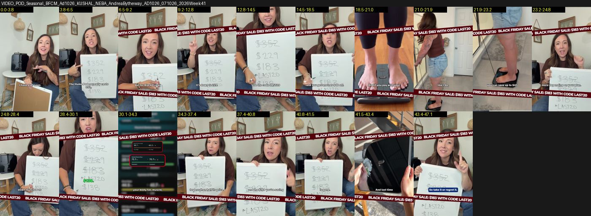

# VIDEO_POD_Seasonal_BFCM_Ad1026_KUSHAL_NEBA_AndreaBytheway_AD1026_071026_2026Week41

Master: `VIDEO_POD_Seasonal_BFCM_Ad1026_KUSHAL_NEBA_AndreaBytheway_AD1026_071026_2026Week41_hook1.mp4` · 47.1s · 1080x1920

**Pacing:** 18 shots · avg 2.616s · median 2.68s · 3.61 cuts/10s · first cut 3.8s · 180.0 wpm · talk ratio 0.96 · cuts on word start 70.6% · cuts in speech gaps 58.8%
**Audio:** {'I_lufs': -23.3, 'LRA': 3.5, 'true_peak_db': -6.1} · BPM≈123.0 · music {'speech_rms_db': -29.5, 'pause_seconds': 0.3} · cuts with SFX/transient 70.6%

**Captions:** 129 cards · 1 words/card (median) · y≈0.738 of frame height · text height≈0.0422 · colours {'white': 126, 'blue': 2, 'red': 1} · cards crossing a cut: 0
Highlighted: on the Hume Pod, on the Hume Pod., Butitendstonight.
**Headlines:** $352 (4.5–4.5s, white) | BLACK (7.0–7.0s, white) | :S183WITHCODELAST20 (7.0–7.0s, white) | $352 (7.0–7.0s, white) | BLACKFRIDAYSALE:S183WITHCC (7.0–7.0s, white) | BLACKFRIDAYSALE (8.0–8.0s, white) | ODELAST20 (8.0–8.0s, white) | FRIDAY SALE:$183WITHCODELA (8.0–8.0s, white)

**Hook (0–3s) spoken:** This is the lowest price I have ever seen on the
**Hook on-screen:** Ihaveeverseen / Thisis the lowestprice
**CTA (last 5s):** humor and a deal like this, it sold out in seven days, so take it or regret it. · on-screen: $138 / $352 / AYSALE:S183WITHCODELAST20 / BLA / BLACKFRIDAY / BLACKFRIDAYSALE:S183W / BLACKFRIDAYSALE:S183WITH / B·LAST20 / E:$183WITHCODELAST20 / FRIDAYSALE:S183WITHCODELAS / Humeranadeali likethis / ITHCODELAST20

## Beat sheet

| # | in–out (s) | dur | transition | spoken | on-screen text |
|---|---|---|---|---|---|
| 1 | 0.00–3.80 | 3.8 |  | This is the lowest price I have ever seen on the HumePod. | Thisis the lowestprice / Ihaveeverseen / on the Hume Pod [blue] / on the Hume Pod. [blue] |
| 2 | 3.80–6.52 | 2.72 | cut | The HumePod normally costs $3 .52, but | on the Hume Pod. [blue] / $352 / #229 / $183 / The Hume Pod normally costs / 352. |
| 3 | 6.52–9.16 | 2.64 | cut +SFX hit | for Black Friday, it's | BLACK (HEADLINE) / :S183WITHCODELAST20 (HEADLINE) / $352 (HEADLINE) / butforBlackFriday / BLACKFRIDAYSALE:S183WITHCC (HEADLINE) / LAST20 |
| 4 | 9.16–12.76 | 3.6 | cut +SFX hit | down to $2 .29, and it gets even better. | BLACKFRIDAYSALE:S183WITHC (HEADLINE) / $352 / # 229 / $183 / It'sdownto229.0 / YSALE:$183WITHCODELAST20 (HEADLINE) |
| 5 | 12.76–14.52 | 1.76 | cut +SFX hit | Use the code LAST20, | ACKFRIDAYSALE:S183WITHCODE (HEADLINE) / $352 (HEADLINE) / #229 (HEADLINE) / $183 (HEADLINE) / AST20 / UsetheCodeLAST20 |
| 6 | 14.52–18.52 | 4.0 | cut | and you get another $46 off, so it's $183, | BLACKFRIDAYS (HEADLINE) / THCODELAST20 (HEADLINE) / $352 / # 229 / andyougetanother$46off. / KFRIDAYSALE:S183WITHCODEL (HEADLINE) |
| 7 | 18.52–21.00 | 2.48 | cut | and if you pay with your HSA FSA, | BLACKFRIDAYSALE [red] (HEADLINE) / DELAST20 (HEADLINE) / And ifyou paywith your / CODELAST20 / BLACKFRIDAYSA / BLACKFRIDAYSALE:S183WITHC [red] (HEADLINE) |
| 8 | 21.00–21.92 | 0.92 | cut | like I do, you | AYSALE:S183WITHCODELAST20 (HEADLINE) / likeIdo, / BLACKFRIDAYSALE:S183WITH |
| 9 | 21.92–23.16 | 1.24 | cut +SFX hit | can save up to $45 more, | BLACKFRIDA (HEADLINE) / WITHCODELAST2O (HEADLINE) / youcansaveupto$45 / CKFRIDAYSALE:S183WITHCODE (HEADLINE) / BLACKFRIDAY SALE:S183 (HEADLINE) / AST20 (HEADLINE) |
| 10 | 23.16–24.80 | 1.64 | cut +SFX hit | depending on your plan. | BLACKFRIDAY SALE:S183 (HEADLINE) / AST20 (HEADLINE) / $352 (HEADLINE) / more depending on your plan. / DAYSALE:S183WITHCODELAST2 (HEADLINE) / $183 (HEADLINE) |
| 11 | 24.80–28.36 | 3.56 | cut +SFX hit | This takes the HumePod down to as low as $138. | $352 (HEADLINE) / LE:$183WITHCODELAST20 (HEADLINE) / BLA (HEADLINE) / $183 (HEADLINE) / ThistakesST20 / 3WITHCODELAST20 |
| 12 | 28.36–30.12 | 1.76 | cut +SFX hit | That's | $183 (HEADLINE) / downtoaslowas / RIDAYSALE:S183WITHCODELAST (HEADLINE) / $352 / ST20 / 4138 |
| 13 | 30.12–34.32 | 4.2 | cut +SFX hit | a scale that reads your body fat, muscle, visceral fat in 30 seconds for | ProgressReport (HEADLINE) / Jul23-Oct12 (HEADLINE) / Weight (HEADLINE) / Metabolic Age (HEADLINE) / 41yrs ≤ (HEADLINE) / 195.7 ibs (HEADLINE) |
| 14 | 34.32–37.40 | 3.08 | cut +SFX hit | less than half its price, but it ends tonight. | 38.7% (HEADLINE) / >40.2%+ (HEADLINE) / BLACKFRIDAY SALE:$183 (HEADLINE) / ST20 (HEADLINE) / 73.7 ibs / 70.7bs |
| 15 | 37.40–40.84 | 3.44 | cut +SFX hit | After midnight, the price goes back up and the 169 -year saving is | $352 / Butitendstonight. [red] / BLACKFRIDAYSAL (HEADLINE) / CODELAST2O (HEADLINE) / $183 (HEADLINE) / FRIDAYSALE:S183WITHCODELA (HEADLINE) |
| 16 | 40.84–41.48 | 0.64 | cut +SFX hit | gone. | BLACKFRIDAYSALE:S (HEADLINE) / LAST20 (HEADLINE) / $352 / is gone. / 4ST20 / DELAST20 |
| 17 | 41.48–43.44 | 1.96 | cut +SFX hit | And last time, humor and a deal like this, | BLACKFRIDAYSALE:S (HEADLINE) / LAST20 (HEADLINE) / $352 / is gone. / 4ST20 / DELAST20 |
| 18 | 43.44–47.08 | 3.64 | cut | it sold out in seven days, so take it or regret it. | SALE:S183WITHCODELAST2O BL (HEADLINE) / Humeranadeali likethis / BLACKFRIDAYSALE:S183WITH [red] (HEADLINE) / BLACKFRIDAY (HEADLINE) / ITHCODELAST20 (HEADLINE) / $352 (HEADLINE) |

## Hook variants

| hook | file | dur | first cut | spoken 0–3s | on-screen 0–3s |
|---|---|---|---|---|---|
| 1 | `USHAL_NEBA_AndreaBytheway_AD1026_071026_2026Week41_hook1.mp4` | 47.1 | 3.8 | This is the lowest price I have ever seen on the | Ihaveeverseen / Thisis the lowestprice |
| 2 | `USHAL_NEBA_AndreaBytheway_AD1026_071026_2026Week41_hook2.mp4` | 46.7 | 3.36 | Let me show you how cheap the HumePod is right now. |  |
| 3 | `USHAL_NEBA_AndreaBytheway_AD1026_071026_2026Week41_hook3.mp4` | 47.4 | 4.12 | Prices on the HumePod have crashed, but only for |  |

## Full transcript

This is the lowest price I have ever seen on the HumePod. The HumePod normally costs $3.52, but for Black Friday, it's down to $2.29, and it gets even better. Use the code LAST20, and you get another $46 off, so it's $183, and if you pay with your HSA FSA, like I do, you can save up to $45 more, depending on your plan. This takes the HumePod down to as low as $138. That's a scale that reads your body fat, muscle, visceral fat in 30 seconds for less than half its price, but it ends tonight. After midnight, the price goes back up and the 169-year saving is gone. And last time, humor and a deal like this, it sold out in seven days, so take it or regret it.