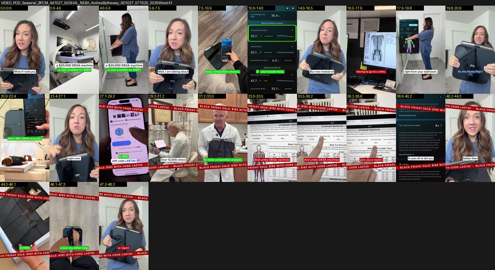

# VIDEO_POD_Seasonal_BFCM_Ad1027_KUSHAL_NEBA_AndreaBytheway_AD1027_071026_2026Week41

Master: `VIDEO_POD_Seasonal_BFCM_Ad1027_KUSHAL_NEBA_AndreaBytheway_AD1027_071026_2026Week41_9X16_HOOK1.mp4` · 48.3s · 1080x1920

**Pacing:** 23 shots · avg 2.099s · median 1.9s · 4.56 cuts/10s · first cut 0.9s · 200.0 wpm · talk ratio 0.94 · cuts on word start 81.8% · cuts in speech gaps 54.5%
**Audio:** {'I_lufs': -19.9, 'LRA': 4.3, 'true_peak_db': -1.4} · BPM≈117.5 · music {'speech_rms_db': -26.0, 'pause_seconds': 0.2} · cuts with SFX/transient 54.5%

**Captions:** 233 cards · 1 words/card (median) · y≈0.719 of frame height · text height≈0.0246 · colours {'white': 181, 'green': 14, 'dark/other': 15, 'blue': 4, 'red': 19} · cards crossing a cut: 19
Highlighted: is nowavailable for$183?, body compositionanalysis, bodycompositionanalysis., bodyfatpercentage,, yourmusclemass,, yourwaterweight, High, and your BMI, having to go to a clinic,, that's98% DEXA accurate, ADDTOCART, to $183, withcodeLAST20, fromthecomfortofhomeSavaondbveta, fromthecomfortofhome.Savaoodbveto
**Headlines:** HumePod (11.0–13.0s, white) | StepOnScale (11.0–11.0s, green) | 195.7ibs (11.0–11.0s, white) | High (11.0–11.0s, dark/other) | 30.6 (11.0–11.0s, white) | Very High (11.0–11.0s, dark/other) | BMI (11.0–11.0s, white) | BodyFatPercentage (11.0–11.0s, white)

**Hook (0–3s) spoken:** What if I told you a $20 ,000 DEXA machine is
**Hook on-screen:** What if I told you / a$20,000DEXAmachine / is nowavailable for$183?
**CTA (last 5s):** machine. At 183, the Hume Pod is a deal you either take or regret. · on-screen: .BLACKFRIDAYSALE:$183WI / ACKFRIDAYSALE:$183WITHCOD / AYSALE:$183WITHCODELAST2 / At$183 / BLACKFRID / BLACKFRIDAYSALE:$183W / CKFRIDAYSALE:$183WITHCOD / CODELAST2O / DAYSALE:$183WITHCODELAST2 / E:$183WITHCODELAST20 / E:$183WITHCODELAST2O.BLA / NITH

## Beat sheet

| # | in–out (s) | dur | transition | spoken | on-screen text |
|---|---|---|---|---|---|
| 1 | 0.00–0.90 | 0.9 |  | What if I told you a | What if I told you |
| 2 | 0.90–4.60 | 3.7 | cut +SFX hit | $20 ,000 DEXA machine is now available for | What if I told you / a$20,000DEXAmachine / is nowavailable for$183? [green] |
| 3 | 4.60–5.87 | 1.27 | cut +SFX hit | $183 ,000? | a$20,000DEXAmachine / is nowavailable for$183? [green] |
| 4 | 5.87–7.47 | 1.6 | cut +SFX hit | Well, I am talking about the | a$20,000DEXAmachine / is nowavailable for$183? [green] / Well, I am talking about |
| 5 | 7.47–10.93 | 3.47 | cut | machine that gives you body composition analysis. It tells your body | Well, I am talking about / that gives you / body compositionanalysis [green] / bodycompositionanalysis. [green] |
| 6 | 10.93–14.03 | 3.1 | cut +SFX hit | fat percentage, your muscle mass, your water weight, and | HumePod (HEADLINE) / StepOnScale [green] (HEADLINE) / 195.7ibs (HEADLINE) / High (HEADLINE) / 30.6 (HEADLINE) / Very High (HEADLINE) |
| 7 | 14.03–16.53 | 2.5 | cut | your BMI. But now, instead of having | and your BMI [green] / But now instead of |
| 8 | 16.53–17.87 | 1.33 | cut | to go to a clinic, | having to go to a clinic, [red] |
| 9 | 17.87–19.83 | 1.97 | cut | you can use it right in your bathroom. | 31m (HEADLINE) / 23m (HEADLINE) / you can use it / right from your bathroom. |
| 10 | 19.83–20.93 | 1.1 | cut | It's the Hume Pod 1 | It'sthe HumePod1 |
| 11 | 20.93–23.37 | 2.43 | cut +SFX hit | that's 98 % DEXA accurate. | EgBodyPod [blue] (HEADLINE) / progresstGenerateeteportnowt (HEADLINE) / that's98% DEXA accurate [green] / BodyPod [blue] (HEADLINE) / 2:02米 [blue] (HEADLINE) / 71.7% (HEADLINE) |
| 12 | 23.37–27.10 | 3.73 | cut +SFX hit | And it's on sale for Black Friday right now. The price has dropped to $183 | that's98% DEXA accurate [green] / BodyPod [blue] (HEADLINE) / 2:02米 [blue] (HEADLINE) / 71.7% (HEADLINE) / FatDistributionAnalyis (HEADLINE) / Subcutanecus Fat Mass (HEADLINE) |
| 13 | 27.10–29.27 | 2.17 | cut +SFX hit | ,000 with code last $20 ,000. Over | 10:09 (HEADLINE) / RIDAYSALE:$183WITHCODELAS [red] (HEADLINE) / D Seeitinao (HEADLINE) / FreeWorldwideShipping (HEADLINE) / 30-DayReturnPolicy (HEADLINE) / 30 (HEADLINE) |
| 14 | 29.27–31.17 | 1.9 | cut +SFX hit | 12 ,000 clinics use it for | 10:09 (HEADLINE) / 30-DayReturnPolicy (HEADLINE) / 1Year included / to $183 [green] / withcodeLAST20 [blue] / ard- |
| 15 | 31.17–33.03 | 1.87 | cut | body composition analysis. | AST2O . BLACK FRIDAY SALE:$18 [red] (HEADLINE) / BlaneSchlinz,Ma / forbodycompositionanalysis [green] / AST2O·BLACKFRIDAYSALE:$18 [red] (HEADLINE) / BLACKFRIDAYSALE:$183WITH [red] (HEADLINE) / BlaneSchlling,Ma |
| 16 | 33.03–33.47 | 0.43 | cut +SFX hit | And unlike | FRIDAYSALE:$183WITHCODEL [red] (HEADLINE) / Reports BodySpec (HEADLINE) / yspec.com/reports (HEADLINE) / 2/7 (HEADLINE) / SUMMARYRESU / This tableprovides an overview ofyour total body composition,broken do |
| 17 | 33.47–36.23 | 2.77 | cut | DEXA machines, it doesn't just give you a report. | FRIDAYSALE:$183WITHCODEL [red] (HEADLINE) / Reports BodySpec (HEADLINE) / yspec.com/reports (HEADLINE) / 2/7 (HEADLINE) / SUMMARYRESU / This tableprovides an overview ofyour total body composition,broken do |
| 18 | 36.23–36.60 | 0.37 | cut +SFX hit |  | TotalMass (lbs) / 89.1 / 27.4% / Age / SUMMARYRESULTS / Fat Tissue (lbs) |
| 19 | 36.60–40.17 | 3.57 | cut +SFX hit | It uses AI to tell you how to improve those numbers. | Confidence Rating 45% (HEADLINE) / LAST2O· BLACKFRIDAYSALE:$ [red] (HEADLINE) / Older (HEADLINE) / Younger (HEADLINE) / Chronological Age 25 yrs (HEADLINE) / Contributors |
| 20 | 40.17–44.30 | 4.13 | cut +SFX hit | So in a way, it's even better than a $20 ,000 DEXA machine. | YSALE:$183WITHCODELAST20 [red] (HEADLINE) / Soina way it's even / $183 WITH CODE LAST20 . BLAC [red] (HEADLINE) / BLAC [red] / $183WITHCODELAST20 [red] / ITHCODELAST2O·BLACKFRIDA [red] (HEADLINE) |
| 21 | 44.30–46.07 | 1.77 | cut | At 183, the Hume Pod is | a$20,000DEXAmachine. / BLACKFRIDAYSALE:$183W [red] (HEADLINE) / .BLACKFRIDAYSALE:$183WI [red] / ACKFRIDAYSALE:$183WITHCOD [red] (HEADLINE) / XHume (HEADLINE) / itit'snot |
| 22 | 46.07–47.33 | 1.27 | cut | a deal you either take or | DAYSALE:$183WITHCODELAST2 [red] (HEADLINE) / a deal you eithertake, [green] / AYSALE:$183WITHCODELAST2 [red] (HEADLINE) / E:$183WITHCODELAST20 [red] (HEADLINE) / a deal you eithertake [green] / E:$183WITHCODELAST2O.BLA [red] (HEADLINE) |
| 23 | 47.33–48.27 | 0.94 | cut | regret. | E:$183WITHCODELAST20 [red] (HEADLINE) / a deal you eithertake [green] / E:$183WITHCODELAST2O.BLA [red] (HEADLINE) / NITH [red] (HEADLINE) / CODELAST2O [red] (HEADLINE) / BLACKFRID [red] (HEADLINE) |

## Hook variants

| hook | file | dur | first cut | spoken 0–3s | on-screen 0–3s |
|---|---|---|---|---|---|
| 1 | `_NEBA_AndreaBytheway_AD1027_071026_2026Week41_9X16_HOOK1.mp4` | 48.3 | 0.9 | What if I told you a $20 ,000 DEXA machine is | What if I told you / a$20,000DEXAmachine / is nowavailable for$183? |
| 1 | `_NEBA_AndreaBytheway_AD1027_071026_2026Week41_9X16_HOOK1.mp4` | 48.3 | 0.9 | What if I told you a $20 ,000 DEXA machine |  |

## Full transcript

What if I told you a $20,000 DEXA machine is now available for $183,000? Well, I am talking about the machine that gives you body composition analysis. It tells your body fat percentage, your muscle mass, your water weight, and your BMI. But now, instead of having to go to a clinic, you can use it right in your bathroom. It's the Hume Pod 1 that's 98% DEXA accurate. And it's on sale for Black Friday right now. The price has dropped to $183,000 with code last $20,000. Over 12,000 clinics use it for body composition analysis. And unlike DEXA machines, it doesn't just give you a report. It uses AI to tell you how to improve those numbers. So in a way, it's even better than a $20,000 DEXA machine. At 183, the Hume Pod is a deal you either take or regret.