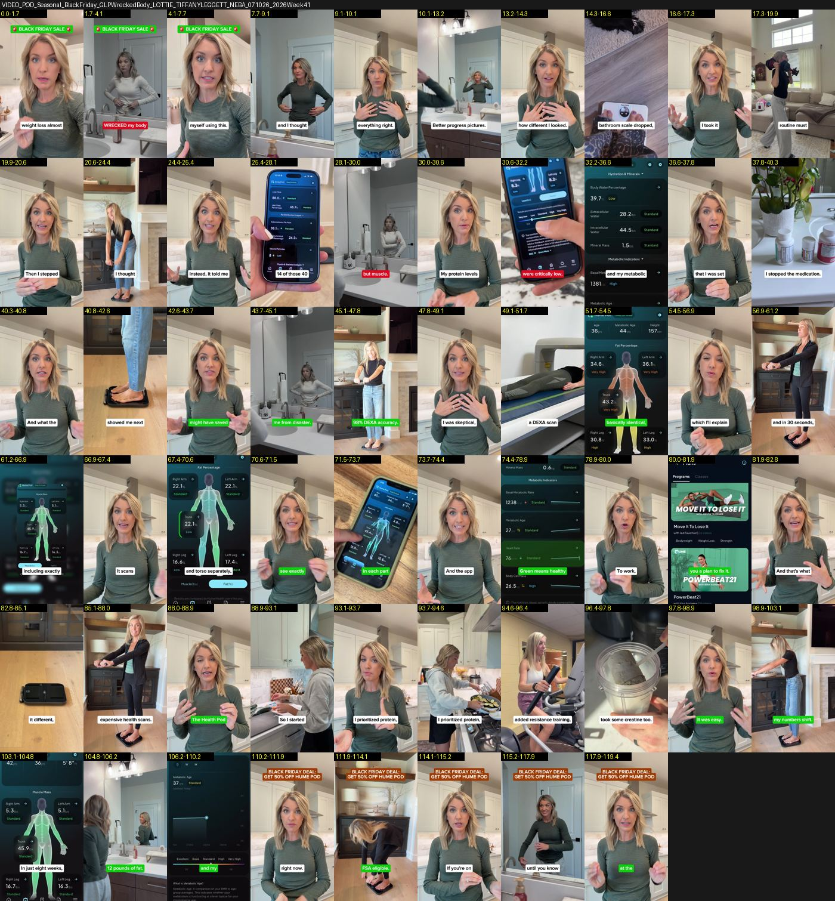

# VIDEO_POD_Seasonal_BlackFriday_GLPWreckedBody_LOTTIE_TIFFANYLEGGETT_NEBA_071026_2026Week41

Master: `VIDEO_POD_Seasonal_BlackFriday_GLPWreckedBody_LOTTIE_TIFFANYLEGGETT_NEBA_071026_2026Week41_Hook1_9x16.mp4` · 119.4s · 1080x1920

**Pacing:** 58 shots · avg 2.058s · median 1.734s · 4.78 cuts/10s · first cut 1.667s · 184.0 wpm · talk ratio 0.98 · cuts on word start 70.2% · cuts in speech gaps 61.4%
**Audio:** {'I_lufs': -22.7, 'LRA': 4.3, 'true_peak_db': -3.2} · BPM≈129.2 · music {'speech_rms_db': -27.4, 'pause_seconds': 0.6, 'pause_rms_db': -28.6, 'bed_minus_voice_db': -1.2, 'music_bed_likely': True} · cuts with SFX/transient 33.3%

**Captions:** 308 cards · 1.0 words/card (median) · y≈0.761 of frame height · text height≈0.0299 · colours {'white': 186, 'red': 8, 'green': 41, 'dark/other': 65, 'blue': 8} · cards crossing a cut: 4
Highlighted: WRECKEDmybody, Forty pounds down, be working, feel even better., gtandard, FatDistributionAnalysis, pounds were muscle., pounds were muscle, but muscle, were critically low,, was inthe red,, High, ratehadtanked, Hume Pod, might have saved
**Headlines:** BLACKFRIDAYSALE (0.0–5.5s, green) | 10:08% (26.0–27.0s, blue) | BodyPod (26.0–26.0s, blue) | StepOnScale (26.0–26.0s, blue) | 30.2%+ (26.0–26.0s, blue) | standare (26.0–26.0s, blue) | Bedy Fat Mas (26.0–26.0s, blue) | 40.4189 (26.0–26.0s, blue)

**Hook (0–3s) spoken:** My GLP1 weight loss almost wrecked
**Hook on-screen:** BLACKFRIDAYSALE / My GLP1 / WRECKEDmybody / weightloss almost
**CTA (last 5s):** on a GLP one do not celebrate until you know what you're losing check it out at the link below · on-screen: BLACKFRIDAYDEAL: / Checkitout / GET50%OFFHUMEPOD / GET5O%OFFHUMEPOD / do not celebrate / linkbelow. / until youknow / what you're losing.

## Beat sheet

| # | in–out (s) | dur | transition | spoken | on-screen text |
|---|---|---|---|---|---|
| 1 | 0.00–1.67 | 1.67 |  | My GLP1 weight loss almost | BLACKFRIDAYSALE [green] (HEADLINE) / My GLP1 / weightloss almost |
| 2 | 1.67–4.10 | 2.43 | cut | wrecked my body until | BLACKFRIDAYSALE [green] (HEADLINE) / weightloss almost / WRECKEDmybody [red] / until Iscanned |
| 3 | 4.10–7.73 | 3.63 | cut +SFX hit | I scanned myself using this. 40 pounds down on my GLP1 | BLACKFRIDAYSALE [green] (HEADLINE) / until Iscanned / myself using this. / Forty pounds down [green] / on my GLP1, |
| 4 | 7.73–9.13 | 1.4 | cut | and I thought I was doing everything | and I thought / everything right. |
| 5 | 9.13–10.07 | 0.93 | cut +SFX hit | right. | everything right. / Smaller jeans. |
| 6 | 10.07–13.20 | 3.13 | cut | Smaller jeans, better progress pictures, people telling me | Smaller jeans. / Better progress pictures. / People telling me |
| 7 | 13.20–14.33 | 1.13 | cut | how different I looked. | People telling me / how different I looked. |
| 8 | 14.33–16.60 | 2.27 | cut | Every time the bathroom scale dropped, I | how different I looked. / SALTER / bathroom scale dropped, |
| 9 | 16.60–17.30 | 0.7 | cut +SFX hit | took it as proof | as proof that my |
| 10 | 17.30–19.90 | 2.6 | cut +SFX hit | that my routine must be working. | as proof that my / routine must / be working [green] |
| 11 | 19.90–20.60 | 0.7 | cut | Then I stepped | ThenI stepped |
| 12 | 20.60–24.37 | 3.77 | cut | on my human pod. Honestly, I thought it would just make me feel even better. | on my Hume Pod. / I thought / make me / feel even better. [green] |
| 13 | 24.37–25.40 | 1.03 | cut +SFX hit | Instead, it told | feel even better. [green] / Instead, it told me |
| 14 | 25.40–28.13 | 2.73 | cut | me 14 of those 40 pounds were muscle. | Instead, it told me / 10:08% [blue] (HEADLINE) / BodyPod [blue] (HEADLINE) / StepOnScale [blue] (HEADLINE) / 30.2%+ [blue] (HEADLINE) / standare [blue] (HEADLINE) |
| 15 | 28.13–29.97 | 1.83 | cut | muscle, not fat, but muscle. | pounds were muscle [red] / but muscle [red] |
| 16 | 29.97–30.57 | 0.6 | cut +SFX hit | My protein | My protein levels |
| 17 | 30.57–32.17 | 1.6 | cut +SFX hit | levels were critically low, | 8.2 (HEADLINE) / 8.3 (HEADLINE) / Standard / composition,a / providedbyHumeHe / advice,feedback.andinsigh |
| 18 | 32.17–36.57 | 4.4 | cut | my hydration was in the red, and my metabolic rate had tanked so badly that | Standard / HumePod (HEADLINE) / StepOnScale [green] (HEADLINE) / 19.31bs (HEADLINE) / High [blue] (HEADLINE) / BoneMineral (HEADLINE) |
| 19 | 36.57–37.80 | 1.23 | cut | I was set up to gain it | that Iwas set |
| 20 | 37.80–40.33 | 2.53 | cut +SFX hit | all back the second I stopped the medication. | it all back / I stopped the medication. |
| 21 | 40.33–40.80 | 0.47 | cut | And what the | I stopped the medication. |
| 22 | 40.80–42.60 | 1.8 | cut +SFX hit | Hume Pod showed me next might | Hume Pod [green] / showed me next |
| 23 | 42.60–43.73 | 1.13 | cut | have saved me | might have saved [green] |
| 24 | 43.73–45.13 | 1.4 | cut +SFX hit | from disaster. | mefrom disaster [green] / With a |
| 25 | 45.13–47.80 | 2.67 | cut | With a 98 % DEXA accuracy, | With a / 98%DEXAaccuracy [green] |
| 26 | 47.80–49.13 | 1.33 | cut | I was skeptical, so | I was skeptical, / so I paid for |
| 27 | 49.13–51.67 | 2.53 | cut +SFX hit | I paid for a DEXA scan just to compare. | so I paid for / a DEXA scan / just to compare. |
| 28 | 51.67–54.47 | 2.8 | cut | The results were basically identical, | Hume Pod (HEADLINE) / StepOnScale [green] (HEADLINE) / Metabolic Age (HEADLINE) / Height (HEADLINE) / Age (HEADLINE) / 44yrs (HEADLINE) |
| 29 | 54.47–56.90 | 2.43 | cut | except for one thing, which I'll explain in a minute, | Hume Pod (HEADLINE) / StepOnScale [green] (HEADLINE) / Metabolic Age (HEADLINE) / Height (HEADLINE) / Age (HEADLINE) / 44yrs (HEADLINE) |
| 30 | 56.90–61.20 | 4.3 | cut | you step on, grab the handles and in 30 seconds it measures 45 | You step on, / grab the handles, / and in 30 seconds, / Body Composition Fundamentals (HEADLINE) / Weight (HEADLINE) / 185.3bs (HEADLINE) |
| 31 | 61.20–66.90 | 5.7 | cut +SFX hit | different health metrics including exactly how much muscle versus fat you're losing. | Body Composition Fundamentals (HEADLINE) / Weight (HEADLINE) / 185.3bs (HEADLINE) / Standard (HEADLINE) / 27.4 (HEADLINE) / High (HEADLINE) |
| 32 | 66.90–67.43 | 0.53 | cut | It scans your | It scans |
| 33 | 67.43–70.57 | 3.13 | cut | arms, legs and your torso separately so | It scans / HumePod (HEADLINE) / FatPercentage (HEADLINE) / RightArm (HEADLINE) / LeftArm (HEADLINE) / 22.1% (HEADLINE) |
| 34 | 70.57–71.53 | 0.97 | cut | you can see exactly | see exactly [green] |
| 35 | 71.53–73.70 | 2.17 | cut | what's happening in each part of your body and | 4:29 [blue] (HEADLINE) / StepOnScale [blue] (HEADLINE) / Age [blue] (HEADLINE) / 63yrs [blue] (HEADLINE) / MetabolicAge [blue] (HEADLINE) / 54yrs [blue] (HEADLINE) |
| 36 | 73.70–74.40 | 0.7 | cut | the | And the app |
| 37 | 74.40–78.90 | 4.5 | cut +SFX hit | app color codes everything. Green means healthy and red means danger. | And the app / 55.5%+ (HEADLINE) / Standard (HEADLINE) / 11.3kg (HEADLINE) / ExtracellularWater (HEADLINE) / 18.3kg (HEADLINE) |
| 38 | 78.90–79.97 | 1.07 | cut | To work it actually | To work, |
| 39 | 79.97–81.87 | 1.9 | cut | gives you a plan to fix it. | Plans (HEADLINE) / Programs (HEADLINE) / Classes (HEADLINE) / TryHumeHealth [red] (HEADLINE) / forfreebody [red] (HEADLINE) / metricfocused [red] (HEADLINE) |
| 40 | 81.87–82.80 | 0.93 | cut | And that's what not | And that's what |
| 41 | 82.80–85.13 | 2.33 | cut +SFX hit | only made it different, but actually | not only made / it different, / better than those |
| 42 | 85.13–88.03 | 2.9 | cut | better than those expensive health scans. | better than those / expensivehealthscans / The HealthPod [green] |
| 43 | 88.03–88.90 | 0.87 | cut | The health pod | The HealthPod [green] |
| 44 | 88.90–93.10 | 4.2 | cut | tells you what to do about it. So I started following what it told me. | tells you [green] / what to do about it [green] / So I started / following what / I prioritized protein, |
| 45 | 93.10–93.67 | 0.57 | cut +SFX hit | I prioritized | I prioritized protein, |
| 46 | 93.67–94.57 | 0.9 | cut | protein, | I prioritized protein, |
| 47 | 94.57–96.37 | 1.8 | cut +SFX hit | added resistance training, took some | added resistance training, / took some creatine too. / PRECOR |
| 48 | 96.37–97.80 | 1.43 | cut +SFX hit | creatine too. | took some creatine too. / PRECOR |
| 49 | 97.80–98.93 | 1.13 | cut | It was easy. | It was easy [green] |
| 50 | 98.93–103.10 | 4.17 | cut | And then I'd rescan every week and see my numbers shift. In just eight | And then / I'd rescan every / my numbers shift [green] / HumePod (HEADLINE) / StepOnScale [green] (HEADLINE) / MetapollcAge (HEADLINE) |
| 51 | 103.10–104.77 | 1.67 | cut | weeks, I lost 12 | HumePod (HEADLINE) / StepOnScale [green] (HEADLINE) / MetapollcAge (HEADLINE) / Age (HEADLINE) / Heignt (HEADLINE) / 42yrs (HEADLINE) |
| 52 | 104.77–106.23 | 1.47 | cut +SFX hit | pounds of fat my | 12 pounds of fat. [green] / ChartMetric (HEADLINE) / Weight (HEADLINE) / BMI (HEADLINE) / BodyFatPercentage / Body Fat Mass |
| 53 | 106.23–110.23 | 4.0 | cut | muscle mass actually went up and my metabolism improved It's | ChartMetric (HEADLINE) / Weight (HEADLINE) / BMI (HEADLINE) / BodyFatPercentage / Body Fat Mass / Subcutaneous Fat Mass |
| 54 | 110.23–111.87 | 1.63 | cut | 50 % off right now It's | BLACKFRIDAYDEAL [red] (HEADLINE) / GET50%OFFHUMEPOD [red] (HEADLINE) / It's50%off [green] / right now. |
| 55 | 111.87–114.13 | 2.27 | cut | HSA and FSA eligible if | GET50%OFFHUMEPOD [red] (HEADLINE) / BLACKFRIDAYDEAL: [red] (HEADLINE) / It'sHSAand [green] / FSAeligible [green] / If you're on |
| 56 | 114.13–115.20 | 1.07 | cut | you're on a GLP one do | GET50%OFFHUMEPOD [red] (HEADLINE) / BLACKFRIDAYDEAL: [red] (HEADLINE) / If you're on / GET5O%OFFHUMEPOD [red] (HEADLINE) / do not celebrate |
| 57 | 115.20–117.90 | 2.7 | cut | not celebrate until you know what you're losing check | BLACKFRIDAYDEAL: [red] (HEADLINE) / GET5O%OFFHUMEPOD [red] (HEADLINE) / do not celebrate / until youknow / what you're losing. |
| 58 | 117.90–119.35 | 1.45 | cut +SFX hit | it out at the link below | BLACKFRIDAYDEAL: [red] (HEADLINE) / GET50%OFFHUMEPOD [red] (HEADLINE) / Checkitout [green] / linkbelow. [green] |

## Hook variants

| hook | file | dur | first cut | spoken 0–3s | on-screen 0–3s |
|---|---|---|---|---|---|
| 1 | `_LOTTIE_TIFFANYLEGGETT_NEBA_071026_2026Week41_Hook1_9x16.mp4` | 119.4 | 1.667 | My GLP1 weight loss almost wrecked | BLACKFRIDAYSALE / My GLP1 / WRECKEDmybody / weightloss almost |
| 2 | `_LOTTIE_TIFFANYLEGGETT_NEBA_071026_2026Week41_Hook2_9x16.mp4` | 120.0 | 1.567 | Losing weight with a GLP -1 was the easy part. |  |
| 3 | `_LOTTIE_TIFFANYLEGGETT_NEBA_071026_2026Week41_Hook3_9x16.mp4` | 118.4 | 1.167 | I lost weight and I thought, great, but over a quarter of it was | BLACKFRIDAYSALE / But over / Ilostweight, / a quarter of it / and I thought, 'great!' |

## Full transcript

My GLP1 weight loss almost wrecked my body until I scanned myself using this. 40 pounds down on my GLP1 and I thought I was doing everything right. Smaller jeans, better progress pictures, people telling me how different I looked. Every time the bathroom scale dropped, I took it as proof that my routine must be working. Then I stepped on my human pod. Honestly, I thought it would just make me feel even better. Instead, it told me 14 of those 40 pounds were muscle. muscle, not fat, but muscle. My protein levels were critically low, my hydration was in the red, and my metabolic rate had tanked so badly that I was set up to gain it all back the second I stopped the medication. And what the Hume Pod showed me next might have saved me from disaster. With a 98% DEXA accuracy, I was skeptical, so I paid for a DEXA scan just to compare. The results were basically identical, except for one thing, which I'll explain in a minute, you step on, grab the handles and in 30 seconds it measures 45 different health metrics including exactly how much muscle versus fat you're losing. It scans your arms, legs and your torso separately so you can see exactly what's happening in each part of your body and the app color codes everything. Green means healthy and red means danger. To work it actually gives you a plan to fix it. And that's what not only made it different, but actually better than those expensive health scans. The health pod tells you what to do about it. So I started following what it told me. I prioritized protein, added resistance training, took some creatine too. It was easy. And then I'd rescan every week and see my numbers shift. In just eight weeks, I lost 12 pounds of fat my muscle mass actually went up and my metabolism improved It's 50% off right now It's HSA and FSA eligible if you're on a GLP one do not celebrate until you know what you're losing check it out at the link below