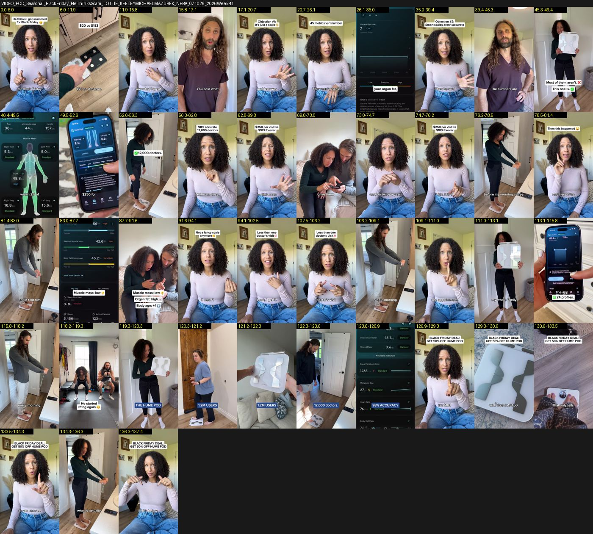

# VIDEO_POD_Seasonal_BlackFriday_HeThinksScam_LOTTIE_KEELEYMICHAELMAZUREK_NEBA_071026_2026Week41

Master: `VIDEO_POD_Seasonal_BlackFriday_HeThinksScam_LOTTIE_KEELEYMICHAELMAZUREK_NEBA_071026_2026Week41_Hook1_9x16..mp4` · 137.4s · 1080x1920

**Pacing:** 43 shots · avg 3.195s · median 2.834s · 3.06 cuts/10s · first cut 6.0s · 217.0 wpm · talk ratio 0.88 · cuts on word start 69.0% · cuts in speech gaps 73.8%
**Audio:** {'I_lufs': -19.9, 'LRA': 2.3, 'true_peak_db': -0.5} · BPM≈172.3 · music {'speech_rms_db': -25.2, 'pause_seconds': 6.7, 'pause_rms_db': -24.2, 'bed_minus_voice_db': 1.0, 'music_bed_likely': True} · cuts with SFX/transient 40.5%

**Captions:** 317 cards · 1 words/card (median) · y≈0.761 of frame height · text height≈0.0293 · colours {'white': 240, 'blue': 15, 'dark/other': 62} · cards crossing a cut: 5
Highlighted: for Black Friday, AHUMEPOD, $183, Fat(%), Lean(bs), Fat(%), Lean(lbs), go to a clinic.", Theapp, Hume, THEHUMEPOD, 1.2MUSERS, 12,000doctors, 98%ACCURACY, Link'sbelow
**Headlines:** He thinksIgot scammed (0.0–5.5s, white) | forBlackFriday (0.0–5.5s, white) | $20 vs $183 (6.0–11.0s, white) | Objection #1: (17.0–20.0s, white) | It's just a scale (17.0–20.0s, white) | 45metricsvs1number (23.0–27.0s, white) | Hume Pod (26.0–28.0s, dark/other) | Right Arm (26.0–27.0s, white)

**Hook (0–3s) spoken:** So I bought this $183 body scanner for Black Friday.
**Hook on-screen:** $183 body scanner / He thinksIgot scammed / So Ibought this / for Black Friday / forBlackFriday
**CTA (last 5s):** tells you your weight or you can see what is actually going on inside. Links below. · on-screen: BLACKFRIDAYDEAL: / GET5O%OFFHUMEPOD / Link'sbelow / SALTER / going on inside. / oryou can see / what is actually / you your weight,

## Beat sheet

| # | in–out (s) | dur | transition | spoken | on-screen text |
|---|---|---|---|---|---|
| 1 | 0.00–6.00 | 6.0 |  | So I bought this $183 body scanner for Black Friday. My husband thinks I got scammed. Let me prove him wrong. | He thinksIgot scammed (HEADLINE) / forBlackFriday (HEADLINE) / So Ibought this / $183 body scanner / for Black Friday [blue] / My husband thinks |
| 2 | 6.00–11.87 | 5.87 | cut +SFX hit | So this is a basic bathroom scale, $20 on Amazon. And this is a Hume Pod, $183. | $20 vs $183 (HEADLINE) / So this is / bathroom scale, / $20 on Amazon. / And this is / AHUMEPOD [blue] |
| 3 | 11.87–15.80 | 3.93 | cut | My husband's first reaction when he saw what I spent was exactly what you'd expect. | My husband's first / reaction when he / was exactly / what you'd expect. |
| 4 | 15.80–17.07 | 1.27 | cut | You paid what for a scale? | You paid what / Objection #1: (HEADLINE) / It's just a scale (HEADLINE) / Okay sohisfirst |
| 5 | 17.07–20.73 | 3.67 | cut +SFX hit | Okay, so his first problem was it's just a fancy scale. | Objection #1: (HEADLINE) / It's just a scale (HEADLINE) / Okay sohisfirst / "It's just a fancy scale. / "It's just a fancy scale." |
| 6 | 20.73–26.07 | 5.33 | cut +SFX hit | Just a fancy scale. Your regular scale gives you one number. This one reads your entire body | Just a fancy scale! / 45metricsvs1number (HEADLINE) / Yourregular scale / gives you one number. / Thisonereads / Hume Pod (HEADLINE) |
| 7 | 26.07–35.03 | 8.97 | cut | composition in 60 seconds. Your muscle, your fat, your organ fat, your biological age, your hydration, 45 different things. | 45metricsvs1number (HEADLINE) / Hume Pod (HEADLINE) / Right Arm (HEADLINE) / LeftArm (HEADLINE) / 25.7% (HEADLINE) / Standard [green] (HEADLINE) |
| 8 | 35.03–39.43 | 4.4 | cut | A regular skill can't do any of that. Then he said, you can't trust smart skills. | 45metricsvs1number (HEADLINE) / Aregular scale / can't do any of that. / Objection #2: (HEADLINE) / Smart scales aren'taccurate (HEADLINE) / Thenhesaid |
| 9 | 39.43–45.27 | 5.83 | cut +SFX hit | Those smart skills are never accurate. My buddy has one. The numbers are all over the place. Most of them aren't. | Objection #2: (HEADLINE) / Smart scales aren'taccurate (HEADLINE) / smartscales." / Thosesmart scales / are never accurate. / The numbers are |
| 10 | 45.27–46.37 | 1.1 | cut +SFX hit | This one is. It's | 98%accurate (HEADLINE) / 12,000doctors (HEADLINE) / Most of them aren't. X / It's accurate |
| 11 | 46.37–49.50 | 3.13 | cut +SFX hit | accurate within 2 % of the scanner's hospitals use. | It's accurate / Hume Pod (HEADLINE) / StepOnScale [green] (HEADLINE) / Age (HEADLINE) / Metabolic Age (HEADLINE) / Height (HEADLINE) |
| 12 | 49.50–52.63 | 3.13 | cut | The kind you'd pay $250 for at a clinic. | Standard / High / Loftteg (HEADLINE) / 8.2% (HEADLINE) / 8.3 (HEADLINE) / Lean(ibs) [blue] (HEADLINE) |
| 13 | 52.63–56.27 | 3.63 | cut | It's used by 12 ,000 doctors and over a million people trust it. Those | It's used by / 12,000 doctors. / And over a million / people trust it. |
| 14 | 56.27–62.83 | 6.57 | cut | cheap smart skills he's talking about, different technology, is not even close. Then he said, why not just go to a clinic? | 12,000 doctors. / And over a million / people trust it. / 98% accurate (HEADLINE) / 12,000 doctors (HEADLINE) / smart scales |
| 15 | 62.83–69.83 | 7.0 | cut +SFX hit | A clinic scan costs $250 to $300 every time. | Objection #3: (HEADLINE) / Just go to a clinic (HEADLINE) / You wanted / just book a scan. / Done. / $250 per visit vs (HEADLINE) |
| 16 | 69.83–73.00 | 3.17 | cut +SFX hit | You have to book it, drive there, take time off, and you only get a snapshot | You have to / drive there, / and you only get |
| 17 | 73.00–74.67 | 1.67 | cut +SFX hit | once or twice a year. | a snapshot / once or twice a year. |
| 18 | 74.67–76.23 | 1.57 | cut +SFX hit | This I do it for 60 seconds | $250 per visit vs (HEADLINE) / $183forever (HEADLINE) / This,Ido it / every morning |
| 19 | 76.23–78.47 | 2.23 | cut | every morning before my morning coffee. | every morning / before my morning coffee./l / before my morning coffee.1 |
| 20 | 78.47–81.43 | 2.97 | cut | One payment forever and here's the part that changed his mind. | before my morning coffee.1 / $250 per visit vs (HEADLINE) / $183forever (HEADLINE) / Onepayment forever. / Then this happened (HEADLINE) / partthat |
| 21 | 81.43–83.00 | 1.57 | cut | He stepped on it and it told him his | Then this happened (HEADLINE) / changed his mind. / and it told him |
| 22 | 83.00–87.67 | 4.67 | cut | muscle mass was lower than average for his age. His organ fat was in the warning zone and | 56yrs (HEADLINE) / Metabolic Age (HEADLINE) / High (HEADLINE) / Younger (HEADLINE) / Older (HEADLINE) / 42.6ibs (HEADLINE) |
| 23 | 87.67–91.60 | 3.93 | cut | his biological age was four years older than his actual age. | Muscle mass: low / Organ fat: high / Body age: +4 |
| 24 | 91.60–94.07 | 2.47 | cut | And suddenly it wasn't a fancy scale anymore. | Not a fancy scale (HEADLINE) / anymore (HEADLINE) / And suddenly, / a fancy scale anymore. |
| 25 | 94.07–102.53 | 8.47 | cut | Yeah, okay. This is actually useful. Look, I get it. $183 sounds like a lot for a scale. But here's what I told him. | Yeah, okay. / This is / actually useful. / Less than one (HEADLINE) / doctor's visit100 (HEADLINE) / Look, I get it. |
| 26 | 102.53–106.23 | 3.7 | cut | You pay more than that for a single doctor's visit that doesn't tell you any of this. | Less than one (HEADLINE) / doctor's visit100 (HEADLINE) / than that / doctor's visit / tell you / The pod |
| 27 | 106.23–109.07 | 2.83 | cut +SFX hit | The pod tells you every single morning for less than what | The pod / tells you every / single morning / what most people |
| 28 | 109.07–111.00 | 1.93 | cut | most people spend on one appointment. | what most people / one appointment. |
| 29 | 111.00–113.07 | 2.07 | cut +SFX hit | And now my whole family uses it. The | And now / mywholefamily / 10:09元 [blue] (HEADLINE) / BodyPod [blue] (HEADLINE) / Weight (HEADLINE) / GoalWeight (HEADLINE) |
| 30 | 113.07–115.77 | 2.7 | cut +SFX hit | app holds 24 profiles. | 10:09元 [blue] (HEADLINE) / BodyPod [blue] (HEADLINE) / Weight (HEADLINE) / GoalWeight (HEADLINE) / 125ibs (HEADLINE) / 133.9ibs (HEADLINE) |
| 31 | 115.77–118.23 | 2.47 | cut | My husband checks his every morning and he started lifting | My husband / every morning. / He started / lifting again. |
| 32 | 118.23–119.27 | 1.03 | cut | again. It's | He started / lifting again. |
| 33 | 119.27–120.27 | 1.0 | cut +SFX hit | called the HumePod. | He started / lifting again. / THEHUMEPOD [blue] |
| 34 | 120.27–121.20 | 0.93 | cut | 1 .2 million | THEHUMEPOD [blue] / 1.2MUSERS [blue] |
| 35 | 121.20–122.30 | 1.1 | cut | users, 12 ,000 | 1.2MUSERS [blue] / 12,000doctors [blue] |
| 36 | 122.30–123.60 | 1.3 | cut | doctors and | 12,000doctors [blue] |
| 37 | 123.60–126.90 | 3.3 | cut +SFX hit | 98 % as accurate as a clinical body scanner. | Hydration&Minerals (HEADLINE) / BodyWaterPercentage (HEADLINE) / 55.5% (HEADLINE) / Standard (HEADLINE) / 11.3kg (HEADLINE) / ExtracellularWater (HEADLINE) |
| 38 | 126.90–129.27 | 2.37 | cut | Right now it's $183 with code | BLACKFRIDAYDEAL: (HEADLINE) / GET5O%OFFHUMEPOD (HEADLINE) / Rightnow, / it's$183 |
| 39 | 129.27–130.60 | 1.33 | cut +SFX hit | last 50. | BLACKFRIDAYDEAL: (HEADLINE) / GET5O%OFFHUMEPOD (HEADLINE) / it's$183 / GET50%OFFHUMEPOD (HEADLINE) / withcodeLAST50. |
| 40 | 130.60–133.53 | 2.93 | cut +SFX hit | You can keep standing on a scale that only tells you your weight or | BLACKFRIDAYDEAL: (HEADLINE) / GET50%OFFHUMEPOD (HEADLINE) / SALTER / standing on a scale. / thatonlytells / GET5O%OFFHUMEPOD (HEADLINE) |
| 41 | 133.53–134.33 | 0.8 | cut | you can see | BLACKFRIDAYDEAL: (HEADLINE) / GET5O%OFFHUMEPOD (HEADLINE) / oryou can see |
| 42 | 134.33–136.33 | 2.0 | cut | what is actually going on inside. | BLACKFRIDAYDEAL: (HEADLINE) / GET5O%OFFHUMEPOD (HEADLINE) / oryou can see / what is actually / going on inside. |
| 43 | 136.33–137.37 | 1.04 | cut | Links below. | going on inside. / BLACKFRIDAYDEAL: (HEADLINE) / GET5O%OFFHUMEPOD (HEADLINE) / Link'sbelow [blue] |

## Hook variants

| hook | file | dur | first cut | spoken 0–3s | on-screen 0–3s |
|---|---|---|---|---|---|
| 1 | `_KEELEYMICHAELMAZUREK_NEBA_071026_2026Week41_Hook1_9x16..mp4` | 137.4 | 6.0 | So I bought this $183 body scanner for Black Friday. | $183 body scanner / He thinksIgot scammed / So Ibought this / for Black Friday / forBlackFriday |
| 2 | `_KEELEYMICHAELMAZUREK_NEBA_071026_2026Week41_Hook2_9x16..mp4` | 139.0 | 7.6 | Babe, babe, tell them what you think of my Black | Babe / Babe? / DidI win Black Friday or just / Yeah / get scammed? / tell them / what you think |
| 3 | `_KEELEYMICHAELMAZUREK_NEBA_071026_2026Week41_Hook3_9x16..mp4` | 137.7 | 6.367 | My wife got this scale from an early Black Friday sale. She |  |

## Full transcript

So I bought this $183 body scanner for Black Friday. My husband thinks I got scammed. Let me prove him wrong. So this is a basic bathroom scale, $20 on Amazon. And this is a Hume Pod, $183. My husband's first reaction when he saw what I spent was exactly what you'd expect. You paid what for a scale? Okay, so his first problem was it's just a fancy scale. Just a fancy scale. Your regular scale gives you one number. This one reads your entire body composition in 60 seconds. Your muscle, your fat, your organ fat, your biological age, your hydration, 45 different things. A regular skill can't do any of that. Then he said, you can't trust smart skills. Those smart skills are never accurate. My buddy has one. The numbers are all over the place. Most of them aren't. This one is. It's accurate within 2% of the scanner's hospitals use. The kind you'd pay $250 for at a clinic. It's used by 12,000 doctors and over a million people trust it. Those cheap smart skills he's talking about, different technology, is not even close. Then he said, why not just go to a clinic? A clinic scan costs $250 to $300 every time. You have to book it, drive there, take time off, and you only get a snapshot once or twice a year. This I do it for 60 seconds every morning before my morning coffee. One payment forever and here's the part that changed his mind. He stepped on it and it told him his muscle mass was lower than average for his age. His organ fat was in the warning zone and his biological age was four years older than his actual age. And suddenly it wasn't a fancy scale anymore. Yeah, okay. This is actually useful. Look, I get it. $183 sounds like a lot for a scale. But here's what I told him. You pay more than that for a single doctor's visit that doesn't tell you any of this. The pod tells you every single morning for less than what most people spend on one appointment. And now my whole family uses it. The app holds 24 profiles. My husband checks his every morning and he started lifting again. It's called the HumePod. 1.2 million users, 12,000 doctors and 98% as accurate as a clinical body scanner. Right now it's $183 with code last 50. You can keep standing on a scale that only tells you your weight or you can see what is actually going on inside. Links below.