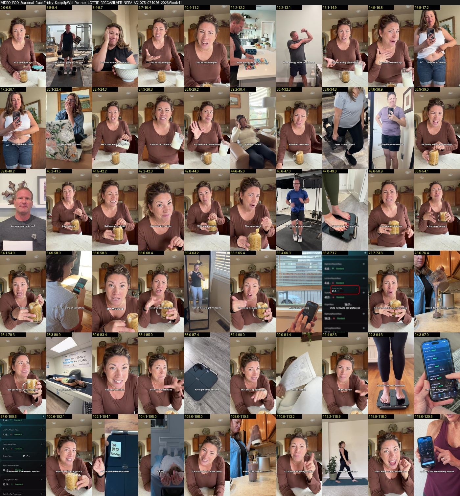

# VIDEO_POD_Seasonal_BlackFriday_KeepUpWithPartner_LOTTIE_BECCASILVER_NEBA_AD1075_071026_2026Week41

Master: `VIDEO_POD_Seasonal_BlackFriday_KeepUpWithPartner_LOTTIE_BECCASILVER_NEBA_AD1075_071026_2026Week41_hook1.mp4` · 169.4s · 1080x1920

**Pacing:** 79 shots · avg 2.144s · median 1.96s · 4.61 cuts/10s · first cut 6.76s · 193.0 wpm · talk ratio 0.93 · cuts on word start 71.8% · cuts in speech gaps 61.5%
**Audio:** {'I_lufs': -23.4, 'LRA': 4.5, 'true_peak_db': -0.9} · BPM≈123.0 · music {'speech_rms_db': -28.6, 'pause_seconds': 0.8, 'pause_rms_db': -32.0, 'bed_minus_voice_db': -3.4, 'music_bed_likely': True} · cuts with SFX/transient 73.1%

**Captions:** 194 cards · 2.0 words/card (median) · y≈0.686 of frame height · text height≈0.0293 · colours {'white': 161, 'red': 5, 'yellow': 5, 'other-colour': 2, 'blue': 7, 'dark/other': 12, 'green': 2} · cards crossing a cut: 4
Highlighted: More energy,more confidence., And I said no., Which felt horrible, to admit,, itwas going to tell me, the wrong weight all the time., High, Butyouknow,Iwas skeptical., That clinicappointment, Icould scan every morning, Standard, 4.60s+, TrunkMuscieMass, Right Log Musole Mats, 14.3usOtanderd
**Headlines:** Myhusband'stransformationalmost (0.0–2.5s, red) | ended mymarriage. (0.0–0.0s, red) | endedmymarriage (0.5–2.5s, red) | XDEXAFIT (79.0–80.0s, white) | Know Your Body. (79.0–80.0s, white) | Transform Your Life. (79.0–80.0s, blue) | 12:25起 (95.0–95.0s, blue) | Stp On Scale (95.0–95.0s, blue)

**Hook (0–3s) spoken:** My husband's transformation almost ended my marriage.
**Hook on-screen:** Myhusband'stransformationalmost / ended mymarriage. / endedmymarriage
**CTA (last 5s):** measuring pounds, take a look. I wish I'd started asking what was changing soon. · on-screen: 1160 / 8000 / ?HumeHealth.com / ETEKCITY / HumeHealth.com / Iwish I'd startedasking / and only measuring pounds, / takealook. / what was changing sooner.

## Beat sheet

| # | in–out (s) | dur | transition | spoken | on-screen text |
|---|---|---|---|---|---|
| 1 | 0.00–6.76 | 6.76 |  | My husband's transformation almost ended my marriage. So six months ago, we said we were going to get healthier together. | Myhusband'stransformationalmost [red] (HEADLINE) / ended mymarriage. [red] (HEADLINE) / endedmymarriage [red] (HEADLINE) / So sixmonthsago / we said / we were going to get |
| 2 | 6.76–8.44 | 1.68 | cut +SFX hit | He started going to the gym, I | He started going to thegym / He started going to thegym. |
| 3 | 8.44–9.68 | 1.24 | cut +SFX hit | started watching when I ate and | He started going to thegym. / Istarted watchingwhatIate |
| 4 | 9.68–10.40 | 0.72 | cut | he just changed. | and he just changed. |
| 5 | 10.40–11.16 | 0.76 | cut +SFX hit |  | and he just changed. / More energy,more confidence. [red] |
| 6 | 11.16–12.20 | 1.04 | cut +SFX hit | More energy, | More energy,more confidence. [red] |
| 7 | 12.20–13.08 | 0.88 | cut +SFX hit | more confidence, | More energy,more confidence. [red] / Clothes fitting differentlyb |
| 8 | 13.08–14.88 | 1.8 | cut | clothes fitting differently. Suddenly he | Clothes fitting differentlyb / Clothes fitting differently |
| 9 | 14.88–16.80 | 1.92 | cut | was the guy I married 20 years ago. | Suddenly He was the guy / married 20 years ag0. |
| 10 | 16.80–17.24 | 0.44 | cut | Me, | I'velost20pounds, |
| 11 | 17.24–20.08 | 2.84 | cut +SFX hit | I'd lost 20 pounds, but I just didn't feel it. | I'velost20pounds, / but justdidn't feel it. / Still exhausted,still soft. |
| 12 | 20.08–22.36 | 2.28 | cut +SFX hit | Still exhausted, still soft. | Still exhausted,still soft. |
| 13 | 22.36–24.32 | 1.96 | cut +SFX hit | We'd take a photo together and I'd | Still exhausted,still soft. / We'd take a phototogether / and I'd be like? |
| 14 | 24.32–26.84 | 2.52 | cut +SFX hit | be like, I feel so out of place. | and I'd be like? / Ifeel so outof place, / Ifeel so outofplace. |
| 15 | 26.84–29.24 | 2.4 | cut +SFX hit | He'd come home excited about something at the gym. I'd | He'd comehome / excited aboutsomething / 'd get irritated |
| 16 | 29.24–30.44 | 1.2 | cut +SFX hit | get irritated. | 'd get irritated |
| 17 | 30.44–32.84 | 2.4 | cut | Not because I didn't want him to do well, but because I | 'd get irritated / Want him to do well, / butbecause |
| 18 | 32.84–34.76 | 1.92 | cut +SFX hit | was trying so hard and | I was trying so hard |
| 19 | 34.76–36.92 | 2.16 | cut | just not getting the same results. | and just not / getting the same results. |
| 20 | 36.92–39.04 | 2.12 | cut +SFX hit | He finally asked me one night, | Hefinallyasked meone night. / Hefinallyasked me one night / Are you upsetwith me? |
| 21 | 39.04–40.16 | 1.12 | cut +SFX hit | are you upset with me? | Are you upsetwith me? / And I said no. [yellow] |
| 22 | 40.16–41.48 | 1.32 | cut +SFX hit | And I said, no, | And I said no. [yellow] |
| 23 | 41.48–42.24 | 0.76 | cut +SFX hit | but honestly, | And I said no. [yellow] / But honestly,a little. |
| 24 | 42.24–42.84 | 0.6 | cut +SFX hit | a little. | But honestly,a little. |
| 25 | 42.84–44.60 | 1.76 | cut +SFX hit | Which felt horrible to admit. | Which felt horrible [yellow] / to admit, [other-colour] |
| 26 | 44.60–45.60 | 1.0 | cut +SFX hit | This same week, | Thesameweek |
| 27 | 45.60–47.00 | 1.4 | cut | he hit his six month mark. | he hit his six month mark, |
| 28 | 47.00–49.56 | 2.56 | cut +SFX hit | I stepped on my humepod. I thought it | Istepped on my Hume Pod. / Istepped on my HumePod / Ithought |
| 29 | 49.56–50.92 | 1.36 | cut +SFX hit | was gonna tell me I | itwas going to tell me [yellow] |
| 30 | 50.92–54.12 | 3.2 | cut +SFX hit | just needed to lose a few more pounds. | Ijustneeded to lose / a few more pounds. / Instead, |
| 31 | 54.12–54.92 | 0.8 | cut +SFX hit | Instead, | Instead, |
| 32 | 54.92–57.96 | 3.04 | cut | I started looking at something I barely thought about, | Istarted lookingat something / Ibarely thought about. |
| 33 | 57.96–58.64 | 0.68 | cut +SFX hit | my muscle. Here, | MY MUSCLE |
| 34 | 58.64–60.40 | 1.76 | cut | I've been thinking, great, | Here I've been thinking. / Great, |
| 35 | 60.40–63.24 | 2.84 | cut | look at this weight I'm losing. And I've been losing the | Great, / look at this weight I'm losing. / And I've been losing / the wrong weight all the time. [yellow] |
| 36 | 63.24–65.36 | 2.12 | cut | wrong weight all the time. | the wrong weight all the time. [yellow] |
| 37 | 65.36–66.28 | 0.92 | cut +SFX hit | They have showed me my | the wrong weight all the time. [yellow] / Theapp showed me |
| 38 | 66.28–71.68 | 5.4 | cut | muscle mass had been dropping while fat levels had plateaued or even gone up a little. | Theapp showed me / 29.4bs / my muscle mass had been / dropping, / 29.4 / while fat levels had plateaued |
| 39 | 71.68–73.64 | 1.96 | cut +SFX hit | So my metabolism was crashing. | So my metabolism was crashing. |
| 40 | 73.64–76.36 | 2.72 | cut | No wonder cutting calories wasn't doing anything. | No wonder cutting calories / wasn't doing anything |
| 41 | 76.36–78.28 | 1.92 | cut +SFX hit | But you know, I was skeptical. | wasn't doing anything / Butyouknow,Iwas skeptical. [other-colour] |
| 42 | 78.28–80.88 | 2.6 | cut +SFX hit | So I booked a DEXA scan at a clinic. | Butyouknow,Iwas skeptical. [other-colour] / XDEXAFIT (HEADLINE) / Know Your Body. (HEADLINE) / Transform Your Life. [blue] (HEADLINE) / dexafitnj.com / 201 -351-1591 |
| 43 | 80.88–83.40 | 2.52 | cut +SFX hit | The results were basically identical. | Theresultswere / basically identical. |
| 44 | 83.40–84.96 | 1.56 | cut +SFX hit | But here's what made having | basically identical. / But here'swhat made |
| 45 | 84.96–87.40 | 2.44 | cut +SFX hit | the pod at home useful for me. that | having the Pod at home / XHume / useful for me. |
| 46 | 87.40–90.04 | 2.64 | cut +SFX hit | clinic appointment gave me one | XHume / useful for me. / That clinicappointment [red] / gaveme / one snapshot. |
| 47 | 90.04–91.36 | 1.32 | cut +SFX hit | snapshot. | one snapshot. |
| 48 | 91.36–92.32 | 0.96 | cut | With the pod, | one snapshot. / Withthe Pod |
| 49 | 92.32–94.32 | 2.0 | cut +SFX hit | I could scan every morning and | Withthe Pod / Icould scan every morning [red] |
| 50 | 94.32–96.96 | 2.64 | cut | track my progress anytime I wanted. | Icould scan every morning [red] / 12:25起 [blue] (HEADLINE) / Stp On Scale [blue] (HEADLINE) / C,BodyPod [blue] (HEADLINE) / RightArmMuscleMass [blue] (HEADLINE) / Stendard [blue] (HEADLINE) |
| 51 | 96.96–100.64 | 3.68 | cut +SFX hit | It measures 45 different metrics in about 30 seconds with | OrganMass / Body Pod (HEADLINE) / 4.6bs+Standard (HEADLINE) / LeftArmMuscleMass (HEADLINE) / 4.6bs + (HEADLINE) / Standard [green] (HEADLINE) |
| 52 | 100.64–102.12 | 1.48 | cut +SFX hit | advertised accuracy of | with advertised accuracy / 187. [blue] / DEXA [blue] (HEADLINE) / Accafacy [blue] (HEADLINE) / XHume / of98%comparedwithDexa. |
| 53 | 102.12–104.12 | 2.0 | cut +SFX hit | 98 % compared with DEXA. | 187. [blue] / DEXA [blue] (HEADLINE) / Accafacy [blue] (HEADLINE) / XHume / of98%comparedwithDexa. / 987. |
| 54 | 104.12–105.00 | 0.88 | cut +SFX hit | Finally, | of98%comparedwithDexa. |
| 55 | 105.00–107.96 | 2.96 | cut +SFX hit | it was starting to make sense. So I stopped making | it was starting to make sense. / So/stopped |
| 56 | 107.96–110.48 | 2.52 | cut | the smallest possible dinner. | makingthesmallest / possible dinner. |
| 57 | 110.48–113.24 | 2.76 | cut | I started prioritizing protein. | possible dinner. / Istarted prioritizing protein, / Istarted prioritizing protein. / Isqueezedinresistance |
| 58 | 113.24–115.88 | 2.64 | cut +SFX hit | I squeezed in resistance training when I could and | Isqueezedinresistance / training when I could, |
| 59 | 115.88–118.04 | 2.16 | cut +SFX hit | I added some creatine too. | and I added some creatine too. / andIstarted to follow my muscle |
| 60 | 118.04–120.56 | 2.52 | cut +SFX hit | And I started following my muscle and fat trends. | andIstarted to follow my muscle / 643 / andstartedto follow mymuscle / and fat trends. |
| 61 | 120.56–125.52 | 4.96 | cut +SFX hit | Instead of wanting one way into side, whether I'd had a good week, eventually I told my husband what | Instead of letting one weigh in, / decide / whether I'd had a good week. / Eventually,Itold myhusband |
| 62 | 125.52–127.32 | 1.8 | cut +SFX hit | had actually been going on that | what had actually been going on, / what had actually been going on |
| 63 | 127.32–131.56 | 4.24 | cut +SFX hit | I felt left behind, that I was embarrassed that every time he said I look good, | what had actually been going on / that Ifelt left behind, / ThatIwasembarrassedthat / every time he said I looked good |
| 64 | 131.56–132.44 | 0.88 | cut +SFX hit | I wanted to believe him, | I wanted to believe him, |
| 65 | 132.44–134.92 | 2.48 | cut +SFX hit | but I didn't feel good in myself. | I wanted to believe him, / butIdidn't feel good inmyself. / butl didn't feel good in myself. |
| 66 | 134.92–140.88 | 5.96 | cut | He said, I thought you wanted me to leave you alone about it. And for the first time in over a year, | Hesaid / Ithoughtyou wanted me / to leave you alone about it. / And for thefirst time / in over a year, |
| 67 | 140.88–143.20 | 2.32 | cut | I started feeling motivated on this journey. Like, | Istarted feeling motivated. / like we were doing this |
| 68 | 143.20–150.20 | 7.0 | cut | we were doing this together again. I just needed a way to understand my own progress. | like we were doing this / together again, / Ijust needed a way [red] / to understand myown progress. / 045. [blue] (HEADLINE) / XHume |
| 69 | 150.20–152.12 | 1.92 | cut +SFX hit | The Hume Pod's technology is | 045. [blue] (HEADLINE) / XHume / The Hume Pod's technology / isused in over |
| 70 | 152.12–154.40 | 2.28 | cut +SFX hit | used in over 12 ,000 | isused in over / 12,000healthclinics |
| 71 | 154.40–155.56 | 1.16 | cut +SFX hit | health clinics, | 12,000healthclinics |
| 72 | 155.56–155.88 | 0.32 | cut +SFX hit | but I |  |
| 73 | 155.88–157.32 | 1.44 | cut | have it right in my bathroom. | 115.6 [blue] / 18.7 / but Ihave it right / 21.6 / in mybathroom |
| 74 | 157.32–159.56 | 2.24 | cut +SFX hit | It's HSA, FSA -eligible, | 18.7 / 21.6 / in mybathroom / It's HSA,FSAeligible |
| 75 | 159.56–161.12 | 1.56 | cut +SFX hit | and comes with a 40 | ?HumeHealth.com / andcomeswitha / HumeHealth.com / 40 day money backguarantee. |
| 76 | 161.12–162.84 | 1.72 | cut +SFX hit | -day money back guarantee. | HumeHealth.com / 40 day money backguarantee. / ?HumeHealth.com |
| 77 | 162.84–164.08 | 1.24 | cut +SFX hit | If you've been working hard and | HumeHealth.com / If you've been working hard / ?HumeHealth.com / and only measuring pounds, / ETEKCITY |
| 78 | 164.08–166.64 | 2.56 | cut +SFX hit | only measuring pounds, take a look. | ?HumeHealth.com / and only measuring pounds, / ETEKCITY / 8000 / HumeHealth.com / 1160 (HEADLINE) |
| 79 | 166.64–169.37 | 2.73 | cut +SFX hit | I wish I'd started asking what was changing soon. | HumeHealth.com / Iwish I'd startedasking / what was changing sooner. [yellow] |

## Hook variants

| hook | file | dur | first cut | spoken 0–3s | on-screen 0–3s |
|---|---|---|---|---|---|
| 1 | `r_LOTTIE_BECCASILVER_NEBA_AD1075_071026_2026Week41_hook1.mp4` | 169.4 | 6.76 | My husband's transformation almost ended my marriage. | Myhusband'stransformationalmost / ended mymarriage. / endedmymarriage |
| 2 | `r_LOTTIE_BECCASILVER_NEBA_AD1075_071026_2026Week41_hook2.mp4` | 172.7 | 6.4 | I wanted us to be the couple who got healthier together. |  |
| 3 | `r_LOTTIE_BECCASILVER_NEBA_AD1075_071026_2026Week41_hook3.mp4` | 171.5 | 5.16 | The most awkward thing I've admitted to my husband started | 'veadmitted tomyhusband. / Bought itto check my progressendedup / I'veadmitted tomyhusband. / I'veadmittedtomyhusband / Startedwitha Hume Podscan. / Themostawkward thing / cryinginthekitchen |

## Full transcript

My husband's transformation almost ended my marriage. So six months ago, we said we were going to get healthier together. He started going to the gym, I started watching when I ate and he just changed. More energy, more confidence, clothes fitting differently. Suddenly he was the guy I married 20 years ago. Me, I'd lost 20 pounds, but I just didn't feel it. Still exhausted, still soft. We'd take a photo together and I'd be like, I feel so out of place. He'd come home excited about something at the gym. I'd get irritated. Not because I didn't want him to do well, but because I was trying so hard and just not getting the same results. He finally asked me one night, are you upset with me? And I said, no, but honestly, a little. Which felt horrible to admit. This same week, he hit his six month mark. I stepped on my humepod. I thought it was gonna tell me I just needed to lose a few more pounds. Instead, I started looking at something I barely thought about, my muscle. Here, I've been thinking, great, look at this weight I'm losing. And I've been losing the wrong weight all the time. They have showed me my muscle mass had been dropping while fat levels had plateaued or even gone up a little. So my metabolism was crashing. No wonder cutting calories wasn't doing anything. But you know, I was skeptical. So I booked a DEXA scan at a clinic. The results were basically identical. But here's what made having the pod at home useful for me. that clinic appointment gave me one snapshot. With the pod, I could scan every morning and track my progress anytime I wanted. It measures 45 different metrics in about 30 seconds with advertised accuracy of 98% compared with DEXA. Finally, it was starting to make sense. So I stopped making the smallest possible dinner. I started prioritizing protein. I squeezed in resistance training when I could and I added some creatine too. And I started following my muscle and fat trends. Instead of wanting one way into side, whether I'd had a good week, eventually I told my husband what had actually been going on that I felt left behind, that I was embarrassed that every time he said I look good, I wanted to believe him, but I didn't feel good in myself. He said, I thought you wanted me to leave you alone about it. And for the first time in over a year, I started feeling motivated on this journey. Like, we were doing this together again. I just needed a way to understand my own progress. The Hume Pod's technology is used in over 12,000 health clinics, but I have it right in my bathroom. It's HSA, FSA-eligible, and comes with a 40-day money back guarantee. If you've been working hard and only measuring pounds, take a look. I wish I'd started asking what was changing soon.