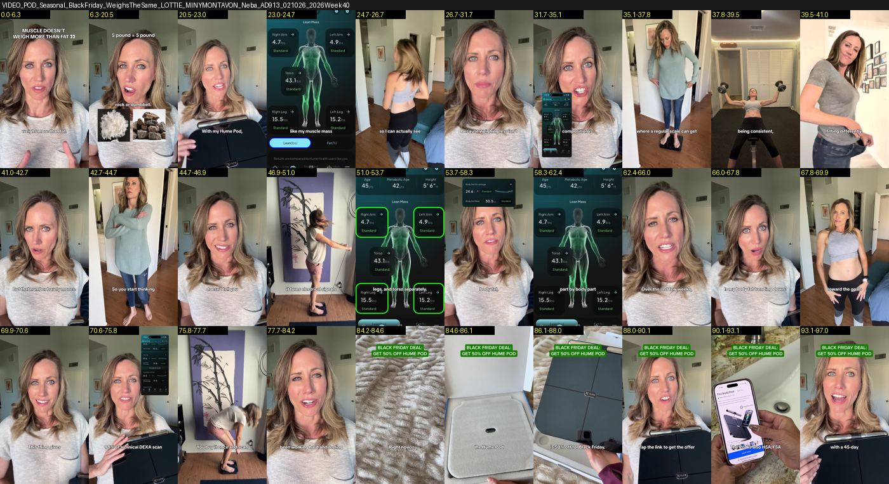

# VIDEO_POD_Seasonal_BlackFriday_WeighsTheSame_LOTTIE_MINYMONTAVON_Neba_AD913_021026_2026Week40

Master: `VIDEO_POD_Seasonal_BlackFriday_WeighsTheSame_LOTTIE_MINYMONTAVON_Neba_AD913_021026_2026Week40_Hook1_9x16.mp4` · 97.0s · 1080x1920

**Pacing:** 30 shots · avg 3.233s · median 2.349s · 2.99 cuts/10s · first cut 6.267s · 216.0 wpm · talk ratio 0.96 · cuts on word start 75.9% · cuts in speech gaps 69.0%
**Audio:** {'I_lufs': -24.7, 'LRA': 2.8, 'true_peak_db': -5.5} · BPM≈129.2 · music {'speech_rms_db': -29.4, 'pause_seconds': 0.0} · cuts with SFX/transient 58.6%

**Captions:** 158 cards · 1.0 words/card (median) · y≈0.752 of frame height · text height≈0.031 · colours {'white': 137, 'dark/other': 15, 'blue': 6} · cards crossing a cut: 1
Highlighted: Lean(lbs), SHOP NO, humehealth, SHOP NOW, humehealth.com, Choose Warranity
**Headlines:** MUSCLEDOESN'T (0.0–6.0s, white) | WEIGHMORETHANFAT (0.0–6.0s, white) | 5pound=5pound (9.0–11.0s, white) | punods=punods (12.0–12.0s, white) | 5pound=5pound (13.0–15.0s, white) | StepOnScale (23.0–24.0s, green) | HumePod (23.0–24.0s, white) | LeanMass (23.0–23.0s, white)

**Hook (0–3s) spoken:** It makes me so crazy when people say muscle weighs more
**Hook on-screen:** Itmakesmesocrazy / MUSCLEDOESN'T / WEIGHMORETHANFAT / weighsmorethan fat. / whenpeoplesaymuscle
**CTA (last 5s):** eligible and comes with a 45 -day money back guarantee. · on-screen: BLACKFRIDAYDEAL / GET50%OFFHUMEPOD / eligibleandcomes / money back guarantee! / with a 45-day

## Beat sheet

| # | in–out (s) | dur | transition | spoken | on-screen text |
|---|---|---|---|---|---|
| 1 | 0.00–6.27 | 6.27 |  | It makes me so crazy when people say muscle weighs more than fat. A pound of muscle and a pound of fat weigh the same thing. | MUSCLEDOESN'T (HEADLINE) / WEIGHMORETHANFAT (HEADLINE) / Itmakesmesocrazy / whenpeoplesaymuscle / weighsmorethan fat. / Apoundofmuscle |
| 2 | 6.27–20.50 | 14.23 | cut | Picture this, a pillowcase filled with five pounds of feathers, how big would that be? Versus a pillowcase filled with a five pound rock or dumbbell, what would that look like? Same weight, very different amount of space. Muscle is more dense than fat and that is why I love | MUSCLEDOESN'T (HEADLINE) / WEIGHMORETHANFAT (HEADLINE) / weigh the same thing! / Picture this:a pillowcase / filled with / 5pound=5pound (HEADLINE) |
| 3 | 20.50–23.03 | 2.53 | cut | my humepod. With my humepod, I can track things like | my Hume Pod. / XHume / I can track things / Hume / StepOnScale [green] (HEADLINE) / HumePod (HEADLINE) |
| 4 | 23.03–24.73 | 1.7 | cut | my muscle mass and body fat | StepOnScale [green] (HEADLINE) / HumePod (HEADLINE) / LeanMass (HEADLINE) / Right Arm (HEADLINE) / Left Arm (HEADLINE) / 4.9ibs (HEADLINE) |
| 5 | 24.73–26.70 | 1.97 | cut | so I can actually see what's changing instead | soI can actually see / what's changing |
| 6 | 26.70–31.70 | 5.0 | cut | of only paying attention to one weight number. because weighing less isn't necessarily my goal. | instead of only / to one weight number. / Because weighing lessisn't / necessarily my goal. |
| 7 | 31.70–35.07 | 3.37 | cut | Improving my body composition is. And this is | 4.7 / Improving my body / 4.70 / composition is. / And thisis / where aregular scale can get |
| 8 | 35.07–37.77 | 2.7 | cut | where a regular scale can get so frustrating. | where aregular scale can get / so frustrating. |
| 9 | 37.77–39.53 | 1.77 | cut +SFX hit | Your lifting weights being consistent, | You're lifting weights, / being consistent, |
| 10 | 39.53–40.97 | 1.43 | cut +SFX hit | your clothes are fitting differently, | fitting differently. |
| 11 | 40.97–42.73 | 1.77 | cut +SFX hit | but that number barely moves. | But that number barely moves. |
| 12 | 42.73–44.73 | 2.0 | cut +SFX hit | So you start thinking nothing's working, | So you start thinking / nothing is working. |
| 13 | 44.73–46.87 | 2.13 | cut +SFX hit | but weight alone doesn't tell you the whole story. | But weightalone / the whole story. |
| 14 | 46.87–51.03 | 4.17 | cut | When you step on a human pod, it sends electrical signals through your hands and feet to | When you step / on the Hume Pod, / it turns electrical signals / through your hands / Metabolic Age (HEADLINE) / Height (HEADLINE) |
| 15 | 51.03–53.73 | 2.7 | cut +SFX hit | scan your arms, legs, and torso separately. | Metabolic Age (HEADLINE) / Height (HEADLINE) / Age (HEADLINE) / 5'6"ft (HEADLINE) / 42yrs (HEADLINE) / 45yrs (HEADLINE) |
| 16 | 53.73–58.27 | 4.53 | cut | Then you can actually see your muscle mass, body fat, body water, and visceral fat, and | Then you can actually see / 87.6bs (HEADLINE) / 70.8% (HEADLINE) / your muscle mass, / 24.6%+Standard (HEADLINE) / 30.51bs (HEADLINE) |
| 17 | 58.27–62.40 | 4.13 | cut | check body part by body part on this cool little humanoid in the app. | and visceral fat / Age (HEADLINE) / Metabolic Age (HEADLINE) / Height (HEADLINE) / 5'6"ft (HEADLINE) / 45yrs (HEADLINE) |
| 18 | 62.40–66.03 | 3.63 | cut +SFX hit | That's the part I care about. Over the last few weeks is my muscle trending up, | Lean Mass (HEADLINE) / Right Arm (HEADLINE) / Left Arm (HEADLINE) / Standard / Torso / Right Leg |
| 19 | 66.03–67.77 | 1.73 | cut +SFX hit | is my body fat trending down, | Is my body fat trending down? |
| 20 | 67.77–69.93 | 2.17 | cut +SFX hit | and my moving toward the goals I actually set. | AmImoving / actually set? |
| 21 | 69.93–70.57 | 0.63 | cut +SFX hit | This thing gives | This thing gives |
| 22 | 70.57–75.83 | 5.27 | cut | you readings to within 98 % of a clinical dexa scan without the clinic prices. | you readings to within / 98%ofaclinicalDEXAscan / XHume / Hume / Without the clinic prices. |
| 23 | 75.83–77.70 | 1.87 | cut +SFX hit | You buy it once and scan whenever you like. | You buy it once and scan / whenever you like. |
| 24 | 77.70–84.20 | 6.5 | cut +SFX hit | No monthly subscription either. So if you've been working hard and feeling discouraged by the scale, stop getting hung up by the weight number. | subscriptioneither / So if you've / been working hard and feeling / discouraged / stop getting hung up / BLACKFRIDAYDEAL: (HEADLINE) |
| 25 | 84.20–84.63 | 0.43 | cut | Right now, | BLACKFRIDAYDEAL: (HEADLINE) / GET50%OFFHUMEPOD (HEADLINE) / Rightnow, |
| 26 | 84.63–86.10 | 1.47 | cut +SFX hit | the Hume Pod is 50 | BLACKFRIDAYDEAL: (HEADLINE) / GET50%OFFHUMEPOD (HEADLINE) / XHume / theHumePod / is50%offforBlackFriday. |
| 27 | 86.10–88.00 | 1.9 | cut +SFX hit | % off for Black Friday. Tap | BLACKFRIDAYDEAL: (HEADLINE) / GET50%OFFHUMEPOD (HEADLINE) / XHume / is50%offforBlackFriday. |
| 28 | 88.00–90.10 | 2.1 | cut +SFX hit | the link to get the offer while it's live. | GET50%OFFHUMEPOD (HEADLINE) / XHume / BLACKFRIDAYDEAL (HEADLINE) / Tapthe link toget the offer / BLACKFRIDAYDEAL: (HEADLINE) / 2:19 |
| 29 | 90.10–93.13 | 3.03 | cut +SFX hit | The pod is also HSA, FSA, eligible and | GET50%OFFHUMEPOD (HEADLINE) / BLACKFRIDAYDEAL: (HEADLINE) / 2:19 / 522963 / TheBodyPod / VHSA1FSAACCEpIedO |
| 30 | 93.13–97.00 | 3.87 | cut +SFX hit | comes with a 45 -day money back guarantee. | GET50%OFFHUMEPOD (HEADLINE) / BLACKFRIDAYDEAL (HEADLINE) / eligibleandcomes / with a 45-day / money back guarantee! |

## Hook variants

| hook | file | dur | first cut | spoken 0–3s | on-screen 0–3s |
|---|---|---|---|---|---|
| 1 | `TIE_MINYMONTAVON_Neba_AD913_021026_2026Week40_Hook1_9x16.mp4` | 97.0 | 6.267 | It makes me so crazy when people say muscle weighs more | Itmakesmesocrazy / MUSCLEDOESN'T / WEIGHMORETHANFAT / weighsmorethan fat. / whenpeoplesaymuscle |
| 2 | `TIE_MINYMONTAVON_Neba_AD913_021026_2026Week40_Hook2_9x16.mp4` | 98.0 | 2.3 | I'm the heaviest I've ever been right now, but I'm also | ButI'malsotheleanest. / GAININGMUSCLEVSFATO / GAININGMUSCLEVSFATOO / I'mtheheaviest / I'veeverbeenrightnow / I'veeverbeenrightnow. |
| 3 | `TIE_MINYMONTAVON_Neba_AD913_021026_2026Week40_Hook3_9x16.mp4` | 95.8 | 2.7 | This scanner showed me I'm the heaviest I've ever been, but I'm |  |

## Full transcript

It makes me so crazy when people say muscle weighs more than fat. A pound of muscle and a pound of fat weigh the same thing. Picture this, a pillowcase filled with five pounds of feathers, how big would that be? Versus a pillowcase filled with a five pound rock or dumbbell, what would that look like? Same weight, very different amount of space. Muscle is more dense than fat and that is why I love my humepod. With my humepod, I can track things like my muscle mass and body fat so I can actually see what's changing instead of only paying attention to one weight number. because weighing less isn't necessarily my goal. Improving my body composition is. And this is where a regular scale can get so frustrating. Your lifting weights being consistent, your clothes are fitting differently, but that number barely moves. So you start thinking nothing's working, but weight alone doesn't tell you the whole story. When you step on a human pod, it sends electrical signals through your hands and feet to scan your arms, legs, and torso separately. Then you can actually see your muscle mass, body fat, body water, and visceral fat, and check body part by body part on this cool little humanoid in the app. That's the part I care about. Over the last few weeks is my muscle trending up, is my body fat trending down, and my moving toward the goals I actually set. This thing gives you readings to within 98% of a clinical dexa scan without the clinic prices. You buy it once and scan whenever you like. No monthly subscription either. So if you've been working hard and feeling discouraged by the scale, stop getting hung up by the weight number. Right now, the Hume Pod is 50% off for Black Friday. Tap the link to get the offer while it's live. The pod is also HSA, FSA, eligible and comes with a 45-day money back guarantee.