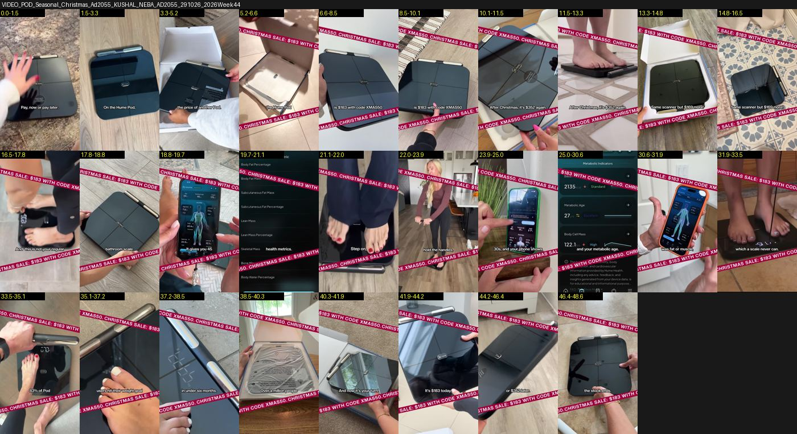

# VIDEO_POD_Seasonal_Christmas_Ad2055_KUSHAL_NEBA_AD2055_291026_2026Week44

Master: `VIDEO_POD_Seasonal_Christmas_Ad2055_KUSHAL_NEBA_AD2055_291026_2026Week44_Hook1_9x16.mp4` · 48.6s · 1080x1920

**Pacing:** 28 shots · avg 1.736s · median 1.64s · 5.55 cuts/10s · first cut 1.54s · 173.0 wpm · talk ratio 0.94 · cuts on word start 74.1% · cuts in speech gaps 51.9%
**Audio:** {'I_lufs': -17.6, 'LRA': 7.2, 'true_peak_db': -1.0} · BPM≈112.3 · music {'speech_rms_db': -24.1, 'pause_seconds': 0.2} · cuts with SFX/transient 37.0%

**Captions:** 127 cards · 1 words/card (median) · y≈0.678 of frame height · text height≈0.0269 · colours {'white': 93, 'dark/other': 24, 'blue': 3, 'red': 6, 'green': 1} · cards crossing a cut: 3
Highlighted: LeanMass, Itgivesyou45, BoneMi, 10.libs, Low, uvity,body, ion,andcardiovascular, Standard, wasfatormuscle,, usershittheirweightgoal
**Headlines:** CHRISTMAS SALE: $183 WITH COL (5.0–5.0s, red) | CHRISTMAS SALE: $183 WITH CO (5.0–5.0s, red) | 0.CHRISTMAS SALE:$183 WITH CO (5.5–5.5s, red) | O.CHRISTMAS SALE: $183 WITH C (5.5–5.5s, red) | 50.CHRISTMAS SALE: $183 WITH (6.0–6.0s, red) | IAS50.CHRISTMAS SALE: $183 WI (7.0–7.0s, red) | MAS50.CHRISTMASSALE:$183WI (7.0–7.0s, red) | XMAS50.CHRISTMAS SALE:$183 (8.0–8.0s, red)

**Hook (0–3s) spoken:** Pay now or pay later. On the Hume Pod, the difference
**Hook on-screen:** On the Hume Pod, / Pay,noworpaylater. / XHume / XHurme / thedifferenceisalmost
**CTA (last 5s):** or 352 dollars later. So hurry before the stock ends · on-screen: .CHRISTMAS SALE: $183 WITH CC / .CHRISTMAS SALE: $183 WITH CO / AS SALE: $183 WITH CODE XMAS? / HRISTMASSALE:$183WITHCODE / IASSALE:$183WITHCODEXMAS / IRISTMASSALE:$183WITHCODE / S50.CHRISTMASSALE:$183WITH / STMASSALE:$183WITHCODEXN / Sohurrybefore / TMASSALE:$183WITHCODEXM / XHume / or$352later

## Beat sheet

| # | in–out (s) | dur | transition | spoken | on-screen text |
|---|---|---|---|---|---|
| 1 | 0.00–1.54 | 1.54 |  | Pay now or pay later. | Pay,noworpaylater. / XHume / On the Hume Pod, |
| 2 | 1.54–3.32 | 1.78 | cut +SFX hit | On the Hume Pod, the difference is | XHume / On the Hume Pod, / XHurme / thedifferenceisalmost |
| 3 | 3.32–5.18 | 1.86 | cut | almost the price of another pod. | thedifferenceisalmost / XHumo / the price of another Pod. / XHume / the price of anotherPod, / GETTNOSTARTEO |
| 4 | 5.18–6.60 | 1.42 | cut | Right now, the Hume Pod is | CHRISTMAS SALE: $183 WITH COL [red] (HEADLINE) / Rightnow / CHRISTMAS SALE: $183 WITH CO [red] (HEADLINE) / 0.CHRISTMAS SALE:$183 WITH CO [red] (HEADLINE) / O.CHRISTMAS SALE: $183 WITH C [red] (HEADLINE) / 50.CHRISTMAS SALE: $183 WITH [red] (HEADLINE) |
| 5 | 6.60–8.50 | 1.9 | cut | $183, | IAS50.CHRISTMAS SALE: $183 WI [red] (HEADLINE) / is$183withcodeXMAS50. / MAS50.CHRISTMASSALE:$183WI [red] (HEADLINE) / XMAS50.CHRISTMAS SALE:$183 [red] (HEADLINE) / YHume / is$183withcodeXMAS50 |
| 6 | 8.50–10.14 | 1.64 | cut +SFX hit | with code XMAS50. | DEXMAS5O.CHRISTMASSALE:$ [red] (HEADLINE) / is$183withcodeXMAS50. / DDEXMAS5O.CHRISTMASSALE:$ [red] (HEADLINE) / CODE XMAS5O.CHRISTMAS SALE [red] (HEADLINE) / AfterChristmas,it's$352again. / CODEXMAS5O.CHRISTMASSAL [red] (HEADLINE) |
| 7 | 10.14–11.54 | 1.4 | cut | After Christmas, it's $352 | CODE XMAS5O.CHRISTMAS SALE [red] (HEADLINE) / AfterChristmas,it's$352again. / CODEXMAS5O.CHRISTMASSAL [red] (HEADLINE) / ITH CODE XMAS5O.CHRISTMAS S [red] (HEADLINE) / AfterChristmas,it's$352again |
| 8 | 11.54–13.32 | 1.78 | cut +SFX hit | again. | 3WITHCODEXMAS5O.CHRISTMA [red] (HEADLINE) / AfterChristmas,it's$352again. / $183 WITH CODE XMAS50.CHRIST [red] (HEADLINE) / $183 WITH CODE XMAS50.CHRIS [red] (HEADLINE) |
| 9 | 13.32–14.78 | 1.46 | cut | Same scanner, but $169 | AfterChristmas,it's$352again. / $183 WITH CODE XMAS50.CHRIST [red] (HEADLINE) / $183 WITH CODE XMAS50.CHRIS [red] (HEADLINE) / E: $183 WITH CODE XMAS50. CHF [red] (HEADLINE) / Samescannerbut$169more! / _E:$183WITHCODEXMAS50.CH [red] (HEADLINE) |
| 10 | 14.78–16.50 | 1.72 | cut | more. | Samescannerbut$169more! / SALE:$183 WITH CODE XMAS50. [red] (HEADLINE) / AS SALE: $183 WITH CODE XMAS5 [red] (HEADLINE) / Samescannerbut$i69more! / AS SALE: $183 WITH CODE XMAS! [red] (HEADLINE) |
| 11 | 16.50–17.80 | 1.3 | cut +SFX hit | And this is not your regular | TMAS SALE: $183 WITH CODE XM [red] (HEADLINE) / And thisisnotyourregular |
| 12 | 17.80–18.76 | 0.96 | cut | bathroom scale. | RISTMAS SALE: $183 WITH CODE [red] (HEADLINE) / bathroomscale. / IRISTMASSALE:$183 WITHCODE [red] (HEADLINE) |
| 13 | 18.76–19.72 | 0.96 | cut +SFX hit | It gives you 45 | CHRISTMAS SALE: $183 WITH CO [red] (HEADLINE) / CHumePod [blue] (HEADLINE) / Metabofic Age (HEADLINE) / Height (HEADLINE) / 45yrs (HEADLINE) / 175cm (HEADLINE) |
| 14 | 19.72–21.14 | 1.42 | cut | health metrics. | LeanMass [blue] / ChartMetric (HEADLINE) / BodyFatPercentage (HEADLINE) / 50. CHRISTMAS SALE: $183 WITH [red] (HEADLINE) / BodyFatMass (HEADLINE) / SubcutaneousFat Mass (HEADLINE) |
| 15 | 21.14–21.96 | 0.82 | cut | Step on, | 1AS50.CHRISTMAS SALE:$183 WI [red] (HEADLINE) / Step on, / MAS50.CHRISTMAS SALE:$183 W [red] (HEADLINE) |
| 16 | 21.96–23.86 | 1.9 | cut | hold the handles, 30 seconds, | XMAS50.CHRISTMAS SALE: $183 [red] (HEADLINE) / holdthehandles, / DDE XMAS5O.CHRISTMAS SALE: $ [red] (HEADLINE) / 30s,andyourphoneshows |
| 17 | 23.86–25.04 | 1.18 | cut +SFX hit | and your phone shows your muscle, | CODE XMAS5O.CHRISTMAS SAL [red] (HEADLINE) / 5.9 / 30s,andyour.phoneshows / FatPercentage (HEADLINE) / ITH CODE XMAS5O. CHRISTMAS S [red] (HEADLINE) / Low [blue] (HEADLINE) |
| 18 | 25.04–30.62 | 5.58 | cut +SFX hit | your body fat, your visceral fat, and your metabolic age. It tells you if the weight you lost | FatPercentage (HEADLINE) / ITH CODE XMAS5O. CHRISTMAS S [red] (HEADLINE) / Low [blue] (HEADLINE) / Muscle&SkeletonAnalysis (HEADLINE) / SkeletalMuscleMass / 118.5ibs |
| 19 | 30.62–31.86 | 1.24 | cut | was fat or muscle which | TMAS SALE: $183 WITH CODE XM [red] (HEADLINE) / 11:480 [blue] (HEADLINE) / CHumePod [blue] (HEADLINE) / 66m [blue] (HEADLINE) / 4.6b / 4.4m |
| 20 | 31.86–33.50 | 1.64 | cut | a scale never can That's | RISTMAS SALE:$183 WITH CODE [red] (HEADLINE) / whichascalenevercan. / IRISTMASSALE:$183WITHCODE [red] (HEADLINE) / CHRISTMAS SALE: $183 WITH CO [red] (HEADLINE) |
| 21 | 33.50–35.14 | 1.64 | cut | why 83 % of pod | 50.CHRISTMAS SALE: $183 WITH [red] (HEADLINE) / 677 / 83%ofPod / S50.CHRISTMASSALE:$183WITH [red] (HEADLINE) / MAS50.CHRISTMAS SALE: $183 WI [red] (HEADLINE) / MAS50.CHRISTMASSALE:$183W [red] (HEADLINE) |
| 22 | 35.14–37.16 | 2.02 | cut | users hit their weight goal in under | 83%ofPod / MAS50.CHRISTMAS SALE: $183 WI [red] (HEADLINE) / MAS50.CHRISTMASSALE:$183W [red] (HEADLINE) / XMAS50.CHRISTMAS SALE:$183 [red] (HEADLINE) / usershittheirweightgoal [red] / EXMAS50.CHRISTMASSALE:$183 [red] (HEADLINE) |
| 23 | 37.16–38.46 | 1.3 | cut +SFX hit | six months over | DDEXMAS5O.CHRISTMASSALE:$ [red] (HEADLINE) / inundersixmonths. / ODEXMAS5O.CHRISTMASSALE:$ [red] (HEADLINE) / CODE XMAS5O.CHRISTMAS SAL [red] (HEADLINE) / HCODEXMAS5O.CHRISTMASSAL [red] (HEADLINE) |
| 24 | 38.46–40.30 | 1.84 | cut +SFX hit | a million people own this and | inundersixmonths. / CODE XMAS5O.CHRISTMAS SAL [red] (HEADLINE) / HCODEXMAS5O.CHRISTMASSAL [red] (HEADLINE) / /ITH CODE XMAS5O.CHRISTMAS S [red] (HEADLINE) / vortindeen,Diese Taiche it koin Spintreug. / sich tnNase.undMundfosthal |
| 25 | 40.30–41.90 | 1.6 | cut | now it's your turn It's | PE (HEADLINE) / 3 WITH CODE XMAS5O.CHRISTMA [red] (HEADLINE) / sichanNose,und Mundfesthalten unddsAumen / bag is notatoy. / ownthis. / 3WITHCODEXMAS5O.CHRISTMI [red] (HEADLINE) |
| 26 | 41.90–44.22 | 2.32 | cut +SFX hit | 183 dollars today or | LE: $183 WITH CODE XMAS50.CHF [red] (HEADLINE) / It's$183today / LE: $183 WITH CODE XMAS50.CHI [red] (HEADLINE) / SALE: $183 WITH CODE XMAS50. [red] (HEADLINE) / XHume / It's $183 today, |
| 27 | 44.22–46.40 | 2.18 | cut | 352 dollars later. | AS SALE: $183 WITH CODE XMAS? [red] (HEADLINE) / or$352later. / IASSALE:$183WITHCODEXMAS [red] (HEADLINE) / TMASSALE:$183WITHCODEXM [red] (HEADLINE) / or$352later / STMASSALE:$183WITHCODEXN [red] (HEADLINE) |
| 28 | 46.40–48.62 | 2.22 | cut | So hurry before the stock ends | IRISTMASSALE:$183WITHCODE [red] (HEADLINE) / or$352later. / HRISTMASSALE:$183WITHCODE [red] (HEADLINE) / .CHRISTMAS SALE: $183 WITH CO [red] (HEADLINE) / XHume / Sohurrybefore |

## Hook variants

| hook | file | dur | first cut | spoken 0–3s | on-screen 0–3s |
|---|---|---|---|---|---|
| 1 | `s_Ad2055_KUSHAL_NEBA_AD2055_291026_2026Week44_Hook1_9x16.mp4` | 48.6 | 1.54 | Pay now or pay later. On the Hume Pod, the difference | On the Hume Pod, / Pay,noworpaylater. / XHume / XHurme / thedifferenceisalmost |
| 2 | `s_Ad2055_KUSHAL_NEBA_AD2055_291026_2026Week44_Hook2_9x16.mp4` | 46.5 | 1.18 |  |  |
| 3 | `s_Ad2055_KUSHAL_NEBA_AD2055_291026_2026Week44_Hook3_9x16.mp4` | 47.1 | 0.98 |  |  |

## Full transcript

Pay now or pay later. On the Hume Pod, the difference is almost the price of another pod. Right now, the Hume Pod is $183, with code XMAS50. After Christmas, it's $352 again. Same scanner, but $169 more. And this is not your regular bathroom scale. It gives you 45 health metrics. Step on, hold the handles, 30 seconds, and your phone shows your muscle, your body fat, your visceral fat, and your metabolic age. It tells you if the weight you lost was fat or muscle which a scale never can That's why 83% of pod users hit their weight goal in under six months over a million people own this and now it's your turn It's 183 dollars today or 352 dollars later. So hurry before the stock ends