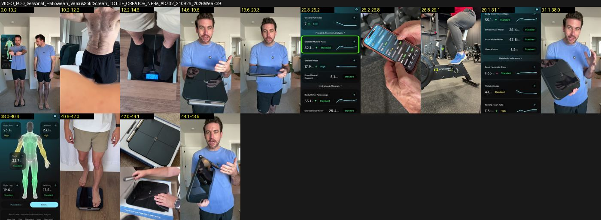

# VIDEO_POD_Seasonal_Halloween_VersusSplitScreen_LOTTIE_CREATOR_NEBA_AD732_210926_2026Week39

Master: `VIDEO_POD_Seasonal_Halloween_VersusSplitScreen_LOTTIE_CREATOR_NEBA_AD732_210926_2026Week39_9X16_HOOK1.mp4` · 48.9s · 1080x1920

**Pacing:** 14 shots · avg 3.493s · median 2.333s · 2.66 cuts/10s · first cut 10.167s · 254.0 wpm · talk ratio 0.94 · cuts on word start 69.2% · cuts in speech gaps 53.8%
**Audio:** {'I_lufs': -16.7, 'LRA': 3.5, 'true_peak_db': -0.0} · BPM≈123.0 · music {'speech_rms_db': -22.0, 'pause_seconds': 0.0} · cuts with SFX/transient 61.5%

**Captions:** 78 cards · 1.0 words/card (median) · y≈0.635 of frame height · text height≈0.0252 · colours {'dark/other': 7, 'blue': 5, 'white': 58, 'yellow': 5, 'green': 3} · cards crossing a cut: 0
Highlighted: 8888, 8122, 21 22, High, Standard, High, Orconcept2, Oconcept2, BikeERG, High, Standard, Standard, Fat(%)
**Headlines:** Body Pod (21.0–23.0s, white) | Connected (21.0–23.0s, green) | 120ibs (21.0–21.0s, white) | Goal Weight (21.0–21.0s, white) | BodyFatPercentage (21.0–21.0s, white) | 28.0%+ (21.0–21.0s, white) | Standard (21.0–22.0s, green) | Hydration&Minerals (22.0–22.0s, white)

**Hook (0–3s) spoken:** He's on a regular scale and I'm on the Hume Pod. It's an at
**Hook on-screen:** 
**CTA (last 5s):** So if you're serious about taking care of your body, it's time to start measuring more than just your weight. · on-screen: 

## Beat sheet

| # | in–out (s) | dur | transition | spoken | on-screen text |
|---|---|---|---|---|---|
| 1 | 0.00–10.17 | 10.17 |  | He's on a regular scale and I'm on the Hume Pod. It's an at -home body composition scanner and it gives you so much more than your body weight. And right now they're buy one, get one free. Measuring weight can be misleading. |  |
| 2 | 10.17–12.23 | 2.07 | cut | He could be losing fat and building muscle and | STEKCITY / 8888 [blue] |
| 3 | 12.23–14.63 | 2.4 | cut | the number on the scale, it might stay exactly the same. | STEKCITY / 8888 [blue] / ETEKCITY / 8122 [blue] / 21 22 [blue] |
| 4 | 14.63–19.63 | 5.0 | cut +SFX hit | He starts thinking that his training wasn't working and he might ditch a plan that was actually working pretty well for him. |  |
| 5 | 19.63–20.27 | 0.63 | cut +SFX hit | The Hume Pod shows |  |
| 6 | 20.27–25.23 | 4.97 | cut | body fat percentage, water retention, skeletal muscle mass, metabolic age and | Body Pod (HEADLINE) / Connected [green] (HEADLINE) / 120ibs (HEADLINE) / Goal Weight (HEADLINE) / BodyFatPercentage (HEADLINE) / 28.0%+ (HEADLINE) |
| 7 | 25.23–26.80 | 1.57 | cut +SFX hit | 45 other things. |  |
| 8 | 26.80–29.07 | 2.27 | cut +SFX hit | And as someone who takes the gym pretty seriously, having | Orconcept2 [yellow] / Oconcept2 [yellow] / BikeERG [yellow] / Body Pod (HEADLINE) / Connected [green] (HEADLINE) / MetabolicAge (HEADLINE) |
| 9 | 29.07–31.13 | 2.07 | cut +SFX hit | that information whenever I wanted it, | Body Pod (HEADLINE) / Connected [green] (HEADLINE) / MetabolicAge (HEADLINE) / 43yrs (HEADLINE) / Standard [yellow] (HEADLINE) / RestingHeartRate (HEADLINE) |
| 10 | 31.13–38.00 | 6.87 | cut | it's been a game changer. In fact, I have lost more than a hundred pounds. So I know how important it is to have the real numbers about |  |
| 11 | 38.00–40.63 | 2.63 | cut +SFX hit | how much fat I'm shedding and how much muscle I'm keeping. | Hume Pod (HEADLINE) / RightArm (HEADLINE) / LeftArm (HEADLINE) / 23.1% (HEADLINE) / High (HEADLINE) / Trunk |
| 12 | 40.63–41.97 | 1.33 | cut +SFX hit | And I do it with the Hume Pod and |  |
| 13 | 41.97–44.13 | 2.17 | cut +SFX hit | right now it's buy one, get one free. | TRACK56KEYHEALTHI [blue] (HEADLINE) / TRACK56KEYHEALTHMETRICS [blue] (HEADLINE) |
| 14 | 44.13–48.90 | 4.77 | cut | So if you're serious about taking care of your body, it's time to start measuring more than just your weight. |  |

## Hook variants

| hook | file | dur | first cut | spoken 0–3s | on-screen 0–3s |
|---|---|---|---|---|---|
| 1 | `n_LOTTIE_CREATOR_NEBA_AD732_210926_2026Week39_9X16_HOOK1.mp4` | 48.9 | 10.167 | He's on a regular scale and I'm on the Hume Pod. It's an at |  |
| 1 | `n_LOTTIE_CREATOR_NEBA_AD732_210926_2026Week39_9X16_HOOK1.mp4` | 48.9 | 10.167 |  |  |
| 2 | `n_LOTTIE_CREATOR_NEBA_AD732_210926_2026Week39_9X16_HOOK2.mp4` | 49.0 | 10.267 |  |  |
| 2 | `n_LOTTIE_CREATOR_NEBA_AD732_210926_2026Week39_9X16_HOOK2.mp4` | 49.0 | 10.267 |  |  |
| 3 | `n_LOTTIE_CREATOR_NEBA_AD732_210926_2026Week39_9X16_HOOK3.mp4` | 47.8 | 9.067 |  |  |
| 3 | `n_LOTTIE_CREATOR_NEBA_AD732_210926_2026Week39_9X16_HOOK3.mp4` | 47.8 | 9.067 |  |  |

## Full transcript

He's on a regular scale and I'm on the Hume Pod. It's an at-home body composition scanner and it gives you so much more than your body weight. And right now they're buy one, get one free. Measuring weight can be misleading. He could be losing fat and building muscle and the number on the scale, it might stay exactly the same. He starts thinking that his training wasn't working and he might ditch a plan that was actually working pretty well for him. The Hume Pod shows body fat percentage, water retention, skeletal muscle mass, metabolic age and 45 other things. And as someone who takes the gym pretty seriously, having that information whenever I wanted it, it's been a game changer. In fact, I have lost more than a hundred pounds. So I know how important it is to have the real numbers about how much fat I'm shedding and how much muscle I'm keeping. And I do it with the Hume Pod and right now it's buy one, get one free. So if you're serious about taking care of your body, it's time to start measuring more than just your weight.