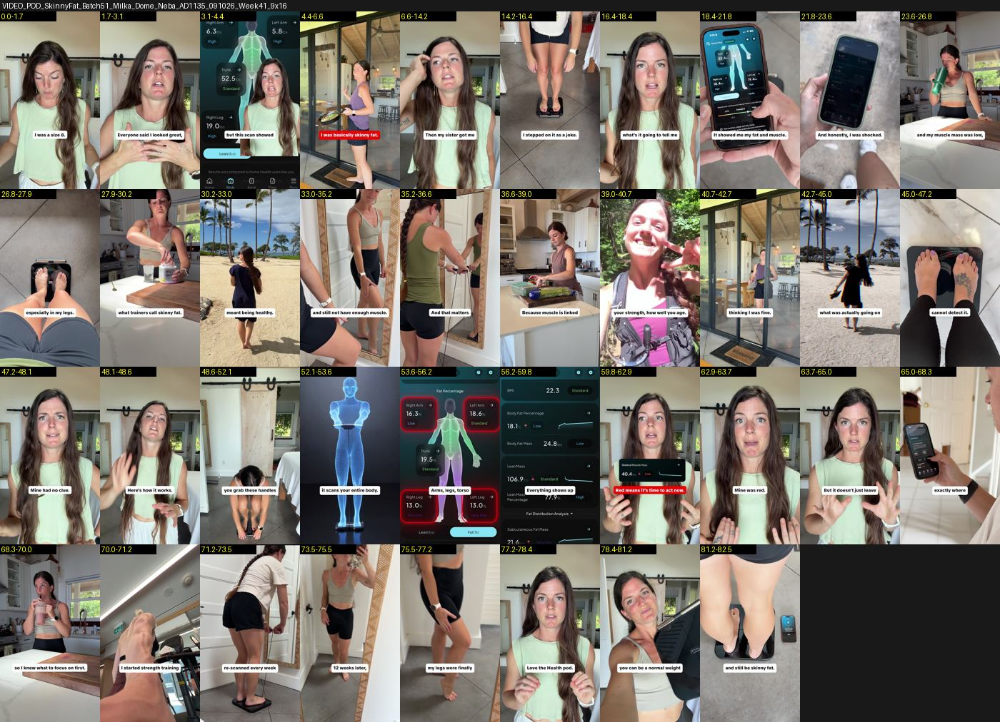

# VIDEO_POD_SkinnyFat_Batch51_Milka_Dome_Neba_AD1135_091026_Week41_9x16

Master: `VIDEO_POD_SkinnyFat_Batch51_Milka_Dome_Neba_AD1135_091026_Week41_9x16_hook1.mp4` · 82.5s · 1080x1920

**Pacing:** 38 shots · avg 2.172s · median 2.0s · 4.48 cuts/10s · first cut 1.68s · 231.0 wpm · talk ratio 0.93 · cuts on word start 81.1% · cuts in speech gaps 78.4%
**Audio:** {'I_lufs': -17.7, 'LRA': 4.6, 'true_peak_db': -0.0} · BPM≈123.0 · music {'speech_rms_db': -23.7, 'pause_seconds': 0.2} · cuts with SFX/transient 73.0%

**Captions:** 155 cards · 1 words/card (median) · y≈0.681 of frame height · text height≈0.0269 · colours {'white': 117, 'dark/other': 29, 'blue': 4, 'red': 4, 'green': 1} · cards crossing a cut: 0
Highlighted: Lean(lbs), I was basically skinny fat., It'scalledtheHume HealthPod., Low, Fat(%), Hume Health, Green means you're good, Low, Red means it'stimeto act now.
**Headlines:** Left Arm (3.0–4.0s, white) | RightArm (3.0–4.0s, white) | 6.3bs (3.0–3.0s, white) | 5.81bs (3.0–3.0s, white) | High (3.0–4.0s, blue) | Trunk (3.0–4.0s, white) | 6.3ibs (3.5–3.5s, white) | 5.8ibs (3.5–4.0s, white)

**Hook (0–3s) spoken:** I was a size eight. Everyone said I looked great,
**Hook on-screen:** Everyone said Ilooked great, / I wasasize8.
**CTA (last 5s):** health pod. Check it out, because you can be a normal weight and still be skinny fat. · on-screen: LovetheHealth pod. / XHume / and still be skinny fat. / because / you can be a normal weight

## Beat sheet

| # | in–out (s) | dur | transition | spoken | on-screen text |
|---|---|---|---|---|---|
| 1 | 0.00–1.68 | 1.68 |  | I was a size eight. | I wasasize8. / Everyone said Ilooked great, |
| 2 | 1.68–3.12 | 1.44 | cut +SFX hit | Everyone said I looked great, | Everyone said Ilooked great, / Left Arm (HEADLINE) / RightArm (HEADLINE) / 6.3bs (HEADLINE) / 5.81bs (HEADLINE) / High [blue] (HEADLINE) |
| 3 | 3.12–4.44 | 1.32 | cut +SFX hit | but this scan showed I | Left Arm (HEADLINE) / RightArm (HEADLINE) / 6.3bs (HEADLINE) / 5.81bs (HEADLINE) / High [blue] (HEADLINE) / Trunk (HEADLINE) |
| 4 | 4.44–6.64 | 2.2 | cut +SFX hit | was basically skinny fat. | Left Arm (HEADLINE) / RightArm (HEADLINE) / High [blue] (HEADLINE) / Trunk (HEADLINE) / 52.5ibs / Standard |
| 5 | 6.64–14.20 | 7.56 | cut | I've been a size A my whole adult life, never thought twice about my health. Then my sister got me this for my birthday. It's called the Hume Health Pod. | I've been a size 8, / my whole adult life. / Never thought twice / Thenmysister gotme / this for my birthday. / It'scalledtheHume HealthPod. [blue] |
| 6 | 14.20–16.36 | 2.16 | cut | I stepped on it as a joke, honestly, like what's | I stepped on it as a joke. / stepped on it as a joke. / Like, |
| 7 | 16.36–18.36 | 2.0 | cut +SFX hit | it gonna tell me that I don't already know? | Like, / what's it going to tell me / that I don't already know? |
| 8 | 18.36–21.84 | 3.48 | cut | It showed me my fat and muscle broken down by body part. | that I don't already know? / 3:00本 [blue] (HEADLINE) / HumePod [blue] (HEADLINE) / Trunk (HEADLINE) / 52.6ibs (HEADLINE) / LeftLeg |
| 9 | 21.84–23.56 | 1.72 | cut | And honestly, I was shocked. | 4,267 (HEADLINE) / 645 / 103.9 / And honestly,I wasshocked. |
| 10 | 23.56–26.76 | 3.2 | cut | Almost everything was fat and my muscle mass was low, especially | Almost everything was fat / and my musclemass waslow, / 40.4bs / Low [red] / SkeletalMass / 19.61bs≤ |
| 11 | 26.76–27.88 | 1.12 | cut +SFX hit | in my legs. Apparently, | especially in my legs. |
| 12 | 27.88–30.20 | 2.32 | cut +SFX hit | that's what trainers call skinny fat. I | Apparently that's / what trainers call skinny fat. / Ialways thought being thin |
| 13 | 30.20–32.96 | 2.76 | cut +SFX hit | always thought being thin meant being healthy, but turns out you | Ialways thought being thin / meant being healthy. / But turns out |
| 14 | 32.96–35.24 | 2.28 | cut | can look small and still not have enough muscle. | you can look small / and still not haveenough muscle. / Andthatmatters |
| 15 | 35.24–36.64 | 1.4 | cut +SFX hit | And that matters more than I knew, | Andthatmatters / morethanI knew. |
| 16 | 36.64–39.04 | 2.4 | cut | because muscle is linked to your metabolism, | Because muscleis linked / to your metabolism, / your strength, how well you age. |
| 17 | 39.04–40.68 | 1.64 | cut +SFX hit | your strength, and how well you age. | your strength, how well you age. |
| 18 | 40.68–42.68 | 2.0 | cut +SFX hit | I'd been walking around thinking I was fine, | I've been walking around / thinking I was fine. |
| 19 | 42.68–45.00 | 2.32 | cut +SFX hit | with no idea what was actually going on underneath. | With no idea / what was actually going on |
| 20 | 45.00–47.24 | 2.24 | cut +SFX hit | Your regular scale cannot detect it. | Your regular scale / cannot detect it. / Mine had no clue. |
| 21 | 47.24–48.08 | 0.84 | cut +SFX hit | Mine had no clue. | Mine had no clue. / Here's how it works. |
| 22 | 48.08–48.56 | 0.48 | cut +SFX hit | Here's how it works. | Here's how it works. |
| 23 | 48.56–52.12 | 3.56 | cut +SFX hit | You step on, you grab these handles, and in 30 seconds flat, | you grab these handles / and in 30s flat, / it scans your entire body. |
| 24 | 52.12–53.60 | 1.48 | cut | it scans your entire body. | it scans your entire body. |
| 25 | 53.60–56.24 | 2.64 | cut +SFX hit | Arms, legs, torso separately. 45 | HumePod (HEADLINE) / StepOnScale [green] (HEADLINE) / FatPercentage (HEADLINE) / Right Arm (HEADLINE) / LeftArm (HEADLINE) / 16.3% (HEADLINE) |
| 26 | 56.24–59.84 | 3.6 | cut +SFX hit | different metrics. Everything shows up color -coded in the app. | HumePod (HEADLINE) / StepOnScale [green] (HEADLINE) / Weight (HEADLINE) / Goal Weight (HEADLINE) / 130 ibs (HEADLINE) / 137.2 (HEADLINE) |
| 27 | 59.84–62.92 | 3.08 | cut +SFX hit | Green means you're good, red means it's time to act now. | 19.616s$Standard / Green means you're good [green] / SkeletalMuscleMass / 40.4ibs / Low [red] / Red means it'stimeto act now. [red] |
| 28 | 62.92–63.72 | 0.8 | cut | Mine was red, | Mine was red. |
| 29 | 63.72–65.00 | 1.28 | cut +SFX hit | but it doesn't just leave you scared. | Butit doesn't just leave |
| 30 | 65.00–68.28 | 3.28 | cut +SFX hit | The app showed me exactly where I needed to build muscle, | Theapp showed me / exactly where / I needed to build muscle, |
| 31 | 68.28–69.96 | 1.68 | cut | so I knew what to focus on first. | I needed to build muscle, / soI knew what to focus on first. |
| 32 | 69.96–71.24 | 1.28 | cut +SFX hit | I started strength training, | I started strength training / re-scannedevery week |
| 33 | 71.24–73.52 | 2.28 | cut +SFX hit | re -scanned every week, and watched my muscle actually | re-scannedevery week / andwatchedmymuscle |
| 34 | 73.52–75.48 | 1.96 | cut +SFX hit | go up. 12 weeks later, | actually go up. / 12 weeks later, |
| 35 | 75.48–77.16 | 1.68 | cut +SFX hit | my legs were finally out of the red. | 12 weeks later, / my legs were finally / LovetheHealth pod. |
| 36 | 77.16–78.40 | 1.24 | cut +SFX hit | Love the health pod. | LovetheHealth pod. |
| 37 | 78.40–81.16 | 2.76 | cut +SFX hit | Check it out, because you can be a normal weight and still | LovetheHealth pod. / XHume / because / you can be a normal weight / and still be skinny fat. |
| 38 | 81.16–82.54 | 1.38 | cut +SFX hit | be skinny fat. | and still be skinny fat. |

## Hook variants

| hook | file | dur | first cut | spoken 0–3s | on-screen 0–3s |
|---|---|---|---|---|---|
| 1 | `_Batch51_Milka_Dome_Neba_AD1135_091026_Week41_9x16_hook1.mp4` | 82.5 | 1.68 | I was a size eight. Everyone said I looked great, | Everyone said Ilooked great, / I wasasize8. |
| 1 | `_Batch51_Milka_Dome_Neba_AD1135_091026_Week41_9x16_hook1.mp4` | 82.5 | 1.68 | I was a size 8. Everyone said I looked great. |  |
| 2 | `_Batch51_Milka_Dome_Neba_AD1135_091026_Week41_9x16_hook2.mp4` | 80.9 | 2.24 | I was skinny fat. Size 8. Everyone said I | Everyone saidIlooked great / Iwasskinnyfatsize8 / Iwasskinnyfatsize8. |
| 2 | `_Batch51_Milka_Dome_Neba_AD1135_091026_Week41_9x16_hook2.mp4` | 80.9 | 2.24 | I was skinny fat. Size 8. Everyone said I |  |
| 3 | `_Batch51_Milka_Dome_Neba_AD1135_091026_Week41_9x16_hook3.mp4` | 79.3 | 1.12 | I was skinny fat, a size eight with almost no muscle. |  |
| 3 | `_Batch51_Milka_Dome_Neba_AD1135_091026_Week41_9x16_hook3.mp4` | 79.3 | 1.12 | I was skinny fat, a size eight with almost no muscle. |  |

## Full transcript

I was a size eight. Everyone said I looked great, but this scan showed I was basically skinny fat. I've been a size A my whole adult life, never thought twice about my health. Then my sister got me this for my birthday. It's called the Hume Health Pod. I stepped on it as a joke, honestly, like what's it gonna tell me that I don't already know? It showed me my fat and muscle broken down by body part. And honestly, I was shocked. Almost everything was fat and my muscle mass was low, especially in my legs. Apparently, that's what trainers call skinny fat. I always thought being thin meant being healthy, but turns out you can look small and still not have enough muscle. And that matters more than I knew, because muscle is linked to your metabolism, your strength, and how well you age. I'd been walking around thinking I was fine, with no idea what was actually going on underneath. Your regular scale cannot detect it. Mine had no clue. Here's how it works. You step on, you grab these handles, and in 30 seconds flat, it scans your entire body. Arms, legs, torso separately. 45 different metrics. Everything shows up color-coded in the app. Green means you're good, red means it's time to act now. Mine was red, but it doesn't just leave you scared. The app showed me exactly where I needed to build muscle, so I knew what to focus on first. I started strength training, re-scanned every week, and watched my muscle actually go up. 12 weeks later, my legs were finally out of the red. Love the health pod. Check it out, because you can be a normal weight and still be skinny fat.