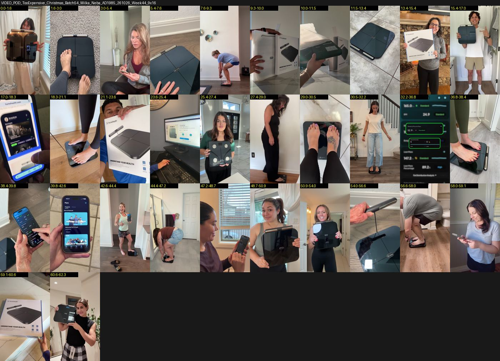

# VIDEO_POD_TooExpensive_Christmas_Batch54_Milka_Neba_AD1985_261026_Week44_9x16

Master: `VIDEO_POD_TooExpensive_Christmas_Batch54_Milka_Neba_AD1985_261026_Week44_9x16_hook1.mp4` · 62.3s · 1080x1920

**Pacing:** 32 shots · avg 1.945s · median 1.665s · 4.98 cuts/10s · first cut 1.64s · 229.0 wpm · talk ratio 0.96 · cuts on word start 90.3% · cuts in speech gaps 74.2%
**Audio:** {'I_lufs': -18.3, 'LRA': 3.6, 'true_peak_db': -0.5} · BPM≈143.6 · music {'speech_rms_db': -24.8, 'pause_seconds': 0.0} · cuts with SFX/transient 25.8%

**Captions:** 64 cards · 1.0 words/card (median) · y≈0.595 of frame height · text height≈0.0293 · colours {'white': 48, 'blue': 9, 'green': 1, 'dark/other': 6} · cards crossing a cut: 0
Highlighted: CODE:BF5O, WorkoutPrograms, Shop Now, HumeHealth, 115.6, WELCONETO FILACK, MOVEITTO LOSEIT, WELCOMETOFILACK, WELCOMETO FITACK, 025
**Headlines:** HumeHealth (14.0–14.0s, white) | XHumeHealth (15.0–15.0s, white) | 63 (17.0–17.0s, white) | humehealth.com (17.0–18.0s, white) | 639 (18.0–18.0s, white) | WeighuBody (18.0–18.0s, dark/other) | ProteinMans (18.0–18.0s, dark/other) | MuncleMass (18.0–18.0s, white)

**Hook (0–3s) spoken:** Hume Pod is nice, but I feel it's too expensive.
**Hook on-screen:** X Hume
**CTA (last 5s):** So hurry up and get yours before the Christmas sale ends. Click the link below and grab it now. · on-screen: 025 / HumeHealth / NCORPORELLECONNETEE / UNDERSTAND YOURHEALTH

## Beat sheet

| # | in–out (s) | dur | transition | spoken | on-screen text |
|---|---|---|---|---|---|
| 1 | 0.00–1.64 | 1.64 |  | Hume Pod is nice, but I |  |
| 2 | 1.64–3.00 | 1.36 | cut +SFX hit | feel it's too expensive. | X Hume |
| 3 | 3.00–5.40 | 2.4 | cut | Since you seem to think the Hume Pod was too pricey, |  |
| 4 | 5.40–7.64 | 2.24 | cut | we had to make an insane Christmas deal so | XHume |
| 5 | 7.64–9.28 | 1.64 | cut | you could finally try it for yourself. |  |
| 6 | 9.28–10.00 | 0.72 | cut | That's right, |  |
| 7 | 10.00–11.52 | 1.52 | cut | we just dropped our Christmas sale and |  |
| 8 | 11.52–13.40 | 1.88 | cut +SFX hit | the Hume Pod is 50 % off. |  |
| 9 | 13.40–15.44 | 2.04 | cut | It goes from $366 to | HumeHealth (HEADLINE) / UNDERSTANDYOURHEALTH / XHumeHealth (HEADLINE) |
| 10 | 15.44–17.00 | 1.56 | cut | $183 with | UNDERSTANDYOURHEALTH / XHumeHealth (HEADLINE) |
| 11 | 17.00–18.32 | 1.32 | cut +SFX hit | code last50. | 63 (HEADLINE) / humehealth.com (HEADLINE) / 50% / OFF / CODE:BF5O [blue] / GoogleFae |
| 12 | 18.32–21.08 | 2.76 | cut | This is your chance to finally stop guessing about your body. | humehealth.com (HEADLINE) / 639 (HEADLINE) / WeighuBody (HEADLINE) / ProteinMans (HEADLINE) / MuncleMass (HEADLINE) / GetPersonalized (HEADLINE) |
| 13 | 21.08–23.56 | 2.48 | cut | And it's HSA and FSA -eligible so | iHumeHealth (HEADLINE) / UNDERSTANDYOURHEALTH / XHumeHealth (HEADLINE) / UNDERSTANDYOURHEALTH (HEADLINE) / BOOYMASS / HumeHealth (HEADLINE) |
| 14 | 23.56–25.36 | 1.8 | cut | you can use your pre -tax dollars too. | The HumePod |
| 15 | 25.36–27.36 | 2.0 | cut +SFX hit | You won't have to stare at a regular scale, | The HumePod / CAUTION / RENPHO |
| 16 | 27.36–29.00 | 1.64 | cut | wondering if that number is fat, | CAUTION / RENPHO |
| 17 | 29.00–30.48 | 1.48 | cut | muscle, or just water anymore. | 19.0. / 19.12 (HEADLINE) |
| 18 | 30.48–32.16 | 1.68 | cut | In just 30 seconds, you get 45 | 19.12 (HEADLINE) / EMEMBER / THISIS / HumePod (HEADLINE) / StepOnScale [green] (HEADLINE) / 149 (HEADLINE) |
| 19 | 32.16–36.84 | 4.68 | cut | health metrics, like muscle mass, visceral fat, metabolic age, and hydration, | HumePod (HEADLINE) / StepOnScale [green] (HEADLINE) / 149 (HEADLINE) / 25/07 (HEADLINE) / 271 (HEADLINE) / 24/07 (HEADLINE) |
| 20 | 36.84–38.40 | 1.56 | cut | whenever you want, right at home. |  |
| 21 | 38.40–39.84 | 1.44 | cut +SFX hit | And it doesn't just give you numbers. | 115.6 [blue] / 21.60 / 18.7 |
| 22 | 39.84–42.64 | 2.8 | cut | It gives you a personalized action plan based on your data, | 9:321 (HEADLINE) / Plans (HEADLINE) / Programs (HEADLINE) / Classes (HEADLINE) / WELCONETO FILACK [blue] / MOVEITTO LOSEIT [blue] |
| 23 | 42.64–44.44 | 1.8 | cut +SFX hit | so you know exactly what to do next. |  |
| 24 | 44.44–47.20 | 2.76 | cut | It's easy to set up. You just step on and hold the sensors and |  |
| 25 | 47.20–48.68 | 1.48 | cut +SFX hit | everything shows up on your phone. |  |
| 26 | 48.68–50.88 | 2.2 | cut | With the HumePod, you always know where you're at. |  |
| 27 | 50.88–54.04 | 3.16 | cut +SFX hit | And that's what keeps you motivated. Remember, for a limited time only, | XHume |
| 28 | 54.04–56.60 | 2.56 | cut | you You can get the HumePod for $183 with | XHume |
| 29 | 56.60–57.96 | 1.36 | cut | code LAST50. |  |
| 30 | 57.96–59.12 | 1.16 | cut | So hurry up and get yours | HumeHealth / UNDERSTAND YOURHEALTH (HEADLINE) |
| 31 | 59.12–60.60 | 1.48 | cut | before the Christmas sale ends. | HumeHealth / UNDERSTAND YOURHEALTH (HEADLINE) / HumeHealth (HEADLINE) / NCORPORELLECONNETEE |
| 32 | 60.60–62.25 | 1.65 | cut | Click the link below and grab it now. | 025 [blue] |

## Hook variants

| hook | file | dur | first cut | spoken 0–3s | on-screen 0–3s |
|---|---|---|---|---|---|
| 1 | `stmas_Batch54_Milka_Neba_AD1985_261026_Week44_9x16_hook1.mp4` | 62.3 | 1.64 | Hume Pod is nice, but I feel it's too expensive. | X Hume |
| 1 | `stmas_Batch54_Milka_Neba_AD1985_261026_Week44_9x16_hook1.mp4` | 62.3 | 1.64 |  |  |
| 2 | `stmas_Batch54_Milka_Neba_AD1985_261026_Week44_9x16_hook2.mp4` | 61.6 | 1.72 |  |  |
| 2 | `stmas_Batch54_Milka_Neba_AD1985_261026_Week44_9x16_hook2.mp4` | 61.6 | 1.72 |  |  |
| 3 | `stmas_Batch54_Milka_Neba_AD1985_261026_Week44_9x16_hook3.mp4` | 58.5 | 1.6 |  |  |
| 3 | `stmas_Batch54_Milka_Neba_AD1985_261026_Week44_9x16_hook3.mp4` | 58.5 | 1.6 |  |  |
| 4 | `stmas_Batch54_Milka_Neba_AD1985_261026_Week44_9x16_hook4.mp4` | 59.1 | 1.8 |  |  |
| 4 | `stmas_Batch54_Milka_Neba_AD1985_261026_Week44_9x16_hook4.mp4` | 59.1 | 1.8 |  |  |

## Full transcript

Hume Pod is nice, but I feel it's too expensive. Since you seem to think the Hume Pod was too pricey, we had to make an insane Christmas deal so you could finally try it for yourself. That's right, we just dropped our Christmas sale and the Hume Pod is 50% off. It goes from $366 to $183 with code last50. This is your chance to finally stop guessing about your body. And it's HSA and FSA-eligible so you can use your pre-tax dollars too. You won't have to stare at a regular scale, wondering if that number is fat, muscle, or just water anymore. In just 30 seconds, you get 45 health metrics, like muscle mass, visceral fat, metabolic age, and hydration, whenever you want, right at home. And it doesn't just give you numbers. It gives you a personalized action plan based on your data, so you know exactly what to do next. It's easy to set up. You just step on and hold the sensors and everything shows up on your phone. With the HumePod, you always know where you're at. And that's what keeps you motivated. Remember, for a limited time only, you You can get the HumePod for $183 with code LAST50. So hurry up and get yours before the Christmas sale ends. Click the link below and grab it now.