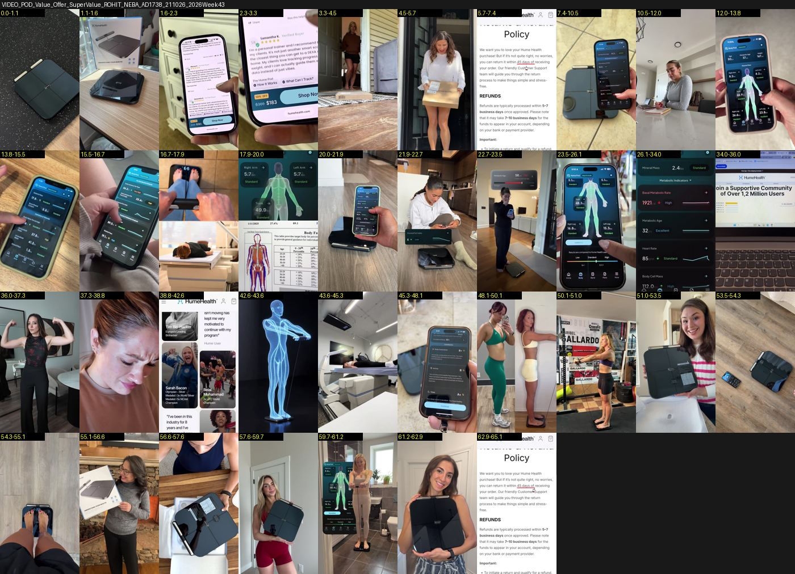

# VIDEO_POD_Value_Offer_SuperValue_ROHIT_NEBA_AD1738_211026_2026Week43

Master: `VIDEO_POD_Value_Offer_SuperValue_ROHIT_NEBA_AD1738_211026_2026Week43_9X16_HOOK1.mp4` · 65.1s · 1080x1920

**Pacing:** 37 shots · avg 1.759s · median 1.533s · 5.53 cuts/10s · first cut 1.1s · 249.0 wpm · talk ratio 0.94 · cuts on word start 80.6% · cuts in speech gaps 58.3%
**Audio:** {'I_lufs': -19.1, 'LRA': 2.1, 'true_peak_db': -4.0} · BPM≈112.3 · music {'speech_rms_db': -22.6, 'pause_seconds': 0.0} · cuts with SFX/transient 69.4%

**Captions:** 337 cards · 1 words/card (median) · y≈0.641 of frame height · text height≈0.0258 · colours {'white': 276, 'yellow': 5, 'dark/other': 54, 'blue': 2} · cards crossing a cut: 7
Highlighted: ★★★★言, 50%0FB, ★★★★★, 50%0FF, 50%OFF, Body, Continue
**Headlines:** XHumeHealth (1.0–1.0s, white) | fots.h (1.5–1.5s, white) | par10:174bctu (1.5–1.5s, white) | happening inmybody.Ivedropped4%bodyfat (1.5–1.5s, white) | 9yerkouts (1.5–1.5s, white) | in6weeks andforthe first time,Ifeel in control (1.5–2.0s, white) | insteadofguessing. (1.5–2.0s, white) | The Hume Pod (1.5–2.5s, white)

**Hook (0–3s) spoken:** You said it was too expensive, so we launched our massive 50 % off sale.
**Hook on-screen:** $366$183 / *What CanITrack? / 11/21/2025 / 50%0FB / 50%0FF / 50%OFF / 9yerkouts / DataAccur / How ItWorksWhat CanI Track? / How ItWorksWhatCan Track? / HowItWorks / I wastiredofguessing ifmyworkouts were / I'm a personaltrainer andi reeommend / I'mapersonaltrainerandIrecommendthisto / Marcus P.VerifiedBuyer / MarcusP,VerifiedBuyer / SamanthaK.Verified Buyer / SamanthaK.VerifiedBuyer / Shop No / Shop Now / The Hume Pod / UNDERSTANDYOURHEALTH / Was this heipful? / Was this helpf / Was this helpfo / Was this helpt / Wasthis helpful724473 / Weight,and I ean aetuallyguidethemy / XHumeHealth / anddroppingfat,Thatkeptmemotivatedwhen! / anddroppingfat.Thatkeptmemotivatedwheni / data instead of just vibes / fots.h / fywekouts,my / happening inmybody.Ivedropped4%bodyfat / hare / healthcoachbuilt intoascale. / home.My elients leve traeking progfess / home.Myclientslove tracking progress beyond / humehealth.com / in6weeks andforthe first time,Ifeel in control / insteadofguessing. / might have otherwise quit.It's like havinga / my clients,It's not just another smart scale.It's / my clients.It's not just another smart scale.It's / my elients, lt's not just anethef smart see / par10:174:ctu / par10:174bctu / t Share / the closest thingyou can getto a DExA scan at / the glosest thing you ean get te a DExA / tt Share / weightstayed thesame,Iwasgainingmuscle / working.TheBodyPod showed methat whilemy / ★★★★★ / ★★★★言
**CTA (last 5s):** regret it. It is even HSA and FSA eligible and has a 45 -day money back guarantee. · on-screen: Hume / HumeHealth" / Important: / Policy / REFUNDS / Refundsaretypicallyprocessedwithin5-7 / Toinitiateareturnandgualifyforarefund / WewantyoutoloveyourHumeHealth / X HumeHealth" g / businessdaysonceapproved.Pleasenote / free. / funds to appearinyouraccount,depending

## Beat sheet

| # | in–out (s) | dur | transition | spoken | on-screen text |
|---|---|---|---|---|---|
| 1 | 0.00–1.10 | 1.1 |  | You said it was too expensive, | XHumeHealth (HEADLINE) / UNDERSTANDYOURHEALTH |
| 2 | 1.10–1.60 | 0.5 | cut +SFX hit | so we launched | XHumeHealth (HEADLINE) / UNDERSTANDYOURHEALTH / fots.h (HEADLINE) / par10:174bctu (HEADLINE) / happening inmybody.Ivedropped4%bodyfat (HEADLINE) / 9yerkouts (HEADLINE) |
| 3 | 1.60–2.30 | 0.7 | cut | our massive 50 | fots.h (HEADLINE) / par10:174bctu (HEADLINE) / happening inmybody.Ivedropped4%bodyfat (HEADLINE) / 9yerkouts (HEADLINE) / in6weeks andforthe first time,Ifeel in control (HEADLINE) / insteadofguessing. (HEADLINE) |
| 4 | 2.30–3.27 | 0.97 | cut +SFX hit | % off sale. | in6weeks andforthe first time,Ifeel in control (HEADLINE) / insteadofguessing. (HEADLINE) / The Hume Pod (HEADLINE) / 11/21/2025 / I wastiredofguessing ifmyworkouts were / working.TheBodyPod showed methat whilemy |
| 5 | 3.27–4.53 | 1.27 | cut +SFX hit | Then you asked for more, fine. | The Hume Pod / $366$183 / humehealth.com / SamanthaK.Verified Buyer (HEADLINE) / HowItWorks / 50%OFF [yellow] |
| 6 | 4.53–5.73 | 1.2 | cut +SFX hit | We threw in free shipping, a | umeHealth / HumeHealth" (HEADLINE) / Policy (HEADLINE) / Wewantyouto loveyourHumeHealth (HEADLINE) / purchase!But if it's not quite right, no worries, (HEADLINE) / youcanreturn itwithin45daysof receiving |
| 7 | 5.73–7.40 | 1.67 | cut +SFX hit | 45 day money back guarantee, | HumeHealth" (HEADLINE) / Policy (HEADLINE) / Wewantyouto loveyourHumeHealth (HEADLINE) / purchase!But if it's not quite right, no worries, (HEADLINE) / youcanreturn itwithin45daysof receiving / your order.Our friendly Customer Support |
| 8 | 7.40–10.53 | 3.13 | cut +SFX hit | and the Hume app completely free with no mandatory subscriptions. | Policy (HEADLINE) / Wewantyouto loveyourHumeHealth (HEADLINE) / youcanreturn itwithin45daysof receiving / teamwill guideyouthroughthereturn / processtomakethingssimpleand stress- / free. |
| 9 | 10.53–11.97 | 1.43 | cut +SFX hit | But that still wasn't enough for you. |  |
| 10 | 11.97–13.80 | 1.83 | cut +SFX hit | So we rebuilt the app from the ground up, | 11:250 [blue] (HEADLINE) / Connected [blue] (HEADLINE) / Body Pod [blue] (HEADLINE) / Height (HEADLINE) / Metabolic Age (HEADLINE) / 167cm (HEADLINE) |
| 11 | 13.80–15.47 | 1.67 | cut | even improved the original scans. | Standard / 4:28 [blue] (HEADLINE) / Skeletal Muscle Mass [blue] (HEADLINE) / Step On Scale [blue] (HEADLINE) / 50 [blue] (HEADLINE) / 52.3b+ [blue] (HEADLINE) |
| 12 | 15.47–16.73 | 1.27 | cut +SFX hit | You get nearly the same data as | Standard / Step On Scale [blue] (HEADLINE) / 5.3ibs / Hydration&Minerals / BodyWaterPercentage / Extracellular |
| 13 | 16.73–17.93 | 1.2 | cut | a DEXA scan machine because |  |
| 14 | 17.93–20.00 | 2.07 | cut +SFX hit | it's 98 % DEXA accurate. | HumePod (HEADLINE) / LeftArm (HEADLINE) / RightArm (HEADLINE) / 5.7ibs (HEADLINE) / Standard (HEADLINE) / Trunk |
| 15 | 20.00–21.90 | 1.9 | cut +SFX hit | You can get 45 plus metrics like visceral | Eg BotyPod [blue] (HEADLINE) / 23.2 |
| 16 | 21.90–22.67 | 0.77 | cut +SFX hit | fat, |  |
| 17 | 22.67–23.50 | 0.83 | cut +SFX hit | metabolic age, | 58yrsen (HEADLINE) |
| 18 | 23.50–26.07 | 2.57 | cut +SFX hit | and even muscle and fat distribution, limb by limb. | 5.1ibs [blue] (HEADLINE) / 5.libs (HEADLINE) / 48.3ibs / LeftLeg / Right Leg / 15.3ibs |
| 19 | 26.07–34.00 | 7.93 | cut +SFX hit | Everything is color coded and easy to understand. Green means good, red means needs work. You then get personalized recommendations and workouts for each metric, and that is how | HumePod (HEADLINE) / StepOnScale [green] (HEADLINE) / Muscle&SkeletonAnalysis (HEADLINE) / SkeletalMuscleMass (HEADLINE) / 106.4ibs (HEADLINE) / Standard (HEADLINE) |
| 20 | 34.00–35.97 | 1.97 | cut | over 1 .5 million users made | XHumeHealth (HEADLINE) / JoinaSupportiveCommunity (HEADLINE) / ofOver1,2MillionUsers (HEADLINE) / dy-Ppod7srsltid=AtmBOop7lt016A-j2hcaeLi5VuQlwFSRxrRSTUbcj7GKX284C7AwE61 (HEADLINE) / actors accessBrea (HEADLINE) / naSupportiveCommunit (HEADLINE) |
| 21 | 35.97–37.30 | 1.33 | cut +SFX hit | way faster progress compared |  |
| 22 | 37.30–38.83 | 1.53 | cut | to people with regular scales. |  |
| 23 | 38.83–42.57 | 3.73 | cut +SFX hit | It's developed with Harvard engineers and loved by celebrities and world champions. | X HumeHealth" (HEADLINE) / champions. (HEADLINE) / From world champions to everyday (HEADLINE) / heroes,Hume Health isthefutureof (HEADLINE) / human performance and longevity / "Being able to |
| 24 | 42.57–43.60 | 1.03 | cut +SFX hit | It's the same technology that's |  |
| 25 | 43.60–45.33 | 1.73 | cut | used in 12 ,000 clinics, |  |
| 26 | 45.33–48.13 | 2.8 | cut +SFX hit | but it's yours forever, and you can use it every single day. | HealthScore / 602+ / Yourhealthmetricsarebetterthanaverage / ContidenceRating62% / Contributors / ,BodyComposition |
| 27 | 48.13–50.07 | 1.93 | cut +SFX hit | This is probably the best health investment you | EUROPE (HEADLINE) / CrossFit (HEADLINE) / SEMIFINAL (HEADLINE) / ARIBEL (HEADLINE) / ALLARDO (HEADLINE) / GALLARDO |
| 28 | 50.07–51.03 | 0.97 | cut | can make this year, | EUROPE (HEADLINE) / CrossFit (HEADLINE) / SEMIFINAL (HEADLINE) / ARIBEL (HEADLINE) / ALLARDO (HEADLINE) / GALLARDO |
| 29 | 51.03–53.47 | 2.43 | cut +SFX hit | and right now, you can get it for 50 % off with |  |
| 30 | 53.47–54.33 | 0.87 | cut | the code below. |  |
| 31 | 54.33–55.07 | 0.73 | cut +SFX hit | But just a heads up, | HumeHealth (HEADLINE) / UNDERSTANDYOURHEALTH |
| 32 | 55.07–56.57 | 1.5 | cut +SFX hit | these have been flying off the shelves and | HumeHealth (HEADLINE) / UNDERSTANDYOURHEALTH / HumaHeath (HEADLINE) |
| 33 | 56.57–57.60 | 1.03 | cut +SFX hit | stock is running low. So |  |
| 34 | 57.60–59.67 | 2.07 | cut | links below. Don't wait for it to sell out again because |  |
| 35 | 59.67–61.23 | 1.57 | cut | you will regret it. It is even HSA | CBodyPod [green] (HEADLINE) / 4.6bs (HEADLINE) / 40.4ibs / 14.31bs / Hume |
| 36 | 61.23–62.90 | 1.67 | cut +SFX hit | and FSA eligible and | Hume |
| 37 | 62.90–65.09 | 2.19 | cut | has a 45 -day money back guarantee. | HumeHealth" (HEADLINE) / Policy (HEADLINE) / WewantyoutoloveyourHumeHealth (HEADLINE) / purchase!But if it's not quite right, no worries, (HEADLINE) / youcan return it within 45daysof receiving / yourorder.OurfriendlyustomerSupport |

## Hook variants

| hook | file | dur | first cut | spoken 0–3s | on-screen 0–3s |
|---|---|---|---|---|---|
| 1 | `uperValue_ROHIT_NEBA_AD1738_211026_2026Week43_9X16_HOOK1.mp4` | 65.1 | 1.1 | You said it was too expensive, so we launched our massive 50 % off sale. | $366$183 / *What CanITrack? / 11/21/2025 / 50%0FB / 50%0FF / 50%OFF / 9yerkouts / DataAccur |
| 1 | `uperValue_ROHIT_NEBA_AD1738_211026_2026Week43_9X16_HOOK1.mp4` | 65.1 | 1.1 |  |  |
| 2 | `uperValue_ROHIT_NEBA_AD1738_211026_2026Week43_9X16_HOOK2.mp4` | 65.7 | 1.767 |  |  |
| 2 | `uperValue_ROHIT_NEBA_AD1738_211026_2026Week43_9X16_HOOK2.mp4` | 65.7 | 1.767 |  |  |
| 3 | `uperValue_ROHIT_NEBA_AD1738_211026_2026Week43_9X16_HOOK3.mp4` | 65.9 | 1.167 |  |  |
| 3 | `uperValue_ROHIT_NEBA_AD1738_211026_2026Week43_9X16_HOOK3.mp4` | 65.9 | 1.167 | You said it was too pricey so we heard you and launched our massive 50 |  |

## Full transcript

You said it was too expensive, so we launched our massive 50% off sale. Then you asked for more, fine. We threw in free shipping, a 45 day money back guarantee, and the Hume app completely free with no mandatory subscriptions. But that still wasn't enough for you. So we rebuilt the app from the ground up, even improved the original scans. You get nearly the same data as a DEXA scan machine because it's 98% DEXA accurate. You can get 45 plus metrics like visceral fat, metabolic age, and even muscle and fat distribution, limb by limb. Everything is color coded and easy to understand. Green means good, red means needs work. You then get personalized recommendations and workouts for each metric, and that is how over 1.5 million users made way faster progress compared to people with regular scales. It's developed with Harvard engineers and loved by celebrities and world champions. It's the same technology that's used in 12,000 clinics, but it's yours forever, and you can use it every single day. This is probably the best health investment you can make this year, and right now, you can get it for 50% off with the code below. But just a heads up, these have been flying off the shelves and stock is running low. So links below. Don't wait for it to sell out again because you will regret it. It is even HSA and FSA eligible and has a 45-day money back guarantee.