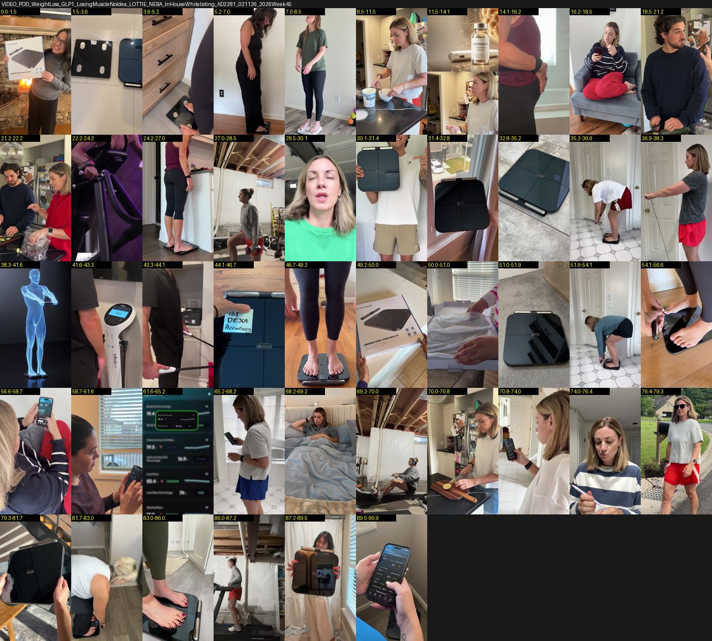

# VIDEO_POD_WeightLoss_GLP1_LosingMuscleNoIdea_LOTTIE_NEBA_InHouseWhitelisting_AD2281_021126_2026Week45

Master: `VIDEO_POD_WeightLoss_GLP1_LosingMuscleNoIdea_LOTTIE_NEBA_InHouseWhitelisting_AD2281_021126_2026Week45_9x16_hook1.mp4` · 90.9s · 1080x1920

**Pacing:** 46 shots · avg 1.977s · median 2.0s · 4.95 cuts/10s · first cut 1.48s · 232.0 wpm · talk ratio 0.97 · cuts on word start 80.0% · cuts in speech gaps 37.8%
**Audio:** {'I_lufs': -15.4, 'LRA': 6.2, 'true_peak_db': 0.1} · BPM≈123.0 · music {'speech_rms_db': -21.6, 'pause_seconds': 0.3} · cuts with SFX/transient 55.6%

**Captions:** 38 cards · 1.0 words/card (median) · y≈0.507 of frame height · text height≈0.0299 · colours {'white': 28, 'blue': 3, 'dark/other': 6, 'red': 1} · cards crossing a cut: 0
Highlighted: 1402, 1402#, DEXA, klulemon
**Headlines:** HumeHeath (0.0–0.0s, white) | HumeHealth (0.5–0.5s, white) | XHumeHeaith (1.0–1.0s, white) | MOUNJARO (12.0–13.0s, white) | 00 (35.0–35.0s, white) | 00 (37.0–38.0s, white) | InBody570 (42.0–42.0s, white) | 187. (44.0–44.0s, dark/other)

**Hook (0–3s) spoken:** It's more than a scale and it's definitely more than a smart
**Hook on-screen:** HumeHealth / HumeHeath / UNDERSTANDYOURHEALTH / XHumeHeaith
**CTA (last 5s):** and weight loss journey no matter what your goals are, you'll be able to like track everything through the app. · on-screen: 113.1e,+ / 162.9元, / 22.4* / 26.4 / 36.50m / 69.4 / LenHass / Stadard / Standard

## Beat sheet

| # | in–out (s) | dur | transition | spoken | on-screen text |
|---|---|---|---|---|---|
| 1 | 0.00–1.48 | 1.48 |  | It's more than a scale and | HumeHeath (HEADLINE) / UNDERSTANDYOURHEALTH / HumeHealth (HEADLINE) / XHumeHeaith (HEADLINE) |
| 2 | 1.48–3.56 | 2.08 | cut +SFX hit | it's definitely more than a smart scale. | UNDERSTANDYOURHEALTH / XHumeHeaith (HEADLINE) |
| 3 | 3.56–5.20 | 1.64 | cut | Most smart scales just measure like |  |
| 4 | 5.20–7.00 | 1.8 | cut | the bottom half of your body and |  |
| 5 | 7.00–8.52 | 1.52 | cut +SFX hit | then they estimate the top. |  |
| 6 | 8.52–11.52 | 3.0 | cut | A couple of years ago I started on a GLP -1 called | 176 |
| 7 | 11.52–14.12 | 2.6 | cut +SFX hit | Manjaro to help me lose weight. | MOUNJARO (HEADLINE) |
| 8 | 14.12–16.16 | 2.04 | cut +SFX hit | When I did that I was dropping weight |  |
| 9 | 16.16–18.52 | 2.36 | cut | but I wasn't working out at the same time. And |  |
| 10 | 18.52–21.20 | 2.68 | cut +SFX hit | Eddie, my brother -in -law, was having conversation with me like |  |
| 11 | 21.20–22.24 | 1.04 | cut | you want to be like lifting |  |
| 12 | 22.24–24.20 | 1.96 | cut | weights and building muscle because | IPRECOR |
| 13 | 24.20–26.96 | 2.76 | cut +SFX hit | not only could you be losing fat, you |  |
| 14 | 26.96–28.48 | 1.52 | cut +SFX hit | could be also losing muscle |  |
| 15 | 28.48–30.12 | 1.64 | cut | which is not what you want. And |  |
| 16 | 30.12–31.36 | 1.24 | cut +SFX hit | so he recommended this |  |
| 17 | 31.36–32.80 | 1.44 | cut | body analyzer called |  |
| 18 | 32.80–35.20 | 2.4 | cut | Hume. It's this little body pod because | 00 (HEADLINE) |
| 19 | 35.20–36.88 | 1.68 | cut +SFX hit | it has these little paddles that | 00 (HEADLINE) |
| 20 | 36.88–38.28 | 1.4 | cut +SFX hit | you hold onto. It's | 00 (HEADLINE) |
| 21 | 38.28–41.64 | 3.36 | cut | actually doing like a full body, kind of like the in -body scans, | 00 (HEADLINE) |
| 22 | 41.64–43.28 | 1.64 | cut | the medical grade ones, you can do it at a gym | hBody / 1402 [blue] / InBody570 (HEADLINE) / InBody / 1402# [blue] |
| 23 | 43.28–44.12 | 0.84 | cut | or whatever. This | InBody / 1402# [blue] / 187. (HEADLINE) / DEXA [blue] (HEADLINE) / Accufacy [blue] (HEADLINE) / X Hume |
| 24 | 44.12–46.68 | 2.56 | cut +SFX hit | is going to be 98 % accuracy like that | 187. (HEADLINE) / DEXA [blue] (HEADLINE) / Accufacy [blue] (HEADLINE) / X Hume / 987 / DEXA [blue] |
| 25 | 46.68–49.20 | 2.52 | cut | without having to spend the like high dollar to | KHumeHealth / UNDERSTAND YOUR HEALTH (HEADLINE) / FCONNETEE |
| 26 | 49.20–50.04 | 0.84 | cut | do those body | KHumeHealth / UNDERSTAND YOUR HEALTH (HEADLINE) / FCONNETEE |
| 27 | 50.04–51.00 | 0.96 | cut +SFX hit | scans at |  |
| 28 | 51.00–51.88 | 0.88 | cut | like a gym. | XHuma |
| 29 | 51.88–54.12 | 2.24 | cut | And you can just do it at home and do it every morning. It's | 00 (HEADLINE) |
| 30 | 54.12–56.64 | 2.52 | cut +SFX hit | just super convenient and it takes about a minute. The |  |
| 31 | 56.64–58.72 | 2.08 | cut +SFX hit | app tracks seriously so many different things, |  |
| 32 | 58.72–61.56 | 2.84 | cut | but two of my favorite things that are like the key hitters for |  |
| 33 | 61.56–65.24 | 3.68 | cut | me that I really pay attention to are the body fat percentage and the muscle mass because | Body Pod (HEADLINE) / StepOnScale (HEADLINE) / Weight (HEADLINE) / 115.4bs (HEADLINE) / Standard (HEADLINE) / 19.9 (HEADLINE) |
| 34 | 65.24–68.16 | 2.92 | cut | what's hard is like I'll hit a plateau or something |  |
| 35 | 68.16–69.20 | 1.04 | cut +SFX hit | and I'll get super discouraged |  |
| 36 | 69.20–69.96 | 0.76 | cut +SFX hit | and I'm working out |  |
| 37 | 69.96–70.84 | 0.88 | cut +SFX hit | and I'm eating well but |  |
| 38 | 70.84–73.96 | 3.12 | cut +SFX hit | it helps me to see like am I losing fat and |  |
| 39 | 73.96–76.36 | 2.4 | cut +SFX hit | gaining muscle or vice versa and |  |
| 40 | 76.36–79.28 | 2.92 | cut +SFX hit | to just make sure I'm like on the right track well this | klulemon [red] |
| 41 | 79.28–81.72 | 2.44 | cut +SFX hit | Hume body pod analyzer has | Htume / XHume |
| 42 | 81.72–82.96 | 1.24 | cut +SFX hit | helped me so much |  |
| 43 | 82.96–86.00 | 3.04 | cut +SFX hit | and it's just been super helpful for me in this like health journey |  |
| 44 | 86.00–87.20 | 1.2 | cut | and weight loss journey no |  |
| 45 | 87.20–89.48 | 2.28 | cut +SFX hit | matter what your goals are, you'll be able to like track |  |
| 46 | 89.48–90.92 | 1.44 | cut +SFX hit | everything through the app. | 162.9元, / Stadard / 26.4 / 22.4* / 36.50m / LenHass |

## Hook variants

| hook | file | dur | first cut | spoken 0–3s | on-screen 0–3s |
|---|---|---|---|---|---|
| 1 | `_InHouseWhitelisting_AD2281_021126_2026Week45_9x16_hook1.mp4` | 90.9 | 1.48 | It's more than a scale and it's definitely more than a smart | HumeHealth / HumeHeath / UNDERSTANDYOURHEALTH / XHumeHeaith |
| 1 | `_InHouseWhitelisting_AD2281_021126_2026Week45_9x16_hook1.mp4` | 90.9 | 1.48 |  |  |
| 2 | `_InHouseWhitelisting_AD2281_021126_2026Week45_9x16_hook2.mp4` | 86.8 | 2.04 |  |  |
| 2 | `_InHouseWhitelisting_AD2281_021126_2026Week45_9x16_hook2.mp4` | 86.8 | 2.04 |  |  |
| 3 | `_InHouseWhitelisting_AD2281_021126_2026Week45_9x16_hook3.mp4` | 96.2 | 2.44 |  |  |
| 3 | `_InHouseWhitelisting_AD2281_021126_2026Week45_9x16_hook3.mp4` | 96.2 | 2.44 |  |  |

## Full transcript

It's more than a scale and it's definitely more than a smart scale. Most smart scales just measure like the bottom half of your body and then they estimate the top. A couple of years ago I started on a GLP-1 called Manjaro to help me lose weight. When I did that I was dropping weight but I wasn't working out at the same time. And Eddie, my brother-in-law, was having conversation with me like you want to be like lifting weights and building muscle because not only could you be losing fat, you could be also losing muscle which is not what you want. And so he recommended this body analyzer called Hume. It's this little body pod because it has these little paddles that you hold onto. It's actually doing like a full body, kind of like the in-body scans, the medical grade ones, you can do it at a gym or whatever. This is going to be 98% accuracy like that without having to spend the like high dollar to do those body scans at like a gym. And you can just do it at home and do it every morning. It's just super convenient and it takes about a minute. The app tracks seriously so many different things, but two of my favorite things that are like the key hitters for me that I really pay attention to are the body fat percentage and the muscle mass because what's hard is like I'll hit a plateau or something and I'll get super discouraged and I'm working out and I'm eating well but it helps me to see like am I losing fat and gaining muscle or vice versa and to just make sure I'm like on the right track well this Hume body pod analyzer has helped me so much and it's just been super helpful for me in this like health journey and weight loss journey no matter what your goals are, you'll be able to like track everything through the app.